# IT 250 — Digital Economy

### BIM 8th Semester · 3 credits · 48 lecture hours · Complete Course Notes

These are your full course notes for IT 250. Everything taught across all six units is here, written
in plain language with an example attached to almost every idea. You do not need the lecture slides
alongside this.

**Every unit ends with a *Test yourself* section** — multiple choice, a unit review, short-answer,
applied-case and discussion questions, with the answer key printed at the end of that section. All 264
questions come from the lecture set itself.

**How the notes are written.** Each topic starts with a one-line answer, then explains it in simple
words, then gives you an example you already know from daily life in Nepal. Exam words (the technical
terms your examiner expects) are printed in **bold** the first time, always with a plain-English
meaning next to them. Tables are used wherever two things are easy to mix up.

**Books the course is based on:** Øverby & Audestad (2021), *Introduction to Digital Economics*
(Springer) · Maheshwari (2019), *Digital Transformation* (Wiley) · Adhikari, *Digital Economics*
(Kathmandu).

---

## Contents

| Unit | Title | LH | What it covers |
|---|---|---|---|
| **1** | Introduction | 8 | What the digital economy is · the knowledge economy · digital vs knowledge economy · the Fourth Industrial Revolution · how the three connect · effects on sustainability, privacy, rules and business strategy · Nepal's policies and ethics |
| **2** | Fundamentals of Digital Economy | 7 | Platforms that serve two or more groups · network effects · flywheels and scaling · lock-in and switching costs · how digital monopolies form · measuring digital adoption (DAI, DGI) |
| **3** | Digital Markets, Strategy & Innovation | 10 | What a digital market is · competition · cooperation and co-opetition · the three layers of the internet · digital innovation · business models · value creation models · modeling markets · digital strategy |
| **4** | Digital Transformation | 8 | Digitization vs digitalization vs transformation · drivers · SDGs and ICT4D · technological revolutions and the world economy · globalization and growth · digital currencies |
| **5** | Economics of Information | 8 | Information as a good · asymmetric information · signalling and screening · how digital markets fix (and re-create) it · search engines · AI · versioning, price discrimination and bundling · consumer choice · labour markets · intellectual property |
| **6** | Digitalization in Nepalese Perspective | 7 | E-governance: idea, process and structure · Nepal's government platforms · digital financial inclusion · public-sector wins and problems · trade, tourism, agriculture and SMEs |
| **—** | Quick Revision | — | Every table, list, framework, Nepal fact and keyword in one place |

---

# Unit 1 — Introduction

**8 lecture hours.** Digital economics: concepts, drivers and ecosystem · K-economy: concepts and
drivers · differences between the digital economy and the K-economy · the Fourth Industrial
Revolution: drivers, opportunities and challenges · influence of the digital economy: sustainability,
privacy, regulation and strategies.

## 1.1 What is the digital economy?

**In one line:** the digital economy is all the earning, buying and selling that happens *because of*
digital technology.

Think about your own morning. You check your phone, pay for something with Khalti, order food on
Foodmandu, book a Pathao, watch something on YouTube. Every one of those is money or value moving
through a phone and an internet connection. Add up all of that across the country and you have the
digital economy. The subject that studies it is called **digital economics**.

The important word is *because of*. A shop that uses a computer only to print a bill is not really a
digital business — the selling still happens over the counter. But Foodmandu has no counter at all.
The ordering, the paying, the dispatching and the tracking all happen inside an app. There, the
technology is not helping the business; the technology **is** the business.

So the digital economy is bigger than just online shopping. It covers every digital interaction that
creates value.

| Where | Examples |
|---|---|
| **Global** | Amazon (shopping + delivery), Netflix (entertainment), Alibaba (trade) |
| **Nepal** | Daraz (shopping), Pathao (rides and delivery), Foodmandu (food), eSewa / Khalti / Nabil Bank app (payments), Hamro Patro (calendar, news, utilities) |

> **Picture this.** A small bakery in Pokhara used to sell only to people who walked in. Now it sells
> through Foodmandu and Facebook, and takes orders from Kathmandu. The bakery did not get bigger. It
> got *reachable*. That one change is the whole idea of the digital economy for a small business.

## 1.2 How the economy became digital

It did not happen in one jump. It happened in three stages.

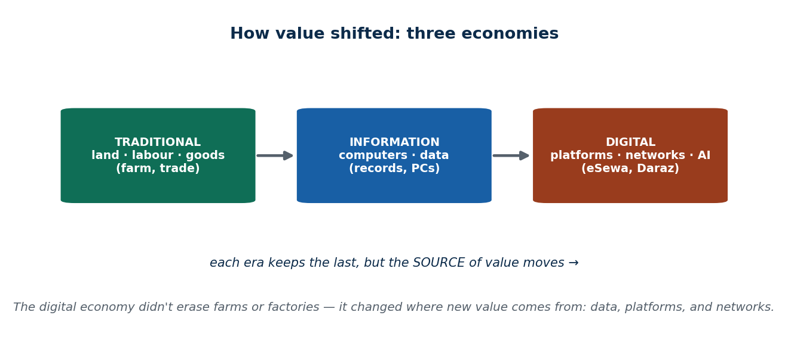

| Stage | What life looked like | What technology did |
|---|---|---|
| **Traditional economy** | Physical shops, cash, paper records, meeting face to face | Nothing much |
| **Information economy** | Offices use computers for records, billing and email, but buying and selling is still physical | Helps with paperwork |
| **Digital economy** | Buying, paying and getting the service all happen online — online shopping, QR payment, e-learning | Technology *is* the activity |

Easiest way to feel the change: booking a movie ticket took about **thirty minutes** ten years ago. It
takes about **thirty seconds** now.

## 1.3 The five things that make a digital business different

These five words come up again and again in this course, and almost every exam question in Unit 1 can
be answered using them.

| Feature | Plain meaning | Example |
|---|---|---|
| **Data-driven** | Every click and purchase is recorded, then used to make the service fit you better. People say "data is the new oil" | Netflix suggests shows, YouTube suggests videos, Daraz shows you what you are likely to buy |
| **Automation** | Software does work that people used to do by hand — faster, with fewer mistakes | Robots in Amazon warehouses; chatbots answering customers; your banking app sorting your spending; AI catching fraud |
| **Global connectivity** | Distance stops mattering. You can serve someone on the other side of the world today | A Nepali freelancer working for a US client on Upwork; a Zoom meeting across three countries |
| **Platform-based** | The company does not make the product. It builds the space where other people meet and trade | Uber owns no cars, Airbnb owns no rooms, Daraz makes none of the goods it sells |
| **Scalability** | Serving one more customer costs almost nothing, so the business can grow very fast | TikTok reached a billion users without opening offices for them; an e-learning site teaches 10,000 students with no extra classroom |

> **Compare two businesses.** A restaurant that wants more customers needs more tables, more cooks and
> more space. A digital business that wants more customers mostly needs more server capacity. That
> difference is why digital companies grow so much faster than traditional ones.

## 1.4 Four ideas you need before anything else

| Idea | What it means in plain words | Nepal example |
|---|---|---|
| **Digital goods and services** | Things that are made and delivered digitally — you never hold them | eSewa top-up; a Hamro Patro subscription; a downloaded course |
| **Platform economy** | Businesses that connect two sides without owning what is sold | Daraz, Pathao, SastoDeal |
| **Data as an asset** | The record of what users do is itself worth money, because it lets the company personalise and plan | Hamro Patro choosing which notification to send you; eSewa choosing which offer to show you |
| **Network effects** | The more people use it, the more useful it becomes for everyone | Pathao got better for riders as more drivers joined, and better for drivers as more riders joined |

## 1.5 What is pushing the digital economy forward (drivers)

A **driver** is simply a force that pushes change. The digital economy has four groups of them. The
key insight: they only work together. Good technology with no users and no business model goes
nowhere.

**Technology drivers** — mobile phones, 4G/5G, cheap internet, cloud computing, artificial
intelligence, Internet of Things (IoT) devices, and digital platforms.

**Economic drivers** — being able to sell worldwide (Nepali freelancers on Upwork and Fiverr); getting
more work done for less (Zoom, digital accounting, online collaboration in SMEs); and the value of
data (Khalti seeing which top-ups sell best in which district). Cost-cutting and competition sit here
too.

**Social drivers** — more people know how to use digital tools (school ICT classes, YouTube tutorials);
people now *prefer* fast, convenient services like food delivery and mobile banking; connectivity is
spreading through 4G and fibre; and young people adopt new apps very quickly.

**Business drivers** — SMEs listing on online marketplaces, startups built on technology from day one,
and tourism and service businesses starting to use AI and analytics. *Example:* a trekking agency
near Annapurna uses AI to suggest a custom itinerary based on what the tourist likes.

### The technologies doing the heavy lifting

| Technology | What it actually does for a business | Used in Nepal for |
|---|---|---|
| **Cloud computing** | You rent storage and computing power instead of buying servers, and you can expand instantly | Nabil Bank and eSewa handling millions of transactions |
| **Mobile technology** | Phones are how most Nepalis reach the internet at all | Foodmandu, Daraz; students in rural districts attending online class on a phone |
| **Internet of Things (IoT)** | Ordinary physical objects get sensors and go online | Smart farming sensors; water-level sensors for irrigation |
| **Artificial intelligence (AI)** | Software that learns from data and then predicts or decides | Banks spotting fraudulent transactions automatically |
| **Digital platforms** | The meeting places that connect supply and demand | Daraz, Pathao, SastoDeal |

## 1.6 Why data is called the fuel

Data is what makes everything else work. Three jobs it does:

- **Personalised offers** — Daraz promotions and Hamro Patro notifications chosen for *you*.
- **Automatic decisions** — a bank blocking a suspicious transaction in real time, no human involved.
- **Predicting trends** — TikTok and Netflix deciding what to show, and even what to make next.

And here is the part students often miss: **you produce the data**. One review you write makes a
seller look more trustworthy. Your clicks train the ranking algorithm. The time you spend is the
platform's engagement number. You are a customer and an unpaid supplier at the same time.

## 1.7 Who is in the digital economy (the ecosystem)

Four groups. Take any one away and the system stops working.

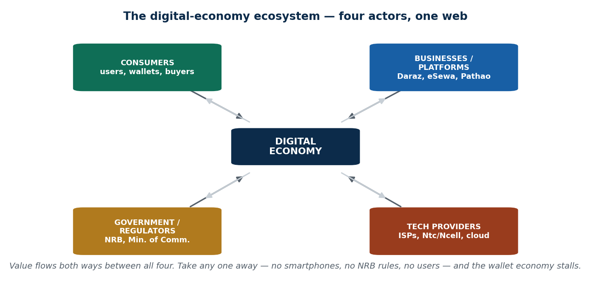

| Who | What they do | In Nepal |
|---|---|---|
| **Consumers** | Create demand, and supply data and attention | Anyone with a smartphone and a wallet app |
| **Businesses and platforms** | Supply the goods, services and the matchmaking | Pathao, Daraz, Foodmandu, local SMEs |
| **Government and regulators** | Write the rules, give licences, supervise | Nepal Rastra Bank; Ministry of Communication and Information Technology |
| **Technology providers** | Build and run the pipes underneath | NTC, Ncell, internet service providers, cloud companies |

## 1.8 The good and the bad

| What we gain | What it costs us |
|---|---|
| **Wider reach** — a Bhaktapur handicraft seller can reach a buyer in Europe | **Privacy** — apps collect personal data, often without you really agreeing |
| **Speed** — payments settle in seconds instead of a bank visit | **Compliance burden** — NRB rules, KYC, e-payment and e-commerce regulations |
| **New jobs** — freelancers, YouTubers, developers, digital marketers | **Cybersecurity** — banking fraud, phishing SMS, fake apps |
| **Better decisions** — targeted marketing, personalised service | **E-waste and energy use** — old phones and laptops with nowhere to go |
| **Better public services** — QR tax payment, online bill portals, digital registration | **Digital divide** — not everyone has a phone, data or the skills |

## 1.9 The knowledge economy (K-economy)

**In one line:** an economy where the main thing being sold is not goods or labour but **knowledge** —
skills, ideas, designs, research and expertise.

In a farming economy, land makes you rich. In an industrial economy, machines and factories make you
rich. In a knowledge economy, what is in people's heads makes you rich. The technical term for that is
**human capital**.

**How economies moved:** Traditional → Industrial → Service → Knowledge.
**What created value at each step:** Labour → Machines → Skills and knowledge → Innovation.

**Global example:** South Korea, which grew on high technology and heavy research spending.
**Nepal examples:** IT outsourcing companies, EdTech platforms like Edusanjal, coding bootcamps, and
freelancers exporting skills.

### What a knowledge economy is made of

| Feature | Plain meaning | Nepal example |
|---|---|---|
| **Human capital** | Educated, skilled people are the main asset | Growing number of IT colleges and CS programmes |
| **Innovation and R&D** | Turning new ideas into products, services and patents | Nepali AI translation tools; robotics clubs in colleges |
| **Information flow** | Knowledge gets shared instead of locked in one person's head | Company knowledge portals; shared code repositories |
| **Digital infrastructure** | Internet, cloud and platforms so knowledge can travel | Cloud-based Nepali startups; teams working on Zoom, Notion and GitHub |
| **Collaboration and networks** | Universities, startups and firms working together | Kathmandu IT hubs; Fusemachines Nepal training AI engineers |

### Knowledge workers (K-workers)

People whose job is to **create, share and apply knowledge** — developers, data analysts, designers,
researchers, content creators, online teachers, engineers. In Nepal: freelance developers serving
global clients, and EdTech teachers.

**The skills they need:** critical thinking · creativity · digital literacy · problem-solving ·
communication · teamwork · the habit of continuous learning.

### Knowledge companies (K-companies)

Companies whose main raw material is knowledge. They use few physical resources and produce a lot of
intellectual output, and they are often global from the first day.
**Global:** Google, IBM. **Nepal:** Fusemachines, Leapfrog Technology, CloudFactory, Genese Cloud,
Yarsa Games, the eSewa innovation team.

**What they look like inside:** a learning culture · high spending on research · flexible, mixed teams
· strong digital tools · short innovation cycles.

### Knowledge management (KM)

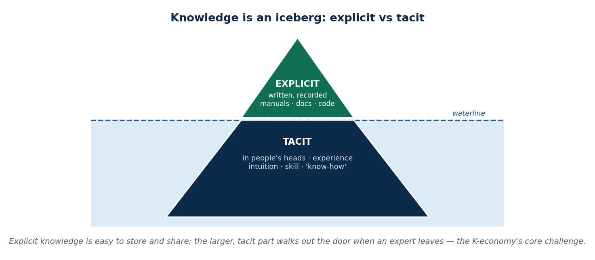

**Definition:** capturing, organising and sharing what an organisation knows, so it can make better
decisions and treat knowledge like an asset.

**Why bother?** Because it stops knowledge walking out of the door when an employee leaves, raises
efficiency, prevents the same mistake being made twice, improves decisions, and speeds up innovation.

| Type | What it is | Easy to write down? | Examples |
|---|---|---|---|
| **Explicit knowledge** | Knowledge already recorded in words | Yes — a document can carry it | Manuals, procedures, documentation, code in a repository |
| **Tacit knowledge** | Knowledge in a person's hands and instincts | No — it is learned by doing | Riding a bike; calming an angry customer; a designer's sense of taste |

**KM in Nepal:** banks running internal knowledge portals; IT companies keeping code on GitHub; NGOs
maintaining research databases; colleges using e-learning platforms; eSewa studying user behaviour to
improve the app; Daraz tracking orders and preferences.

### Benefits and problems of a knowledge economy

| Benefits | Problems |
|---|---|
| Higher productivity | Not enough trained people (skill gap) |
| Growth driven by innovation, not just more labour | Very little money spent on research |
| High-value, well-paid jobs | Weak infrastructure — internet and devices in rural areas |
| Stronger education and digital ecosystem | **Brain drain** — skilled people leaving the country |
| | Policies exist on paper but move slowly |

### What pushes a country toward a knowledge economy (drivers)

1. **Human capital development** — skilled people become the main resource. Needs education, digital
   skills, creativity and constant upskilling. *Nepal:* IT colleges, digital marketing courses,
   bootcamps like Broadway Infosys and Deerwalk.
2. **Technology and digital infrastructure** — internet, 4G/5G, cloud, and the tools that let people
   create and share knowledge. *Nepal:* cloud-based startups; remote work on Zoom, Notion, GitHub.
3. **Innovation and R&D** — labs, software development and patents that turn ideas into money.
   *Nepal:* AI translation tools; school and college robotics clubs.
4. **Knowledge workers** — people who think, analyse, design and create. Small in number, large in
   impact. *Nepal:* Upwork freelancers delivering design, code and marketing.
5. **Knowledge companies** — firms whose value comes from ideas, software and research.
6. **R&D and intellectual property** — patents and copyrights that turn content, software, designs
   and fonts into assets you can own and sell. *Nepal:* music, apps, graphics, Nepali fonts.

## 1.10 Digital economy vs knowledge economy — the key comparison

This is the most commonly asked comparison in Unit 1, so learn the row headings.

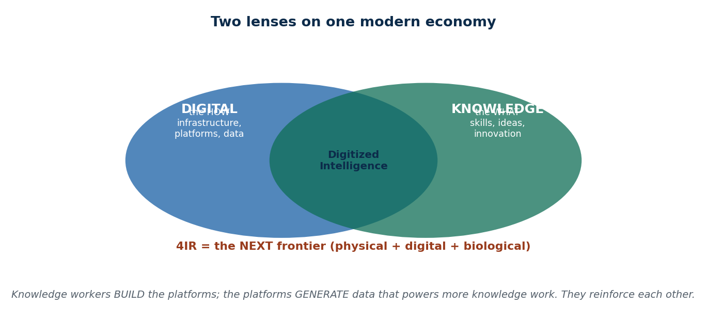

| | **Digital Economy** | **Knowledge Economy** |
|---|---|---|
| **Main focus** | Technology, data, platforms | Skills, expertise, creativity, innovation |
| **What creates value** | Automation, online transactions, scale of the platform | Ideas, problem-solving, research output |
| **Key resources** | Cloud, mobile apps, big data, AI | Human capital, education, experience |
| **Type of work** | Operating digital tools, coding, analytics, content | Designing solutions, researching, thinking critically, deciding strategy |
| **What it produces** | E-commerce sales, digital payments, streaming | Consulting, research findings, patents, innovations |
| **Nepal examples** | eSewa, Khalti, Pathao, Daraz, online banking, NetTV | Fusemachines, Deerwalk, educators, engineers, doctors, designers, research hubs |
| **Why it needs the other** | Digital tools make knowledge travel faster | Knowledge workers are the ones who build the digital tools |

**The link between them, in one sentence:** eSewa is the digital economy — but eSewa was *built by*
programmers, which is the knowledge economy. The digital economy produces data; the knowledge economy
makes sense of it; and that understanding is used to build better technology.

## 1.11 The Fourth Industrial Revolution (4IR)

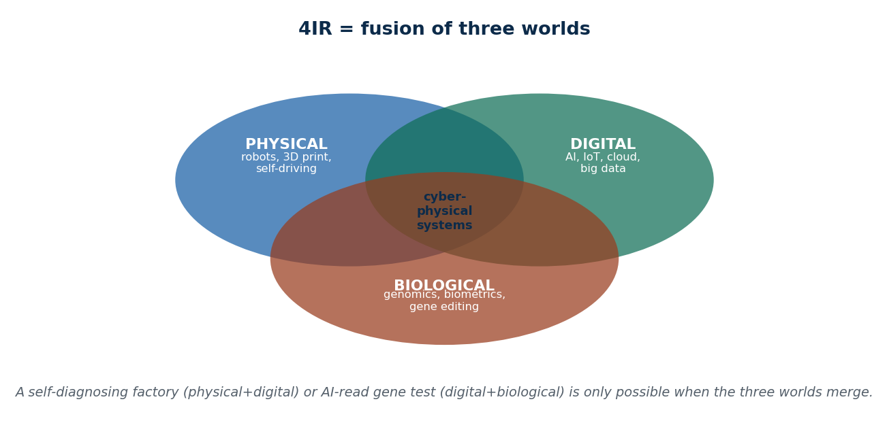

**In one line:** 4IR is the period we are living in now, where **physical, digital and biological**
technologies blend into one another.

What makes it different from earlier waves is that the technology does not sit in a separate machine
room any more. It is in your watch, your bank, your field and your hospital. Innovation cycles are
shorter, and systems are becoming "smart" — they sense, decide and act on their own. Think
self-driving vehicles, AI assistants, drones, factory robots and IoT devices.

### The four revolutions

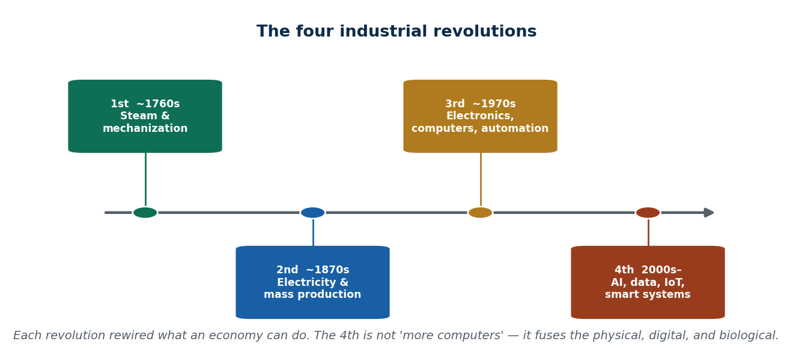

| Revolution | When | Headline | Technologies and effects |
|---|---|---|---|
| **First** | 1760s–1840s | Mechanization and steam power | Steam engines, mechanised production → factories, cities grow |
| **Second** | 1870s–1914 | Electricity and mass production | Electricity, assembly lines, telegraph → mass production, faster communication |
| **Third** | 1960s–2000s | Electronics, computers, automation | Computers, internet, automation → knowledge economy and IT services |
| **Fourth** | 2000s–now | AI, data, automation, smart systems | AI, IoT, big data, robotics, cloud, blockchain, 3D printing, nanotechnology |

### The five drivers of 4IR

1. **Artificial intelligence** — machines that learn from data and then decide. Used in
   recommendations, chatbots, image recognition. *Nepal:* AI fraud detection in banks.
2. **Internet of Things (IoT)** — ordinary devices connected to the internet: smart homes, sensors,
   vehicles. *Nepal:* smart farming tools.
3. **Big data** — collecting and analysing huge volumes of information to support decisions.
4. **Automation and robotics** — machines doing repetitive work faster and with fewer errors.
5. **Cloud computing** — storage, software and servers delivered over the internet, reachable from
   anywhere. *Nepal:* digital biometric systems.

### Four characteristics of 4IR

**Speed** — it is being adopted faster than any earlier revolution. **Scope** — it crosses every
industry and country. **Impact** — it changes business models, jobs and society, not just factories.
**Integration** — physical, digital and biological systems merge.

### Opportunities of 4IR

| Area | What becomes possible | Nepal example |
|---|---|---|
| **Business and economy** | New digital businesses; automation raises efficiency; global market access for local workers | IT outsourcing jobs rising; freelancers earning in dollars; digital SMEs growing |
| **Innovation** | New products and services; research-based industries; the chance to **leapfrog** — skip stages other countries had to pass through | Local AI and agri-tech products built without a big industrial base |
| **Jobs** | Demand for AI engineers, designers, analysts; new fields like digital marketing, cloud, cybersecurity | Expanding IT services sector |
| **Public services** | Digital government, telemedicine, smart-city possibilities | Telemedicine during COVID-19 |
| **Daily life** | Smart devices, personalised services, faster communication | Online banking, wallets, digital classrooms |
| **Competitiveness** | Countries that adopt technology grow faster, spend less on operations, innovate more | Freelancers working on international AI/ML projects |

### Challenges of 4IR

| Challenge | What goes wrong | Nepal reality |
|---|---|---|
| **Skill gap** | Workers are not trained for AI and automation; courses are outdated; too few technical specialists | Many schools have no ICT teacher |
| **Job displacement** | Automation takes over repetitive work; old jobs shrink; workers must retrain | Small shops still fully manual |
| **High cost of technology** | AI, robots and IoT are expensive; small firms cannot afford them | Government systems slow to automate |
| **Privacy and cybersecurity** | More data means more to steal; security practice is weak | Cybercrime rising |
| **Digital divide** | Unequal access to devices and internet; rural areas and older people left out | Rural internet slow or unstable |
| **Ethical and social** | Biased AI, job losses, over-dependence on machines | Digital banking still confusing for many users |

### Is Nepal ready for 4IR? (SWOT)

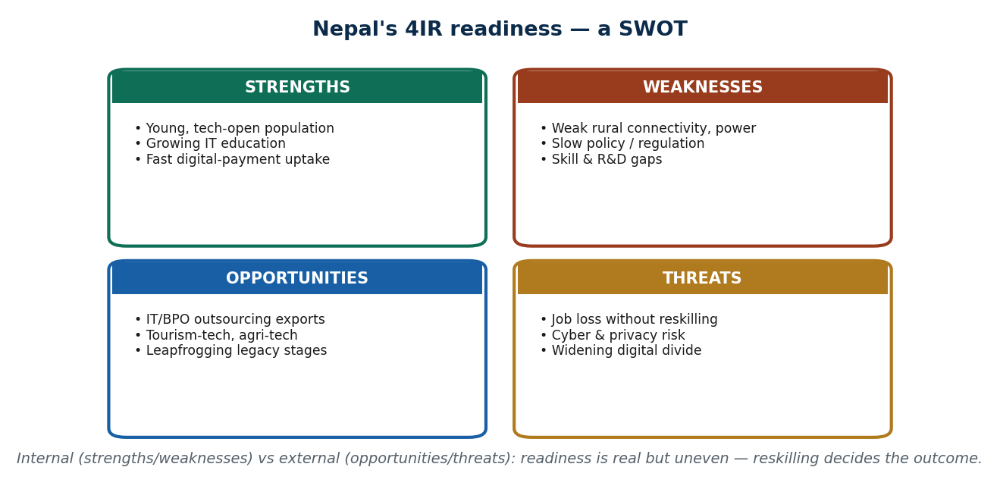

| | |
|---|---|
| **Strengths** — young population, growing IT education, widely used digital payments | **Weaknesses** — poor rural connectivity, slow policy, skill gaps |
| **Opportunities** — IT outsourcing, tourism technology, agri-tech | **Threats** — unemployment if people are not retrained; cybersecurity and privacy risks |

## 1.12 How the three fit together

Digital economy, knowledge economy and 4IR are not three rivals. They feed each other. The memory
hook used in the lectures:

> **Knowledge Economy = the WHAT** (the intellectual value) ·
> **Digital Economy = the HOW** (the infrastructure that delivers it) ·
> **4IR = the NEXT FRONTIER** (the transforming technology).

### Where the money comes from in each

| | Value comes from | How you measure it | Global example | Nepal example |
|---|---|---|---|---|
| **Digital economy** | Transactions, users and engagement — earned through ads, subscriptions and transaction fees | Number of transactions, new users, services used | Amazon: retail + AWS + data insights | eSewa: transactions, new users, services adopted |
| **Knowledge economy** | People's skills, innovation and intellectual property | Productivity, innovation output, patents | Google: employees' research becomes products and patents | Upwork freelancers turning skills into export income; outsourcing firms training talent |
| **4IR** | Joining digital, physical and biological systems to get smarter and faster results — efficiency and insight, not just products | Efficiency gained, new models, better decisions and user experience | Smart factories, AI logistics | Daraz using AI to plan delivery routes; telemedicine with AI-assisted diagnosis; Pathao reading demand patterns; health apps tracking steps and heart rate |

### The three combinations

| Combination | What it creates | How it works | Examples |
|---|---|---|---|
| **Knowledge + Digital** | **Digitized intelligence** — human expertise turned into digital form | Knowledge becomes videos, code, documents, AI models and papers. Digital systems gather huge data; knowledge (maths, statistics, ML) turns it into predictions and insight | Online education — experts make courses, platforms like Coursera distribute them worldwide; digital consulting, online medical advice, remote tutoring, cloud research tools |
| **Digital + 4IR** | **Smart digital systems** — systems that run themselves | Digital software, apps and networks join with sensors, robots, AI and IoT | Smart home automation; self-driving cars; bank fraud detection; smart factories where IoT sensors watch production; **digital twins** |
| **Knowledge + 4IR** | **Advanced innovation systems** | Deep research and expertise feed technologies that cannot exist without them — AI, robotics, biotech, materials science | Healthcare: AI + genomics → personalised medicine. Agriculture: sensors + analytics → precision farming in Nepal. Education: AI adaptive learning. Daily life: Siri and Google Assistant |

**Digital twin** is worth learning as its own term: a *digital twin* is a virtual copy of a real object
or process, so you can test a change on the copy before doing it for real. Examples: remote car
diagnostics (a twin of your vehicle), delivery-route simulation (a twin of the logistics network),
smart-city planning (a twin of the city), Google Maps live traffic (a twin of road conditions), a
smartwatch tracking your body, weather forecasting (a twin of the atmosphere), and surgical simulation
(a twin of an organ).

### When all three combine

| Application | Knowledge part | Digital part | 4IR part | Result |
|---|---|---|---|---|
| **AI drug discovery** | Genetic research, medical expertise | Biomedical datasets, cloud computing | AI and machine learning | Development time falls from years to months |
| **Autonomous supply chains** | Logistics know-how, forecasting | Real-time tracking, platforms | IoT sensors, robots, AI decisions | Logistics that optimise themselves |
| **Smart cities** | Urban planning, data science | Digital infrastructure, citizen apps | AI traffic control, IoT utilities, self-driving vehicles | More efficient, more sustainable cities |
| **Precision agriculture 4.0** | Agricultural science, climate knowledge | Farm software, market data | Drones, AI pest detection, automatic irrigation | Highest yield with least environmental damage |
| **Personalised education** | Teaching expertise, curriculum design | Learning management systems, digital content | AI tutors, adaptive algorithms, VR classrooms | A different learning path for each student |
| **Predictive healthcare** | Medical research, clinical experience | Health records, health apps | AI diagnosis, wearables, robotic surgery | Preventive and personalised treatment |
| **Digital twin manufacturing** | Engineering and production expertise | Live data, simulation software | IoT sensors, AI analysis, 3D printing | Test virtually before building physically |

### What we gain from the three being connected

| Benefit | Why it happens | Global example | Nepal example |
|---|---|---|---|
| **Faster innovation** | Knowledge workers use data to spot opportunities, and AI removes a lot of trial and error | Netflix combines data, AI and creative teams to decide what to make | Hamro Patro uses user data and feedback to ship new features quickly |
| **More efficiency** | Platforms plus insight plus automation remove repetitive work, so people do higher-value work | Amazon's warehouse robots and data-driven logistics | Pathao allocating rides using GPS and data, cutting waiting time |
| **Bigger markets** | Platforms give global reach; 4IR tools let even small firms compete internationally | — | Freelancers on Upwork and Fiverr; Daraz sellers reaching the whole country and beyond |
| **New jobs and new business models** | Whole new job titles (AI engineer, data analyst, digital marketer) and new ways to earn (platform, subscription, gig) | — | Online tutoring, digital marketing agencies, IT outsourcing; Fusemachines training people for global AI work |
| **Better decisions and personalisation** | Good data plus skilled people equals faster, better decisions and happier customers | — | eSewa sending personalised offers; Hamro Patro recommending content by user type |

### Knowledge-driven innovation

Innovation does not come from technology by itself. It comes from **knowledge workers who read the
data and then design something**. They study platform data to understand customers, build solutions
using 4IR tools, and work with teams across the world online. The pay-off is faster product
development, stronger competitiveness, better problem-solving and new business models. *Global:*
Google's engineers plus AI tools produce Maps and chatbots. *Nepal:* Fusemachines trains Nepali AI
developers who then deliver global projects.

### Three case studies

| Case | Digital economy part | Knowledge economy part | 4IR part |
|---|---|---|---|
| **Uber** (global) | An app that connects riders and drivers | Studying ride data, traffic and feedback to set prices and routes | AI for route prediction, dynamic pricing, self-driving research |
| **Daraz** (Nepal) | A marketplace connecting sellers and buyers nationwide | Browsing and purchase data turned into recommendations | Logistics optimisation, automated inventory, sales forecasting |
| **Hamro Patro** (Nepal) | Calendar, news, horoscope and notifications in one app | Engagement data used to decide what to improve | Possible AI personalisation of content |

> *Daraz in action:* a small seller in Pokhara lists handicrafts. The platform shows those products to
> the users most likely to buy them. The seller does nothing extra, but sells more. That is data doing
> the selling.

### What is coming next

**Globally:** AI and machine learning everywhere; IoT in homes, cities and industry; cloud making
global collaboration normal; remote work and the digital-nomad economy.
**In Nepal:** digital payments still growing; freelancing and outsourcing expanding; telemedicine and
digital classrooms; startups using AI and analytics for local problems; government pushing IT parks
and technology education. *Example:* an agri-tech startup combining IoT sensors with a mobile app to
advise farmers, raising both efficiency and income.

## 1.13 How the digital economy changes four big things

The syllabus names four areas of influence: **sustainability, privacy, regulation and strategy**.

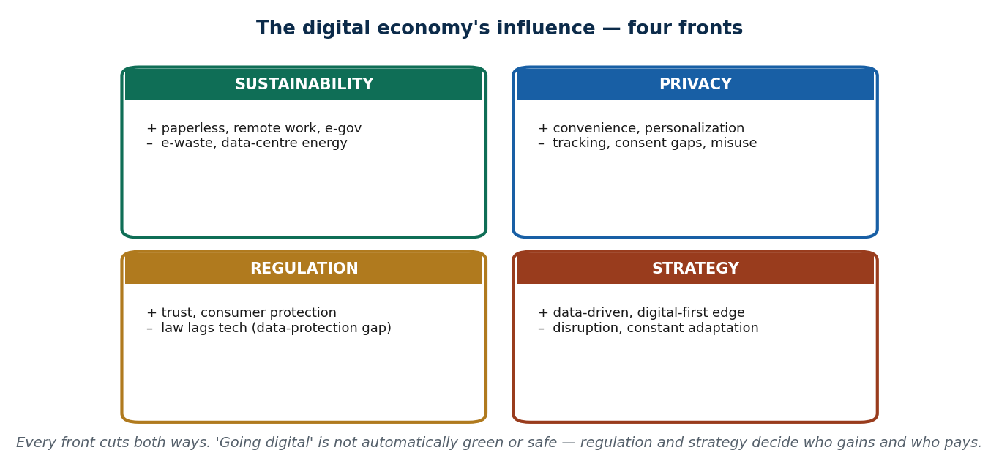

**Sustainability.** The good side: paperless offices, smart energy systems that cut consumption,
remote work that cuts travel emissions, and government services that remove the need to travel at all.
The bad side: **e-waste** — phones, laptops, routers and batteries piling up while Nepal has almost no
recycling system. Old laptops end up in Kathmandu dumping sites, harming health and the environment.
Collection and recycling programmes are the missing piece. Data centres also consume a lot of energy.

**Privacy.** More data collected means more responsibility. Apps track location, contacts and browsing;
people rarely give informed consent; and misuse or leaks are a real risk.

**Regulation.** Governments respond with digital taxation (VAT on online services), stronger
e-commerce rules and cybersecurity obligations. The purpose is not to slow business down but to build
the trust that digital markets need to work at all.

**Business strategy.** Companies shift to decisions based on data, to digital-first operations that cut
costs, and to automation that reduces human error — for example, online retailers managing inventory
automatically. The reward is competitive advantage; the punishment for ignoring it is irrelevance.

## 1.14 Nepal's policies and rules

### Nepal Rastra Bank (NRB)

NRB is the central bank, and it regulates everyone who moves digital money — **Payment Service
Providers (PSPs)** and **Payment Service Operators (PSOs)**. What it does:

- Issues guidelines for mobile wallets like eSewa and Khalti.
- Makes **KYC** (Know Your Customer — proving who you are) compulsory.
- Sets transaction limits to reduce fraud.
- Requires **QR interoperability**, so one QR code works with any wallet.
- Runs the **National Payment System Strategy**, which standardises and strengthens digital payments.
- Pushes the country from cash toward cashless.

**Why this matters so much:** it builds trust in digital payments, prevents money laundering and fraud,
lets online transactions flow smoothly, supports e-commerce growth, encourages fintech innovation, and
extends digital services into rural areas.

### IT Policy of Nepal 2072

| Element | What it says |
|---|---|
| **Vision** | Turn Nepal into a knowledge-based society and economy |
| **Mission** | Use ICT to drive sustainable development and reduce poverty |
| **Digital governance** | Make government services transparent, efficient and inclusive |
| **Industry and innovation** | Promote domestic software, startups and ICT-enabled SMEs |
| **Infrastructure and inclusion** | Build secure ICT infrastructure and close the urban–rural gap |

### Startup Act (proposed)

- **Purpose:** make it easier to start and run a business.
- **Tax benefit:** 5–7 years of income-tax relief for eligible startups.
- **Support:** subsidised loans, grants and incubation programmes.
- **Who qualifies:** startups with an innovative product or service and turnover below a set limit
  (around NPR 100 million a year).
- **Priority sectors:** ICT, AI, fintech, health-tech, education, agriculture, tourism, creative industries.
- **Goal:** more innovation, more jobs, and startups that can export.

### Digital Nepal Framework — the eight sectors

| Sector | What it targets |
|---|---|
| **Education** | Digital learning platforms, e-schools, remote education |
| **Health** | e-Health, telemedicine, digital health records |
| **Agriculture** | Smart farming, agri-tech, digital supply chains |
| **Finance** | Mobile payments, fintech, financial inclusion |
| **Tourism** | Digital promotion, e-ticketing, virtual tours |
| **Governance** | e-Government, online services, transparency |
| **Commerce and industry** | E-commerce, digital SMEs, supply-chain technology |
| **Infrastructure and connectivity** | Broadband, 5G, the national ICT backbone |

### E-commerce rules, privacy and cybercrime

**E-commerce:** consumer protection and refund rules, VAT on online services, and return policies —
Daraz's cashback-and-return policy is the usual example. The point of all of it is user trust.

**Data and cybercrime:** the **Privacy Act 2075** gives basic protection, and cybercrime is handled
under the **Electronic Transactions Act**. But Nepal still has **no dedicated data protection law** —
this is the recognised gap. A typical example of the problem: an app quietly collecting your location
without asking.

## 1.15 Ethics in the digital economy

| Area | The problem | Example |
|---|---|---|
| **AI ethics** | Algorithms can be biased (facial recognition failing on some faces); users are not told when AI decided something; nobody is clearly accountable when AI gets it wrong | A chatbot giving a customer wrong advice. Ethical AI means fairness and inclusion |
| **Privacy** | Apps track location, contacts and browsing; consent is usually a tick-box nobody reads; data can be misused | Facebook ad targeting. Users need both awareness and control |
| **Fair digital labour** | Gig workers — Pathao and Foodmandu riders — need fair pay, insurance and safety | Rider accident-insurance schemes. Ethics here means protecting the humans inside a digital system |

## 1.16 Nepal compared with the world, and the skills you will need

| Area | Globally | In Nepal |
|---|---|---|
| **Connectivity** | Fast internet, 5G rolling out | Slower internet, unreliable electricity; video calls difficult in rural areas |
| **Workforce and R&D** | Large skilled workforce, funded research | Limited AI, cloud and data skills; universities and startups need support |
| **Applications** | AI used widely across sectors | AI farm-advisory services barely started |
| **Where the opportunity is** | — | Digital payments, AI-enabled sectors and remote monitoring, digital education, remote work and outsourcing |

**Skills worth having when you graduate:** basics of AI and machine learning · data analytics and
visualisation · cloud computing (AWS, GCP, Azure) · cybersecurity fundamentals · digital marketing and
UI/UX.

**What universities should do:** update the curriculum for 4IR, run labs and real projects, arrange
industry internships, and encourage startups — for example, student AI projects for agriculture.

**Where to learn online:** globally Coursera, Udemy and LinkedIn Learning; in Nepal eSiksha and
Kullabs.

> **A small exercise you may be asked to do.** Take one app you use and break it into three layers.
> *Foodmandu* — **Digital:** the app, payments, GPS. **Knowledge:** reviews and recommendation data.
> **4IR:** route optimisation and demand prediction. **Value:** faster delivery and happier users.
> Any app can be mapped this way, and examiners like this question.

### Key words from Unit 1

Digital economy · digital economics · information economy · digital goods · platform economy · data as
an asset · network effects · scalability · digital ecosystem · knowledge economy · human capital ·
knowledge worker · knowledge company · knowledge management · explicit vs tacit knowledge · brain
drain · Fourth Industrial Revolution · leapfrogging · digital twin · digitized intelligence · smart
digital systems · knowledge-driven innovation · e-waste · digital divide · KYC · PSP and PSO ·
National Payment System Strategy · IT Policy 2072 · Startup Act · Digital Nepal Framework · Privacy
Act 2075 · Electronic Transactions Act · algorithmic bias · fair digital labour.

### Summary — Unit 1

- The digital economy is every economic activity that depends on digital technology. It grew through
  three stages: traditional → information → digital.
- Five features define it: **data-driven, automated, globally connected, platform-based, scalable.**
- It is pushed by technological, economic, social and business drivers, and it has four actors:
  consumers, businesses/platforms, government, and technology providers.
- The knowledge economy runs on human capital, innovation and intellectual property, through K-workers
  and K-companies, and it manages explicit and tacit knowledge deliberately.
- Digital vs knowledge economy: **technology vs skills**, **scale vs ideas**, **transactions vs
  innovation** — but each depends on the other.
- 4IR fuses physical, digital and biological technology, driven by AI, IoT, big data, robotics and
  cloud. It gives Nepal a chance to leapfrog, and threatens it with skill gaps and inequality.
- The three together: Knowledge = the WHAT, Digital = the HOW, 4IR = the NEXT FRONTIER. Their pairs
  give digitized intelligence, smart digital systems and advanced innovation systems.
- Nepal's framework: NRB payment regulation, IT Policy 2072, the proposed Startup Act, the eight-sector
  Digital Nepal Framework, e-commerce rules, Privacy Act 2075 and the Electronic Transactions Act —
  with a dedicated data protection law still missing.

<!-- question-bank:unit1:begin -->
## 1.T Test yourself — Unit 1

Work through the questions first and keep the answer key covered. Parts A and B have fixed answers, given at the end of this section; Parts C to E are the open questions that carry the most marks in an exam, so practise writing them out in full.

### Part A — Multiple choice

**A1.** The best test of whether something is 'the digital economy' is:

  *a)* it happens on a phone  ·  *b)* remove the digital tech and the activity would stop existing  ·  *c)* it is new  ·  *d)* it is expensive

**A2.** 'Near-zero marginal cost' means:

  *a)* the product is free  ·  *b)* serving one more user costs almost nothing  ·  *c)* there are no costs  ·  *d)* it never makes profit

**A3.** In the digital-economy ecosystem, NRB is best classified as a:

  *a)* technology provider  ·  *b)* consumer  ·  *c)* government/regulator  ·  *d)* platform

**A4.** 4G mobile coverage is which kind of driver?

  *a)* social  ·  *b)* technological  ·  *c)* business  ·  *d)* legal

**A5.** A bank's written KYC procedure manual is an example of:

  *a)* explicit knowledge  ·  *b)* tacit knowledge  ·  *c)* a physical asset  ·  *d)* manual labour

**A6.** The MAIN asset of a knowledge company is:

  *a)* its buildings  ·  *b)* its inventory  ·  *c)* its people and their expertise  ·  *d)* its machinery

**A7.** Brain drain is best understood as:

  *a)* a benefit  ·  *b)* a challenge caused by weak surrounding drivers (pay, R&D, jobs, IP)  ·  *c)* unpatriotic behaviour  ·  *d)* a technology gap

**A8.** Which driver PROTECTS ideas so innovators profit from them?

  *a)* human capital  ·  *b)* infrastructure  ·  *c)* R&D + intellectual property  ·  *d)* collaboration

**A9.** A newly granted patent is an economic output of the:

  *a)* knowledge economy  ·  *b)* digital economy  ·  *c)* traditional economy  ·  *d)* none

**A10.** In the memory hook, the digital economy is the:

  *a)* WHAT  ·  *b)* HOW  ·  *c)* NEXT  ·  *d)* WHY

**A11.** What makes 4IR different from the third revolution is:

  *a)* faster computers  ·  *b)* fusion of physical, digital & biological into cyber-physical systems  ·  *c)* more internet  ·  *d)* cheaper phones

**A12.** Which is NOT one of the five drivers of 4IR?

  *a)* AI  ·  *b)* IoT  ·  *c)* big data  ·  *d)* steam power

**A13.** 'Leapfrogging' in the 4IR context means:

  *a)* falling behind  ·  *b)* skipping legacy stages to adopt modern tech directly  ·  *c)* copying rich countries  ·  *d)* banning old tech

**A14.** In a SWOT, the digital divide is a:

  *a)* strength  ·  *b)* opportunity  ·  *c)* weakness/threat (it holds readiness back)  ·  *d)* driver

**A15.** 'Going digital is automatically green' is:

  *a)* true  ·  *b)* false — it shifts the footprint (e-waste, data-centre energy)  ·  *c)* always true in Nepal  ·  *d)* true for phones only

**A16.** Nepal's current data-protection situation is best described as:

  *a)* a strong dedicated law  ·  *b)* only a thin Privacy Act (2075), no dedicated data-protection law yet  ·  *c)* EU-level rules  ·  *d)* no rules of any kind

### Part B — Unit review

Complete each line from memory.

**B1.** The digital economy is best defined as → ?

**B2.** 'Near-zero marginal cost' means → ?

**B3.** In the ecosystem, NRB is a → ?

**B4.** A written KYC manual is → ?

**B5.** A knowledge company's main asset is → ?

**B6.** A patent is an output of the → ?

**B7.** Digital = HOW, knowledge = WHAT, 4IR = → ?

**B8.** 4IR differs from the 3rd revolution by → ?

**B9.** NOT a 4IR driver → ?

**B10.** 'Leapfrogging' means → ?

**B11.** The digital divide is a → ?

**B12.** Nepal's data-protection law status → ?

### Part C — Short answer

**C1.** Define the digital economy + list 3 of its drivers.

**C2.** Explicit vs tacit knowledge, with an example of each.

**C3.** Give 3 differences between the digital and knowledge economies.

**C4.** List 3 opportunities and 3 challenges of 4IR.

**C5.** Name the four fronts of the digital economy's influence.

### Part D — Applied case

**D1.** Map a Nepali app (e.g. Pathao) onto the four ecosystem actors, and name one benefit + matching challenge it creates.

**D2.** Classify five given scenarios as digital-economy, knowledge-economy, or both — justify each by its source of value.

### Part E — Discussion

**E1.** 'Is Nepal ready for the fourth industrial revolution?' Argue using the SWOT (strengths/weaknesses/opportunities/threats).

**E2.** Name a Nepali service that is the digital economy and one that is not — justify with the removal test.

**E3.** Pick a Nepali app and name a real player in each of the four ecosystem roles.

**E4.** Name one piece of tacit knowledge in a job you know — how would a firm avoid losing it?

**E5.** Which single driver, if fixed, would most help Nepal retain talent — and why?

**E6.** Give one Nepali example that is clearly BOTH economies and explain each lens.

**E7.** Give a Nepali example where at least three 4IR drivers combine.

**E8.** Which single Nepali job is most at risk from 4IR, and what would you retrain into?

**E9.** Name one digital-economy influence you have felt personally on each of two fronts.

### Answers — Unit 1

| # | Answer | Why |
|---|---|---|
| **A1** | **b)** remove the digital tech and the activity would stop existing | The technology is constitutive — Pathao/eSewa vanish without it, while cash-at-the-haat continues. |
| **A2** | **b)** serving one more user costs almost nothing | The build cost is paid once; each extra user (one more stream, one more app install) adds little — the engine of scalability. |
| **A3** | **c)** government/regulator | NRB sets and enforces the rules (wallet licensing, KYC, QR interoperability) — the regulator role. |
| **A4** | **b)** technological | Connectivity infrastructure is a technological driver (one of the five pillars); adoption of it is social. |
| **A5** | **a)** explicit knowledge | It is codified and easy to copy and share — the definition of explicit knowledge. |
| **A6** | **c)** its people and their expertise | Value comes from human capital and know-how, which is mobile — hence culture and retention matter. |
| **A7** | **b)** a challenge caused by weak surrounding drivers (pay, R&D, jobs, IP) | Talent leaves when the other drivers are too weak to reward staying — a systems failure, not a character flaw. |
| **A8** | **c)** R&D + intellectual property | IP protection lets creators capture the value of their ideas, giving a reason to innovate at home. |
| **A9** | **a)** knowledge economy | A patent is created by expertise and research — the knowledge economy's characteristic output. |
| **A10** | **b)** HOW | Knowledge = WHAT (ideas/value), digital = HOW (infrastructure), 4IR = NEXT (the coming fusion). |
| **A11** | **b)** fusion of physical, digital & biological into cyber-physical systems | The qualitative change is blurring the lines between the three worlds, not just more computing. |
| **A12** | **d)** steam power | Steam powered the FIRST revolution; the 4IR drivers are AI, IoT, big data, automation/robotics, cloud. |
| **A13** | **b)** skipping legacy stages to adopt modern tech directly | Nepal jumped straight to mobile money without a credit-card era — adopting the new without the old. |
| **A14** | **c)** weakness/threat (it holds readiness back) | Unequal access is a limitation/risk — it prevents opportunities from reaching everyone. |
| **A15** | **b)** false — it shifts the footprint (e-waste, data-centre energy) | Digital cuts paper/travel but creates e-waste and energy demand; net effect depends on choices. |
| **A16** | **b)** only a thin Privacy Act (2075), no dedicated data-protection law yet | NRB regulates money (wallets/KYC/QR), but comprehensive personal-data law is still missing (Unit 6). |

| # | Answer |
|---|---|
| **B1** | activity enabled by & dependent on digital tech |
| **B2** | serving one more user costs almost nothing |
| **B3** | government/regulator |
| **B4** | explicit knowledge |
| **B5** | its people & their expertise |
| **B6** | knowledge economy |
| **B7** | NEXT (the coming fusion) |
| **B8** | fusing physical + digital + biological |
| **B9** | steam power (that was the 1st revolution) |
| **B10** | skipping legacy stages to adopt modern tech directly |
| **B11** | weakness/threat in a SWOT |
| **B12** | thin Privacy Act only, no dedicated law yet |

<!-- question-bank:unit1:end -->

---

# Unit 2 — Fundamentals of Digital Economy

**7 lecture hours.** Multi-sided platforms: network effects and positive feedback · lock-in and
switching costs · formation of monopolies in the digital economy · Digital Adoption Index and the
OECD digital government index.

## 2.1 The three words people keep mixing up

Before platforms, get these three straight. They describe three different depths of change.

| Word | What changes | Focus | Example |
|---|---|---|---|
| **Digitization** | Information turns from paper into digital form. Nothing about the work changes | Data | Scanning land ownership papers into PDFs |
| **Digitalization** | You use technology to do the *same* work better | Process | Filling an online form instead of a paper one |
| **Digital transformation** | You rethink the business itself | Business model | Ride-hailing apps replacing taxi stands |

So: **digitization = data becomes digital · digitalization = process gets better · transformation =
the business changes.** (This is covered again in Unit 4, where it is the main topic.)

## 2.2 Why the digital economy behaves strangely

Three economic facts explain almost everything else in this unit.

**1. Digital products can be copied endlessly.** Once software is written, making another copy costs
nothing. Economists call this **zero marginal cost** — the cost of serving one more customer is close
to zero. Netflix makes a show once and millions watch it. Zoom adding one more person to a meeting
costs almost nothing.

**2. Digital platforms cut transaction costs.** A **transaction cost** is the hassle around a deal —
finding the other person, agreeing the price, making sure they deliver. Platforms slash all three:

| Type of cost | What it used to be | What cut it |
|---|---|---|
| **Search cost** | Walking shop to shop to compare | Google, Daraz |
| **Coordination cost** | Standing on the road waving at taxis | Uber, Pathao |
| **Payment cost** | Going to a bank, carrying cash | eSewa, UPI, QR |

**3. Value comes from data, users and algorithms** rather than from factories and stock.

Put together: digital economy = **information + connectivity + computation**.

## 2.3 Ordinary digital business vs platform business

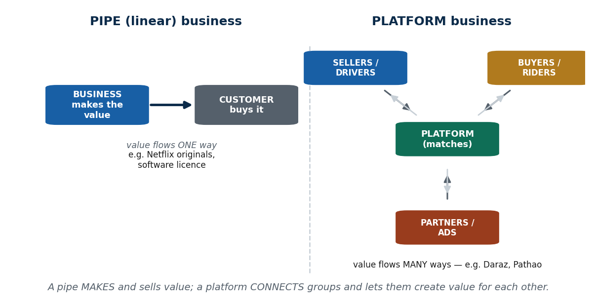

| | **Digital (pipeline) business** | **Platform business** |
|---|---|---|
| **What it does** | Makes a product or service and sells it | Connects two or more groups and lets them deal with each other |
| **Who creates the value** | The company | The users, with the company providing the space |
| **Direction of value** | One way: business → customer | Many ways: user ↔ platform ↔ other users |
| **Examples** | Netflix making its own shows; Udemy selling recorded courses; a company selling software licences | Uber (drivers and riders), Daraz (sellers and buyers), Facebook (users, creators, advertisers) |

**Why the platform model is more powerful:** it scales faster, it benefits from network effects, it
collects far more data, and the users supply most of the content or service themselves. *Example:*
eSewa does not create "payments". It connects users, merchants, banks and billers — and that
connection is the product.

## 2.4 Multi-sided platforms (MSPs)

**Definition:** a **multi-sided platform** is a business that connects two or more groups who need
each other, and makes money from the interaction between them.

An MSP solves a **matching problem** — buyers need sellers, riders need drivers, creators need
audiences. Neither side is useful alone, and the more people join, the more useful it becomes.

**Key features of an MSP:**

- It *facilitates*, it does not produce.
- It has two or more distinct user groups.
- Value comes from interactions, not from goods made.
- Marginal cost is low, so it scales easily.
- It gives users tools to trade, share, communicate, transact and create content.

| Platform type | Side A | Side B | (Side C) |
|---|---|---|---|
| Ride-sharing | Riders | Drivers | — |
| Payments | Users | Merchants | Banks, billers |
| Marketplaces | Buyers | Sellers | — |
| Social media | Users / creators | Advertisers | Viewers |
| App stores | Developers | Users | — |
| Food delivery | Customers | Restaurants | Delivery riders |

**Nepali MSPs:** eSewa and Khalti (banks, users, merchants, billers) · Foodmandu (restaurants, riders,
customers) · Daraz and HamroBazaar (buyers and sellers) · Pathao (drivers and riders).

## 2.5 How platforms actually create value

Five mechanisms. Learn them as a list — this is a standard exam question.

| Mechanism | What it solves | Example |
|---|---|---|
| **Reducing transaction costs** | Finding the right match used to be slow and expensive. Platforms cut search cost, negotiation cost (clear prices, reviews) and enforcement cost (ratings, verified profiles) | Daraz saves you walking store to store |
| **Efficient matching** | Algorithms and data pair the right two people quickly | Foodmandu assigns the nearest rider to cut delivery time |
| **Building trust** | Strangers will not trade without some guarantee. Ratings, reviews, verification and dispute resolution create it | Pathao driver ratings keep service quality up |
| **Providing tools and infrastructure** | Small players cannot build payment gateways, logistics and tracking themselves | Khalti gives merchants QR codes, payment APIs and dashboards |
| **Creating network value** | Each new user makes the platform more useful for everyone else | A marketplace with 5 sellers is useless; with 5,000 sellers, buyers flock to it |

## 2.6 The chicken-and-egg problem

**The problem:** buyers only join if sellers are there, and sellers only join if buyers are there. At
launch, neither is there. This is the single biggest reason new platforms die — not a bad idea, but
an empty platform.

| Platform type | The deadlock |
|---|---|
| Ride-sharing | No riders → drivers will not sign up → no drivers → no riders |
| E-commerce | No buyers → sellers will not list → no variety → no buyers |
| Social media | No audience → creators will not post → no content → no audience |

**How real platforms broke the deadlock:**

| Strategy | Meaning | Who did it |
|---|---|---|
| **Subsidise one side** | Pay or discount one group until the other arrives | Uber subsidised rides heavily at the start |
| **Build inventory manually** | Founders create the first supply by hand | Airbnb founders posted listings themselves |
| **Go dense, not wide** | Launch in one small area so that area feels full | Facebook launched campus by campus |
| **Exclusive early partnerships** | Lock in one side first | FonePay onboarded merchants in person |
| **Freemium / no commission early** | Make joining risk-free | Many marketplaces waive fees in year one |
| **Incentives** | Discounts, promo codes, referral rewards | **Pathao in Nepal:** paid riders bonuses even when demand was low, and gave customers promo codes — creating supply and demand at the same time |

The word for having enough of both sides for the thing to work is **liquidity** (see 2.11).

## 2.7 Why MSPs end up dominating

| Reason | Explanation |
|---|---|
| **Low marginal cost** | One more rider, seller or user needs no new warehouse or infrastructure, so growth is nearly free |
| **Network effects** | More users → more value → more users. A self-feeding loop |
| **Data advantage** | Platforms collect preferences, behaviour, demand patterns and pricing signals, which improve recommendations, search, fraud detection and personalisation. A rival with less data simply cannot match the quality |
| **Interconnected ecosystems** | They add service after service, so leaving means giving up many things at once — Google (Search + Gmail + Maps + YouTube + Android); eSewa (payments + QR + bills + transfers) |
| **Lock-in** | Once you store data, build a reputation and form a habit, leaving is expensive |

*Nepal example:* Pathao dominates ride-sharing because it arrived early, built a large driver base,
earned trust, kept discounting and kept waiting times low. A competitor has to beat all five at once.

## 2.8 How platforms make money (MSP revenue models)

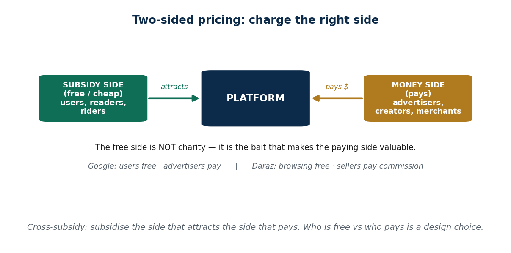

| Model | How it works | Examples |
|---|---|---|
| **Transaction / commission fee** | Take a percentage of each deal | Daraz takes about 5–15% from sellers; Pathao takes a commission per ride; Airbnb charges a service fee |
| **Advertising** | Sell user attention, with precise targeting | Social media ads, search ads, YouTube monetisation |
| **Subscription / freemium** | Basic free, advanced paid | Spotify, Canva, Zoom premium, cloud storage |
| **Data monetisation** | Aggregated, anonymised data used internally or sold as insight (a sensitive, regulated area) | Trend analysis, location insights, market analytics |
| **Seller services** | Charge the supply side for extras | Daraz charging for warehousing, promotion and better product ranking |

## 2.9 Who is in a platform ecosystem

**Users / consumers** (demand the service) · **producers / service providers** (supply it) ·
**developers and partners** (add features) · **advertisers** (pay for attention) · **regulators**
(enforce rules, taxes, safety).

**Daraz as an example:**

| Stakeholder | Role |
|---|---|
| Buyers | Purchase goods |
| Sellers | List and sell products |
| Logistics partners | Deliver goods |
| Payment providers | Process transactions |
| Advertisers | Promote products |
| Regulators | Ensure compliance |

## 2.10 What can go wrong with platforms

| Risk | What happens | Example |
|---|---|---|
| **Platform dependency** | Users and businesses become unable to leave | eSewa users tied to the merchant and wallet ecosystem |
| **Market power / monopoly** | A dominant platform sets prices, fees and rules alone | Pathao surge pricing |
| **Data privacy** | Huge data collection invites misuse or breach | Social platforms tracking users for ads |
| **Negative network effects** | Too many participants can reduce quality | Marketplace spam and low-quality listings overwhelming buyers |
| **Regulatory and legal risk** | Consumer protection, tax, competition law | In Nepal, digital payment and ride-sharing rules are still evolving |
| **Disintermediation** | Users bypass the platform after meeting through it | A customer calls the Pathao driver directly next time |
| **Platform envelopment** | A big platform absorbs a smaller one's feature | Meta copying TikTok with Reels; Google adding shopping into Search |

## 2.11 Network effects — the core idea of the unit

**Definition:** a **network effect** exists when a product becomes **more valuable as more people use
it**.

One user alone = almost no value. Many users = enormous value. WhatsApp is useless if you are the only
person on it; it is essential when everyone you know is on it. Pathao with three drivers is useless;
with three thousand it brings a bike in four minutes.

> **Think of it as a snowball.** The bigger it gets, the faster it grows. But if it hits a wall — a bad
> experience, poor quality — it can stop or even roll backwards.

**Why network effects matter:** they speed up adoption, create a competitive advantage rivals cannot
copy, produce **winner-take-most** markets, create lock-in, and make it very hard for a startup to
challenge an established giant.

### The four types of network effect

| Type | What grows the value | Examples | Nepal example |
|---|---|---|---|
| **Direct** (one-sided) | More users **of the same kind** | WhatsApp and Viber (more people to talk to); Facebook and Instagram (more content); online games (better matchmaking) | Viber and WhatsApp groups |
| **Indirect** (cross-side) | More users of a **different kind** | Uber: more drivers → shorter waits → more riders → more drivers. App Store: more developers → more apps → more users | Daraz: more sellers → more choice → more buyers → more sellers |
| **Data** | More usage produces more data, which improves the product, which attracts more users | Google Maps traffic prediction; TikTok's algorithm; Fitbit activity models | FonePay and eSewa: more transactions → better fraud detection and faster payments |
| **Technology / standard** | A technical standard becomes more valuable the more widely it is adopted | USB-C, QR payment standards, GSM mobile standard, PDF and MP3 formats | FonePay's QR standard — merchants accept it because other merchants already do |

**Data network effects in detail:**

| Platform type | Example | How data helps |
|---|---|---|
| Search engine | Google Search | More searches → better results and suggestions |
| Maps / navigation | Google Maps, Pathao | More users → better traffic, routing and ETA |
| E-commerce | Daraz, Amazon | More users → better recommendations and stock planning |
| Social media | Facebook, TikTok | More activity → better content recommendations |
| Payments | FonePay, eSewa | More transactions → better fraud detection, faster processing |

**Network effect vs viral effect — do not mix these up.** A **network effect** means the product gets
*more useful* as more people use it (WhatsApp). A **viral effect** means it *spreads fast* through
sharing, but is not necessarily more valuable (a meme goes viral; the platform is not improved).

## 2.12 Growth stages and the cold start problem

| Stage | What is happening |
|---|---|
| **Cold start** | Too few users; the platform is genuinely useless |
| **Critical mass** | Enough users that network effects begin to work |
| **Growth acceleration** | Positive feedback loops take over |
| **Maturity** | Winner-takes-most phase |

**The cold start problem:** a new messaging app has nobody to chat with; a new ride app has no drivers,
so no riders, so no drivers; a new marketplace has no sellers, so no buyers.

**How it is solved:** subsidise one side (Uber paying drivers) · seed exclusive early content (TikTok)
· create hype with invite-only access (Clubhouse) · use offline networks first (FonePay signing up
merchants by hand) · pay incentives (Pathao's early rider bonuses).

### Positive feedback loops

"Success breeds more success." **Users → value → more users → more value.**

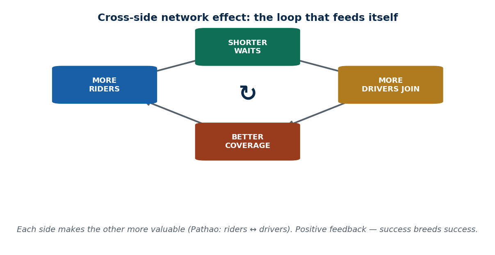

- Facebook: launched campus by campus to make each campus feel full.
- Daraz: more sellers → lower prices → more buyers → more sellers.
- Instagram: more creators → more content → more users → more creators.
- Airbnb: more hosts → more destinations → more guests → more hosts.
- Uber: more drivers → shorter waits → more riders → higher driver earnings → more drivers.

### Negative network effects

Sometimes more users makes things **worse**:

- **Congestion** — too many users, so delays (Zoom slowing at peak hours).
- **Spam and low-quality content** — crowded marketplaces where buyers lose trust.
- **Toxicity** in communities.
- **Surge pricing anger** in ride-sharing.
- **Too many ads** reducing engagement.

### How strong is a network effect?

It depends on how much value each new user adds, whether users are interchangeable, whether switching
is easy, and how differentiated the platform is.
**Strong:** WhatsApp — everyone is already there.
**Weak or broken:** easy multi-homing, low switching cost, a poor product, or a better rival
ecosystem. *Failures:* Google+ failed even with Google's huge user base; Clubhouse lost to Instagram
Reels and Twitter Spaces.

## 2.13 Flywheels: network effects on purpose

**The distinction to remember:** a **network effect happens naturally**. A **flywheel is designed**.

| **Network effect** | **Flywheel** |
|---|---|
| Value rises as users grow | A structured cycle that *amplifies* that rise |
| A natural characteristic | An engineered system |
| Does not guarantee dominance | Is built to produce dominance |

*TikTok example.* The natural network effect: more users → more videos → more variety. The flywheel
TikTok built on top: an algorithm that uses new user behaviour immediately, refines recommendations
instantly, pushes content viral, pulls in more creators, who attract more users. TikTok did not wait
for growth; it engineered it.

*Amazon example.* Natural: more sellers → more products → more buyers. Engineered: Prime membership,
fast delivery, recommendations, seller tools and review systems — so each new user creates data,
which improves recommendations, which increases sales, which attracts sellers, which improves
delivery, which attracts users.

### The four-loop flywheel framework

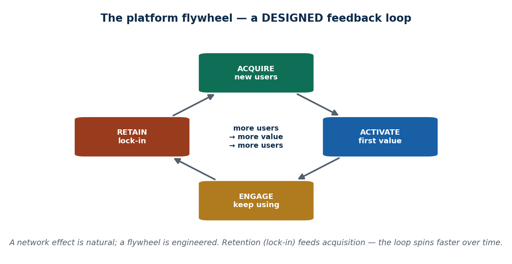

| Loop | The question it answers | Examples |
|---|---|---|
| **Acquisition loop** | How do new users find us? | A self-sustaining cycle where each new user brings the next — *not* paid ads or one-off campaigns |
| **Activation loop** | How do new users reach value quickly? | The "aha moment". Critical in the first 7–14 days. TikTok gives a personalised feed immediately; Duolingo shows a streak after lesson one; a food app makes the first order fast and trackable |
| **Engagement loop** | Why do users keep coming back? | TikTok likes/comments/shares feeding better recommendations; food apps with personalised deals; games with daily challenges; LinkedIn posts → likes → notifications |
| **Retention / reinforcement loop** | How do old users make the platform stronger? | Airbnb guests leave reviews → reviews attract guests → more hosts join. Uber riders ride more → more trips → more driver incentives. AI platforms: users give feedback → model improves → more users |

**Multi-flywheel platforms** run several loops at once, and each strengthens the others. Amazon runs a
marketplace flywheel, a logistics flywheel and a Prime-loyalty flywheel together.

### Liquidity — the heart of growth

**Liquidity** means how quickly supply meets demand. High liquidity (a bike in three minutes, a
restaurant that is open, a seller who has the item) gives a good experience, so users stay and the
flywheel spins faster. Low liquidity means the platform stalls and users leave, and the loops never
start.

### Cold → warm → hot

| Stage | State |
|---|---|
| **Cold start** | Just launched; few users; hard to attract anyone |
| **Warm start** | Enough users for real interactions; growth stabilises |
| **Hot start** | Critical mass reached; interactions scale on their own |

Once a platform is **mature**, the focus shifts from getting new users to reducing churn, raising
customer lifetime value, expanding the ecosystem and improving personalisation — and, deliberately,
to raising switching costs. That takes us to lock-in.

## 2.14 Lock-in and switching costs

**Lock-in** means users face a high cost — in time, money, data, relationships or emotion — if they try
to leave. **Switching cost** is that cost, seen from the user's side.

**Why platforms want it:** it protects their user base, raises lifetime value, keeps data flowing into
the flywheel, and builds a **competitive moat** that rivals cannot cross.

### The five types of switching cost

| Type | What you lose by leaving | Example |
|---|---|---|
| **Financial** | Subscriptions, paid assets, termination fees | A paid annual plan you cannot transfer |
| **Learning / effort** | The time to learn a new system | Moving from Pathao to InDrive means learning a new app |
| **Data / asset loss** | Photos, files, chat history, saved settings | WhatsApp chat backups cannot move easily to Signal |
| **Network loss** | Friends, followers, community, your rating | A TikTok creator losing their audience |
| **Psychological / habit** | Comfort, familiarity, fear of losing something | "I have always used eSewa" |

### How platforms build lock-in on purpose

| Technique | How it works | Example |
|---|---|---|
| **Ecosystem bundling** | Several connected services so leaving one means leaving all | Apple: iPhone + iPad + Mac + Apple Music + iCloud |
| **Proprietary formats / data lock** | Your files and chats only work inside the platform | WhatsApp backups |
| **Loyalty programmes** | Points, streaks and credits you lose if you go | Starbucks Rewards, Amazon Prime, Daraz vouchers |
| **Seamless cross-device sync** | Convenience that is painful to give up | Google Workspace, Apple continuity |
| **Exclusive features** | Things available nowhere else | Instagram Stories filters and effects |

### Walled gardens and multi-homing

A **walled garden** is a closed ecosystem fully controlled by one company — Apple (iOS + App Store +
iMessage + iCloud), Meta (Facebook + Instagram + Messenger + WhatsApp), Amazon (Kindle + Prime Video +
shopping). The user experience is excellent, retention is high, but interoperability is poor and
regulators pay attention.

**Multi-homing** is the opposite: users using several competing platforms at the same time. Drivers
running Uber, Pathao and InDrive together; restaurants listed on several apps; people using both
Telegram and WhatsApp. Multi-homing happens when switching costs are low, and it **weakens** flywheels
because attention is split. Platforms reduce it with loyalty points, exclusive features and ecosystem
integration.

### How lock-in feeds the flywheel

Lock-in keeps users → they keep engaging → they generate more data → the algorithms improve → the
experience gets more personal → more users arrive → network effects strengthen → competitors have an
even harder time. *Spotify:* playlists and personalised recommendations mean users rarely leave; their
data improves recommendations; that attracts new users.

## 2.15 How digital monopolies form

**A digital monopoly rarely means 100% of the market.** It usually means **winner-take-most**: one
platform takes the great majority, one competitor survives, the rest disappear.

Dominance is based on network effects, control of data, high switching costs and the size of the
ecosystem. *Examples:* WhatsApp is near-universal for messaging in Nepal and India; Google Maps is the
default navigation worldwide; Google Search holds roughly 90% of global search.

### Market structures you should be able to name

| Market type | Meaning | Examples |
|---|---|---|
| **De facto monopoly** | One provider in practice, no real substitute | Amazon in e-commerce, Meta in social networking, Microsoft in business software |
| **Oligopoly** | A few sellers of the same thing | Apple and Samsung in smartphones |
| **Monopolistic competition** | Many sellers, differentiated products | Fast-food chains: Subway, McDonald's, KFC, Pizza Hut, Burger King, Domino's |
| **Monopsony** | Only **one buyer** | Amazon in the e-book market; YouTube as the main distribution channel for video producers |
| **Oligopsony** | A few dominant buyers | Google, Facebook and Amazon as buyers of digital advertising space |

**How to spot a monopoly in practice:** the company's products account for a large share of users or
traffic · there is little or no competition · its dominance in one market gives it a big advantage in
related markets.

### The six forces that create digital monopolies

| Force | Definition | Examples |
|---|---|---|
| **Network effects** | More users = more value, so the biggest keeps winning | WhatsApp, Google Search |
| **Economies of scale** | Cost per user falls as the platform grows. High fixed cost, tiny extra cost | Netflix produces a show once and millions watch; Google's servers cost similar whether serving 1M or 100M; Amazon's shipping cost per package fell every year as volume grew |
| **Economies of scope** | The same infrastructure, login or dataset supports many services | Google Account → Gmail + Maps + YouTube + Drive. Uber's driver network → UberX, UberMoto, Uber Eats. Meta's one ad network across Facebook, Instagram and WhatsApp. Like a Swiss army knife: one tool, many uses |
| **Data advantage** | More users → more data → better product → more users. Years of data cannot be copied | TikTok's For You page learns from billions of interactions; Google Maps traffic prediction; Spotify recommendations |
| **Zero marginal cost** | Serving one more customer costs almost nothing, so giants can offer things free | App Store downloads, Spotify streams, Netflix viewers. Small startups cannot match free |
| **Entry barriers** | Huge server and talent costs, data that cannot be replicated, user habits that will not break, and expensive regulatory compliance | Nobody can build a Google Search alternative easily; nobody can recreate Amazon's logistics; WhatsApp's 2 billion users cannot be matched overnight |

### Market tipping and tipping points

A **tipping point** is the moment one platform becomes effectively unstoppable.

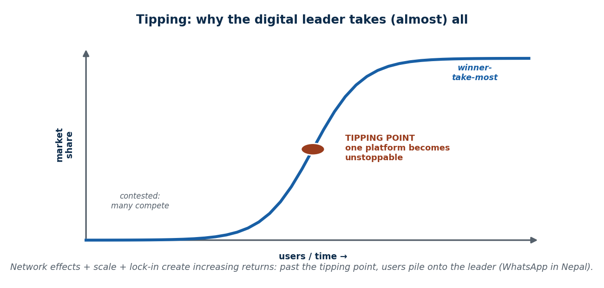

- WhatsApp passed 400 million users — all your friends were already there, so there was no reason to switch.
- TikTok passed a billion downloads, and its algorithm became unbeatable.
- Amazon reached a point where customers stopped checking other sites.

> **Analogy:** once a party becomes crowded, everyone wants to go to *that* party. Small platforms
> rarely survive once a big one dominates. MySpace lost to Facebook; Vine was driven out by TikTok;
> Instagram Stories stalled Snapchat's growth.

### Why this is risky

Less competition means less innovation · data concentrates, so privacy risk rises · the platform can
control prices (Apple's 30% App Store commission) · algorithms can be biased · and big platforms can
simply copy and crush competitors (Meta copying Stories and Reels).

**Real cases:** Google fined by the EU for anti-competitive search practices · Apple sued over control
of the iPhone app market · Amazon accused of undercutting its own sellers.

### Why regulating big tech is hard, and what governments do

**The difficulty:** products are often "free", so it is hard to prove consumer harm · digital markets
move faster than legal processes · data ownership law is unclear.

| Government tool | What it does | Example |
|---|---|---|
| **Data portability** | You can download your data and take it elsewhere | EU GDPR right to data portability |
| **Interoperability** | Competing services must be able to work with each other | EU Digital Markets Act forcing Meta to allow messaging interoperability |
| **Antitrust action and fines** | Punish and prevent abuse of dominance | EU vs Google and Apple; US FTC cases against Amazon and Google |
| **Bans** | Blocking a service outright | India banning TikTok over data concerns |
| **Breaking up companies** | Splitting a firm (rare, but possible) | — |

## 2.16 Measuring digital adoption

**Digital adoption** means how far digital tools are actually **used** in everyday life, in business
and in government. Note the word *used* — availability alone is not adoption.

| Area measured | What counts |
|---|---|
| **Daily life** | Online shopping (Daraz), digital payments (Khalti, eSewa, FonePay QR), navigation apps, telemedicine, e-learning, social messaging |
| **Business** | Cloud platforms, e-commerce participation, online advertising, digital accounting, automated supply chains |
| **Government** | Online tax filing (IRIS portal), digital ID (Nagarik App), online passport application, digital land records, utility payments, e-governance portals for complaints and certificates |

**Why measure it?** It shows how digitally advanced a country is, reveals infrastructure gaps, helps
governments plan policy, and shows businesses where the opportunities are. It is used by the World
Bank, UN, OECD, IMF and ITU. Countries with high digital adoption coped far better during COVID-19
(remote work, online schooling).

### World Bank Digital Adoption Index (DAI) — three pillars

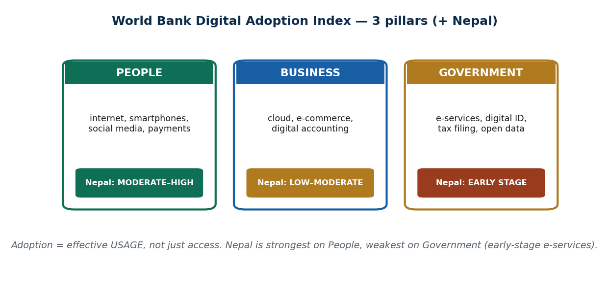

| Pillar | What it measures | Examples |
|---|---|---|
| **People** | Internet access, smartphone use, social media, online learning and telemedicine, digital payments | Nepal: very high TikTok penetration. India: around 300 million UPI transactions a day. South Korea: almost universal high-speed internet |
| **Business** | Cloud use, e-commerce participation, online advertising, digital accounting, automated supply chains | Amazon's AI-driven logistics; Nepali SMEs rarely using cloud accounting; restaurants joining Foodmandu or Pathao Food |
| **Government** | Online service delivery, digital ID, tax filing, open data, e-governance platforms | Estonia: 99% of services online. India: Aadhaar + DigiLocker. Nepal: Nagarik App, online passport appointments |

### OECD Digital Government Index (DGI) — six dimensions

The DGI goes further than the DAI: it measures how **modern, efficient and citizen-focused** a digital
government is — quality and maturity, not just access.

| Dimension | Meaning | Example |
|---|---|---|
| **1. User-centricity** | Services designed around people, not bureaucracy — simple interface, fast processing, mobile-friendly | UAE: 90% of services in one app. Estonia: one-click tax filing |
| **2. Digital by design** | Systems built digitally from the start, not a paper system scanned in. Unified identity, payments and signatures | IndiaStack (Aadhaar, eKYC, UPI); Singapore's SingPass |
| **3. Data-driven public sector** | Government uses data to improve decisions, predict trends and deliver smarter services | Singapore using data to set bus frequency; India's digital health missions; Google mobility data in COVID response |
| **4. Proactiveness** | Government delivers the service before you ask | Denmark automatically sending child benefits after a birth is registered |
| **5. Government as a platform** | Shared building blocks (ID, payments, cloud) that others build on | UPI used by thousands of apps; Estonia's X-Road connecting all government systems |
| **6. Open by default** | Transparency and public access to government data | UK open data portal; US government APIs; open COVID dashboards |

### Where Nepal stands

| Pillar | Level | Evidence |
|---|---|---|
| **People** | Moderate–High | Very high TikTok, Facebook and Instagram use; digital payments growing fast (eSewa, Khalti, FonePay). But internet quality is inconsistent |
| **Business** | Low–Moderate | Digital accounting is rare; cloud adoption is low; e-commerce is rising but largely informal |
| **Government** | Early stage | Some progress — Nagarik App, online passport appointments — but systems are not integrated, manual paperwork still dominates, and there is no digital-by-design approach |

## 2.17 Putting it together: six platforms analysed

This is the classic Unit 2 exercise — take a platform and analyse it on network effects, lock-in,
switching cost and monopoly risk.

| Platform | Network effect | Lock-in | Switching cost | Monopoly risk |
|---|---|---|---|---|
| **Pathao** (rides) | Medium–strong, but **local** — works best in Kathmandu and Pokhara. More riders → more driver income → more drivers → faster rides | Saved locations, ride history, familiar drivers, habit | Low in money, high in convenience; new app to learn; eSewa/Khalti already linked | **Medium** — InDrive and Tootle exist; strongest brand but replaceable |
| **TikTok** (short video) | Very strong and **global**. More creators → more content → more viewers → more creators; the algorithm improves with every user | Personalised For You feed; followers, drafts and content invested; creators depend on it for income | High for creators (losing audience); medium for viewers (losing recommendations) | **High** — the strongest recommendation algorithm in the world; Reels and Shorts exist but TikTok still leads |
| **Daraz** (marketplace) | Strong. More sellers → more variety → more buyers → more sellers; better logistics → more trust | Wallet, vouchers, reward points, delivery tracking, seller ratings | Sellers depend on Daraz traffic; buyers lose wishlist, coupons and history | **Medium–High** — SastoDeal and HamroBazaar are weaker; logistics give Daraz an edge |
| **eSewa** (wallet) | Strong. More merchants accept it → more users adopt → more merchants join; person-to-person transfers reinforce it | Linked bank accounts, recurring bill payments, saved QR templates | Must re-add bank accounts elsewhere; friends and shops already use eSewa; habit and trust | **High** — dominant share in Nepal; Khalti is a real but much smaller rival |
| **Foodmandu** (food delivery) | Medium. More restaurants → more customers → more orders → more restaurants | Saved addresses, order history, exclusive restaurant tie-ups, recommendations | **Low** — Pathao Food and Bhojdeals are easy alternatives; fees differ | **Low–Medium** — strong competition from Pathao Food |
| **WhatsApp** (messaging) | Very strong **direct** effect — everyone uses it, so you must too. Groups, communities, broadcast lists | All chats, groups and media live inside it; family and work groups create emotional and social lock-in | **Extremely high** — leaving means losing groups, history and contacts, and convincing everyone else to move | **Very high** — dominant across South Asia, Latin America and Africa; Telegram and Signal are far smaller |

## 2.18 Three case studies

### Nepal's digital journey

| Strengths | Weaknesses | Opportunities |
|---|---|---|
| High mobile adoption; eSewa and Khalti widespread; Pathao, Foodmandu and Daraz introduced platform thinking | Government digital services weak; low trust in official platforms; slow interoperability; legacy systems and paperwork | A national digital ID; public digital platforms on the model of India's DPI |

### India's Digital Public Infrastructure (DPI)

| Component | What it did |
|---|---|
| **UPI** | Removed transaction barriers; became a global benchmark for digital payments |
| **Aadhaar** | Provided the digital identity backbone |
| **ONDC** (Open Network for Digital Commerce) | An open marketplace network open to all sellers, aimed at reducing Amazon and Flipkart dominance |

The lesson: when a government builds shared infrastructure, thousands of private services can be built
on top of it — this is "government as a platform" from the DGI.

### Sri Lanka's PickMe — how a local platform beat a global one

Uber had better global technology and far more money. PickMe won anyway. Why:

1. **Local adaptation** — it understood Sri Lankan traffic, popular routes, a cash-first payment
   culture, and offered local-language support.
2. **Cheaper and more reliable** — lower prices for everyday trips, predictable fares, a large local
   driver network, and willingness to serve short trips that global apps ignore.
3. **Multi-service ecosystem** — it added food, grocery, parcel and logistics services, which kept
   users inside and created network effects and lock-in.

> **The big lesson:** a local platform can beat a global giant if it understands local needs better.
> Uber had global technology and capital; PickMe had local knowledge, trust, customisation and
> partnerships. **In digital markets, winning is not only about size — it is about relevance.**

### Key words from Unit 2

Digitization · digitalization · digital transformation · zero marginal cost · transaction cost ·
search/coordination/payment cost · pipeline vs platform business · multi-sided platform · matching
problem · chicken-and-egg problem · liquidity · subsidising one side · disintermediation · platform
envelopment · network effect · direct / indirect / data / technology network effect · viral effect ·
cold start · critical mass · positive feedback loop · negative network effect · flywheel · acquisition
/ activation / engagement / retention loop · lock-in · switching cost · walled garden · multi-homing ·
competitive moat · economies of scale · economies of scope · data advantage · entry barrier ·
winner-take-most · market tipping · de facto monopoly · oligopoly · monopolistic competition ·
monopsony · oligopsony · data portability · interoperability · antitrust · Digital Adoption Index ·
Digital Government Index · digital public infrastructure.

### Summary — Unit 2

- Digital economics rests on **zero marginal cost**, **falling transaction costs**, and value coming
  from data, users and algorithms.
- A **platform** connects groups instead of producing goods. An **MSP** serves two or more
  interdependent groups and solves a matching problem.
- Platforms create value by cutting transaction costs, matching efficiently, building trust, providing
  tools, and generating network value. Their first obstacle is the **chicken-and-egg problem**, solved
  by subsidies, manual inventory, density, partnerships and incentives.
- **Network effects** come in four kinds — direct, indirect, data and technology. They drive positive
  feedback, but they can also turn negative through congestion, spam and toxicity.
- A **flywheel** is an engineered version of a network effect, built from acquisition, activation,
  engagement and retention loops, and powered by **liquidity**.
- **Lock-in** (financial, learning, data, network, psychological) protects the flywheel; walled gardens
  deepen it; multi-homing weakens it.
- Digital markets tend toward **winner-take-most** because of network effects, economies of scale and
  scope, data advantage, zero marginal cost and entry barriers. Once a market **tips**, it is nearly
  impossible to reverse.
- Adoption is measured by the World Bank **DAI** (people, business, government) and the OECD **DGI**
  (user-centricity, digital by design, data-driven, proactive, government as a platform, open by
  default). Nepal: people moderate–high, business low–moderate, government early stage.

<!-- question-bank:unit2:begin -->
## 2.T Test yourself — Unit 2

Work through the questions first and keep the answer key covered. Parts A and B have fixed answers, given at the end of this section; Parts C to E are the open questions that carry the most marks in an exam, so practise writing them out in full.

### Part A — Multiple choice

**A1.** The key difference between a pipe and a platform business is:

  *a)* size  ·  *b)* who creates the value — the firm (pipe) vs the users, for each other (platform)  ·  *c)* profit  ·  *d)* age

**A2.** A multi-sided platform's defining feature is that its user groups are:

  *a)* unrelated  ·  *b)* all buyers  ·  *c)* interdependent — each side needs the other  ·  *d)* employees

**A3.** Uber/Pathao's riders-attract-drivers-attract-riders is which type?

  *a)* direct  ·  *b)* indirect / cross-side  ·  *c)* data  ·  *d)* standard

**A4.** Going viral is the same as a network effect:

  *a)* true  ·  *b)* false — viral = fast spread; network effect = lasting added value  ·  *c)* only for TikTok  ·  *d)* only offline

**A5.** Google Search is free to users because:

  *a)* it is charity  ·  *b)* users are the subsidy side; advertisers (money side) pay for their attention  ·  *c)* it loses money  ·  *d)* the government funds it

**A6.** 'Near-zero marginal cost' means, as a platform grows, its average cost per user:

  *a)* rises  ·  *b)* stays flat  ·  *c)* falls (fixed cost spread over more users)  ·  *d)* becomes negative

**A7.** The difference between a network effect and a flywheel is:

  *a)* none  ·  *b)* a network effect is natural; a flywheel is a designed growth loop  ·  *c)* size  ·  *d)* only Amazon has flywheels

**A8.** Losing your WhatsApp groups and chat history if you left is which switching cost(s)?

  *a)* financial only  ·  *b)* network/social + data/asset  ·  *c)* learning only  ·  *d)* none

**A9.** 'Winner-take-most' in digital markets is driven mainly by:

  *a)* advertising  ·  *b)* increasing returns — network effects, scale & lock-in compounding  ·  *c)* luck  ·  *d)* government

**A10.** Amazon dictating terms to small sellers who depend on it is an example of:

  *a)* monopoly (seller power)  ·  *b)* monopsony (buyer power)  ·  *c)* oligopoly  ·  *d)* competition

**A11.** Regulating digital monopolies is hard mainly because:

  *a)* they're small  ·  *b)* products are often 'free' (no price rise to prove), markets move fast, data rules unclear  ·  *c)* no laws exist  ·  *d)* users don't care

**A12.** Data portability and interoperability work by:

  *a)* raising prices  ·  *b)* lowering switching costs so competition can return  ·  *c)* banning platforms  ·  *d)* adding ads

**A13.** The World Bank DAI measures adoption across which three pillars?

  *a)* rich/middle/poor  ·  *b)* People, Business, Government  ·  *c)* phones/PCs/servers  ·  *d)* urban/rural/remote

**A14.** A government service that is a scanned PDF of an old paper form scores LOW on the DGI's:

  *a)* openness  ·  *b)* 'digital by design'  ·  *c)* fines  ·  *d)* network effect

### Part B — Unit review

Complete each line from memory.

**B1.** A platform business differs from a pipe in that → ?

**B2.** A multi-sided platform connects → ?

**B3.** Riders-attract-drivers-attract-riders is a → ?

**B4.** TikTok's feed improving with use is a → ?

**B5.** Google is free to users because → ?

**B6.** As a digital platform scales, average cost per user → ?

**B7.** Neither side joining first is the → ?

**B8.** A flywheel differs from a network effect in that it is → ?

**B9.** Losing chat history + groups if you leave = which switching costs → ?

**B10.** 'Winner-take-most' is driven by → ?

**B11.** Amazon dictating terms to dependent sellers is → ?

**B12.** The OECD DGI measures → ?

### Part C — Short answer

**C1.** Define a multi-sided platform + name 2 value-creation mechanisms.

**C2.** Name the 4 network-effect types with an example each.

**C3.** Explain cross-subsidy with one example.

**C4.** List the 6 forces behind digital monopolies.

**C5.** Name the DAI's 3 pillars and the OECD DGI.

### Part D — Applied case

**D1.** Choose ONE Nepali platform (Pathao / eSewa / Daraz / Foodmandu) and analyse it on: network effect · lock-in · switching cost · monopoly risk.

**D2.** Assess Nepal on the DAI's three pillars (People / Business / Government) and justify each rating.

### Part E — Discussion

**E1.** 'Are digital monopolies inevitable?' Argue using tipping/winner-take-most vs the PickMe/ONDC counter-cases.

**E2.** Name a Nepali platform and every side it connects.

**E3.** Name a Nepali platform's network-effect type and one way it could turn negative.

**E4.** For a new Nepali platform, which side would you make free and why?

**E5.** Name a service you'd leave but haven't — which switching costs trap you?

**E6.** Pick a Nepali digital market — will it tip to one winner or stay contested? Why?

**E7.** Pick a dominant platform — should a regulator act, and with which tool?

**E8.** Rate Nepal on the three DAI pillars and propose a fix for the weakest.

### Answers — Unit 2

| # | Answer | Why |
|---|---|---|
| **A1** | **b)** who creates the value — the firm (pipe) vs the users, for each other (platform) | A pipe produces and sells value; a platform enables users to create value for each other. |
| **A2** | **c)** interdependent — each side needs the other | Sellers are useless without buyers and vice versa; the platform's job is to match interdependent sides. |
| **A3** | **b)** indirect / cross-side | Value on one side (riders) grows the other side (drivers) — a cross-side (indirect) network effect. |
| **A4** | **b)** false — viral = fast spread; network effect = lasting added value | A meme spreads (viral) without making the platform more useful; a network effect durably adds value. |
| **A5** | **b)** users are the subsidy side; advertisers (money side) pay for their attention | Cross-subsidy — subsidise the side (users) that attracts the paying side (advertisers). |
| **A6** | **c)** falls (fixed cost spread over more users) | High fixed + ~0 marginal cost → the bigger the base, the cheaper per user — economies of scale. |
| **A7** | **b)** a network effect is natural; a flywheel is a designed growth loop | The network effect is the force; the flywheel is the engineered machine that harnesses it. |
| **A8** | **b)** network/social + data/asset | Groups = network/social loss; chat history = data/asset loss — stacked switching costs. |
| **A9** | **b)** increasing returns — network effects, scale & lock-in compounding | The more a platform grows, the better/cheaper it gets, attracting more users — increasing returns. |
| **A10** | **b)** monopsony (buyer power) | Amazon is the dominant BUYER/gateway for those sellers — buyer-side market power (monopsony). |
| **A11** | **b)** products are often 'free' (no price rise to prove), markets move fast, data rules unclear | The classic 'did prices rise?' test fails when the product is free, though data/innovation harms are real. |
| **A12** | **b)** lowering switching costs so competition can return | They attack the lock-in mechanism (S12) directly, letting users move and rivals interconnect. |
| **A13** | **b)** People, Business, Government | The DAI's three pillars are People, Business, and Government — each with its own indicators. |
| **A14** | **b)** 'digital by design' | Digital-by-design means rebuilt digitally, not paper copied — a scanned form is access, not maturity. |

| # | Answer |
|---|---|
| **B1** | users create the value for each other |
| **B2** | 2+ interdependent groups (solves matching) |
| **B3** | indirect / cross-side network effect |
| **B4** | data network effect |
| **B5** | advertisers (money side) pay for their attention |
| **B6** | falls (near-zero marginal cost) |
| **B7** | chicken-and-egg problem |
| **B8** | designed, not natural |
| **B9** | data/asset + network/social |
| **B10** | increasing returns (network effects + scale + lock-in) |
| **B11** | monopsony (buyer power) |
| **B12** | digital-government maturity (6 dimensions) |

<!-- question-bank:unit2:end -->

---

# Unit 3 — Digital Markets, Strategy and Innovation

**10 lecture hours.** Competition, cooperation and co-opetition · the layered internet model · digital
innovation · digital business models · value creation models · modeling of digital markets.

## 3.1 What a digital market is

**Definition:** a **digital market** is a platform or environment where goods, services or information
are exchanged electronically.

The key point: a digital market is much more than a website. It is a combination of **technology,
payments, logistics, data and customer support** working together. Daraz is not just a site — it is a
site plus a payment gateway plus a delivery fleet plus a recommendation engine plus a complaints desk.

**Nepali examples:** Daraz (shopping), eSewa (payments), Foodmandu (delivery), Pathao (rides and
delivery), Hamro Patro (utility app).

### Digital vs traditional markets

| Feature | Traditional market | Digital market |
|---|---|---|
| **Transactions** | Slower, physical | Instant, online |
| **Reach** | Local or regional | National or global |
| **Cost of expansion** | High | Low |
| **Scalability** | Limited | High, potentially unlimited |
| **Examples** | Local shops, bazaars | Daraz, Foodmandu, Hamro Patro |

### The parts that make up a digital market

| Component | What it does | Nepal example |
|---|---|---|
| **The platform** | The website or app where buyers and sellers meet | Daraz app |
| **Payment system** | Moves money securely | eSewa, Khalti, FonePay |
| **Logistics / supply chain** | Delivers the goods or service | Daraz courier network |
| **Data analytics** | Understands customer behaviour | Recommendations, demand forecasting |
| **Customer support** | Creates trust and resolves problems | Returns, refunds, helplines |

## 3.2 The four characteristics of a digital market

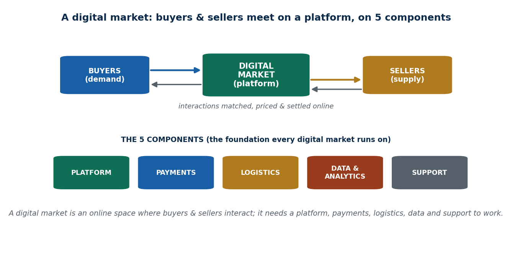

### Speed

Transactions happen in real time, and everything updates instantly: stock shows "Out of Stock" the
moment it runs out, price changes reach every user at once, shipping can be tracked live, and a ride
shows as accepted immediately.

| | Traditional | Digital |
|---|---|---|
| Finding the product | Travel to the store, browse by hand | Browse instantly |
| Price | Ask, negotiate | Updates automatically |
| Paying | Cash, wait for a receipt | Completed in seconds |
| Stock | Seller checks manually | Updates the moment someone else buys |

**Why speed matters.** For consumers: saves time, better experience, faster decisions, real-time
offers. For businesses: more transactions per minute, better inventory control, faster support, more
sales at peak times. **In digital markets, speed is competitiveness.**
*Nepal:* Daraz flash sales; FonePay instant payments.

### Scale

A supermarket that wants more customers needs a bigger store, more staff, more shelves and more stock.
A digital business that wants more customers mostly needs more server capacity. Once the digital
infrastructure exists, adding users or sellers costs very little.

> **Pathao's story.** It started in Kathmandu with a small group of riders and a few requests an hour.
> Once the app was stable, thousands of riders joined, daily requests reached tens of thousands, and it
> expanded to Pokhara and Chitwan — with no physical branch in any of those cities.

**Why scale matters:** lower prices for customers, more choice, higher revenue for the platform,
stronger network effects, and faster nationwide growth.

### Network effects

Covered fully in Unit 2 — here, remember the market-level consequence: *more users → more interactions
→ more value → even more users join*, which usually produces one dominant platform.
*Global:* Facebook with 10 users is useless; with hundreds of millions it is unavoidable.
*Nepal:* as more merchants accept eSewa, paying digitally gets easier, which brings more users, which
brings more merchants. Pathao: more riders → faster pickup → more users → more transactions.

### Low marginal cost

Adding one more user or product costs almost nothing, so platforms can scale fast and experiment
cheaply.
*Global:* Spotify streaming one more song to one more user costs almost nothing extra.
*Nepal:* SastoDeal can list thousands more products without opening a single new shop.
**Why it matters:** rapid national or global scaling, low-risk testing of new products, quick response
to demand, and the ability to stay competitive as users pour in.

## 3.3 Types of digital market

| Type | Full form | Meaning | Nepali example |
|---|---|---|---|
| **B2C** | Business to consumer | A business sells to individuals | Daraz selling to shoppers |
| **B2B** | Business to business | A business sells to another business | A local supplier selling to large Kathmandu stores |
| **C2C** | Consumer to consumer | Individuals sell to each other | Facebook Marketplace, HamroBazaar, OLX Nepal |
| **C2B** | Consumer to business | Individuals sell services to companies | Freelancers offering design or coding to firms |
| **P2P / sharing** | Peer to peer | People share assets through a platform | Pathao ride-sharing; room-sharing platforms |

**Global examples:** Amazon (e-commerce + AWS cloud), Airbnb (peer-to-peer lodging), Netflix and
Spotify (subscription services).
**Nepali examples:** Daraz (shopping and flash sales), Foodmandu (food delivery), Hamro Patro
(calendar, news, utilities), Pathao (rides and delivery).

## 3.4 Benefits and challenges of digital markets

| Benefits | Challenges |
|---|---|
| Wider market access for businesses — a small shop can sell nationwide through Daraz or social media | **Intense competition** with winner-takes-most dynamics |
| Convenience for consumers | **Digital divide** — not every Nepali has a smartphone or reliable internet |
| Lower barriers to starting a business | **Trust and logistics** — people still prefer cash on delivery |
| Encourages innovation in products and services | Rural connectivity problems |

## 3.5 Competition in digital markets

Competition online does not work the way competition in a bazaar works.

| Aspect | Traditional markets | Digital markets |
|---|---|---|
| **Basis of competition** | Location, price, relationships | Speed, scale, technology |
| **Market reach** | Local or regional | National or global |
| **Growth speed** | Slow and incremental | Rapid and exponential |
| **Cost of expansion** | High (shops, staff, rent) | Low (software, servers) |
| **Number of competitors** | Many can coexist | Few dominant platforms |
| **Switching cost** | Low | High (accounts, data, habits) |
| **Data advantage** | Minimal | Very high |
| **Typical outcome** | Fragmented market | **Winner-takes-most** |

### Winner-takes-most

One platform captures most users; others survive only in niches. Importantly, **quality alone does not
decide the winner** — timing and growth speed matter more.
*Global:* Google dominates search. *Nepal:* Pathao dominates ride-hailing. *Social:* Facebook and
Instagram dominate attention.
**Cause → effect:** strong network effects → market concentration and platform dominance.

### Platform dominance

Dominant platforms control **access to the market itself**. They influence pricing, visibility and the
rules; their data advantage deepens dominance; and smaller players depend on them to reach customers.
Google controls which businesses are found in search; Facebook controls advertising reach; Daraz
controls which sellers Nepali buyers see.
**Cause → effect:** centralised platforms → less competition, but higher efficiency.

### What this does to consumers and startups

| | Short term | Long term |
|---|---|---|
| **Consumers** | Convenience and lower prices | Fewer choices, dependence on one platform, privacy concerns. *Cause → effect:* platform dominance → convenience up, choice down |
| **Startups** | Easy to enter a digital market | Hard to survive once a dominant player appears; user acquisition becomes expensive; most shift to niches. *Nepal:* e-commerce startups struggle against Daraz; ride-hailing rivals struggle against Pathao |

**Discussion points your examiner may use:** Is Pathao's dominance good for Nepal? Should the
government regulate digital platforms? How can Nepali startups compete intelligently?

## 3.6 Cooperation in digital markets

Most people assume markets are purely competitive — one company wins, the rest lose. Digital markets
are not like that. They are built on **shared infrastructure**, run as **ecosystems**, and depend on
**interoperability** (different systems working with each other). Many platforms simply cannot exist
alone.

**Cooperation is not weakness. It is often a strategic necessity.**

**Cooperation means** working together to share technology or infrastructure, expand markets, reduce
costs or improve the customer experience — and it happens even between direct competitors.

### Why digital markets push firms to cooperate

| Cause | Effect | Example |
|---|---|---|
| **Technology is modular** — products are made of separate parts (front end, back end, payments, logistics), so nobody has to build everything | Each firm focuses on its strength and relies on others for the rest | Pathao focuses on ride matching and its driver network; payment is handled by eSewa or Khalti |
| **APIs allow easy integration** — an **API** (Application Programming Interface) is a digital bridge that lets two apps talk to each other | Companies cooperate without merging or losing their identity | The Daraz API lets local sellers connect their stock; the eSewa API lets many apps accept payments |
| **Network effects need scale** | Platforms partner — even with rivals — to grow the network fast | eSewa, Khalti and IME Pay accept the same QR codes so any merchant works with any wallet; ride apps integrate Google Maps |
| **User convenience beats exclusivity** — users want ease, not loyalty | If platforms refuse to cooperate, users abandon all of them in frustration | A tourist wants to pay with any wallet at a restaurant; without a common QR there is friction and adoption falls |
| **High development costs** | Sharing cost reduces risk and speeds up launch | Uber uses Google Maps instead of building mapping; AWS powers thousands of startups; Pathao uses Ncell and NTC networks; eSewa integrates with many banks rather than building its own banking system |
| **Need for standardisation** | Agreed standards make everything work together and avoid fragmenting the market | PayPal and Visa/Mastercard follow shared protocols; Android apps follow Google standards; Nepal's QR standard lets any wallet pay any merchant |
| **Faster market growth** | Firms grow the whole market instead of fighting over a small one | Google and phone makers cooperate so millions adopt Android, then compete on apps. **"Grow the pie first, then compete for slices."** |

### Forms of cooperation

**1. Joint platforms** — one platform built once and used by many firms. Typically used for data
exchange, payment processing and transaction clearing.

| Example | What it does |
|---|---|
| **SWIFT** | A single global network for interbank payments |
| **NCHL** (Nepal Clearing House) | Processes interbank transactions for all Nepali banks |
| **ConnectIPS** | A government-regulated system connecting banks, wallets and institutions |

*Benefits:* avoids duplicate investment, improves speed, standardises the market, and lowers the entry
barrier for small players — a small bank or fintech can process payments without building its own
clearing system.
*Why it is regulated:* payment systems involve trust, security and compliance, so government oversight
ensures safety, standard procedures, transparency, and fair competition on top of shared
infrastructure.

**2. Partnerships** — two or more firms working together to create extra value. They may be
**strategic** (long term) or **operational** (sharing resources for efficiency).

| Sub-type | What it means | Examples |
|---|---|---|
| **General partnership** | Joint working arrangement | Starbucks + Spotify co-branded playlists; Uber Eats + restaurant chains; Foodmandu + local cloud kitchens; Daraz + courier services |
| **Co-branding** | Two brands combine to reach a bigger or better-targeted audience | Daraz co-branded with telecom companies for festival promotions; FonePay + banks for cashback campaigns |
| **Shared logistics** | Sharing transport, delivery or warehousing to cut cost | Food delivery apps sharing cloud kitchens or delivery networks; e-commerce sellers sharing third-party couriers |
| **Joint marketing** | Running campaigns together | Festival sales by several Nepali e-commerce platforms with banks; ride-hailing and tourism apps promoting together |

**3. Integration of services** — several platforms work together as one seamless system, usually
through APIs, so the user experiences one journey instead of four apps.

| Integration | Nepali example | Benefit |
|---|---|---|
| Payment + e-commerce | Daraz + eSewa/Khalti | Smooth checkout, higher sales |
| Ride-hailing + maps | Pathao + Google Maps | Accurate matching, faster trips |
| Food delivery + wallets | Foodmandu + e-wallets | Quick payment, better experience |
| Banking + bill payments | ConnectIPS | One platform for many transactions |

*Why it matters:* users prefer one-stop solutions, friction and drop-offs fall, and small firms can
use existing services instead of building them.

## 3.7 Co-opetition

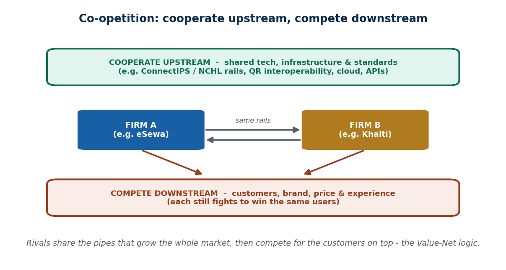

**Co-opetition = Cooperation + Competition.** Firms cooperate in some areas and compete in others at
the same time. The usual pattern:

> **Cooperate upstream** (technology, infrastructure, standards) · **compete downstream** (customers,
> branding, price).

| | **Upstream cooperation** | **Downstream competition** |
|---|---|---|
| What is shared or fought over | Shared technology, APIs, infrastructure, standards — reducing cost and ensuring compatibility | Users, brand, pricing, promotions, features |
| Global example | Google gives Android free to phone makers, who build the handsets, and Google gains the app ecosystem | Google apps compete with the phone makers' own apps; Samsung, Xiaomi and OnePlus compete on devices |
| Nepal example | eSewa, Khalti and IME Pay cooperate on interoperable QR; banks cooperate through ConnectIPS | Wallets compete on cashback, UI/UX and merchant onboarding; Pathao vs InDrive on fare and driver incentives; Foodmandu vs rival food apps on delivery, menu and discounts |

**Why co-opetition is so common:** no single firm controls the whole value chain, digital products are
layered (see 3.8), and ecosystems outperform isolated firms.
> *"Telecom companies share network towers but compete on plans."*

### Co-opetition in Nepali digital business

| Businesses | They cooperate on | They compete on | Result |
|---|---|---|---|
| eSewa + Nabil Bank | Shared QR and payment rails | Cashback, user experience, app features | Faster adoption, more convenience |
| Daraz + Pathao delivery | Delivery infrastructure | Pricing, speed, coverage | Efficient logistics, satisfied customers |
| Pathao + Mero Trip | Integrated booking | Ride pricing, promotions | Better tourist experience, higher adoption |

### Benefits and risks

| Market-level benefits | Business-level benefits |
|---|---|
| **Faster digital adoption** — interoperable QR means more merchants and users go digital | **Cost reduction** — shared cloud kitchens and delivery networks |
| **Standard user experience** — shared standards make apps behave predictably | **Faster scaling** — Pathao expanded across cities using existing payment gateways and maps |
| **Less fragmentation** — ConnectIPS means one system works across all banks | **Access to new users** — Daraz + telecom festival partnerships reach millions |

**Why cooperation matters especially in Nepal:** the market is small, so cooperation maximises reach ·
capital is limited, so small startups cannot afford standalone infrastructure · cooperative ecosystems
reduce risk and improve long-term survival. *"In Nepal, collaboration is survival."*

**Risks:**

| Risk | What goes wrong | Example |
|---|---|---|
| **Dependency** | Small firms become reliant on big platforms | Merchants who depend entirely on Daraz |
| **Power imbalance** | The dominant platform dictates terms | Drivers dependent on Pathao's rules |
| **Innovation lock-in** | Too much standardisation reduces experimentation | Everyone building the same way |

> **Takeaway:** digital markets are ecosystems, not isolated firms. *"In digital markets, the biggest
> competitors today may be tomorrow's partners."*

## 3.8 The layered internet model

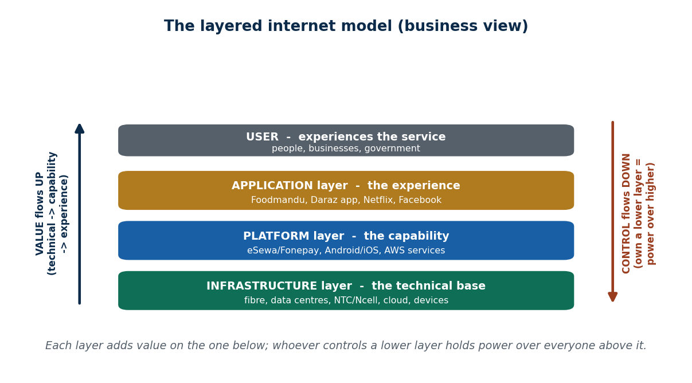

**The idea:** every digital service sits on a stack of three layers, each depending on the one below.
Users only ever see the top layer.

| Layer | What it contains | Global example | Nepali example |
|---|---|---|---|
| **Infrastructure layer** | Physical hardware — servers, routers, data centres — and connectivity (4G, 5G, fibre) | 4G/5G networks, AWS data centres | NTC and Ncell 4G networks; bank backend servers |
| **Platform layer** | Operating systems, cloud platforms, databases, APIs, development frameworks | AWS, Google Cloud; Android and iOS | Nabil Bank's app backend hosted on cloud; Android on most Nepali phones |
| **Application layer** | The apps and websites people actually use | Netflix, Spotify, WhatsApp | eSewa, Daraz, Pathao, Foodmandu, Nabil Bank app |

**The analogy used in class:** infrastructure = roads and electricity · platform = vehicles ·
applications = passengers. Good apps still fail on bad roads.

### How value flows

**Value flow** means how usefulness and economic value move upward from infrastructure to the user.

- **Infrastructure creates capability** — connectivity, speed, reliability, processing power. It never
  touches the user directly, but nothing works without it. *If internet speed is poor in rural Nepal,
  no app can deliver its full value, however well designed it is.*
- **Platform turns capability into something usable** — operating systems, cloud storage, APIs and
  databases that developers can build on. *If Android changes its rules, Nepali apps must adapt
  immediately, even though they do not control Android.*
- **Application turns that into experience** — convenience, speed, trust and user interface. *Users pay
  for the application layer, but that value rests on invisible layers below.*

**Lower layers create capability; upper layers create experience. Value always flows bottom to top.**

**Worked example.** 4G network (infrastructure) provides internet access → Nabil Bank backend
(platform) processes the transaction and stores data securely → the mobile app (application) lets the
user transfer money and see a balance. *If the 4G network fails, the app cannot work even though the
bank's systems are fine.*
Same pattern globally: AWS servers → Netflix's cloud platform (content delivery, recommendations) →
the Netflix app streaming smoothly.

### Why the model matters — power

**Whoever controls a lower layer has power over the layers above.** Telecom companies influence how
every app performs. Platform owners influence app visibility and pricing.

**Nepal's position:** Nepali startups operate almost entirely at the **application layer**. The
country does not control the platform or infrastructure layers — the cloud, the operating systems, the
app stores are all foreign. This makes Nepali startups *structurally dependent*, and it affects both
innovation and cost.

**Benefits of a layered architecture:** **scalability** (apps grow without rebuilding infrastructure) ·
**flexibility** (one platform hosts many apps) · **innovation** (developers focus on apps, not
servers) · **interoperability** (standard layers let apps work across devices). *In Nepal:* Daraz can
run on the same cloud as many other apps; banks can offer digital services without building their own
networks.

## 3.9 Digital innovation

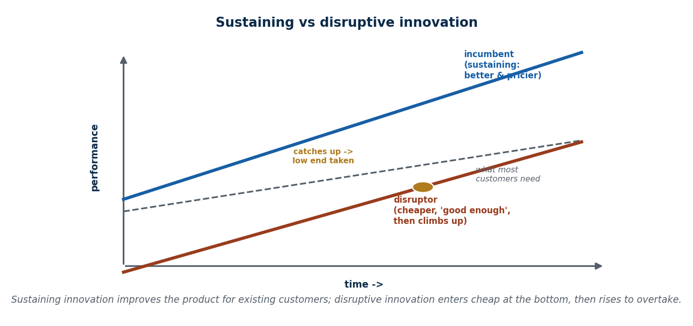

**Definition:** using digital technology to create new or improved **products, processes, services and
business models**.

| What can be innovated | Meaning |
|---|---|
| **Products** | What users interact with — apps, features |
| **Processes** | How work gets done internally — delivery, payments, operations |
| **Services** | How customers are served — speed, convenience, personalisation |
| **Business models** | How money is made — subscriptions, commissions, platforms |

Four things to understand about digital innovation:

1. **It is driven by solving real problems.** People used to travel far to pay bills; eSewa solved a
   real pain point of time, travel and inconvenience. *Real problem → digital solution → adoption →
   business growth.* **Technology alone does not create value; solving real problems does.**
2. **It is continuous and cumulative.** It does not have to be a breakthrough. Pathao adding an in-app
   wallet, then location sharing, then ride ratings — each small update improves the experience, and
   over time they add up to a major advantage.
3. **It is not the same as adopting technology.** Having a website is not innovation; using data to
   personalise services is. Many Nepali businesses made a Facebook page during COVID-19, but only some
   actually changed how they served customers. **Innovation is about changing behaviour, not installing
   software.**
4. **Innovation ≠ invention.** Innovation means *applying* technology to create value. WhatsApp did not
   invent the smartphone; Pathao did not invent ride-sharing. Pathao innovated by applying GPS, mobile
   internet and digital payments **to the Nepali context**.

**Why it matters:** improves productivity and efficiency · improves customer experience · builds
competitive advantage · opens new revenue streams · supports data-driven decisions.

### The six types of digital innovation

| Type | Meaning | Examples |
|---|---|---|
| **Product innovation** | New or much improved digital products — new features, better UX, personalisation | eSewa growing from a simple payment app into recharge, bills and ticketing; Netflix streaming instead of DVDs; Spotify playlists |
| **Process innovation** | Improving how work is done — automation, optimisation, faster decisions | **Daraz logistics:** orders tracked digitally, delivery routes optimised, warehouse operations automated. *The customer sees faster delivery; the real innovation is behind the scenes.* AWS scalable infrastructure |
| **Business model innovation** | Changing how the company earns | **Pathao owns no vehicles** and earns commission per ride — it is not a transport company, it is a digital platform. Foodmandu takes commission from restaurants; Daraz earns from sellers, ads and logistics; Netflix's subscription model |
| **Service / customer experience innovation** | Making life easier for the user | Pathao GPS tracking, driver ratings, live updates; eSewa instant notifications and easy bill payment; Netflix recommendations; Amazon one-click purchase |
| **Marketing innovation** | Reaching the right people with digital tools | Daraz targeted flash-sale campaigns by SMS, push notification and social media; Foodmandu promoting partner restaurants in-app; Spotify targeted playlists |
| **Organizational innovation** | Changing how the company works internally | **Daraz Nepal:** small product teams ship a flash-sale feature in days instead of months. **Foodmandu:** logistics, restaurant relations and support coordinate to fix delivery delays quickly. A startup facing payment failures puts finance, developers and QA together for a same-day fix |

### The technologies behind digital innovation

| Technology | What it enables | Nepal use |
|---|---|---|
| **Artificial intelligence** | Systems learn from data and decide — recommendations, fraud detection, demand prediction | Ride demand prediction; banking fraud detection |
| **Internet of Things** | Connects physical objects to the internet | GPS in delivery bikes; Pathao tracking riders; logistics tracking |
| **Cloud computing** | Rent computing power instead of owning it — low startup cost, easy scaling | Daraz handling flash-sale traffic spikes |
| **Big data** | Understand user behaviour at scale | Daraz analysing purchase patterns; Pathao optimising routes |
| **Augmented reality (AR)** | Adds digital elements on top of the real world; improves experience and marketing | IKEA Place app to visualise furniture at home; Snapchat filters |
| **Virtual reality (VR)** | Creates a fully digital immersive environment; improves training and education | Virtual property tours; VR medical training |

### The innovation process and culture

**Stages:** **Ideation → Prototype / MVP → Scale.**

| Stage | What you do | Example |
|---|---|---|
| **Ideation** | Generate ideas to solve a problem | Brainstorming ways to make food delivery faster |
| **Prototype / MVP** | Build a **Minimum Viable Product** — the simplest version that tests the idea | Launch a basic app that just takes orders |
| **Scale** | Improve and expand after feedback | Add more restaurants, GPS tracking, digital payments, wider delivery area |

**Principles that make it work:** experimentation and feedback (test quickly, learn from real users,
improve) and collaboration across teams (developers build, marketing promotes, operations handles
logistics).

### What makes innovation fail

| Challenge | Explanation | Example |
|---|---|---|
| **Resistance to change** | People prefer the old way | Staff unwilling to use a new app-based ordering system |
| **Skills gaps** | Nobody knows how to run the new thing | Small businesses struggling with digital marketing or app management |
| **Data security and privacy** | Customer data must be protected | Payment systems and customer databases are breach targets |
| **High initial investment** | Technology, infrastructure and training cost money | Building an app or buying VR equipment |
| **Measuring ROI** | Hard to prove the innovation paid off | AR marketing spend that does not immediately lift sales |

**The three things good ideas still need:** **culture** (people open to change), **skills** (teams who
can use the technology) and **governance** (clear policies and oversight for security and ROI).

### Nepal's innovation context

| Constraint | Reality |
|---|---|
| **Limited infrastructure** | Internet speed, electricity and hardware are unreliable; online learning struggles in rural areas; apps must work on low bandwidth |
| **Digital skills gap** | Small shops cannot manage an e-commerce listing properly |
| **Trust and adoption** | People hesitate to use digital payments instead of cash, out of habit or fear |

**Where the opportunity is:** **fintech** (digital payments, microloans, wallets — eSewa, Khalti) and
**agri-tech** (farm advisory, crop tracking, apps connecting farmers to markets). **Mobile penetration
is essential** — the smartphone is the main access point, which is why Pathao-style apps work.

**How Nepali startups actually innovate:** not by inventing from scratch, but by **adapting global
ideas to local conditions**. *"Innovation is not only about technology — it is about context."*

## 3.10 Digital business models

**Digital business** means using technology, data and digital networks to **create, deliver and
capture value**. It goes beyond digitising existing processes: it changes how the business operates
and how customers experience it, and it brings scalability, global reach and lower costs.

### The five core ideas

| Idea | Meaning |
|---|---|
| **Value creation** | How digital tools create new value — data, personalisation, automation |
| **Value delivery** | How it reaches customers — apps, websites, marketplaces |
| **Value capture** | How money is made — subscription, freemium, ads, or a mix |
| **Digital ecosystems** | Connected services that increase loyalty and engagement |
| **Data-driven decision making** | Analytics, AI and metrics used to optimise operations |

### How you build a digital business model

1. Identify customer needs and pain points.
2. Decide how to create, deliver and monetise value using technology.
3. Choose a model type — platform, subscription, freemium, marketplace, etc.
4. Plan for scalability and network effects.
5. Build in trust, security and regulatory compliance.
6. Test and iterate using data.

> **Worked example — a Nepali smart agriculture app.**
> *What it is:* one app giving farmers weather forecasts, crop prices, farming tips and a marketplace.
> *How it creates value:* farmers make informed decisions, sell at better prices, lose less produce.
> *How it delivers value:* through mobile phones, connecting farmers to buyers, experts and government
> services.
> *How it captures value:* premium subscriptions, ads from agri-companies, commission on marketplace
> sales.
> *Why it matters:* digitises agriculture, cuts out middlemen, brings rural communities into the digital
> economy and makes the food supply chain more transparent.

### Tools used to build a digital business

| Category | Tools |
|---|---|
| Digital infrastructure | AWS, Google Cloud, Azure |
| E-commerce platforms | Shopify, Daraz, SastoDeal |
| Analytics | Google Analytics, Mixpanel, Power BI |
| Marketing and engagement | Social media, email campaigns, SEO, paid ads |
| Payments and security | eSewa, Khalti, Stripe, PayPal |
| Collaboration and operations | Slack, Trello, Notion, Jira |

**Steps to launch:** ideation → business model design → digital infrastructure setup (website, app,
cloud, payments) → marketing and launch (social media, influencers, SEO, early adopters) → data
analysis and optimisation → scale and build network effects.

### The main digital business models

| Model | How it works | Global examples | Nepal examples |
|---|---|---|---|
| **Platform-based** | Connects producers and consumers without owning the product; earns from transaction fees, ads or subscriptions; network effects raise value | Uber, Airbnb, Facebook Marketplace | Foodmandu, Pathao |
| **Subscription** | Users pay a recurring fee for ongoing access; gives predictable revenue and loyalty | Netflix, Spotify Premium, Microsoft 365 | E-learning platforms, digital news and media |
| **Freemium** | Basic free, advanced paid; builds a large base and monetises the active few; works well in price-sensitive markets | LinkedIn, Dropbox, Evernote | Pathao and local productivity or entertainment apps |
| **Sharing economy** | People share assets instead of owning them; the platform takes a fee; trust comes from ratings and secure payments; brings the informal economy into the digital one | Uber, Airbnb, Zipcar | Room and vehicle rental; community sharing |
| **Marketplace** | Connects many buyers and many sellers; earns commission, listing fees or ads; lets small vendors test products cheaply | Amazon, eBay, Etsy | Daraz, SastoDeal |
| **Advertising / ad-supported** | Content is free; revenue comes from targeted advertising; attracts huge audiences cheaply | Google Search, Facebook, YouTube | Online news portals |
| **E-commerce** | Selling physical or digital products online; no shop needed; depends on payments and logistics | Amazon, eBay | Daraz, SastoDeal, NepBay |
| **Ecosystem / integrated platform** | Many connected services keep users inside; revenue from subscriptions, services, hardware or partners | Apple, Google, Microsoft | eSewa, Khalti (payments + services + partner apps) |
| **Usage-based / on-demand** | Pay for what you use rather than a flat subscription | AWS, Uber, pay-per-view | Cloud services; ride-hailing per trip |
| **Experience / premium** | Selling an experience or enhanced service, often digital plus physical; justifies premium pricing | Tesla, Airbnb Experiences | Virtual tourism, online cultural experiences |
| **Hybrid and data monetisation** | Combining several models; using user insights to improve services or earn | Spotify, YouTube | Local apps using analytics for marketing and premium upsells |

### How digital lowers the barrier to starting a business

You need little more than a smartphone and internet · cloud services make storage and software cheap ·
marketing is possible through social media · network effects raise value as users join. In Nepal this
means small businesses, freelancers and rural entrepreneurs can take part at all.

### How digital changed the way firms earn

Revenue moved from one-time sales to **subscriptions, pay-per-use and microtransactions** · hybrid
models mix freemium, ads, subscription and data · **dynamic pricing** became possible through
analytics · even a Nepali startup can earn globally · less dependence on physical infrastructure ·
constant experimentation with new monetisation.

### Social and regulatory side

The **gig economy** grows (Pathao, Foodmandu, Hamro Patro): it creates jobs, brings the informal sector
into the formal one, and develops skills. But it raises questions about taxation, payment regulation
and consumer protection, and it depends on trust, privacy and secure transactions. Nepal-specific
factors: internet penetration, infrastructure and adoption patterns.

## 3.11 Value creation models

**Value creation** means making something useful or beneficial. Customers get benefits (convenience,
savings, entertainment, speed, access); businesses get returns (revenue, data, loyalty, growth);
society may get jobs, efficiency and inclusion.

**The shift:** in traditional business, value came from producing and selling a product — a factory
makes shoes, sells shoes, earns profit. In digital business, value comes from **interactions, data,
platforms and experiences** — TikTok creates enormous value without producing a single video itself.

### Value creation in an ecosystem

A **digital ecosystem** is a network of users, creators and service providers, partners, and the
platform owner. **All of them co-create the value.**

*TikTok:* creators make videos · users watch, like, comment and share · the algorithm analyses
behaviour · advertisers reach targeted audiences · TikTok orchestrates everything. The value is not
created by one actor.
*Pathao:* riders create demand · drivers supply the service · restaurants join for delivery · Pathao
coordinates matching, pricing and payments. **Without drivers or riders, Pathao has no value.**

### Key features of digital value creation

- **Customer-centricity** — start from a real user need.
- **Innovation and differentiation** — offer what competitors do not.
- **Efficiency and cost optimisation** — digital systems cut waste.
- **Sustainability and stakeholder value** — benefit customers, employees, partners and society.

### The main value creation models

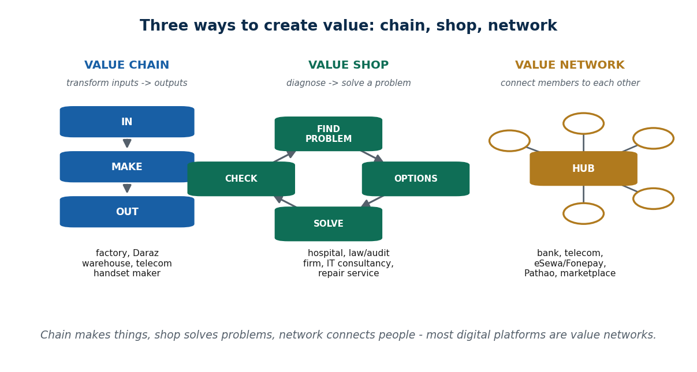

| Model | How value is created | Examples |
|---|---|---|
| **Platform / ecosystem** | Connect participants and orchestrate their interactions | TikTok, Pathao |
| **Data-driven / personalisation** | Use data to tailor services and optimise operations | TikTok, Pathao |
| **Data monetisation** | Turn insights into revenue or strategic advantage | Google Ads, Nepali e-commerce |
| **Advertising / attention** | Match users with relevant offers | Instagram, Nepali news portals |
| **Multi-stakeholder / inclusive** | Create benefit for customers, partners, employees and society | eSewa, Pathao |
| **Experience-based** | Improve convenience and the feel of using the service | TikTok, Pathao |
| **Value creation loop** | Continuous improvement through feedback and engagement | TikTok, Pathao |

### Data-driven value creation

Data is the most important asset in digital business. Platforms collect clicks, searches, location,
time spent, preferences and purchase history, and use it to **understand users**, **personalise**
(feeds, prices, recommendations), **run more efficiently** (faster matching, less waste), and
**improve continuously**.

*TikTok:* tracks watch time, scroll speed and likes → learns interests → shows more relevant content →
users stay longer → more value.
*Pathao:* uses ride data to predict demand, cut waiting time and optimise pricing. **More data →
better service → more users → more data.** That is the **value creation loop**.

### Data monetisation

**Important point:** most companies do **not** sell raw data. They monetise the **insights** from it —
through advertising, personalised offers, dynamic pricing, improved retention and new services.

*Google:* users search for free → Google learns intent → advertisers pay to reach those users → users
see relevant ads.
*Nepal:* e-commerce apps analyse buying patterns, popular products and seasonal demand, then adjust
pricing, promote products and improve inventory. **Value is created without charging the user
directly.**

### Advertising as value creation

The old view: advertising is an annoying interruption. The digital view: advertising is **value
matching**. Users see relevant offers, businesses reach interested customers, platforms earn revenue,
and services stay free or cheap.
*Instagram ads* are based on interests, follows and engagement — more useful than a random TV ad.
*Nepal:* online news portals use ads to keep content free, support journalism and connect local
businesses to readers. **Advertising becomes part of the value exchange, not just monetisation.**

### Platform orchestration

**Orchestration** means designing, managing and controlling how value is created and exchanged. The
platform decides who may join, how matching happens, pricing rules, quality standards, and incentives
and penalties.
*Uber* matches riders and drivers, sets the pricing algorithm, handles payments and enforces ratings —
**Uber does not drive cars; it orchestrates value creation.**
*Pathao* controls driver onboarding, fare calculation, ride assignment and dispute resolution.
**Good orchestration produces trust, efficiency and scale.**

### Multi-stakeholder value

Value is not only for customers. Digital firms create value for **customers** (convenience,
affordability), **partners** (income, market access), **employees** (skills, innovation) and
**society** (inclusion, efficiency).
*Digital payments in Nepal:* users get easy transactions · merchants get more customers · platforms get
data and fees · society becomes less cash-dependent.

### The value creation framework

**Inputs → Process → Outputs → Impact.**

| Stage | Contents |
|---|---|
| **Inputs** | Technology, data, capital, people |
| **Process** | Analyse needs → build solutions → personalise experiences |
| **Outputs** | Products and services, insights, improved engagement |
| **Impact** | User satisfaction, profitability, ecosystem growth |

**Worked example 1 — ride-hailing (Pathao / Uber).**
*Inputs:* mobile app, GPS, payment system; location, ride history and peak-hour data; drivers, riders,
support staff; capital for development and marketing.
*Process:* understand the need for fast, affordable transport; analyse demand and driver availability;
design real-time matching; personalise pricing and suggestions.
*Outputs:* on-demand rides; quick booking and cashless payment; insight into traffic and demand; a
connection between drivers and riders.
*Impact:* high satisfaction, repeat usage and loyalty, commission revenue, a growing transport ecosystem.

**Worked example 2 — social media (TikTok / Instagram).**
*Inputs:* AI algorithms and cloud servers; likes, watch time and comments; creators, viewers and
advertisers; platform infrastructure capital.
*Process:* understand the desire for entertainment; analyse viewing behaviour; design the
recommendation algorithm; personalise the feed.
*Outputs:* short-form video; a highly engaging feed; insight into interests and trends; a link between
creators and viewers.
*Impact:* long engagement, creator loyalty, advertising revenue, an expanding creator economy.

**Worked example 3 — digital payments (eSewa / Khalti).**
*Inputs:* a secure payment gateway; transaction history; users, merchants and partners; financial and
regulatory setup.
*Process:* understand the need for easy payment; analyse spending and usage; design a multi-service
app; personalise offers and reminders.
*Outputs:* digital payments and bill pay; fast, secure transactions; spending insights; a link between
users and merchants.
*Impact:* trust and daily usage, merchant adoption, transaction-fee revenue, a growing digital
financial ecosystem.

## 3.12 Modeling digital markets

**Why model a market?** Because digital markets are **designed systems, not accidents**. Small
decisions about pricing and incentives can shift the whole outcome, and modeling lets you test them
safely before spending money.
*Pathao* tested ride subsidies before scaling them. *Daraz* used flash sales and discounts to test
demand before a full rollout. Even a slight change in pricing can decide who dominates a market.

### Business model vs market model

| | **Business model** (static view) | **Market model** (dynamic view) |
|---|---|---|
| **Describes** | How value is offered and revenue earned | How users, prices and interactions behave **over time** |
| **Focuses on** | Product or service, target customers, revenue sources | User adoption, conversion, retention and churn, network effects |
| **Answers** | *Who pays? For what?* | *What happens when users react to prices, incentives and each other?* |
| **Spotify example** | Free music with ads; premium subscription for ad-free, offline listening | How many free users convert to paid, when users cancel, how recommendations raise usage, how a price change affects churn |

**Freemium, modelled:** the business model is "free basic, paid premium". The market-model questions
are: how many sign up for free? what percentage upgrade? when do they upgrade? how long do they stay?

### Simulation

Simulation lets you test pricing strategies, predict user reactions and visualise network effects,
answering questions like *"What if we raise the price?"*, *"What if one side leaves the platform?"*,
*"What if growth slows?"* A simulated market can show rapid growth, market collapse, or a
winner-takes-most outcome — safely, at no cost.

### Pricing as a decision model

Pricing is about **who pays, when, and how much**, and it always involves trade-offs: growth vs
revenue, adoption vs profitability, and how much friction you will accept at the point of conversion.
**Pricing is a strategic lever, not just a fee.**

| Case | Lesson |
|---|---|
| **Spotify** | Free → premium conversion is the whole model |
| **Pathao** | Ride subsidies used to grow the user base first |
| **Netflix** | Price increases communicated alongside added value (new content) produced growth despite the increase |
| **Adobe** | Moving from software licences to subscription expanded the market and made revenue predictable |
| **Gillette** | Cheap razors, ongoing revenue from blades — a classic "loss leader" entry price |

**Key insight:** effective pricing is about *learning and testing* against real market response. Many
firms adjust prices frequently.

### Dynamic pricing and algorithmic markets

**Dynamic pricing** means prices change automatically based on demand, supply, time and user behaviour,
driven by data, algorithms and real-time feedback.

| Example | How it works |
|---|---|
| **Pathao / Uber surge pricing** | Prices rise in peak hours or rain, which pulls more drivers onto the road and keeps rides available |
| **Airlines and hotels** | Prices adjust to booking patterns, events and seasonality — dynamic pricing can raise revenue by roughly 20% |
| **Amazon** | Adjusts prices many times a day based on demand, inventory and competitor prices |
| **E-commerce flash sales** | Time-limited pricing to create urgency and test demand |

Dynamic pricing maximises revenue and can reduce waiting time — and it is now available to small
sellers through pricing tools too.

### Modeling multi-sided markets

Platforms must balance several groups — users, providers, advertisers — and a central question is
**who subsidises whom**.
*Pathao:* riders want low fares, drivers want high income. Pushing too hard on either side breaks the
market. *Airbnb:* balances hosts (supply) and travellers (demand). *Foodmandu:* restaurants, riders and
customers.
*Credit cards* are the textbook case: consumers often pay nothing while merchants pay the fee.
*Adobe* made Reader free to build the user base, then monetised the paid side.
**The common pitfall to avoid: pricing both sides too high too early.** Failure on one side can
collapse the whole market.

### Winner-takes-most, modelled

Dominance comes from pricing, network effects and early adoption. Early losses can buy long-term market
power. *Pathao* dominated Nepali ride-sharing because of early incentives plus network effects.
Understanding **market tipping points** is central to strategy — and explains why smaller competitors
struggle even with a good product.

### Nepal pricing context

- **Telecom subscription debate:** providers such as Ncell have debated moving from usage-based to
  subscription pricing.
- **Price transparency problems:** Daraz and SastoDeal face trust issues around discount strategies and
  perceived prices.
- **Price competition:** SmartDoko, BhatBhateniOnline, NepBay, Mero Shopping and SastoDeal compete on
  price, deals and delivery offers.

## 3.13 Strategy in digital markets

**Strategy** is a long-term plan to **create, capture and defend value**. In digital markets it
focuses on platforms, data, ecosystems and scale — and crucially, it is **not just about beating
competitors; it is about shaping the market**.

| Traditional strategy | Digital strategy |
|---|---|
| Price, location, production | Network effects, data control, user lock-in |
| A taxi company competes on its cars | **Pathao competes on its platform, data and network** |

### From products to ecosystems

Digital firms do not just sell products; they build ecosystems of users, partners, developers and
advertisers, and value grows as the ecosystem grows.
*Amazon:* customers, sellers, logistics partners, AWS. *Pathao:* riders, drivers, restaurants,
payments. **Leaving an ecosystem is costly — that is the point of building one.**

**Ecosystem strategy** means attracting participants, keeping them engaged and making the platform hard
to leave. Its tools are **APIs, incentives, data sharing, and rules and governance**.
*Facebook:* developers build apps, businesses run ads, users create content.
*Nepal:* FonePay connects banks, merchants and users. **The platform becomes infrastructure, not just
a service.**

### Platform dominance, scalability and control points

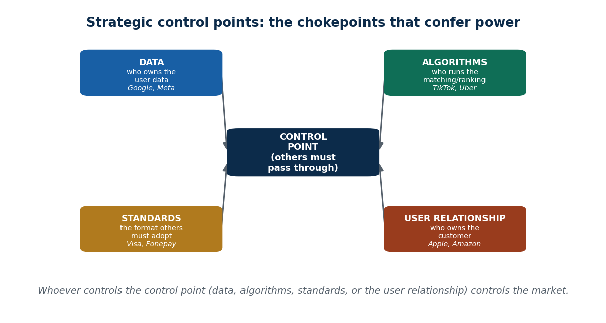

- **Dominance through network effects:** more users → more value → winner-takes-most and market
  concentration. **Early growth is a strategic weapon** — late competitors struggle. *Google Search:*
  more users → better data → better results. *Pathao:* more drivers → faster rides → more users.
- **Scalability:** digital firms grow without proportional cost because marginal cost is near zero. A
  traditional shop needs more staff and space for more customers; a digital app mostly needs servers.
  *eSewa scales nationwide faster than a bank can open branches.*
- **Strategic control points:** firms control value through **data ownership, algorithms, standards and
  the user relationship**. *TikTok controls the recommendation algorithm. Amazon controls product
  visibility. Daraz controls seller rankings.* **Whoever controls the control point controls the
  market — strategy becomes deciding who gets seen.**

### Strategic trade-offs

Every strategy costs something. Firms must balance **growth vs profitability**, **openness vs control**
and **speed vs trust**. Heavy discounting buys fast growth and low profit; high commissions raise
platform profit but drive partners away.

### Case studies

| Firm | Strategy | What to notice |
|---|---|---|
| **Amazon** | Customer obsession, low prices, fast delivery, ecosystem expansion | Tolerated early losses, decided by data, used **cross-subsidisation** — AWS profits funding retail. Strategy over short-term profit |
| **Meta (Facebook)** | User growth first, free services, ad-based revenue, data-driven targeting | *A user base and its data can be worth more than selling a product directly* |
| **Daraz (Nepal)** | Heavy discounts, logistics investment, seller ecosystem, regional scale | Builds the hardest thing to copy — delivery and seller supply |

### Risk, regulation and the Nepali context

As platforms grow, power concentrates, dominance rises and governments step in — privacy laws (GDPR),
fintech regulation in Nepal, platform accountability. Trust erosion is itself a business risk.
**Strategy evolves with the environment**, and future strategy must balance growth with responsibility.

**Local challenges:** trust and delivery reliability, price sensitivity, and competition.
**Strategy must fit the local context — it cannot be copied from abroad.**

**Opportunities for Nepali startups:** niche platforms · solving specifically local problems ·
mobile-first design · partnership-driven growth · data-informed decisions.
**Competing with global giants requires focus, not scale.**

## 3.14 Putting the unit together

Digital success never comes from one good idea. A digital business has to integrate four things, and
weakness in one weakens the whole system:

| Element | The question it answers |
|---|---|
| **Business model** | How is money made? |
| **Value creation** | Why do users care? |
| **Market structure** | How does competition work here? |
| **Strategy** | How is the advantage sustained? |

| Example | Business model | Value creation | Market structure | Strategy |
|---|---|---|---|---|
| **Pathao** | Platform + commission | Convenience, income, access | Two-sided platform | Network effects + local focus |
| **Spotify** | Freemium + subscription | Personalised music experience | Winner-takes-most | Data, recommendations, ecosystem |

**Trends shaping what comes next:** AI and automation · big data and analytics · cloud computing ·
blockchain · IoT. **AI's role in strategy** specifically: personalisation (TikTok, Netflix), dynamic
pricing, demand prediction and automated decisions — **strategy becomes data-driven rather than
intuition-driven.**

**Nepal's digital future.** *Opportunities:* fintech expansion, e-commerce logistics, gig economy
growth, local content platforms. *Challenges:* infrastructure, trust, regulation, digital literacy.

### Key words from Unit 3

Digital market · B2C, B2B, C2C, C2B, P2P · speed, scale, network effects, low marginal cost ·
winner-takes-most · platform dominance · cooperation · interoperability · API · modularity ·
standardisation · joint platform · NCHL · ConnectIPS · co-branding · shared logistics · service
integration · co-opetition · upstream cooperation / downstream competition · dependency risk · power
imbalance · innovation lock-in · layered internet model · infrastructure / platform / application layer
· value flow · structural dependency · digital innovation · product / process / business model /
service / marketing / organizational innovation · innovation ≠ invention · MVP · ideation–prototype–
scale · AR and VR · digital business model · value creation, delivery, capture · platform,
subscription, freemium, sharing, marketplace, advertising, e-commerce, ecosystem, usage-based,
experience, hybrid models · gig economy · value creation loop · data monetisation · platform
orchestration · multi-stakeholder value · inputs–process–outputs–impact · market model · simulation ·
dynamic pricing · surge pricing · subsidising a side · strategic control point · cross-subsidisation ·
ecosystem strategy.

### Summary — Unit 3

- A digital market combines technology, payments, logistics, data and support. Its four defining traits
  are **speed, scale, network effects and low marginal cost**, and it comes in B2C, B2B, C2C, C2B and
  P2P forms.
- Competition online is unequal: digital markets concentrate into **winner-takes-most** outcomes where
  timing and growth matter more than quality, which benefits consumers short-term and squeezes startups
  into niches.
- **Cooperation is strategically necessary** because technology is modular, APIs make integration easy,
  network effects need scale, and users value convenience over exclusivity. It takes the form of joint
  platforms, partnerships and service integration.
- **Co-opetition** means cooperating upstream (infrastructure, standards) and competing downstream
  (customers, pricing) — the normal state of Nepal's fintech and ride-hailing markets.
- The **layered internet model** (infrastructure → platform → application) shows that value flows
  bottom-up and that controlling a lower layer gives power over higher ones. Nepal operates almost
  entirely at the application layer.
- **Digital innovation** is applying technology to solve real problems. It is continuous, it is not the
  same as adopting technology, and it is not invention. Six types: product, process, business model,
  service, marketing, organizational.
- **Digital business models** describe how value is created, delivered and captured: platform,
  subscription, freemium, sharing, marketplace, advertising, e-commerce, ecosystem, usage-based,
  experience and hybrid.
- **Value creation** in digital business happens through interactions, data and experiences, follows
  the **inputs → process → outputs → impact** framework, and is sustained by the **value creation
  loop**.
- **Modeling** separates the static business model from the dynamic market model, and uses pricing,
  subsidies and simulation to predict adoption, conversion, churn and tipping.
- **Digital strategy** is ecosystem-driven: control the data, the algorithm, the standards and the user
  relationship; balance growth against profit; and shape the market rather than merely compete in it.

<!-- question-bank:unit3:begin -->
## 3.T Test yourself — Unit 3

Work through the questions first and keep the answer key covered. Parts A and B have fixed answers, given at the end of this section; Parts C to E are the open questions that carry the most marks in an exam, so practise writing them out in full.

### Part A — Multiple choice

**A1.** Which is NOT one of the four characteristics of a digital market?

  *a)* speed  ·  *b)* scale  ·  *c)* high marginal cost per user  ·  *d)* network effects

**A2.** Ordinary people buying and selling used phones to each other on Hamrobazar is:

  *a)* B2C  ·  *b)* C2C (consumer-to-consumer)  ·  *c)* B2B  ·  *d)* C2B

**A3.** Compared with a bazaar, digital competition is mainly fought on:

  *a)* rent & smiles  ·  *b)* data, network size, speed & user experience  ·  *c)* shop location  ·  *d)* shouting

**A4.** Ride-hailing in Nepal stays contested (Pathao + InDrive) mainly because:

  *a)* weak apps  ·  *b)* easy multi-homing & local needs  ·  *c)* no network effects at all  ·  *d)* government rule

**A5.** Nepali banks jointly building and funding ConnectIPS is cooperation via:

  *a)* a price war  ·  *b)* a joint platform (shared rails)  ·  *c)* an acquisition  ·  *d)* advertising

**A6.** 'Grow the pie first, then compete for slices' means:

  *a)* never compete  ·  *b)* enlarge the whole market together before fighting for share  ·  *c)* merge  ·  *d)* cut prices

**A7.** Co-opetition typically means firms:

  *a)* compete on everything  ·  *b)* cooperate on everything  ·  *c)* merge  ·  *d)* cooperate upstream (tech/rails) and compete downstream (customers)

**A8.** A key RISK of co-opetition for a small firm is:

  *a)* lower costs  ·  *b)* dependency & power imbalance vs the larger partner  ·  *c)* more customers  ·  *d)* faster innovation

**A9.** Cloud, data centres, connectivity and devices belong to which layer?

  *a)* application  ·  *b)* infrastructure  ·  *c)* user  ·  *d)* payment

**A10.** 'Control of a lower layer gives power over higher layers' is shown by:

  *a)* users choosing apps  ·  *b)* an app store taking a ~30% cut from every app  ·  *c)* fast internet  ·  *d)* free apps

**A11.** 'Innovation is not invention' means innovation is about:

  *a)* creating value people use from an idea, not just inventing the tech  ·  *b)* patents only  ·  *c)* pure lab research  ·  *d)* copying rivals

**A12.** A cheaper, 'good-enough' newcomer that enters low and rises to overtake incumbents is:

  *a)* sustaining innovation  ·  *b)* disruptive innovation  ·  *c)* invention  ·  *d)* marketing innovation

**A13.** Netflix charging a flat monthly fee for access is which model?

  *a)* freemium  ·  *b)* marketplace  ·  *c)* subscription  ·  *d)* advertising

**A14.** Google giving search free and earning from ads is capturing value via:

  *a)* subscription  ·  *b)* advertising (selling user attention)  ·  *c)* e-commerce  ·  *d)* usage fees

**A15.** A hospital or IT consultancy that diagnoses and solves a client's problem is a:

  *a)* value chain  ·  *b)* value shop  ·  *c)* value network  ·  *d)* value pipe

**A16.** A business model and a value-creation model differ in that the business model answers:

  *a)* how value is generated  ·  *b)* how you EARN money (capture)  ·  *c)* the logo  ·  *d)* the tax rate

**A17.** A business model describes how you EARN; a market model describes:

  *a)* the logo  ·  *b)* the office  ·  *c)* how the market behaves over time (adoption, churn, tipping)  ·  *d)* the tax rate

**A18.** Pathao raising fares automatically at peak demand is:

  *a)* freemium  ·  *b)* a subsidy  ·  *c)* loss-leader  ·  *d)* dynamic (surge) pricing

**A19.** Controlling the data, algorithms, or standards others must pass through is holding a:

  *a)* strategic control point  ·  *b)* a patent  ·  *c)* a subsidy  ·  *d)* a pipe

**A20.** For most Nepali startups facing global giants, the wisest strategy is usually:

  *a)* out-spend them on scale  ·  *b)* focus on a niche and fit local context  ·  *c)* copy them exactly  ·  *d)* avoid digital

### Part B — Unit review

The whole unit in one pass.

**B1.** A defining characteristic of a digital market is

  *a)* high marginal cost per user  ·  *b)* near-zero marginal cost & network effects  ·  *c)* fixed local reach  ·  *d)* slow price changes

**B2.** 'Winner-take-most' means

  *a)* all firms share equally  ·  *b)* the newest firm wins  ·  *c)* the leading platform captures the bulk of the market  ·  *d)* government picks the winner

**B3.** Two banks jointly running ConnectIPS is cooperation via

  *a)* a joint platform  ·  *b)* a price war  ·  *c)* an acquisition  ·  *d)* advertising

**B4.** Co-opetition typically means firms

  *a)* compete on everything  ·  *b)* cooperate on everything  ·  *c)* merge  ·  *d)* cooperate upstream (tech) & compete downstream (customers)

**B5.** Cloud, data-centres & connectivity belong to which layer?

  *a)* application  ·  *b)* infrastructure  ·  *c)* user  ·  *d)* payment

**B6.** 'Innovation is not invention' means innovation is about

  *a)* creating value people use, not just inventing tech  ·  *b)* patents only  ·  *c)* pure research  ·  *d)* copying

**B7.** A cheap, 'good-enough' entrant that rises to overtake incumbents is

  *a)* sustaining innovation  ·  *b)* disruptive innovation  ·  *c)* invention  ·  *d)* marketing innovation

**B8.** Netflix charging a flat monthly fee is which business model?

  *a)* freemium  ·  *b)* marketplace  ·  *c)* subscription  ·  *d)* advertising

**B9.** A hospital or consultancy that diagnoses & solves a problem is a

  *a)* value chain  ·  *b)* value shop  ·  *c)* value network  ·  *d)* value pipe

**B10.** A business model shows how you EARN; a market model shows

  *a)* the logo  ·  *b)* the office  ·  *c)* how the market behaves over time (adoption, churn, tipping)  ·  *d)* the tax rate

**B11.** Pathao raising fares automatically at peak demand is

  *a)* freemium  ·  *b)* a subsidy  ·  *c)* loss-leader  ·  *d)* dynamic (surge) pricing

**B12.** Controlling data/algorithms/standards others must pass through is holding a

  *a)* strategic control point  ·  *b)* a patent  ·  *c)* a subsidy  ·  *d)* a pipe

### Part C — Short answer

**C1.** Define co-opetition and give a Nepali example.

**C2.** Name the 3 internet layers and the direction value flows.

**C3.** Name 3 digital business-model types.

**C4.** Explain value chain vs value shop vs value network.

**C5.** What is a strategic control point? Name two.

### Part D — Applied case

**D1.** Map Pathao across ALL FOUR dimensions: value creation · business model · market model · strategy (the integration question).

**D2.** Explain a Nepali co-opetition case (eSewa + Nabil, or Daraz + Pathao): what is shared upstream, what is competed downstream?

### Part E — Discussion

**E1.** Is Pathao's dominance good for Nepal? Should digital platforms be regulated? Can Nepali startups compete — focus or scale?

**E2.** Pick a Nepali platform — name its type and its weakest of the 5 components.

**E3.** Name a Nepali market that tipped and one that stayed contested — why?

**E4.** Name a Nepali cooperation and its form (joint platform / partnership / integration).

**E5.** Name a Nepali co-opetition and split its upstream cooperation vs downstream competition.

**E6.** For a Nepali service, which layers are local and which foreign — where's the power?

**E7.** Name a Nepali innovation — its type, and whether it is sustaining or disruptive.

**E8.** Name a Nepali hybrid firm and the two-plus models it combines.

**E9.** Classify a Nepali firm as chain/shop/network and name its business model.

**E10.** For a Nepali platform, name its market-model variables and one pricing lever.

**E11.** Map any Nepali platform across value creation, business model, market model, strategy.

### Answers — Unit 3

| # | Answer | Why |
|---|---|---|
| **A1** | **c)** high marginal cost per user | Digital markets have LOW (near-zero) marginal cost — the opposite of high. |
| **A2** | **b)** C2C (consumer-to-consumer) | Both sides are consumers; the platform only provides the meeting place and trust. |
| **A3** | **b)** data, network size, speed & user experience | Online the basis shifts from price/location to data, network, speed, and UX — often global. |
| **A4** | **b)** easy multi-homing & local needs | Drivers/riders run both apps and needs are local, so the market does not tip to one. |
| **A5** | **b)** a joint platform (shared rails) | Rivals share common payment infrastructure none would build alone — a joint platform. |
| **A6** | **b)** enlarge the whole market together before fighting for share | Cooperation expands total demand first; firms compete for share of the bigger market after. |
| **A7** | **d)** cooperate upstream (tech/rails) and compete downstream (customers) | Shared infrastructure/standards upstream; competition for customers and brand downstream. |
| **A8** | **b)** dependency & power imbalance vs the larger partner | Relying on a rival's rails creates dependency; the bigger partner can set terms. |
| **A9** | **b)** infrastructure | Infrastructure is the technical base — networks, data centres, devices, cloud. |
| **A10** | **b)** an app store taking a ~30% cut from every app | The platform (app store) beneath the app sets terms the app must accept — power flows down. |
| **A11** | **a)** creating value people use from an idea, not just inventing the tech | Invention creates a technology; innovation turns it into value people actually use. |
| **A12** | **b)** disruptive innovation | Disruptive innovation enters at the low end and climbs to displace better, pricier incumbents. |
| **A13** | **c)** subscription | A recurring fee for ongoing access is the subscription model. |
| **A14** | **b)** advertising (selling user attention) | The advertising model gives the service free and monetises attention/data — Unit 2's money side. |
| **A15** | **b)** value shop | The value shop creates value by solving a unique problem, iteratively — not by production or connection. |
| **A16** | **b)** how you EARN money (capture) | Value creation = how value is generated; business model = how that value is captured as revenue. |
| **A17** | **c)** how the market behaves over time (adoption, churn, tipping) | The market model is dynamic — acquisition, conversion, retention, churn, and tipping over time. |
| **A18** | **d)** dynamic (surge) pricing | Prices auto-adjust to demand/time — dynamic/algorithmic (surge) pricing. |
| **A19** | **a)** strategic control point | A control point is a chokepoint others must pass through — it defends value and confers power. |
| **A20** | **b)** focus on a niche and fit local context | Small players can't win a spending war; 'focus, not scale' wins a niche giants underprioritise. |

| # | Answer |
|---|---|
| **B1** | **b)** near-zero marginal cost & network effects |
| **B2** | **c)** the leading platform captures the bulk of the market |
| **B3** | **a)** a joint platform |
| **B4** | **d)** cooperate upstream (tech) & compete downstream (customers) |
| **B5** | **b)** infrastructure |
| **B6** | **a)** creating value people use, not just inventing tech |
| **B7** | **b)** disruptive innovation |
| **B8** | **c)** subscription |
| **B9** | **b)** value shop |
| **B10** | **c)** how the market behaves over time (adoption, churn, tipping) |
| **B11** | **d)** dynamic (surge) pricing |
| **B12** | **a)** strategic control point |

<!-- question-bank:unit3:end -->

---

# Unit 4 — Digital Transformation

**8 lecture hours.** Digital transformation: concepts and drivers · accelerating SDGs through digital
transformation · role of the technological revolution in the world economy · globalization and
economic growth in the digital age · digital currencies: concepts and types.

## 4.1 What digital transformation is

**Definition:** **digital transformation (DT)** is using digital technology to **fundamentally change
how an organisation works and delivers value**.

It touches three things: business **processes**, business **models**, and the **customer experience**.
And it is not only about technology — it is equally about strategy and culture.

> **The one-line idea:** *doing things differently using digital technology.*

### Four everyday examples

| Setting | Before | After |
|---|---|---|
| **School** | Teacher writes on the blackboard, students copy, homework checked by hand | Projector or smart board, notes shared on Google Classroom, homework submitted online |
| **Grocery shop** | You go to the shop, ask the shopkeeper, pay cash | You order on an app, pay by QR or wallet, items are delivered |
| **Food** | Go to the restaurant, wait, pay at the counter | Order on an app, track the order, food arrives at home |
| **Games** | Ludo and board games, played in person | Online games with friends in other cities, progress saved digitally |

In each case the activity is the same — the *way* it happens is completely different. That is the test
for transformation.

## 4.2 Digitization vs digitalization vs digital transformation

This is the most frequently asked distinction in Unit 4.

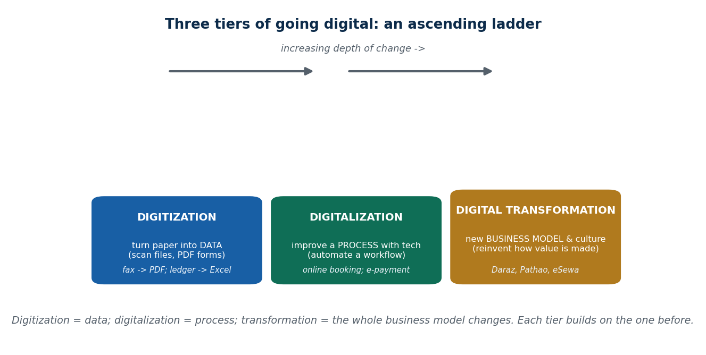

| | **Digitization** | **Digitalization** | **Digital transformation** |
|---|---|---|---|
| **What it does** | Converts analog information into digital form | Uses technology to improve existing processes | Rethinks processes and the business model completely |
| **Focus** | Data | Efficiency / process | Innovation and value creation |
| **Scope** | Narrow | Medium | Broad |
| **Impact** | Low | Moderate | High |
| **Does the process change?** | No | Mostly not | Yes, fundamentally |
| **Examples** | Scanning paper documents into PDFs; converting handwritten records into Excel; government offices scanning land records | Online forms instead of paper forms; email instead of postal letters | Ride-hailing apps replacing traditional taxis; online education platforms replacing physical classrooms |
| **One-word summary** | **Data** becomes digital | **Process** improves | **Business** changes |

**The path most organisations take:** manual systems → computerised systems (ledgers → Excel) →
standalone software → internet-based systems → digital platforms. *Example:* traditional bank →
online banking → mobile banking app.

## 4.3 Why digital transformation matters

- **Rising customer expectations** — people expect instant, easy, trackable service.
- **Global competition** — rivals may be anywhere.
- **Cost efficiency** — automation and digital channels cut costs.
- **Innovation and growth** — new models become possible.
- **Survival** — *organisations that do not transform risk becoming irrelevant.*

**Where you can see it:** banking (mobile banking, QR payments) · education (online classes, learning
management systems) · government (e-governance). **In Nepal:** eSewa, Khalti, online exam forms, the
Nagarik App.

### Four companies that failed to transform

| Company | What happened | Result | Lesson |
|---|---|---|---|
| **Kodak** (photography) | Actually invented the digital camera, but kept selling film and ignored the shift | Lost the market to Canon, Nikon and then smartphone cameras | Ignoring digital change can destroy even a giant |
| **Nokia** (mobile phones) | Dominated phones but ignored smartphones and app ecosystems | Lost leadership to Apple and Samsung | Not innovating with technology makes you irrelevant |
| **Yahoo** (internet services) | Did not innovate against Google and Facebook; missed search, social and mobile | Lost relevance; sold off parts of the company | Even technology companies must keep transforming |
| **Toys "R" Us** (retail) | Never built a strong online presence | Bankrupt in 2017; Amazon and Walmart took the market | Retail cannot survive without digital transformation |

**Digital transformation is also the foundation of the digital economy** — it is what makes platform
businesses, digital payments and global digital services possible, and it shifts the source of value
to data, networks and technology.

> **A question worth thinking about:** is Facebook an example of digitalization or digital
> transformation? (It changed how socialising, advertising and news distribution work entirely — so it
> is transformation, not merely a digital version of something older.)

## 4.4 Drivers of digital transformation

A **driver** is a force that pushes an organisation to change. Transformation never happens randomly.

> **Simple way to see it:** you use a calculator instead of doing sums by hand because it is faster
> and easier. Businesses adopt digital technology for exactly the same kind of reason — pressure.

### Technological drivers

Technology makes transformation possible in the first place.

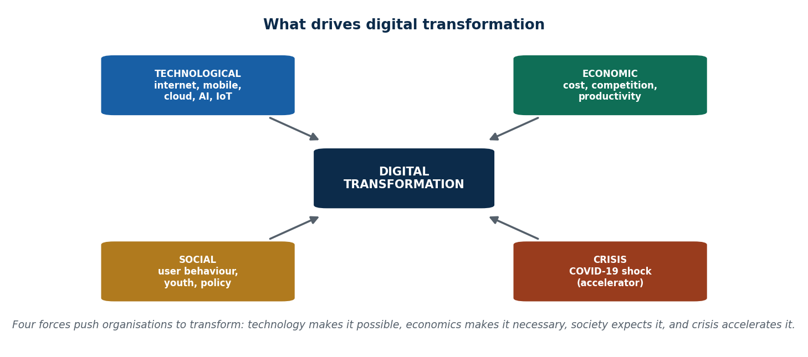

| Technology | What it allows | Example |
|---|---|---|
| **Internet** | Reach customers anywhere | Online shopping, Netflix |
| **Mobile** | Access services anytime from a phone | Paying bills, booking a taxi |
| **Cloud computing** | Store and process data online instead of on paper or local servers | Google Drive, Zoom |
| **Big data** | Understand what customers like | Spotify and Amazon recommendations |
| **Artificial intelligence** | Make smart decisions automatically | Chatbots, Netflix suggestions |
| **IoT** | Connect devices to apps | Smartwatches, smart home devices |

### Economic drivers

Money and competition push change.

| Driver | Explanation | Example |
|---|---|---|
| **Cost reduction** | Automation saves money and manual effort | Online payroll instead of paper salary slips; cloud servers instead of owned hardware |
| **Competition** | Stay ahead or lose customers | Traditional taxis vs Uber and Pathao |
| **Productivity** | Do more work in less time | Automated inventory systems |
| **Global market** | Sell beyond your own town | Nepali crafts sold online worldwide |
| **Flexible business models** | Change how the product is offered | Netflix's subscription model |
| **Operational efficiency** | Faster, smarter operations | AI in warehouses |

### Social drivers

People's behaviour and government rules shape transformation.

| Driver | Explanation | Example |
|---|---|---|
| **Changing customer behaviour** | People want fast, easy, online service | Food delivery apps like Foodmandu |
| **Mobile payments** | Cashless and convenient transactions | eSewa, Khalti |
| **Online learning** | Study from anywhere | Zoom, Google Classroom |
| **Social media influence** | Businesses reach customers where they already are | Instagram and Facebook shops |
| **Work from home** | Remote work becomes normal | Teams, Slack |
| **Government and policy** | Governments actively encourage digital services | Nepal's e-Governance portals: submit forms online instead of queuing |

### COVID-19 as an accelerator

The pandemic forced businesses to go digital in weeks rather than years. **Crisis speeds up digital
adoption.**

| Area | What changed |
|---|---|
| Education | Schools moved online with Zoom and Google Classroom |
| Payments | eSewa and Khalti used to avoid handling cash |
| Shopping | People bought groceries on Daraz and SastoDeal |
| Healthcare | Telemedicine and online doctor consultations |
| Entertainment | Netflix, YouTube, TikTok at home |
| Work | Offices shifted to Teams and Slack |

**Summary of forces:** **technology** (internet, mobile, cloud, AI) · **economics** (cost,
competition) · **society** (customer behaviour, government policy) · **external shocks** (COVID-19).

## 4.5 Accelerating the SDGs through digital transformation

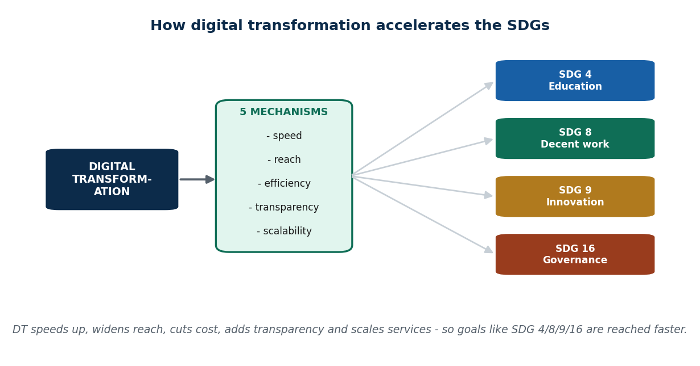

### What the SDGs are

The **Sustainable Development Goals (SDGs)** are **17 goals adopted by the United Nations in 2015**,
aiming for a better and more sustainable world **by 2030**. This course focuses on four of them.

**Why link DT and the SDGs?** Digital technology speeds up development: it reaches remote populations,
improves efficiency and increases transparency. *Example:* online learning lets students in rural
areas access quality teaching. *Nepal:* COVID-19 forced the adoption of online education and digital
government services, which pushed several SDGs forward at once.

### The four SDGs in focus

| SDG | Goal | What digital transformation does | Nepal examples | Impact |
|---|---|---|---|---|
| **SDG 4 — Quality Education** | Inclusive, equitable quality education | Online learning platforms, learning management systems, video lectures, e-books | HamroPathshala, online exams, LMS use | Education reaches remote areas; personalised learning; cheaper and scalable |
| **SDG 8 — Decent Work and Economic Growth** | Sustainable growth and decent employment | Freelancing platforms, e-commerce, digital payments supporting entrepreneurship | Upwork and Fiverr for Nepali youth; Daraz, Pathao, Foodmandu; eSewa and Khalti | New jobs; small businesses grow digitally; financial inclusion. **Pathao creates gig-economy work for drivers and delivery riders** |
| **SDG 9 — Industry, Innovation and Infrastructure** | Resilient infrastructure, sustainable industry, innovation | Cloud computing, AI and automation in business; incubators and innovation hubs | eSewa, Pathao, Daraz; Nepal Communitere incubator | Tech-based entrepreneurship; higher industrial productivity; new business models. *Digital tech → innovation → growth → SDG 9* |
| **SDG 16 — Peace, Justice and Strong Institutions** | Accountable, transparent, inclusive institutions | E-governance portals, online tax filing, public data dashboards | Nagarik App; revenue filing through the Inland Revenue Department | Less corruption; more transparency and accountability; faster public services |

### ICT for Development (ICT4D)

**Definition:** using Information and Communication Technology to advance **social and economic
development**.

**Focus areas:** education, healthcare, governance, agriculture, entrepreneurship.
**Benefits:** inclusion of marginalised groups · more efficient use of resources · better monitoring
and reporting.
**Examples:** mobile banking for financial inclusion · telemedicine in remote villages · digital
agricultural advisory services. **In Nepal:** eSewa and Khalti, mobile health apps, agriculture apps
such as KrishiGyan.

> **ICT4D is the bridge between technology and development.**

### How DT accelerates development, and what blocks it

| How it accelerates | What blocks it |
|---|---|
| **Speed** — faster service delivery | **Digital divide** — urban vs rural, rich vs poor |
| **Reach** — includes remote and marginalised people | **Limited ICT skills** |
| **Efficiency** — lower cost, faster processes | **Infrastructure** — electricity and internet |
| **Transparency** — less corruption and fewer errors | **Data privacy and cybersecurity risks** |
| **Scalability** — a working solution can expand easily | **Policy and regulatory hurdles** |

**Quick self-check answers.** *A Nepali example of DT affecting SDG 4:* e-learning and online classes
during COVID-19 let students in remote areas keep studying. *How digital payment supports SDG 8:*
payments become faster, safer and more reliable, which encourages entrepreneurship, increases trade
and strengthens the economy. *Which SDG benefits most from ICT4D in Nepal:* SDG 9, because ICT4D
enables innovative startups, tech-based industry and resilient infrastructure, producing long-term
growth.

## 4.6 Technological revolution and the world economy

**Definition:** a **technological revolution** is a period of rapid technological change that
transforms industries, societies and economies.

**Characteristics:** new technologies appear · they are adopted rapidly · they have major social,
economic and industrial impact.

> **The pattern, in one line:** *new technology arrives → the old way disappears → a new way of life
> begins.* Mobile phones arrived and landlines vanished. The internet arrived and cyber cafés emptied.

### The four revolutions and their effects

| Revolution | Period | Technologies | Economic impact |
|---|---|---|---|
| **First** | 1760–1840 | Steam engines, mechanised production | Factories, urbanisation |
| **Second** | 1870–1914 | Electricity, assembly lines, telegraph | Mass production, faster communication |
| **Third** | 1960s–2000s | Computers, internet, automation | Knowledge economy, IT services |
| **Fourth (4IR)** | 2000s–present | AI, IoT, robotics and automation, blockchain and digital currencies, 3D printing and nanotechnology | New business models, changed labour markets, changed social structures |

**4IR in one formula:** *Digital + AI + IoT + Automation.*
**Its four characteristics:** **speed** (faster adoption than ever before) · **scope** (crosses
industries, societies and countries) · **impact** (business models, labour markets, social structures)
· **integration** (physical, digital and biological systems merge).

### Global impact of technological revolutions

Increased productivity and efficiency · new industries and jobs · disruption of traditional industries
· integrated global supply chains · innovation-driven growth.
*Examples:* Uber and Airbnb disrupting transport and hospitality; Amazon disrupting retail worldwide.

**The link to transformation:** technological revolutions **enable** digital transformation, and
digital transformation is the application of 4IR technologies to innovate — AI in banking (chatbots,
fraud detection), IoT in manufacturing (smart factories), blockchain in supply chains (global product
tracking).

### Effect on the world economy and labour

**The digital economy and global GDP:** faster growth in IT-enabled sectors · the platform economy
(Uber, Airbnb, Alibaba) · digital trade in cross-border services and e-commerce.

**Labour market effects:** automation replaces repetitive tasks, producing a **skill shift** · demand
for digital skills rises · the gig economy and freelancing grow globally.

| Jobs that disappear | Jobs that appear |
|---|---|
| Typist | App developer |
| Telephone operator | Digital marketer |
| Routine clerical work | Freelancer, data analyst, cloud and cybersecurity specialist |

*Nepal:* Upwork and Fiverr provide work for young people.

**Startups and innovation:** technological revolutions encourage startups through rapid prototyping
and global reach. *Nepal:* eSewa, Pathao, Daraz Nepal, HamroPathshala — producing an innovation
ecosystem, growth and employment.

**Platform economy:** platforms use network effects, reduce transaction costs and connect users
globally. *Nepal:* Pathao connects drivers to passengers; Daraz connects sellers to buyers.

### Sector-wise impact

| Sector | Technology impact | Nepal example |
|---|---|---|
| Education | Online learning, LMS | HamroPathshala |
| Banking | Mobile banking, QR payments | eSewa, Khalti |
| Transportation | Ride-hailing, live tracking | Pathao |
| Healthcare | Telemedicine | mHealth apps |

**Challenges:** job displacement from automation · the digital divide between urban and rural ·
data privacy and cybersecurity risks · regulatory and policy gaps.

**Nepal's position:** rapid adoption of mobile phones, internet and digital payments · a startup
ecosystem supported by private and government initiatives · digital platforms creating youth
employment and financial inclusion (Nagarik App for e-governance, Pathao for gig work).
**Future trends:** AI-driven business decisions · blockchain for secure transactions and supply chains
· smart cities and IoT infrastructure · in Nepal, gradual adoption in banking, health and transport.

## 4.7 Globalization in the digital age

**Globalization** is the growing interconnection and interdependence of countries through trade in
goods and services, flows of capital and investment, movement of people, and exchange of information
and culture.

> **One phone, four countries:** designed in the USA, manufactured in China, software written in
> India, sold in Nepal.

### Traditional vs digital globalization

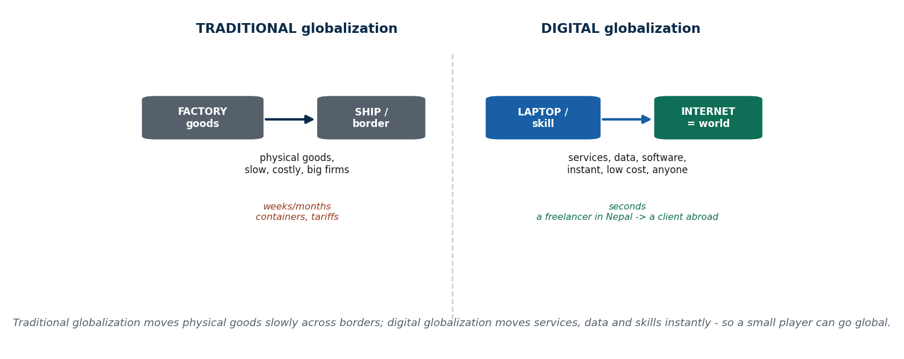

**Traditional globalization** depended on physical goods, transport (ships, trucks, planes),
face-to-face business, high cost and long timescales. *Example:* Nepal exporting carpets — long
shipping, customs, physical delivery.

**Digital globalization** is globalization driven by the internet, cloud computing, mobile technology
and digital platforms. It moves **data, services, knowledge and digital products** instead of physical
goods.

| Traditional | Digital |
|---|---|
| Goods-based | Data and service-based |
| Slow | Fast |
| High cost | Low cost |
| Physical movement | Virtual movement |
| Limited participation | Global access |

### E-commerce and digital trade

**E-commerce** is buying and selling goods and services online: **B2C** (Amazon, Daraz), **B2B**, and
**C2C**. *Example:* ordering clothes from Daraz Nepal on a phone.

**Digital trade** is wider: online services (software, design, consulting), digital products (apps,
games, e-books) and cross-border data flows. **It requires no physical delivery at all.** *Example:* a
Nepali designer emailing a logo to a client in the USA.

### Platforms and multinational digital firms

**Digital platforms** — Amazon, Google, Facebook, Upwork, Fiverr — connect buyers and sellers
worldwide, reduce barriers, give global market access and enable digital payments.

**Multinational digital firms** — Google, Meta, Microsoft, Amazon, Apple — operate globally using
technology, and **do not need a factory in every country**. They shape globalization by controlling
global data flows, knowing user preferences everywhere, providing the tools people use to store and
share, selling access through advertising, and making many products work together. *Example:*
businesses in Nepal use Google Ads to reach customers abroad.

### What this means for a developing country

| Opportunities | Risks and challenges |
|---|---|
| Access to global markets | **Digital divide** — unequal internet access |
| Sell your work worldwide | Job displacement from automation |
| Find digital jobs | Data privacy issues |
| Start small without large capital | **Dependence on foreign platforms** |
| Work from anywhere | Local businesses competing with global giants like Amazon |

> **The key idea:** *you do not need a factory — only skills and an internet connection.*

### Nepal in digital globalization

Nepal participates through **freelancing**, **IT outsourcing**, **online content creation** and
**digital payments** (eSewa, Khalti). The important shift: **Nepal is moving from being a consumer of
digital services to being a provider of them.**

**Freelancing:** popular areas are graphic design, web and app development, content writing and
digital marketing, on platforms like Upwork, Fiverr and Freelancer. A Nepali student can earn in US
dollars from home.
**Outsourcing and IT services:** Nepal supplies software development, data entry and support, and QA
testing — bringing foreign income, skill development and employment.
**For BIM graduates specifically:** roles as business analysts, digital entrepreneurs, IT project
managers, and data and information managers. **Digital globalization is a career opportunity.**

> **Simple case.** A Nepali startup builds a mobile app → uploads it to Google Play → users download
> it worldwide → revenue arrives digitally. No shipping. No shop. Global reach.

## 4.8 Digital transformation and economic growth

**Economic growth** means a country earning more over time — more jobs, more businesses, higher
income. If Nepal earns more this year than last year, Nepal is growing. *Examples:* tourism earning
more in 2025 than 2024; IT exports rising as more freelancers join global platforms.

**The digital economy** means earning through digital technology: internet businesses, apps and
software, online services, digital payments (Daraz, eSewa, Khalti, freelancing platforms).

**GDP** is the total value of goods and services a country produces. The digital economy raises GDP by
creating new businesses, making work faster and cheaper, and connecting Nepal to global markets.
*Examples:* freelancers earning dollars add to GDP; a Nepali SaaS company selling software abroad
brings in foreign income; eSewa QR payments bring more transactions into the formal, measurable
economy.

### What growth actually depends on

| Factor | Why it matters | Nepal example |
|---|---|---|
| **Digital infrastructure** | The roads of the digital world: internet and broadband, data centres, mobile networks. **No internet, no digital economy** | Slow internet means no freelancing and no startups |
| **Role of government** | Government is the referee: it builds infrastructure, writes rules and supports startups | Digital Nepal Framework; online business registration; subsidised internet in schools |
| **Low marginal cost** | The first copy is expensive, every extra copy is almost free, so businesses can sell to millions, profits rise quickly and prices fall | A Nepali game app, free to download, earning from global ads; an online course with no extra cost per student; a YouTube video reaching millions |
| **Network effects** | More users → more value → platforms grow fast and markets go global, and the winner becomes very large | eSewa: more users → more merchants → more transactions. Tootle: more drivers attract more passengers |
| **Innovation** | Ideas spread and get tested faster; decisions become data-driven; products can be improved cheaply; opportunities appear that did not exist | Food delivery apps saving time; agri apps letting farmers sell at market price; EdTech serving remote areas |
| **Skills and human capital** | Skills are the fuel: programming, data analysis, digital marketing, information management. **No skills, no digital growth** | Coding builds apps like Tootle and Pathao; digital marketing promotes Daraz shops; analytics tracks sales trends |
| **Digital financial systems** | Mobile banking, wallets and QR payments make the economy move faster | eSewa and Khalti; online stores collecting payment instantly; freelancers receiving USD through Payoneer or Wise |
| **Entrepreneurship and startups** | Digital tools let people start with little money, sell online and reach global customers | Tootle (ride-sharing), Pathao (rides + food), a Nepali SaaS startup selling worldwide |
| **Platform businesses** | Platforms connect people and grow fast on network effects | Daraz (buyers and sellers), Upwork (freelancers and clients), eSewa (users and merchants) |
| **Trust, security and regulation** | People only participate if they feel safe; rules keep competition fair | OTP and password on payments; consumer-protection rules for e-commerce; cyber law against fraud |

**How startups and platforms boost growth:** they create jobs, increase competition, improve services
and attract foreign money. *Example:* ride-sharing platforms cut travel time and create work.

**Sector productivity:** digital transformation raises productivity in education (online learning),
health (telemedicine) and agriculture (agri apps). **Better productivity means economic growth.**

### The digital divide

**Digital divide** means some people have internet access and digital skills and others do not.
**Causes:** poor connectivity, low digital skills, high device cost.
**Risk:** growth becomes unequal — urban areas grow faster while rural areas are left behind.

### The simple economic chain to remember

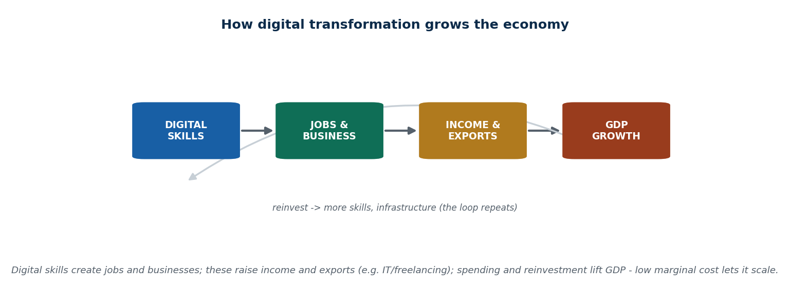

> **Digital skills → digital jobs → income → higher GDP → economic growth.**

*Example:* coding skills → build an app → the app is used globally → money comes in.
**For Nepal specifically:** digital transformation increases freelancing income, supports startups and
improves productivity. **Digitalization is growth without factories.**

## 4.9 Digital currencies

### What money is, and how it evolved

Money is used to buy things, store value, measure prices and settle debts. Examples: cash, coins, a
bank balance.

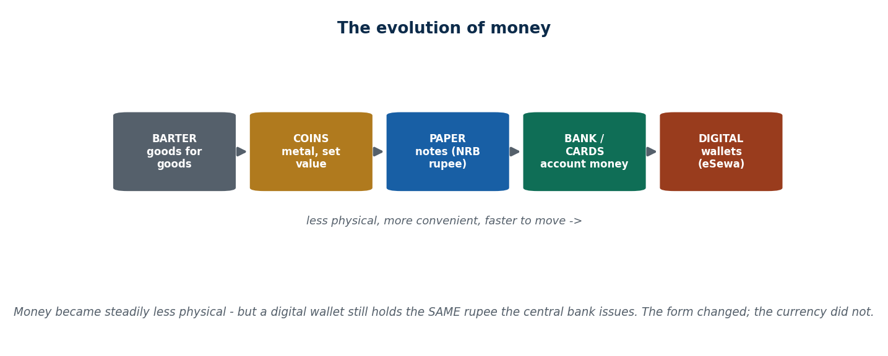

**Evolution:** **barter** (goods traded directly for goods, depending on both people wanting what the
other has) → **coins** → **paper money** → **bank money** (ATM, cards) → **digital currency**.

### What a digital currency is

**Definition:** money that exists **only in electronic form** — no physical notes or coins, stored and
transferred digitally, using the internet and computers.

> *You cannot put it in your pocket, but you can put it in your phone.*

**Examples:** mobile wallet balance, online payment balance, in-app virtual money. In Nepal: an eSewa
or Khalti balance.

| Physical money | Digital currency |
|---|---|
| You can touch it | You cannot touch it |
| Paper or coin | Electronic |
| Easy to lose | Protected by a password |
| Works offline | Needs technology |

*Cash is like a printed book; digital currency is like an e-book.*

**Why digital currency emerged:** the growth of the internet · the need for faster payments · the rise
of online business · global transactions. *Old money was too slow for the digital world.*

| Problem with traditional money | How digital currency answers it |
|---|---|
| Carrying cash is risky | Nothing physical to steal |
| International transfers take days | Instant transfer |
| High transaction cost | Lower cost |
| Limited banking access | Available 24/7, easy to track |

**How it works:** 1) the user has a digital wallet → 2) the wallet stores a digital balance → 3) the
payment is sent over a network → 4) the receiver's balance increases. *Like sending a message, but
with money.*

**Technologies involved:** internet · mobile devices · encryption · databases or blockchain.
**Key characteristics:** digital form only · requires technology · secured by encryption · traceable
transactions.
**Where trust comes from:** the security of the technology, the institutions behind it (banks,
government) and transparent systems.

**Link to the digital economy:** it supports e-commerce (online businesses can accept payment),
enables online services (streaming, rides, food, courses) and encourages a cashless society.
**Risks:** cybercrime, hacking, low digital literacy, system failure.
**Daily uses:** paying bills, online shopping, sending money, government services.

### The crucial distinction: digital money vs digital currency

**eSewa balance is digital money, but it is NOT a digital currency.** This is a favourite exam point.

The reasoning: money in eSewa is not new money. It is still the Nepali Rupee. NPR is issued by Nepal
Rastra Bank, you deposit NPR into a bank, and eSewa only stores and transfers that NPR electronically.
**eSewa is a digital storage and transfer system, not a creator of currency.** If it cannot create
money, it is not a currency.

> An online PDF of a book is not a new book. A digital photo of your citizenship is not a new
> citizenship. Same thing, different form. Scanning a paper document does not make it a digital-born
> document.

| | **Digital money** | **Digital currency** |
|---|---|---|
| What it is | An existing national currency, just in electronic form | A new form of money with its own system |
| Who controls it | The central bank | The network, or a government (depending on type) |
| Examples | NPR inside eSewa or a bank app | Bitcoin, CBDC |

| Question | eSewa money | Cryptocurrency |
|---|---|---|
| Issued by | Nepal Rastra Bank | No one |
| Controlled by | Government | The network |
| Uses blockchain | No | Yes |
| Legal tender | Yes | No (in Nepal) |
| Value | Fixed (NPR) | Changes daily |

**Remember:** all cryptocurrency is digital, and all digital currency is digital — **but not all
digital money is digital currency.**

### The three types of digital currency

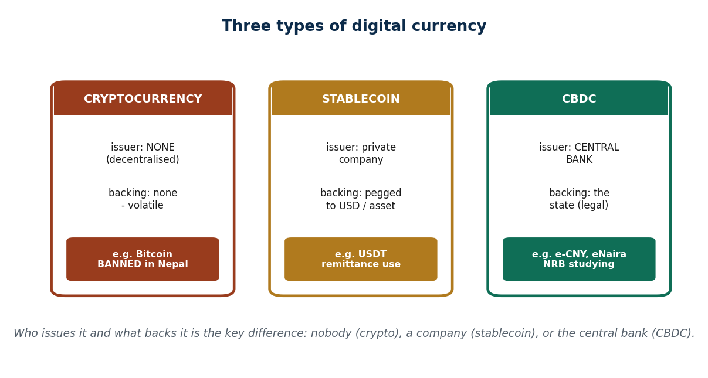

#### 1. Cryptocurrency

**Definition:** internet money with no government control, running on **blockchain**, where anyone can
send money directly to anyone, secured using **cryptography** (secret writing), on a **peer-to-peer**
basis. *Digital cash without Nepal Rastra Bank.*

**Two sub-types:**

| | **Payment cryptocurrencies** | **Platform / smart contract cryptocurrencies** |
|---|---|---|
| **Purpose** | Digital money for sending and receiving payments | Running applications and smart contracts |
| **How it works** | Peer-to-peer, no bank in between | The blockchain acts as a programmable platform |
| **Examples** | Bitcoin (BTC), Litecoin (LTC) | Ethereum (ETH), Solana (SOL) |
| **If allowed in Nepal** | Cheaper remittance, direct international transfer | Nepali developers could build blockchain applications |
| **Main goal / use** | Replace traditional money | Technology, not daily payments |
| **Major risks** | High price swings, weak user protection | Complex, high technical barrier |

**Bitcoin specifically:** like digital gold — limited supply, price changes a lot. If allowed in
Nepal, people could send money abroad easily and traders could accept global payments — but prices
could crash suddenly.

**Key features of cryptocurrency:** decentralised · transparent public ledger · limited supply ·
globally accessible · highly volatile.
**Other examples:** Bitcoin (BTC), Ethereum (ETH), Binance Coin (BNB), Ripple (XRP).

| Advantages | Risks |
|---|---|
| No central authority | Extreme price volatility |
| Low transaction cost | Used in illegal activity |
| Fast cross-border payment | Cybersecurity risk |
| High transparency | No legal protection in many countries |
| Resistant to censorship | Losing your private key means losing your money |

**What crypto could do in Nepal:** faster foreign payments, freelancers paid directly from abroad,
less dependence on banks. **But:** NRB cannot control it, and the risk to ordinary people is high.

> **Exam line:** *"Nepal bans cryptocurrency due to financial and regulatory risks."* The reasons:
> transactions are difficult to trace · money-laundering risk · high fraud potential · no consumer
> protection.

#### 2. Stablecoins

**Definition:** a digital currency designed to **reduce volatility** — its value barely changes
because it is linked to something stable, usually the US dollar. It acts as a **bridge between crypto
and traditional money**.

**Types:** fiat-backed (USD, EUR) · crypto-backed · algorithmic. **Fiat-backed is the most common.**
**Examples:** Tether (USDT), USD Coin (USDC), Binance USD (BUSD).

| Advantages | Risks |
|---|---|
| Price stability | Depends on trusting the reserve |
| Faster digital payments | Centralised control |
| Useful for remittance | Regulatory uncertainty |
| Reduces crypto market risk | Reserves could be mismanaged |

#### 3. Central Bank Digital Currency (CBDC)

**Definition:** a digital currency **issued by the central bank**. A Nepali CBDC would be a **digital
Nepali Rupee** issued by Nepal Rastra Bank, worth exactly the same as cash, and legally money.

> *Like an eSewa-style app, but owned by NRB.*

If Nepal launched a Digital Rupee, people would pay directly from an NRB wallet, with no intermediary
company, and the government would control security.

**Types:** **retail CBDC** (for the public) and **wholesale CBDC** (for banks and institutions).
**Examples worldwide:** Digital Yuan (China), eNaira (Nigeria), Digital Rupee (India, pilot stage).

| Advantages | Risks and problems |
|---|---|
| Government-backed and stable | Privacy concerns — the state can see transactions |
| Reduces the cost of handling and printing cash | Cybersecurity risk |
| Improves monetary policy | High infrastructure cost |
| Promotes financial inclusion | Internet dependency |
| Increases transaction transparency | Fear of excessive government control |

**What a CBDC could do for Nepal:** reduce counterfeit notes · improve tax collection · help rural
people access money · cut the cost of printing cash.

### Comparing the three

| Feature | Cryptocurrency | Stablecoin | CBDC |
|---|---|---|---|
| **Control** | Decentralised | Semi-centralised | Centralised |
| **Stability** | Low | High | Very high |
| **Legal status** | Uncertain | Limited | Legal tender |
| **Issued by** | No one | A private company | The central bank |
| **Example** | Bitcoin | USDT | Digital Rupee |

### Digital currencies overall

| General advantages | General risks |
|---|---|
| Faster transactions | Cybercrime |
| Lower operational cost | Data privacy issues |
| Financial inclusion | Technical complexity |
| Transparency | Lack of public awareness |
| 24/7 availability | Regulatory uncertainty |

**Regulatory challenges:** there is no global regulatory framework · money-laundering risk · terrorist
financing · difficulty taxing · consumer protection gaps.

**Four approaches governments take:** complete ban · partial regulation · a **regulatory sandbox** (a
controlled space where new financial products are tested under supervision) · developing their own
CBDC.

**The future:** physical cash declining · CBDCs growing · integration with AI and IoT · smart
contracts · **asset tokenisation** (representing real assets such as property as digital tokens).
Digital currencies will support digital trade, enable global transactions, encourage fintech
innovation and strengthen digital financial systems.

### Key words from Unit 4

Digital transformation · digitization · digitalization · drivers (technological, economic, social) ·
COVID-19 as accelerator · Kodak, Nokia, Yahoo, Toys "R" Us · SDGs · SDG 4, 8, 9, 16 · ICT4D · digital
divide · technological revolution · First to Fourth Industrial Revolution · platform economy · skill
shift · gig economy · globalization · digital globalization · e-commerce · digital trade ·
multinational digital firm · outsourcing · freelancing · economic growth · GDP · digital
infrastructure · low marginal cost · network effects · human capital · barter · digital money ·
digital currency · cryptocurrency · blockchain · peer-to-peer · cryptography · Bitcoin · Ethereum ·
smart contract · stablecoin · fiat-backed · CBDC · retail and wholesale CBDC · Digital Rupee ·
regulatory sandbox · asset tokenisation.

### Summary — Unit 4

- **Digital transformation** changes how an organisation works and delivers value — processes, models
  and customer experience — and it is about strategy and culture as much as technology.
- **Digitization = data becomes digital · digitalization = process improves · transformation =
  business changes.**
- It is driven by technology, economics, society and government policy, and COVID-19 accelerated it
  dramatically. Kodak, Nokia, Yahoo and Toys "R" Us show the cost of ignoring it.
- The **17 SDGs** (UN, 2015, target 2030) are accelerated by DT through speed, reach, efficiency,
  transparency and scalability, especially SDG 4, 8, 9 and 16. **ICT4D** is the bridge between
  technology and development.
- Four **technological revolutions** reshaped the world economy; 4IR = *Digital + AI + IoT +
  Automation*, with speed, scope, impact and integration as its features. It creates new industries
  and destroys old jobs, shifting skills.
- **Digital globalization** moves data, services and knowledge instead of goods — fast, cheap and open
  to anyone with skills and internet. Nepal is moving from consumer to service provider through
  freelancing, outsourcing, content and payments.
- Growth depends on infrastructure, government, low marginal cost, network effects, innovation,
  skills, digital finance and trust, and is threatened by the digital divide. Chain to remember:
  **digital skills → digital jobs → income → higher GDP → growth.**
- **Digital currency** is money that exists only electronically. **eSewa money is digital money, not a
  digital currency**, because it is only NPR in electronic form. The three real types are
  **cryptocurrency** (decentralised, volatile, banned in Nepal), **stablecoins** (pegged, usually to
  USD) and **CBDC** (issued by the central bank; a Digital Rupee would be legal tender).

<!-- question-bank:unit4:begin -->
## 4.T Test yourself — Unit 4

Work through the questions first and keep the answer key covered. Parts A and B have fixed answers, given at the end of this section; Parts C to E are the open questions that carry the most marks in an exam, so practise writing them out in full.

### Part A — Multiple choice

**A1.** Scanning paper forms into PDFs (nothing else) is:

  *a)* digitization  ·  *b)* digitalization  ·  *c)* digital transformation  ·  *d)* automation

**A2.** Kodak and Nokia collapsed mainly because they:

  *a)* lacked technology  ·  *b)* failed to change their business MODEL in time  ·  *c)* were too small  ·  *d)* had no customers

**A3.** Cloud, mobile, and AI are examples of which driver type?

  *a)* technological (they make DT possible)  ·  *b)* economic  ·  *c)* social  ·  *d)* crisis

**A4.** COVID-19 is best described as a driver that:

  *a)* invented new technology  ·  *b)* ACCELERATED adoption of existing digital tools  ·  *c)* had no effect  ·  *d)* reversed digitalisation

**A5.** Digital records making it harder to hide corruption is which DT mechanism?

  *a)* speed  ·  *b)* reach  ·  *c)* transparency  ·  *d)* scalability

**A6.** The digital divide means digital transformation can:

  *a)* always reduce inequality  ·  *b)* WIDEN inequality if the unconnected are left out  ·  *c)* has no effect  ·  *d)* only helps government

**A7.** A technological revolution changes the economy mainly by:

  *a)* only making it bigger  ·  *b)* changing its STRUCTURE — new industries rise, old ones are disrupted  ·  *c)* removing all jobs  ·  *d)* nothing

**A8.** The platform economy creates value mainly by:

  *a)* manufacturing goods  ·  *b)* connecting groups (network effects, low transaction cost — Unit 2)  ·  *c)* mining  ·  *d)* farming

**A9.** The key difference between traditional and digital globalization is that digital:

  *a)* is slower  ·  *b)* moves services/data instantly and is open to individuals & small firms  ·  *c)* needs bigger factories  ·  *d)* is only for rich countries

**A10.** A Nepali freelancer coding for a US client is an example of:

  *a)* B2C e-commerce  ·  *b)* traditional export  ·  *c)* cross-border digital (services) trade  ·  *d)* C2C

**A11.** The digital economy lets a country grow GDP without:

  *a)* any workers  ·  *b)* building more physical factories (much value is intangible services/software)  ·  *c)* money  ·  *d)* skills

**A12.** 'Serving one more user costs almost nothing' is which growth engine?

  *a)* network effects  ·  *b)* low marginal cost  ·  *c)* digital divide  ·  *d)* taxation

**A13.** eSewa is best described as:

  *a)* a digital currency  ·  *b)* digital money — a wallet holding existing NRB rupees electronically  ·  *c)* a cryptocurrency  ·  *d)* a bank

**A14.** The test for whether something is a digital CURRENCY is:

  *a)* is it on a phone  ·  *b)* is it fast  ·  *c)* does it create a NEW unit of value (issued by no central bank)  ·  *d)* is it popular

**A15.** The three digital-currency types differ mainly by:

  *a)* speed  ·  *b)* who ISSUES them and what BACKS them (nobody / a company / the central bank)  ·  *c)* colour  ·  *d)* app design

**A16.** Cryptocurrency in Nepal is:

  *a)* legal and common  ·  *b)* banned by NRB (Foreign Exchange Regulation Act basis)  ·  *c)* taxed but allowed  ·  *d)* issued by NRB

### Part B — Unit review

The whole unit in one pass.

**B1.** Digital transformation means changing an organisation's

  *a)* logo  ·  *b)* processes, business model & culture  ·  *c)* office  ·  *d)* name

**B2.** Scanning paper forms into PDFs (only) is

  *a)* digitization  ·  *b)* digitalization  ·  *c)* transformation  ·  *d)* automation

**B3.** Cloud, mobile and AI are which driver type

  *a)* social  ·  *b)* economic  ·  *c)* technological  ·  *d)* crisis

**B4.** COVID-19 acted as a driver that

  *a)* invented new tech  ·  *b)* had no effect  ·  *c)* accelerated adoption of existing tools  ·  *d)* reversed it

**B5.** An SDG that digital transformation directly accelerates is

  *a)* SDG 4 (quality education)  ·  *b)* none  ·  *c)* only SDG 17  ·  *d)* SDG 14 only

**B6.** ICT4D means using technology

  *a)* for war  ·  *b)* for profit only  ·  *c)* for development  ·  *d)* for gaming

**B7.** The platform economy creates value by

  *a)* mining  ·  *b)* connecting groups (network effects)  ·  *c)* farming  ·  *d)* printing

**B8.** Compared with traditional globalization, digital globalization is

  *a)* slower  ·  *b)* only for big firms  ·  *c)* instant and open to individuals  ·  *d)* physical

**B9.** 'Serving one more user costs almost nothing' is

  *a)* network effect  ·  *b)* low marginal cost  ·  *c)* a tariff  ·  *d)* inflation

**B10.** eSewa is best described as

  *a)* a cryptocurrency  ·  *b)* digital money (existing NRB rupees, electronic)  ·  *c)* a digital currency  ·  *d)* a stablecoin

**B11.** Crypto / stablecoin / CBDC differ mainly by

  *a)* colour  ·  *b)* who issues them & what backs them  ·  *c)* speed  ·  *d)* app design

**B12.** Nepal bans cryptocurrency mainly because of

  *a)* it is too slow  ·  *b)* capital flight, fraud & laundering risks (NRB)  ·  *c)* no internet  ·  *d)* no reason

### Part C — Short answer

**C1.** Distinguish digitization, digitalization and digital transformation with an example each.

**C2.** Name the four drivers of DT.

**C3.** Map TWO SDGs to DT with Nepal examples.

**C4.** Distinguish traditional vs digital globalization.

**C5.** Compare cryptocurrency, stablecoin and CBDC.

### Part D — Applied case

**D1.** Why is eSewa digital MONEY but NOT a digital currency? Give the reason, not just the label.

**D2.** Argue whether Nepal should keep banning crypto or move to a CBDC — use remittance, capital flight, and control.

### Part E — Discussion

**E1.** 'Is digital transformation net-positive for Nepal's economy?' Use SDGs, growth engines, and the digital divide.

**E2.** Name one Nepali organisation on each tier — digitize, digitalize, transform.

**E3.** Which single driver most changed how YOU use digital services?

**E4.** Which SDG do you think DT helps Nepal reach fastest, and why?

**E5.** Which Nepali job do you think will change most in the next 5 years?

**E6.** What is Nepal's single best digital-export opportunity, and its biggest risk?

**E7.** What single government enabler would most boost Nepal's digital growth?

**E8.** Why do so many people wrongly call eSewa a 'digital currency'?

**E9.** Should Nepal move from banning crypto toward a CBDC? Argue both sides.

### Answers — Unit 4

| # | Answer | Why |
|---|---|---|
| **A1** | **a)** digitization | Only the DATA is made digital; no process or business model changed — that is digitization. |
| **A2** | **b)** failed to change their business MODEL in time | Both had the technology (Kodak invented the digital camera) but clung to the old model — 'transform or die'. |
| **A3** | **a)** technological (they make DT possible) | These are enabling technologies — they make transformation feasible and cheap, but do not by themselves force it. |
| **A4** | **b)** ACCELERATED adoption of existing digital tools | The technology already existed; the crisis forced rapid adoption and much of it became permanent. |
| **A5** | **c)** transparency | Digital records and payments leave a traceable trail, reducing leakage — the transparency mechanism (SDG 16). |
| **A6** | **b)** WIDEN inequality if the unconnected are left out | If only the connected and literate benefit, gaps in access and skills deepen inequality. |
| **A7** | **b)** changing its STRUCTURE — new industries rise, old ones are disrupted | Value and jobs shift from old sectors (film, print) to new ones (software, e-commerce) — a structural change. |
| **A8** | **b)** connecting groups (network effects, low transaction cost — Unit 2) | Platforms match groups rather than produce goods, coordinating global activity — the Unit 2 logic at economy scale. |
| **A9** | **b)** moves services/data instantly and is open to individuals & small firms | Digital globalization moves services/data/software cheaply and instantly, so even a small player with internet can go global. |
| **A10** | **c)** cross-border digital (services) trade | It is a service delivered across borders online — digital trade in services, Nepal's biggest digital opportunity. |
| **A11** | **b)** building more physical factories (much value is intangible services/software) | Services, software, and data are intangible value — GDP can rise from them without physical production. |
| **A12** | **b)** low marginal cost | Near-zero marginal cost lets revenue scale far faster than cost — a core digital-growth engine (Unit 2). |
| **A13** | **b)** digital money — a wallet holding existing NRB rupees electronically | ESewa creates no new currency; every rupee is NRB-issued, just moved electronically — that is digital money. |
| **A14** | **c)** does it create a NEW unit of value (issued by no central bank) | A digital currency IS a new unit of value; moving existing currency electronically is only digital money. |
| **A15** | **b)** who ISSUES them and what BACKS them (nobody / a company / the central bank) | Crypto (no issuer), stablecoin (private, pegged), CBDC (central bank) — issuer and backing is the dividing line. |
| **A16** | **b)** banned by NRB (Foreign Exchange Regulation Act basis) | NRB has declared crypto trading/mining/dealing illegal, citing capital flight, fraud, and laundering risks. |

| # | Answer |
|---|---|
| **B1** | **b)** processes, business model & culture |
| **B2** | **a)** digitization |
| **B3** | **c)** technological |
| **B4** | **c)** accelerated adoption of existing tools |
| **B5** | **a)** SDG 4 (quality education) |
| **B6** | **c)** for development |
| **B7** | **b)** connecting groups (network effects) |
| **B8** | **c)** instant and open to individuals |
| **B9** | **b)** low marginal cost |
| **B10** | **b)** digital money (existing NRB rupees, electronic) |
| **B11** | **b)** who issues them & what backs them |
| **B12** | **b)** capital flight, fraud & laundering risks (NRB) |

<!-- question-bank:unit4:end -->

---

# Unit 5 — Economics of Information

**8 lecture hours.** Asymmetric information: concepts and determinants · asymmetric information and
digitalization · online search engines · artificial intelligence · strategy and the new economics of
information · effects of digitalization on consumer choice and labor markets · intellectual property
and digitalization.

## 5.1 Why information matters in economics

People make decisions every day, and every decision needs information. **Bad information produces bad
decisions.** Economics studies how information affects markets.

**Information** here simply means *knowledge that helps you decide*: prices, quality, risk, and what
other people think.

> **The everyday case.** You want to buy a phone. Phone A is cheap, Phone B is expensive. If you know
> the battery life, the camera quality and what reviewers say, you can choose well. That knowledge is
> information, and it has economic value.

Information shapes what consumers and firms do, affects prices and market efficiency, and when it is
missing it causes **market failure** (a market that stops allocating things properly). Standard
economic theory assumes **perfect information** — but that almost never exists.

| **Perfect information** (the ideal) | **Imperfect information** (the real world) |
|---|---|
| Buyers know all prices | Some people know more than others |
| Sellers know what customers need | Getting information costs money and time |
| No cheating | The gap creates real economic problems |
| Fair competition | |

### Why information is a strange kind of good

Information is valuable and costly to produce, but easy to share digitally. Examples: a research
report, a piece of software, an online tutorial.

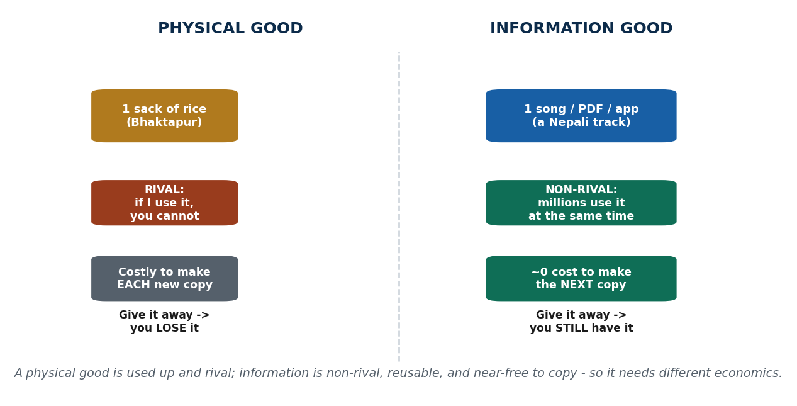

| Physical goods | Information |
|---|---|
| Gets used up | Can be reused endlessly |
| One user at a time | Many users at once |
| Hard to copy | Easy to copy |

> **Think of a secret.** Tell one friend — you still know it. Tell ten friends — you still know it.
> Information does not disappear when you give it away. That is what makes it powerful, and also what
> makes it hard to charge for (which becomes the intellectual property problem in 5.12).

## 5.2 Symmetric and asymmetric information

| **Symmetric information** | **Asymmetric information** |
|---|---|
| Both sides know the same things | One side knows more than the other |
| Examples: a menu with prices, a public bus fare, the exam syllabus | Examples: a seller who knows about a defect; an employer who cannot see a candidate's real skills |
| Result: fair and transparent | Result: unfairness |

**Definition:** **asymmetric information** occurs when one party in a transaction has **more or better
information** than the other.

> **The used bike story.** The seller knows the engine has a problem. The buyer trusts the seller and
> pays a high price. The bike breaks down. The buyer loses, the seller gains. That is asymmetric
> information in one sentence.

**Why it is dangerous:** cheating becomes common · trust falls · good products leave the market · and
the market may collapse entirely — **market failure**.

**Why sellers usually know more:** they produced or used the product · they have an incentive to hide
negative information · they want a higher price. **Information advantage is power.**
**Why buyers know less:** limited time · limited technical knowledge · dependence on the seller's
word. **Information is costly.**

## 5.3 The two big problems: adverse selection and moral hazard

Asymmetric information causes two specific failures. The easiest way to keep them apart:
**adverse selection happens BEFORE the deal. Moral hazard happens AFTER the deal.**

### Adverse selection

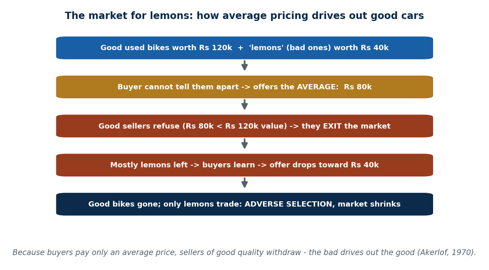

**Definition:** when one side knows more **before** the deal and the other is unsure, so **bad
options get chosen and good options disappear**.

> **The basket of apples.** Some apples are fresh, some are rotten. The seller knows which; the buyer
> does not. The buyer thinks "some might be bad, so I will only pay a low price." People with fresh
> apples say "not worth selling at that price" and leave. People with rotten apples say "good deal!"
> and stay. **In the end, only rotten apples remain in the market.**

> **The famous version — lemons and peaches.** In the used-car market, good cars are called *peaches*
> and bad cars are called *lemons*. Buyers cannot tell them apart, so they offer a low average price.
> Sellers of good cars refuse and withdraw. Only bad cars are left, and the average quality of the
> market falls.

**The cause-and-effect chain to memorise:**

> Asymmetric information → buyer uncertainty → low price offered (or strict rules imposed) → good
> sellers leave → bad sellers dominate → **market failure**.

### Moral hazard

**Definition:** when one party becomes **careless after the deal**, because someone else is carrying
the risk.

> **The insurance example.** Before insurance, you walk carefully. After insurance, you think "if I
> fall, the insurance will pay" — and you take more risk. That change in behaviour is moral hazard.

| Case | How it happens |
|---|---|
| **Bike insurance** | You insure your bike, then park it anywhere, even risky places, because theft would be covered. You act less carefully; the insurer bears the loss |
| **Bank loan (Nepal)** | A bank lends to a borrower; the borrower knows the bank will have to handle any legal process, and becomes careless about repayment; the bank carries the risk |
| **Workplace** | An employee covered by a company health plan, knowing mistakes will not be punished immediately, takes shortcuts; the company suffers |

## 5.4 What determines how bad the information gap is

Five determinants. These are a standard exam list.

| Determinant | How it creates or widens the gap | Example |
|---|---|---|
| **Cost of information** | Getting correct information costs money and time, and not everyone can afford it — so poor consumers suffer most | Checking whether a foreign manpower agency is genuine takes research, phone calls, maybe travel. Many workers simply trust the agent because checking is too expensive — and end up with bad jobs |
| **Access to information** | Even when information exists, not everyone can reach it. Barriers: location, internet, education, language | In rural Nepal people may not know the market price of rice or a phone. Urban buyers compare online and get better deals |
| **Product complexity** | Some products are genuinely hard to understand, and sellers exploit that | Insurance and financial products in Nepal — premiums, coverage, hidden clauses. Also mobile specifications |
| **Technology** | Technology can *close* gaps, but it also *opens new ones*: **the platform knows the user better than the user knows the platform** | Daraz, SastoDeal and eSewa use algorithms to show you what you might buy; sellers may use ads to mislead. Reviews and ratings help, but do not solve it |
| **Regulation and law** | Weak regulation means more cheating; strong regulation creates transparency | Government can require return policies and accurate product descriptions; weak enforcement lets fake ads and scams flourish |

**Nepal's situation:** a fast-growing digital market, weak enforcement in some sectors, and uneven
digital literacy — so asymmetric information is common.

### Three Nepali cases you should be able to cite

| Case | The information gap |
|---|---|
| **Manpower agencies** | The agency knows the real job conditions abroad; the worker trusts the agent; the reality is different. A classic asymmetric information case |
| **Education consultancies** | The consultancy promises scholarships; the student has no way to verify; reality turns out different later |
| **Online advertising** | Edited photos are shown; the buyer expects that quality; the delivered product is poor |
| **Facebook scams** | Fake job offers and fake prize announcements. People lose money because of asymmetric information combined with low digital awareness |

## 5.5 Who gets hurt, and how to fix it

| Impact on consumers | Impact on businesses | Impact on the economy |
|---|---|---|
| Financial loss | Honest firms suffer | Fewer people participate in the market |
| Stress and dissatisfaction | Reputation damage | Resources are allocated inefficiently |
| Reduced trust in the market | Unhealthy competition | Slower economic growth |

**How asymmetric information can be reduced:** **transparency** · **reviews and ratings** ·
**certification** · **regulation** · **technology**.

## 5.6 Signalling and screening — the two ways to close the gap

Section 5.5 ended with a list of fixes. Economists organise those fixes into exactly **two** moves,
and the difference between them is a favourite exam question. The difference is simply **who acts**.

**Signalling** is when the side that **has** the information takes a costly, credible action to
**prove** quality to the side that lacks it. **Screening** is the mirror image: the side that
**lacks** the information designs a test, a menu or a condition that makes the informed side
**reveal** its true type.

> **One line to remember.** Signalling = the side **with** the information proves it. Screening = the
> side **without** it sets a test so the truth comes out. Same goal, opposite actor.

### Signalling — the informed side proves quality

A signal only works if it is **costly and hard for a bad type to fake**. That is the whole secret.
Saying "trust me, the bike is fine" is **cheap talk** and proves nothing, because a cheat can say it
just as easily. Offering a genuine three-month warranty is a **signal**, because a cheat selling a
broken bike could not afford to honour it.

- **Warranty or money-back guarantee** — a seller who knows the product is bad would lose money offering it.
- **Brand and reputation** — built over years and destroyed by one scandal, so it is expensive to fake.
- **Certification or a degree** — the economist **Michael Spence** showed that education can signal
  ability to employers *even beyond the skills it teaches*, because a less able candidate would find
  finishing the degree much harder. This is **education as a signal**.
- **A verified profile or rated seller account** — a history that took real transactions to build.

> **Nepal.** A trusted seller on Hamrobazar offers a short warranty, posts real photos and the
> original bill, and carries a rated profile built over many sales. A scammer would avoid every one of
> those, because each is costly — which is precisely why buyers believe them.

### Screening — the uninformed side sorts

Here the buyer, employer or insurer acts first, designing a choice that forces the other side to sort
itself. The mechanism is **self-selection**: the menu is built so that each type picks the option that
quietly reveals what they are.

- **An insurance menu.** Offer (a) low premium with a high deductible and (b) high premium with a low
  deductible. Safe drivers pick (a); risky drivers pick (b). The insurer has sorted risk without ever
  reading anyone's mind.
- **A test ride or product trial.** Insisting on riding the used bike and taking it to a mechanic
  forces hidden quality into the open.
- **An interview or probation period.** The employer tests what the CV cannot show.
- **Reviews and ratings** — *collective* screening: thousands of strangers run the test for you, which
  is why digital platforms lean on them so heavily.

### The comparison you must be able to write

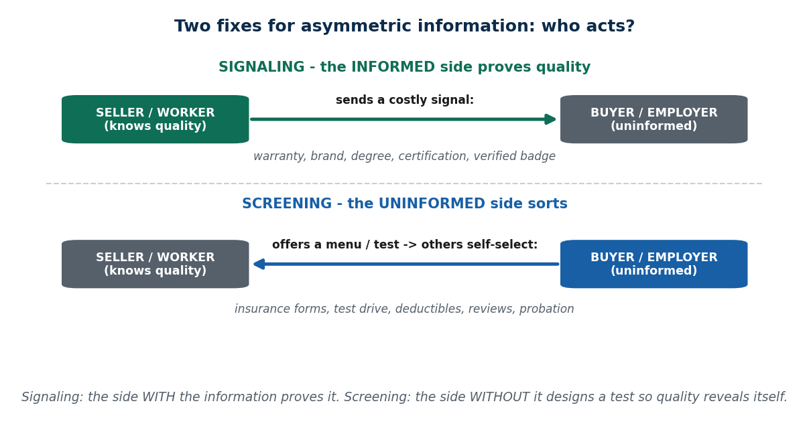

| Question | **Signalling** | **Screening** |
|---|---|---|
| Who acts? | The **informed** side | The **uninformed** side |
| What they do | Send a credible, costly signal | Design a test or menu that sorts types |
| Direction | Informed → proves to uninformed | Uninformed → makes others reveal |
| Labour market | The worker earns a degree | The employer sets a test or probation |
| Used goods | The seller offers a warranty | The buyer insists on a test ride |
| Insurance | A safe driver shows a clean record | The insurer offers a menu of deductibles |
| Works because | Faking it is too expensive for a bad type | Each type finds a different option attractive |

### Every mechanism, sorted — is it a signal or a screen?

| Mechanism | Signal or screen? | Nepal / digital example |
|---|---|---|
| **Warranty / money-back guarantee** | **Signal** — the seller proves | Daraz return policy; a shop's written warranty |
| **Brand and reputation** | **Signal** — the seller proves | Wai Wai's brand trust; a verified Daraz store |
| **Certification or degree** | **Signal** — the worker proves | An IT certification; a BIM degree on a CV |
| **Test ride / product trial** | **Screen** — the buyer tests | Test-riding a used bike before paying |
| **Insurance deductible menu** | **Screen** — the insurer sorts | Choosing a premium-versus-deductible level |
| **Interview / probation period** | **Screen** — the employer tests | A three-month probation before confirmation |
| **Reviews and ratings** | **Screen** — the crowd tests | Hamrobazar and Daraz seller ratings |

> **The trap.** "Signalling and screening are the same thing because both reduce asymmetry." They have
> the same *goal* but opposite *actors*, and that distinction is the exam point. Also: not every claim
> is a signal — only a **credible** one, meaning one a low-quality type could not afford to copy.

## 5.7 Asymmetric information and digitalization

**What changed.** Before digital markets, you asked the seller and trusted their words; there was no
easy way to compare. After digital markets, you search before buying, read reviews and compare prices
in seconds.

> *Earlier you were buying with your eyes closed. Now you are buying with Google in your pocket.*

**How digital platforms reduce the gap:** they act as information helpers, showing prices, quality
signals and the past experiences of other users. Buying a phone online, you see star ratings, written
reviews and photos from real buyers — you no longer depend only on the seller.

### Online search engines

**Search engines let you ask the market questions:** which product is cheaper? which seller is
trusted? what do other people say?
*Examples:* Google — "best laptop under 80k"; Amazon — "top rated headphones"; Daraz — "most ordered
item". Every one of those queries closes part of the information gap.

### The used-car market, old and digital

| Old market | Digital market |
|---|---|
| The seller knows the car's condition | Car history reports are available |
| The buyer hopes for the best | Seller ratings are visible |
| High risk of buying a "lemon" | User reviews describe real experience |
| | **Result:** less cheating, more trust, more trades actually happen |

### Effect on prices and competition

Sellers can no longer overcharge easily · buyers compare quickly · bad sellers lose customers.
*Example:* for the same flight, different sites show different prices, and you pick the cheapest
trusted option. **Prices move closer to fair value.**

### But the problem is not gone — it changed shape

New asymmetries appeared:

| New digital asymmetry | What it means |
|---|---|
| **Fake reviews** | Ratings can be bought or faked |
| **Sponsored rankings** | The "best product" may just be the most promoted one |
| **Hidden algorithms** | You cannot see why you were shown this and not that |
| **Platform control over visibility** | The platform decides who is seen at all |
| **Data ownership** | The platform knows far more about you than you know about it |

> **The one line to remember for this unit:** *Digital markets reduce information gaps — but they also
> create new power structures.*

## 5.8 Artificial intelligence and information economics

**AI** means computer programs that can analyse, predict and decide in ways that resemble human
thinking. Examples: Google Maps predicting traffic; YouTube recommending videos; an app suggesting
services based on your past usage.

**What AI does in economics:** it processes huge amounts of data quickly, helps firms and consumers
decide better, and **reduces the cost of gathering and analysing information**. *Nepal:* banks use AI
to assess loan applications quickly.

### AI as a strategic tool

AI gives companies a competitive advantage by answering: what will customers buy? what should we
stock? what price should we charge right now?
*Nepal:* eSewa predicting which services will be popular; Daraz suggesting trending products.
*Simple version:* a candy shopkeeper who can predict which sweets sell fastest will always beat one
who cannot.

### Personalisation and recommendation engines

AI learns your habits and shows recommendations tailored to you. A **recommendation engine** predicts
what you will like based on your past behaviour, and is used in e-commerce, media and social
platforms.
*Examples:* Netflix suggesting shows; Spotify suggesting songs; Daraz recommending shoes based on
earlier purchases; Foodmandu suggesting restaurants; YouTube Nepal recommending local news and music.

### How AI changes the economics of information

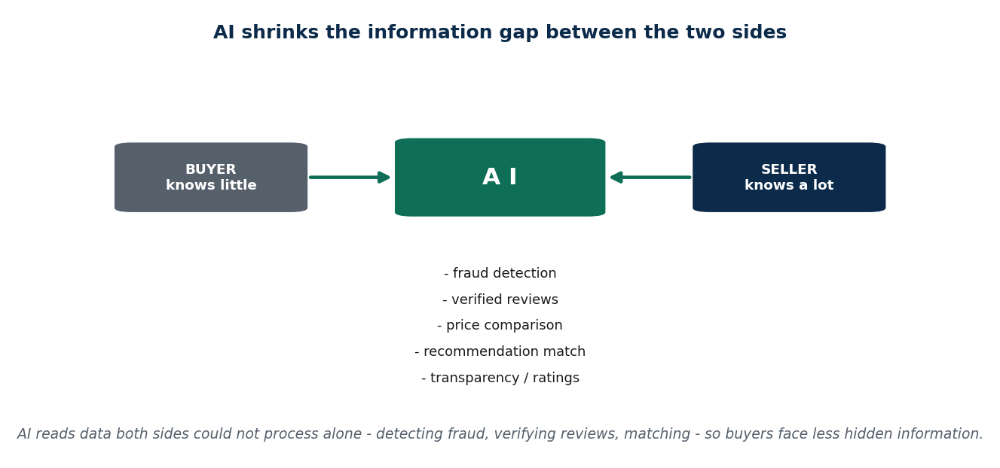

| Change | Effect |
|---|---|
| **Reduces search cost** | You find information faster |
| **Lowers processing cost** | Comparing options becomes easy |
| **Makes information more accessible** | Students can find scholarship information quickly through AI-powered portals |

**AI and decision-making:** it helps consumers choose well, helps firms predict demand and optimise
supply, and reduces mistakes caused by limited knowledge. *Nepal:* banks deciding loan approvals;
health apps predicting local disease outbreaks.

**AI and markets:** makes markets more transparent · reduces asymmetric information · detects fraud
and fake sellers. *Nepal:* verified reviews on Daraz; AI detecting banking fraud; Daraz
automatically flagging fake seller profiles.

**AI and strategy:** customised pricing for different users · **dynamic pricing** · spotting trends
before competitors. *Nepal:* tourism packages priced for peak season; airlines adjusting ticket prices
continuously.

### The "new economics of information"

| Old world | With AI |
|---|---|
| Information was costly and slow | Information is cheap, fast and personalised |
| Comparison was hard work | Markets become efficient and responsive |

**Strategy and the new economics of information.** Because information is now abundant and cheap, the
scarce resource is no longer *having* information but **processing it, controlling it and deciding who
sees what**. Competitive advantage therefore comes from: owning data others cannot get, owning the
algorithm that interprets it, controlling the ranking that decides visibility, and personalising
faster than rivals. This is why platform strategy (Unit 3) and information economics are the same
subject seen from two sides.

### Who gains and who loses

| On consumers | On businesses | On labour markets |
|---|---|---|
| Better recommendations | Optimised marketing and supply chains | AI replaces repetitive tasks |
| Smarter buying decisions | Prediction of demand and customer behaviour | Creates demand for AI-skilled workers |
| Personalised offers save time and money | Less waste, lower cost | *Nepal:* AI roles in fintech, analytics and e-commerce |
| *Nepal:* Foodmandu suggesting meals by preference | *Nepal:* Daraz stocking up for Dashain demand | *Picture it:* the robot does the repetitive chores; humans do the creative work |

### Ethics and limits of AI

**Ethical concerns:** bias in predictions · privacy · the need for transparency and explainability.
*Nepal:* finance apps and government AI projects must protect data, and must avoid unfairly denying a
loan because of a biased model.

**Three questions that are commonly asked, with the expected answers:**

| Question | Answer |
|---|---|
| **Can AI remove all asymmetric information?** | **No.** It reduces gaps, but limits remain: fake reviews, biased data, sellers hiding real quality, algorithm errors and incomplete data. Human judgement is still needed. *Even if Daraz shows a 5-star rating, the seller may still send a poor-quality item.* AI is like a smart librarian — but if a book is damaged and that is not in the database, AI cannot know |
| **Should AI decisions always be trusted?** | **Not always.** AI is a tool, not a person. Data bias produces unfair results, it does not understand local context, and it has no sense of ethics or emotion. Use AI as guidance and verify before acting. *Nepal:* banks use AI for loans but keep manual checks |
| **If AI recommends a poor product, who is responsible?** | It depends on platform rules and seller accountability. The **seller** must describe the product accurately; the **platform** must monitor fake sellers and its own recommendations; the **consumer** should read reviews and check the return policy. **AI only guides; in most cases it is not legally liable.** *If a robot suggests a toy and the toy breaks, the shopkeeper is responsible, not the robot* |

> **Two analogies worth keeping.** *The robot shopkeeper:* it knows your favourite things, tracks your
> last purchases, suggests what you might like and predicts what will sell — that is Daraz or
> Foodmandu. *The smart librarian:* in a library of millions of books, searching shelf by shelf takes
> hours; a smart librarian finds the right book instantly — that is what AI does to search cost.

## 5.9 Strategy and the new economics of information

If information costs a lot to produce but almost nothing to copy (5.1), then the old rule "work out
the cost, add a margin, charge that price" collapses — the cost of the next copy is roughly **zero**.
**Shapiro and Varian** answered this with a strategy toolkit: because extra copies are nearly free,
you do not sell information once at one price, you **sell the same information many ways**. Three
tools do most of the work.

### Versioning — one product, several tiers

Sell the same underlying product in **different versions** so buyers sort themselves by what they are
willing to pay: free versus premium, standard versus pro, SD versus HD. Note that this is **screening**
from 5.6 wearing a commercial hat — the menu makes each customer reveal how much the product is worth
to them.

### Price discrimination — different prices for different buyers

Charge **different buyers different prices** for the same thing: student discounts, regional pricing,
personalised prices, time-based or dynamic pricing.

> **The trap.** "Charging different people different prices for the same thing is simply unfair." It
> is **price discrimination**, a core information strategy — and it can *widen* access, because
> students and lower-income regions pay less than they otherwise would while the firm still captures
> more from those who will pay more. Whether it is unfair depends on how it is used.

### Bundling — many items, one price

Sell many items **together for one price**: an office software suite, a streaming catalogue, a course
pack. A bundle extracts more total value than selling each item separately, because customers who
would never buy item B alone still pay for the bundle containing it.

### The full toolkit

| Tool | How it monetises information | Example |
|---|---|---|
| **Versioning** | Tiers let buyers self-select by the value they place on it | A free app versus a premium app; SD versus HD streaming |
| **Price discrimination** | A different price for each buyer or segment | Student and regional pricing; personalised offers |
| **Bundling** | One price for many items | The MS Office suite; the Netflix catalogue |
| **Freemium** | Free hooks a large base; a few convert to paid extras | A free app with paid professional features |
| **Lock-in / switching costs** | Keep the customer so they keep paying (2.14) | Ecosystem and data lock-in |
| **Dynamic (AI) pricing** | The price adjusts to demand or to the person | Ride-hailing surge pricing; airline and hotel fares |

> **Why all six work.** Every one of them exploits information's near-zero copy cost. Offering one
> more version, one more bundle or one more personalised price costs the firm almost nothing — so each
> captures value that a single "one price for one copy" model would leave on the table.

> **Nepal.** An online-course platform in Kathmandu uses all three at once: **versioning** (free intro
> lessons, a paid full course, a premium mentorship tier), **price discrimination** (a student discount
> and lower pricing for Nepal than for the US) and **bundling** (every course in one "career pack" for
> less than the sum of the parts). The content is already made, so each extra way of selling it costs
> almost nothing.

## 5.10 Effects of digitalization on consumer choice

Consumer choice drives markets and competition, and digitalization has changed how people decide at
every stage: **Need → Search → Compare → Buy → Review.**

> *Before, you picked a toy from one shop. Now every shop comes to your phone.*

| **Before digitalization** | **After digitalization** |
|---|---|
| Limited information | Instant access to product information |
| Physical visits required | Online comparison of price, quality and reviews |
| High search cost | Platforms replace shopkeepers as the information source |
| Dependence on the seller | *Nepal:* buying a phone on Daraz by comparing sellers and ratings |
| *Nepal:* visiting several shops in New Road to buy a phone | Much less time and effort per decision |

### The new behaviour patterns

**Reliance on ratings and reviews.** Decisions are strongly influenced by online feedback — people
will pay slightly more for a higher-rated product. Online information strongly affects both purchase
intention and trust.

**Information abundance.** Platforms supply reviews, videos, specifications and comments. The positive
side is better awareness; the negative side is confusion. **Too much information can actually reduce
decision quality.** *Scenario:* booking a hotel in Pokhara with 100+ options, you end up just picking
"Top Rated" or "Recommended".

**Reduced search costs.** **Search cost** = the time, effort and money needed to find information.
Filters, sorting and AI recommendations cut it dramatically. *Nepal:* Foodmandu filtering restaurants
by location, price and rating. **Lower search costs increase how often people buy online.**

**Bounded rationality.** People aim for a "good enough" decision rather than analysing every detail.
*Example:* choosing the first product rated 4.5 or above. *Nepal:* parents buying a school bag online
simply pick the "best seller". It is a way of coping with information overload.

**Information overload.** Too many options cause decision fatigue and anxiety, and can delay or
prevent a purchase altogether. *Nepal:* laptop buyers abandoning their cart after comparing too much.

### Algorithms, recommendations and bias

Algorithms track clicks, searches and purchases, predict preferences, and **decide which products you
even see**. Repeated exposure raises the chance you buy. *Scenario:* you search for sports shoes once,
and then see shoe advertisements across Daraz, Facebook and YouTube for days.

**Algorithmic bias** is the important critical point: algorithms serve the platform's profit, so
**sponsored products appear first even when cheaper or better alternatives exist**. *Nepal:* sponsored
sellers on Daraz. **Algorithms are not neutral decision-makers.**

### e-WOM — electronic word of mouth

**Definition:** reviews, comments, ratings and recommendations shared online.

> You want to buy a chocolate brand. One brand has 100 people rating it 5 stars; the other you have
> never heard of. You trust the first one — because of what strangers wrote. That is e-WOM.

*Real decision:* on Daraz, one product has 4.8 stars with 50 reviews, another 4.0 with 10 reviews.
Most buyers choose the 4.8 even if it costs a little more. **People trust online reviews almost as
much as a personal recommendation.** Positive e-WOM raises sales; negative e-WOM reduces demand.

### Three sector examples

| Sector | What happens | The catch |
|---|---|---|
| **E-commerce (Daraz, SastoDeal)** | Ratings build trust, reviews shape perceived quality, discounts and flash sales create urgency | Sponsored placement distorts what you see |
| **Travel booking (Booking.com, Agoda)** | AI suggests the cheapest and most popular hotels, saving time. *Nepal:* booking Kathmandu–Pokhara flights | Smaller local hotels get ignored |
| **Finance apps (eSewa, Khalti)** | Suggest loans, insurance and investments based on your data | Consumers may accept offers without understanding them — personalised offers influence financial decisions |

### Changing expectations, and the power question

Consumers now expect fast delivery, transparent pricing and easy returns — *Nepal:* a delayed food
delivery and people switch apps. **Digitalization raises the service standard for everyone.**

| Positive effects | Negative effects |
|---|---|
| Better information and awareness | Over-reliance on algorithms |
| Lower search costs | Privacy risks and data misuse |
| Convenience and wider choice | Manipulated choices |
| **Digitalization empowers consumers** | **Blind trust in digital systems can harm consumers** |

> **The power shift.** Platforms control visibility, algorithms guide demand, and consumers follow
> recommendations. So the real question is: **who actually controls the choice — the consumer or the
> platform?** The honest answer is that choice still exists, but it is **guided choice**.

## 5.11 Effects of digitalization on labor markets

A **labour market** is where the supply of labour (people looking for work) meets the demand for
labour (employers hiring), determining wages and employment levels.

**What digitalization does to work:** it automates repetitive tasks, enables remote and flexible work,
creates new job types and changes the skills required. *Nepal:* freelance IT developers working
remotely; online tutoring replacing some classroom work.

### Jobs lost and jobs created

| **Job displacement** | **Job creation** |
|---|---|
| Routine office, clerical and manual work is hit hardest | New roles in AI, IT, digital marketing and e-commerce |
| *Nepal:* data entry work automated; travel agencies losing clients to online booking | Remote work enables global freelancing |
| Workers must reskill to stay employed | *Nepal:* developers on Upwork; YouTube creators monetising channels |
| | *Some doors close, new doors open — if you adapt* |

**Automation risk:** routine and predictable tasks are at the highest risk. *Nepal:* accounting clerks
and data entry workers. **OECD research suggests around 40% of routine jobs are at risk globally.**

### Skills and polarization

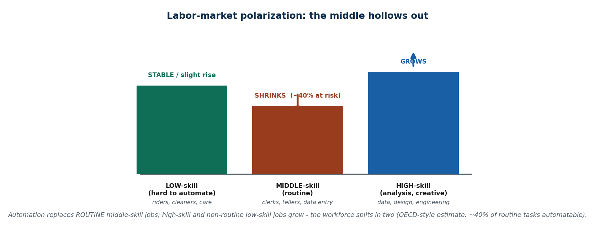

**Skills transformation:** digital literacy, coding, data analysis and AI skills are now required,
plus soft skills — adaptability, communication and problem-solving. *Nepal:* IT colleges teaching
Python, AI and ML. *Like learning the rules of a new game so you can play it well.*

**Labor market polarization** is an important term: **high-skill jobs grow, low-skill routine jobs
decline, and middle-skill jobs shrink** — the middle of the job market is hollowed out. *Nepal:*
skilled programmers earn more while office clerks face uncertainty.

### Gig work and algorithmic management

**Remote work and the gig economy:** platforms enable freelance and on-demand work — flexible, but
with less security. *Nepal:* Pathao drivers, Foodmandu delivery riders, Upwork freelancers. *You are
your own boss, but without guaranteed protection.*

**Algorithmic management** is a key new concept: **platforms monitor and direct workers using AI,
ratings and automatic task allocation**. *Nepal:* Foodmandu and Pathao tracking performance.
**Productivity rises; worker autonomy falls.** *Like a coach assigning positions — it helps the team,
but limits personal choice.*

**Algorithmic bias and fairness** appears here too: a platform's AI may favour some workers over
others. *Nepal:* delivery drivers rated badly for things outside their control, such as traffic or
weather.

### Wages, quality and security

| Topic | What happens |
|---|---|
| **Wages** | Automation pushes routine job pay down; high-skill digital jobs pay more. *Nepal:* freelancers earning in USD often out-earn local salaried jobs |
| **Job quality** | Gig work gives flexibility but few benefits — no health cover, no retirement. Stress and uncertainty rise. *Nepal:* delivery workers under pressure to finish fast |
| **Job flexibility** | Remote work improves work–life balance and widens access. *Nepal:* freelancers working from home while caring for family |
| **Job insecurity** | Digital work can be unstable; platforms can end contracts at any time; gig workers depend on their rating |
| **Transparency** | Platforms publish information about jobs, pay and ratings. *Nepal:* freelancers comparing Upwork and Fiverr projects |
| **Global competition** | You compete worldwide, not locally. *Nepal:* Nepali developers competing with India, Pakistan and the Philippines — like an international tournament |
| **Inequality** | Skilled workers gain most; low-skill workers face job loss or stagnant wages. *Nepal:* IT freelancers vs traditional clerks |

**Reskilling and upskilling** are therefore essential — *like levelling up in a game: if you do not
improve, you cannot compete.* *Nepal:* government IT programmes and private IT institutes.

**Policy implications:** reskilling and training programmes · social protection for displaced workers
· **digital labour laws for gig workers**.

> **The power shift again.** Platforms and algorithms allocate the tasks; workers follow tasks and
> ratings and lose autonomy. *Nepal:* Pathao delivery tasks assigned automatically. **Who really
> controls the work — the worker or the platform?**

## 5.12 Intellectual property and digitalization

### What intellectual property is

Ideas come from people's minds — songs, drawings, apps, stories — and they can be as valuable as
money. When you create something, it belongs to you, even though it is not physical.

**Intellectual property (IP)** means **owning ideas**. It protects what your mind creates, and the law
says others may not copy it without permission.

**Why IP is needed:** without it, people copy freely → creators lose income → creativity stops.

### The three main types

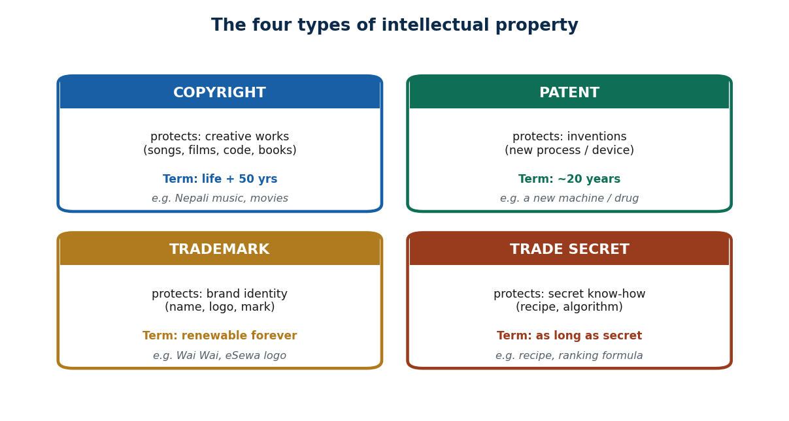

| Type | What it protects | How long / what it gives | Example |
|---|---|---|---|
| **Copyright** | Songs, movies, books, videos, software, written content | Stops others copying without permission; especially important online | A Nepali singer uploads a song and someone re-uploads it without permission — that is a copyright violation |
| **Patent** | New inventions | Only the inventor may sell or license it for a set period; encourages innovation | Someone invents a new water filter; the patent stops others copying it, and the inventor earns from the idea |
| **Trademark** | A brand name and logo | Prevents fakes and stops customers being confused | The Daraz logo; the Pathao name. Fake brands using them are illegal |

### What digitalization does to IP

| The good side | The bad side |
|---|---|
| Creators reach a global audience | Piracy and theft become easy |
| Distribution is cheap and fast | Creators lose income |
| New income opportunities appear | Laws are hard to enforce across borders |

Everything moves online, where content is **easy to copy and share** and very hard to control.

**Piracy** is using paid content without permission and without payment: downloading films illegally,
using cracked software, sharing paid apps.

**Platforms and IP:** YouTube and Facebook host enormous amounts of content, use systems to detect
copying, and remove infringing material. The best-known is YouTube's **Content ID**, which scans every
upload and matches it against a database of copyrighted works, then automatically claims, monetises or
takes down the match. **Licensing** turns the same problem into revenue: the platform pays rights
holders for legal plays instead of merely blocking illegal ones. **Their challenge:** there is too much
content to monitor perfectly, and automated systems make mistakes — sometimes removing legitimate work.

> **The double edge, in one line.** The *same* property of information — near-free copying — is both
> the creator's biggest opportunity (a Nepali artist heard worldwide at almost no distribution cost)
> and their biggest threat (the song re-uploaded on ten pages within hours). IP law and enforcement
> technology exist to keep the opportunity while limiting the threat.

### AI and the ownership question

AI can now write, draw and compose. That raises a genuinely unresolved question: **who owns content
created by AI — the user who prompted it, the developer who built it, or the company that owns the
model?** The laws are still unclear, in Nepal and almost everywhere else. This is a current, open
issue, not a settled one.

### IP in Nepal

**Problems:** low public awareness · high levels of piracy · small creators suffer most.
**Why stronger IP would help Nepal:** it protects creators, encourages innovation, and supports the
digital economy.

**The need for balance:** too strict blocks sharing and learning; too loose encourages theft. A
balanced approach is needed.

| What government can do | What creators can do | What users should do |
|---|---|---|
| Pass stronger laws | Register their work | Respect creators |
| Make registration easy | Use watermarks | Avoid piracy |
| Run awareness programmes | Use platform protection tools | Pay for content |

> **The discussion question to be ready for:** *if everything can be copied freely, will people still
> create?* The economic answer is that some will, but far fewer — which is precisely why IP exists.

## 5.13 How the whole unit fits together

| Step | The question | The answer |
|---|---|---|
| 1 | What is information? | Knowledge that reduces uncertainty; valuable, costly to produce, easy to copy |
| 2 | Why does hidden information break things? | Asymmetric information → adverse selection and moral hazard → market failure |
| 3 | How do the two sides close the gap? | **Signalling** (the informed side proves) and **screening** (the uninformed side tests) |
| 4 | How do digital markets fix some of it? | Search, reviews, comparison and platforms cut search costs and raise transparency |
| 5 | Who processes all this information? | AI — it reads reviews, predicts preferences, recommends |
| 5b | If copies are free, how do you charge? | **Versioning**, **price discrimination** and **bundling** — sell the same information many ways |
| 6 | What happens to choice? | Choice remains, but it becomes **guided choice** |
| 7 | What happens to jobs? | Middlemen disappear (travel agents), new jobs appear (data, AI, platforms) |
| 8 | What rules are needed? | If copying is free, why create? Copyright, patents and platform rules become essential |

**The big insight:** in the traditional economy information was **scarce**; in the digital economy it
is **abundant**. Old problems shrank, and **new power structures appeared**.

**Nepal context in one line each:** online ticket platforms make prices transparent · Daraz reviews
reduce buyer uncertainty · digital jobs are growing · copyright and piracy remain unsolved problems.

**The closing question of the unit:** *will AI remove all asymmetric information, or will it create new
forms of control?* The future of digital economics depends on which way that goes.

### Key words from Unit 5

Information as an economic good · perfect and imperfect information · symmetric and asymmetric
information · market failure · adverse selection · lemons and peaches · moral hazard · signalling ·
screening · self-selection · cheap talk · education as a signal (Spence) · determinants
(cost, access, complexity, technology, regulation) · search cost · transparency · certification ·
digital asymmetries · fake reviews · sponsored ranking · artificial intelligence · recommendation
engine · personalisation · versioning · price discrimination · bundling · freemium · dynamic pricing ·
market efficiency · explainability · consumer choice ·
information abundance · information overload · bounded rationality · algorithmic bias · e-WOM ·
guided choice · labour market · job displacement · job creation · skills transformation · labour
market polarization · gig economy · algorithmic management · job insecurity · reskilling ·
intellectual property · copyright · patent · trademark · piracy · AI ownership problem.

### Summary — Unit 5

- Information is knowledge that helps people decide. It is valuable, costly to produce, and unusual
  because it can be copied and reused without being used up.
- **Asymmetric information** means one side knows more. It causes **adverse selection** (bad options
  dominate *before* the deal — the lemons problem) and **moral hazard** (carelessness *after* the
  deal), and ultimately **market failure**.
- Its five determinants are the **cost** of information, **access** to it, **product complexity**,
  **technology** and **regulation**. Nepal's manpower agencies, education consultancies and online
  advertising are the standard cases.
- The gap is closed in exactly two ways, which differ by **who acts**: **signalling** (the informed
  side takes a costly, hard-to-fake action — a warranty, a brand, a degree) and **screening** (the
  uninformed side designs a test or menu so the truth reveals itself — a test ride, a deductible menu,
  an interview, reviews). Same goal, opposite actor.
- Digitalization reduces information gaps through search engines, reviews, comparison and platforms —
  prices move toward fair value and more trades happen — but it creates **new asymmetries**: fake
  reviews, sponsored rankings, hidden algorithms and platform control of visibility.
- **AI** cuts search and processing cost, personalises, detects fraud and enables dynamic pricing. It
  cannot remove all asymmetry, it should not be blindly trusted, and it is not legally liable for bad
  recommendations.
- Because information costs a lot to make and almost nothing to copy, cost-plus pricing fails. The
  **Shapiro–Varian** toolkit sells the same information many ways: **versioning** (tiers),
  **price discrimination** (a different price per buyer) and **bundling** (many items, one price), plus
  freemium, lock-in and dynamic pricing.
- For **consumers**, digitalization means lower search cost and more awareness, but also information
  overload, bounded rationality, algorithmic bias and e-WOM dependence — choice becomes **guided
  choice**.
- For **labour**, it means displacement of routine work, creation of digital jobs, **polarization**,
  gig work, **algorithmic management**, insecurity, inequality and a permanent need to reskill.
- **Intellectual property** — copyright, patents and trademarks — protects ideas. Digitalization makes
  copying easy and enforcement hard, AI raises unresolved ownership questions, and Nepal needs a
  balance between protecting creators and keeping access open.

<!-- question-bank:unit5:begin -->
## 5.T Test yourself — Unit 5

Work through the questions first and keep the answer key covered. Parts A and B have fixed answers, given at the end of this section; Parts C to E are the open questions that carry the most marks in an exam, so practise writing them out in full.

### Part A — Multiple choice

**A1.** Which is a defining trait of information as an economic good?

  *a)* it is used up when consumed  ·  *b)* it is non-rival — many can use it at once  ·  *c)* each copy is costly  ·  *d)* its value is always known in advance

**A2.** A used-bike seller knowing faults the buyer cannot see is an example of:

  *a)* perfect information  ·  *b)* symmetric information  ·  *c)* asymmetric information  ·  *d)* a network effect

**A3.** In the market for lemons, good sellers exit because buyers:

  *a)* prefer lemons  ·  *b)* can't tell quality, so they offer only an AVERAGE price  ·  *c)* pay too much  ·  *d)* are dishonest

**A4.** An insured person driving more carelessly is an example of:

  *a)* adverse selection  ·  *b)* moral hazard (hidden action after the deal)  ·  *c)* signaling  ·  *d)* price dispersion

**A5.** A seller offering a warranty to prove quality is an example of:

  *a)* screening  ·  *b)* signaling (the informed side proves quality)  ·  *c)* moral hazard  ·  *d)* price dispersion

**A6.** An insurer offering a menu of deductibles so drivers self-select is:

  *a)* signaling  ·  *b)* a network effect  ·  *c)* screening (the uninformed side sorts types)  ·  *d)* adverse selection

**A7.** Identical goods selling at very different prices is called:

  *a)* inflation  ·  *b)* price dispersion (a symptom of high search cost)  ·  *c)* a network effect  ·  *d)* moral hazard

**A8.** The top result in a search is best described as:

  *a)* always the best product  ·  *b)* chosen at random  ·  *c)* the most optimised or most paid, per a hidden algorithm  ·  *d)* the cheapest

**A9.** AI most directly reduces information asymmetry by:

  *a)* raising prices  ·  *b)* detecting fraud & verifying information at scale  ·  *c)* removing all sellers  ·  *d)* banning reviews

**A10.** A key ethical risk of AI decisions is that they:

  *a)* are too slow  ·  *b)* are always random  ·  *c)* can scale hidden bias and be unexplainable (black box)  ·  *d)* never use data

**A11.** Selling a free tier and a paid premium tier of the same app is:

  *a)* bundling  ·  *b)* versioning (buyers self-select by value)  ·  *c)* lock-in  ·  *d)* a network effect

**A12.** The 'new economics of information' says value now comes mainly from:

  *a)* owning scarce copies  ·  *b)* the cost of each copy  ·  *c)* access, attention & convenience  ·  *d)* physical stock

**A13.** Digitalization's effect on the job market is best described as:

  *a)* it only destroys jobs  ·  *b)* it only creates jobs  ·  *c)* polarization — the middle shrinks while top & bottom grow  ·  *d)* no effect

**A14.** A Pathao rider being assigned, paid, rated and deactivated by the app is:

  *a)* signaling  ·  *b)* algorithmic management  ·  *c)* bundling  ·  *d)* price dispersion

**A15.** A brand's name and logo are protected by:

  *a)* copyright  ·  *b)* patent  ·  *c)* trademark  ·  *d)* trade secret

**A16.** Which is NOT illegal piracy?

  *a)* downloading a pirated film  ·  *b)* re-uploading a song as your own  ·  *c)* quoting a line for a class review (fair use)  ·  *d)* selling copied software

### Part B — Unit review

The whole unit in one pass.

**B1.** Information as an economic good is   →

  *a)* non-rival & near-free to copy

**B2.** One side of a deal knowing more than the other is   →

  *a)* asymmetric information

**B3.** In the market for lemons, good sellers exit because buyers pay   →

  *a)* only an average price

**B4.** Adverse selection happens ___ the deal; moral hazard happens ___ it   →

  *a)* before / after

**B5.** A worker earning a degree to prove ability to employers is   →

  *a)* signaling

**B6.** An insurer's menu of deductibles that sorts drivers is   →

  *a)* screening

**B7.** Identical goods at very different prices is   →

  *a)* price dispersion

**B8.** A key ETHICAL risk of AI decisions is that they   →

  *a)* scale hidden bias / are a black box

**B9.** Selling free vs premium tiers of one product is   →

  *a)* versioning

**B10.** Digitalization's effect on jobs is best called   →

  *a)* polarization (middle hollows out)

**B11.** A brand's name and logo are protected by   →

  *a)* trademark

**B12.** A new asymmetry digital markets create is   →

  *a)* fake reviews / paid rankings

### Part C — Short answer

**C1.** Define asymmetric information + give 2 Nepali examples.

**C2.** Adverse selection vs moral hazard — explain the before/after distinction.

**C3.** Signaling vs screening — one example of each.

**C4.** Name 3 ways digitalization reduces asymmetry.

**C5.** Name the 4 IP types with what each protects.

### Part D — Applied case

**D1.** Explain the used-vehicle OR manpower-agency market as adverse selection, and how reviews/signals fix it.

**D2.** Which Nepali jobs shrank vs emerged with digitalization, and why (polarization)?

### Part E — Discussion

**E1.** 'Do digital markets remove information asymmetry, or just create new power structures? Who controls choice — the consumer or the platform?'

**E2.** Name a Nepali deal where one side clearly knows much more, and the fact that's hidden.

**E3.** Give one Nepali market where 'good is driven out by bad' and explain why.

**E4.** Name one NEW asymmetry digital markets created, even as they reduced old ones.

**E5.** How could a search engine that REDUCES asymmetry also CREATE it?

**E6.** Name one AI tool in Nepal that both helps consumers and creates a new risk.

**E7.** Pick a service you use and name its versioning, bundling, and lock-in moves.

**E8.** Name one Nepali job that shrank and one that emerged with digitalization, and why.

**E9.** Who should own an AI-generated logo — the user, the AI firm, or no one? Why?

### Answers — Unit 5

| # | Answer | Why |
|---|---|---|
| **A1** | **b)** it is non-rival — many can use it at once | Information is non-rival, reusable, and near-free to copy — unlike a physical good. |
| **A2** | **c)** asymmetric information | One side (the seller) holds relevant facts the other lacks — an information imbalance. |
| **A3** | **b)** can't tell quality, so they offer only an AVERAGE price | Average pricing makes selling a good product a loss, so good sellers withdraw — adverse selection. |
| **A4** | **b)** moral hazard (hidden action after the deal) | Behaviour changes AFTER the contract because the insurer now bears the cost — moral hazard. |
| **A5** | **b)** signaling (the informed side proves quality) | The side WITH the information acts, using a costly, hard-to-fake action — a signal. |
| **A6** | **c)** screening (the uninformed side sorts types) | The side WITHOUT the information designs a test/menu so the truth reveals itself — screening. |
| **A7** | **b)** price dispersion (a symptom of high search cost) | When comparing is costly, sellers can charge different prices; cheap search shrinks the spread. |
| **A8** | **c)** the most optimised or most paid, per a hidden algorithm | SEO and paid/sponsored placement mean ranking reflects optimisation and money, not pure merit. |
| **A9** | **b)** detecting fraud & verifying information at scale | AI reads and verifies huge data, removing hidden/false information — automating signals and screens. |
| **A10** | **c)** can scale hidden bias and be unexplainable (black box) | Biased training data yields biased decisions at scale, and black-box models can't justify results. |
| **A11** | **b)** versioning (buyers self-select by value) | One product offered in tiers lets buyers self-select by willingness to pay — versioning. |
| **A12** | **c)** access, attention & convenience | Information is abundant and ~free to copy, so value shifts to access, attention, and curation. |
| **A13** | **c)** polarization — the middle shrinks while top & bottom grow | Routine middle-skill jobs are automated while high-skill and low-skill service jobs grow — polarization. |
| **A14** | **b)** algorithmic management | An algorithm performs the manager's role — the defining feature of gig-economy work. |
| **A15** | **c)** trademark | Trademark protects brand identity (name, logo, mark); copyright covers creative works, patents inventions. |
| **A16** | **c)** quoting a line for a class review (fair use) | Fair use (limited, transformative, non-commercial) is a legal exception; the others are infringement. |

| # | Answer |
|---|---|
| **B1** | **a)** non-rival & near-free to copy |
| **B2** | **a)** asymmetric information |
| **B3** | **a)** only an average price |
| **B4** | **a)** before / after |
| **B5** | **a)** signaling |
| **B6** | **a)** screening |
| **B7** | **a)** price dispersion |
| **B8** | **a)** scale hidden bias / are a black box |
| **B9** | **a)** versioning |
| **B10** | **a)** polarization (middle hollows out) |
| **B11** | **a)** trademark |
| **B12** | **a)** fake reviews / paid rankings |

<!-- question-bank:unit5:end -->

---

# Unit 6 — Digitalization in the Nepalese Perspective

**7 lecture hours.** E-governance: concepts, process and structure · e-governance practices in Nepal ·
digital financial inclusion in Nepalese financial markets · opportunities and challenges for digital
transformation in the public sector · digital transformation and economic performance in trade,
tourism, agriculture and SMEs.

## 6.1 Digitalization in government

**Digitalization** here means using digital technology to improve public services and processes.
Before: you submit a paper form at an office. After: you submit the same request online.

**Why it matters:**

| Benefit | What it looks like in practice |
|---|---|
| **Faster service delivery** | Citizens apply for certificates and track progress without visiting an office |
| **Transparency** | The Inland Revenue Department's online tax system lets people see their own filing and payment record |
| **Reduced corruption** | Digital workflow removes middlemen, because requests are processed electronically and leave a record |
| **Better access** | People in rural areas can apply online if they have internet |
| **Citizen convenience** | Services available 24/7 — no queues, no long travel for a basic service |

## 6.2 What e-governance is

**Definition:** **e-governance** is the use of ICT by government to deliver services **efficiently and
transparently**.

### The four goals of e-governance

| Goal | Meaning | Example |
|---|---|---|
| **Transparency** | Decisions and processes are visible to citizens | Online tracking so you can see the status of your application |
| **Efficiency** | Less paperwork, less manual processing time | Electronic tax processing and automatic record storage |
| **Accountability** | Officials and departments can be monitored through digital records and audit trails | Transaction logs showing exactly where a delay occurred |
| **Citizen participation** | Citizens can submit complaints, feedback and requests digitally | Online grievance and feedback portals |

### The four types of e-governance

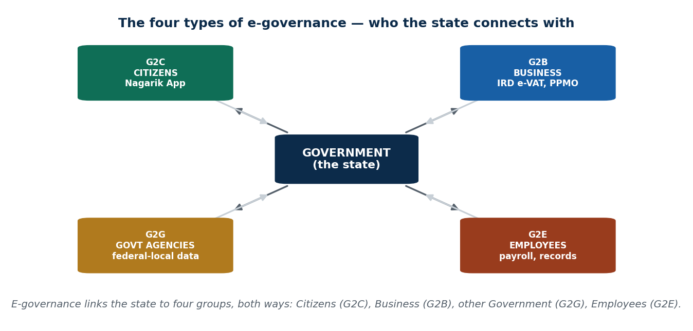

| Type | Full form | Meaning | Example |
|---|---|---|---|
| **G2C** | Government to Citizen | Services delivered to the public | Online certificate application |
| **G2B** | Government to Business | Services for businesses | Business registration |
| **G2G** | Government to Government | Departments sharing data with each other | Shared citizen database between ministries |
| **G2E** | Government to Employee | Internal services for staff | Payroll system |

## 6.3 The process and structure of e-governance

### The process flow model

> **INPUT → PROCESS → OUTPUT → FEEDBACK**

| Stage | What happens | Examples |
|---|---|---|
| **Input** | The citizen submits an application online | Uploading a citizenship or academic document; entering an identification number |
| **Process** | The system verifies against the database and an officer reviews | Automated identity validation; AI-supported fraud detection |
| **Output** | The certificate or approval is issued | A downloadable digital certificate |
| **Feedback** | The citizen is notified and asked for feedback | SMS or email notification; satisfaction survey link |

> **Student certificate example.** *Traditional:* go to the office → fill a form → wait in a queue →
> come back later. *Digital:* open the app → upload the document → receive SMS approval. Time saved is
> roughly **60–70%**, and verification happens automatically in the database.

### The five core elements

| Element | Meaning | Example / scenario |
|---|---|---|
| **Digital service delivery** | Online portals and apps that actually deliver the service | A tax-filing or service-request website; a farmer checking crop-subsidy status online |
| **Interoperability** | Departments share data with each other instead of each holding its own copy | Health and tax records integrated; one citizen database used by several ministries |
| **Citizen-centric design** | A simple interface built around the user, not the bureaucracy | A mobile-friendly government app; voice assistance for an elderly citizen |
| **Data governance** | Privacy and security rules for citizen data | An encrypted citizen database |
| **ICT infrastructure** | Internet, servers and cloud underneath it all | A national data centre |

### The four architecture layers

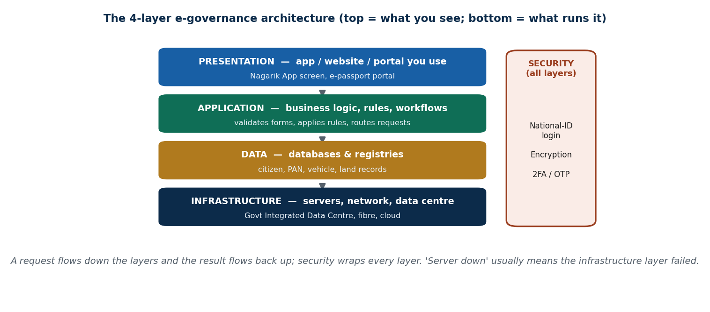

| Layer | What it holds | Example |
|---|---|---|
| **Presentation layer** | The citizen's interface — website or app | A mobile government service portal |
| **Application layer** | The processing logic for each service | A complaint management system |
| **Data layer** | Government databases | The citizen identity registry |
| **Infrastructure layer** | Network, storage, cloud | National data centre and connectivity |

### The transformation model

Government does not jump straight to digital. It moves in three steps:

> **Paper workflow** (manual certificate verification) → **digital internal workflow** (staff process
> requests inside a system) → **online service delivery** (citizens use a portal directly).
>
> In flow terms: *paper form → digital form → automated review → notification.* The end state is that
> **no physical file moves inside the office at all.**

### Security, infrastructure and people

| Area | What is required |
|---|---|
| **Security and governance control** | Cybersecurity protection (firewalls, intrusion detection) · digital identity authentication (national ID login) · data encryption · fraud detection (transaction monitoring) · two-factor authentication and OTP verification |
| **Infrastructure** | High-speed connectivity including 4G/5G rural expansion · government cloud or data centres · backup and disaster recovery · reliable server architecture. **Challenge: mountain geography makes connectivity expensive** |
| **Human and organizational change** | Digital skills training for government staff · workflow redesign to replace paper file movement · public digital literacy programmes (community digital education centres) · change management inside institutions. **Challenge: resistance to digital transition** |

> **E-governance is a socio-technical transformation.** Infrastructure, policy and human skill are all
> essential. Technology should simplify governance, not complicate it — and citizen satisfaction is
> the real goal.

### Benefits, challenges and the future

| Benefits | Challenges in Nepal and other developing countries |
|---|---|
| Faster processing and instant certificate download | **Digital literacy gap** — older citizens struggle with apps |
| Less paperwork and lower administrative cost | **Internet access inequality** — remote mountain areas |
| Increased transparency and reduced corruption risk | **Cybersecurity threats** — hacking and phishing |
| Better public trust | **Organizational resistance** — staff prefer familiar paper files |
| 24/7 availability | **High infrastructure investment cost** — data centres and networks |

**Where digital governance is heading:** AI-assisted administration (citizen support systems) · smart
city monitoring (traffic sensor integration) · predictive policy-making (health outbreak prediction) ·
**blockchain for record security** (a tamper-proof land registry) · real-time public service analytics.

> **Two scenarios worth being able to discuss.**
> **Blockchain land registration.** *Advantages:* records cannot easily be altered or corrupted;
> ownership history is transparent; verification is faster; fraud risk falls. *Limitations:* high
> implementation cost; the legal system must recognise it; it needs strong infrastructure.
> **National ID as a digital wallet.** *Features:* identity verification, government subsidy transfer,
> payment for public services, travel and authentication. *One digital identity, many services.*
> *Caution:* cybersecurity must be very strong, because one breach exposes everything.

> **And the practical one — rural access.** Solutions include community digital service centres,
> mobile government apps, offline-to-online hybrid systems, rural internet expansion, and digital
> literacy programmes. **Digital governance must include rural citizens, not only city people.**

## 6.4 Government initiatives in Nepal

Nepal's public administration is in a digital transformation phase, focused on citizen digital
identity, online service delivery, digital payment integration, and broadband and infrastructure
expansion. The purpose: improve efficiency, reduce corruption risk, increase transparency, make access
citizen-friendly, and support the wider digital economy.

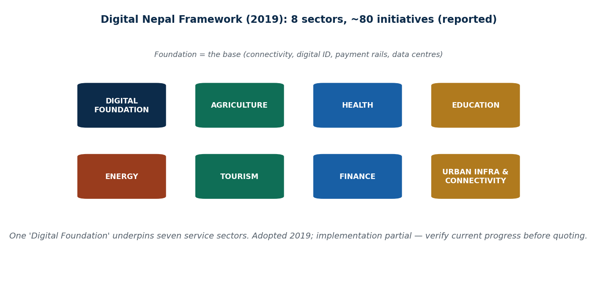

### Nagarik App

| | |
|---|---|
| **Purpose** | A centralised mobile platform for citizen services; integrates multiple government services into one app and acts as the citizen's digital interface |
| **Main uses** | Identity verification · service tracking · certificate download |
| **Before** | Multiple office visits, paper documents, long queues |
| **After** | Online document upload, service tracking, SMS or in-app notification |
| **Pros** | Faster service, less paperwork, more transparency |
| **Cons** | Requires a smartphone and internet · digital literacy gap · server stability issues |
| **Example** | A citizen checks PAN verification from a mobile phone |

### ConnectIPS

| | |
|---|---|
| **Purpose** | The national digital payment gateway |
| **Main uses** | Tax payment · examination fees · government service charges · bank transfers |
| **Before** | Travel to the bank, fill a manual voucher, pay physically |
| **After** | Pay online, receive an instant digital receipt |
| **Why it matters** | Promotes a cashless economy, improves financial transparency, reduces corruption risk |
| **Example** | A student pays a university fee online |

### The digital wallet ecosystem

| | |
|---|---|
| **Platforms** | eSewa · Khalti · IME Pay |
| **Purpose** | Support digital financial transactions |
| **Main uses** | Utility bill payment · online shopping · money transfer |
| **Why it matters** | Financial inclusion and convenient payments; supports e-commerce and the digital economy |
| **Pros** | Fast, convenient, cashless |
| **Cons** | Fraud risk · internet dependency · requires a device |
| **Example** | A citizen pays an electricity bill from a mobile phone |

### Online passport application system

| | |
|---|---|
| **Purpose** | Appointment-based passport service |
| **Main uses** | Online appointment booking, digital form submission, SMS notification, service tracking |
| **Before** | Unpredictable queue waiting times, multiple office visits |
| **After** | A scheduled appointment, with SMS notification |
| **Why it matters** | Reduces crowding and **limits middleman involvement** |
| **Example** | A citizen attends the passport office only at the scheduled time |

### Government IT authority and data centre

| | |
|---|---|
| **Purpose** | Host government applications and databases; provide secure storage for public service systems; support centralised digital governance |
| **Main uses** | Store citizen service records · host government websites and applications · support e-governance portals · enable inter-department data sharing |
| **Why it matters** | Improves data security and reliability · avoids duplicated government IT infrastructure · supports a centralised architecture · helps disaster recovery and backup |
| **Example** | When a citizen uses the Nagarik App, the request is processed through this centralised hosting infrastructure |

### Broadband expansion policy

| | |
|---|---|
| **Purpose** | Provide internet access to rural and remote areas; support digital public services; promote digital inclusion; enable online education, banking and government services |
| **Main uses** | Rural broadband expansion · supporting e-governance platforms · improving communication infrastructure |
| **Why it matters** | Reduces the urban–rural digital gap, lets citizens use government services online, supports digital economic growth, and helps education and healthcare |
| **Example** | A student in a mountain district attends online classes instead of travelling long distances |

**Remaining challenges:** cybersecurity risk · infrastructure inequality between urban and rural areas
· organizational resistance · funding constraints · device affordability · digital literacy gap.
**Future direction:** AI in governance · blockchain transparency systems · smart municipality services
· cloud-based administration.

## 6.5 Digital financial inclusion in Nepal

**Definition:** **digital financial inclusion** means providing **affordable financial services through
digital technology to all citizens** — access to banking and payments anytime, anywhere.

**It includes:** mobile banking · digital wallets · online fund transfer · QR-based payment systems.

### Why it matters

| Financial inclusion helps | Without inclusion |
|---|---|
| Reduce poverty | Rural populations stay outside the formal economy |
| Promote economic participation | Cash dependency increases financial risk |
| Support small businesses | Savings and credit stay out of reach |
| Increase saving habits | |
| Improve access to credit | |

> **Financial inclusion = economic growth.**

### Nepal's digital financial ecosystem

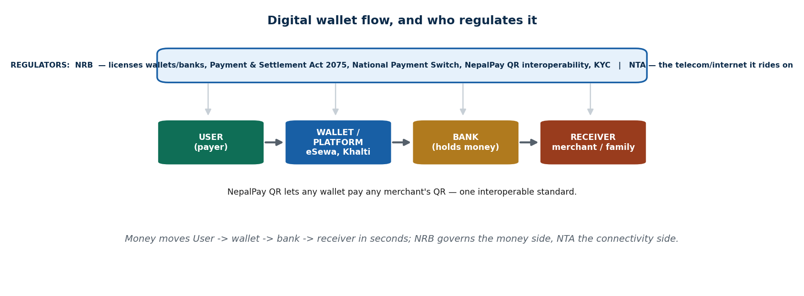

| Digital wallets | Bank-based digital systems |
|---|---|
| **eSewa** — Nepal's first digital wallet, with millions of users | **Mobile banking apps** — all major banks, 24/7 access |
| **Khalti** — popular among young users, many utility payments | **QR payment systems** — ConnectIPS QR and bank-specific QR |
| **IME Pay** — strong remittance connection, growing user base | **Online banking portals** — fund transfers and bill payments |

**Core services provided:** money transfer · utility bill payment (electricity, water, internet) ·
government tax payment · online shopping · school and university fee payment · insurance premium
payment · mobile recharge · remittance collection.

### How a digital wallet works

> 1. The user creates an account → 2. links a bank account → 3. loads a balance → 4. pays by mobile or
> QR.
>
> **Transaction flow:** User → Platform → Bank → Receiver. It takes seconds.

### Who benefits, and how

| For individuals | For government | For businesses |
|---|---|---|
| Saves travel time | Better tax monitoring | Faster customer payment |
| No queues | Reduced cash-corruption risk | Less risk from handling cash |
| Instant transaction confirmation | Transparent transactions | Automatic transaction records |
| Easy record tracking | Better data on the formal economy | Wider customer reach |
| Better financial control | Easier to trace money flow | Easier to accept payment |
| No need to carry cash | **Digital payments leave a trail, which makes corruption harder to hide** | *A small tea shop accepting QR serves customers who have no cash, and gets a daily sales record* |

### Before and after

| **Before** | **After** |
|---|---|
| Cash-based economy — carry money, risk theft or loss | Instant digital payment — no cash, secure |
| Manual bookkeeping — paper records, easy to get wrong | Electronic records — automatic tracking, easy history |
| Travel to a bank branch — wasted time, queues, bank hours only | Mobile banking — 24/7, anywhere, no travel |

> **Case: a vegetable farmer.** *Before:* travel to the market to collect payment, losing time and
> transport money, and carrying cash home. *After:* the customer pays through a digital wallet, the
> money reaches the bank instantly, and the farmer checks it on a phone. *Impact:* faster access to
> income, lower travel cost, safer, and the farmer can reinvest immediately.

### Problems that still block it

| Rural challenges | Security risks |
|---|---|
| Limited broadband access | **Phishing attacks** |
| Poor mobile network coverage | **OTP fraud** |
| Low digital literacy | **Account hacking** |
| Smartphone affordability | **Fake apps** |
| Lack of trust in digital systems | **Prevention:** awareness programmes · strong authentication · cybersecurity regulation · two-factor authentication · regular security updates |

**The geography factor:** mountain terrain makes infrastructure far more expensive, and remote
villages are hard to reach with fibre.
**Solutions needed:** community training programmes · subsidised smartphones · offline-capable apps.

### Who regulates it

| Institution | Role |
|---|---|
| **Nepal Rastra Bank** (central bank) | Oversees digital payments · ensures transaction security · regulates fintech companies · sets interest rates and policy |
| **Nepal Telecommunications Authority** | Monitors network quality · ensures fair competition among telecom operators |

### Economic impact on Nepal

- **Expands the formal economy** — more transactions get recorded, so GDP is measured better.
- **Improves tax transparency** — a digital trail supports audits and reduces evasion.
- **Promotes entrepreneurship** — it is easy to start an online business that accepts payment from
  day one.
- **Supports e-commerce growth** — including cross-border trade.
- **Encourages innovation** — new fintech startups and technology-sector jobs.

**Future trends:** biometric payment (fingerprint, facial recognition) · AI-based fraud detection
(real-time monitoring, pattern recognition) · blockchain for financial transparency (immutable
records, smart contracts) · an **integrated national digital payment gateway** — one interoperable
platform for everything.

> **Three questions commonly asked.** *Can Nepal become fully cashless?* Not soon — connectivity,
> literacy and trust gaps remain, especially rurally. *What happens if the digital payment system
> fails?* Transactions stop entirely, which is why backup, redundancy and offline fallbacks matter.
> *Is digital money safer than cash?* Safer from theft and loss, but exposed to fraud and hacking — so
> safety depends on authentication and user awareness.

## 6.6 Opportunities and challenges for the public sector

This is the honest-assessment section of the unit: what is genuinely working in digital Nepal, and
what is not.

### The wins

**Win 1 — No more queuing.**
*Before:* wake at 4 a.m., queue three hours, be told to come back tomorrow, repeat — and if you live in
Chitwan, take a bus to Kathmandu to do it. *After:* fill the form online, book a slot in two minutes,
arrive at your time, and go home. Passport, land records and tax services now come to the citizen
rather than the other way round.

**Win 2 — Bribery becomes harder.**
*The analogy:* paper files are like dark alleys, where shady things can happen. Digital systems are
like a glass office in daylight, where everyone can see. *Old way:* the file sits on an official's
desk and is "lost" unless something is slid under the table. *New way:* everything is logged,
timestamped and tracked — there is no desk to slide anything under. **E-procurement** publishes
contracts publicly, so they cannot be quietly handed out.

**Win 3 — COVID-19 did in months what policy could not do in years.**
*Necessity beats policy, every time.* Key markers:

| Fact | Detail |
|---|---|
| **IT Decade 2024–2034** | Declared, with the goal of making Nepal an ICT hub |
| **90% of households with internet** | The target set for 2029 in the 16th Plan |
| **UN E-Government Index rank 125** | In 2022, up from 132 in 2020 |

**Win 4 — Local government went online.**
Public notices are posted on Facebook instead of being pinned to a pole outside the ward office ·
complaints can be made by tagging the municipality in a post — not always fixed, but at least visible
· some local governments publish annual budgets and spending, so citizens can check · ward chairs
respond to messages, which was unimaginable in 2005.

### The hard truths

**Challenge 1 — "Online" services that still require you to show up.**
*The story:* Raju reads that he can get his citizenship copy online. He fills the form, submits it,
gets a confirmation email — and when he goes to collect it, the office says *"Sir, please bring the
original form physically."* The numbers tell the story: **about 60 services were promised in the
Nagarik App; about 45 are actually integrated.** *Like ordering food on an app and being told to come
to the kitchen and cook it yourself.*

**Challenge 2 — Rural internet.**
**Only around 41% of rural Nepal has reliable internet.** *The story:* Sita in Humla wants to register
her land through the government app. The app needs internet; the internet needs electricity;
electricity comes four hours a day; her phone battery died two hours ago. **The service exists. Sita
cannot use it.** *The highway is built, but half the country has no vehicle to drive on it.*

**Challenge 3 — Departments do not talk to each other.**
You give your citizenship number to the Inland Revenue Department, the Passport Office, the
municipality and your bank. **Does any system share that data? No.** Each department is its own
island. *Like re-introducing yourself in every class, every day, with a new photo each time.* This is
exactly the **interoperability** failure described in 6.3.

**Challenge 4 — Institutional resistance and political instability.**
Many officials believe that if they ignore the computer long enough, it will go away. And **Nepal has
had 13+ Prime Ministers in 16 years** — every new government means new priorities and another batch of
half-finished digital projects. *Like installing a new operating system on a machine that refuses to
reboot.*

**Challenge 5 — Cybersecurity with no safety net.**
There is still **no proper Personal Data Protection Act**. Your fingerprints, photograph and national
ID data are all stored — and **nobody is legally required to secure them**. Tribhuvan International
Airport has had system crashes that delayed flights. *You built a house with a door but no lock, and
then acted surprised when someone walked in.*

**Challenge 6 — Who gets left out.**
**About 80% of online government service users are male. About 60% are under 30.** Your 65-year-old
grandmother who needs her pension? Nobody designed the app for her. *"Digital services for everyone"
built only for a 24-year-old in Kathmandu.*

### The honest scorecard

| Wins | Challenges |
|---|---|
| No more 4 a.m. queues | Many services still require a physical visit |
| Bribery is harder in a digital trail | Departments do not share data |
| COVID-19 forced rapid adoption | 41% of rural areas lack reliable internet |
| IT Decade 2024–2034 declared | 13+ PMs mean half-finished projects |
| Ward offices went online | 80% of users male, 60% under 30 |
| UN E-Gov rank improved 132 → 125 | No data protection law yet |

> **The honest summary used in class:** Nepal's digitalization is like Nepali cricket. The potential is
> huge and the talent is there — but sometimes the pitch is bad, the weather ruins the match, and half
> the team did not come to practice. Still, when it works, it is genuinely good.

## 6.7 Economic performance in key sectors

How digitalization is changing Nepal's four biggest economic sectors — and where it is not.

### Sector 1 — Trade and e-commerce

> **Bikash's story.** Bikash in Pokhara used to sell handmade lokta paper only to tourists who walked
> past his shop. Now he lists on Daraz, and orders come from Biratnagar, Birgunj and even abroad. He
> did not need a bigger shop. He needed WiFi.

| The good | The catch |
|---|---|
| Daraz, HamroBazaar and SastoDeal give small sellers a **national market** | Most markets are still heavily cash-based |
| **UPI-Nepal launched in 2024** — Indian tourists can scan and pay | **Nepal graduates from LDC (Least Developed Country) status in 2026**, so preferential trade benefits disappear |
| **Over 1 million UPI transactions** already processed | Digital trade must fill that gap, but readiness is low |
| No middleman needed, so more profit stays with local businesses | *You upgraded the engine but forgot to pave the road* |

### Sector 2 — Tourism

> *Instagram has brought more tourists to Nepal than any brochure ever did.*

| The good | The catch |
|---|---|
| **Direct bookings** — trekking agencies in Namche Bazaar get bookings from German and Japanese travellers through Instagram DMs and Booking.com, with no middleman and more profit | Go two hours outside Kathmandu and it is **cash only**. A tourist with Visa, Apple Pay or Revolut cannot pay at a Ghorepani teashop |
| **QR ticketing** — Pashupatinath and Bhaktapur Durbar Square use QR-based tickets: faster entry, no fake tickets, less cash handling | Digital marketing has **not solved the off-season problem**. Tourists still mostly arrive October–November and March–April; the rest of the year the trails are empty |
| **Global campaigns** — Visit Nepal campaigns on YouTube reach millions at almost no cost compared with television | |

### Sector 3 — Agriculture

| The good | The catch |
|---|---|
| **AI disease detection** — TelePlantDoctor (FAO + Nepal, 2024): a farmer photographs a sick plant and gets a diagnosis. *Like a doctor's appointment for your tomatoes* | Agriculture employs Nepal's **largest workforce**, but those farmers are mostly older, in hill and mountain areas, with poor connectivity and very low digital literacy |
| **Mobile banking reaches farmers** — eSewa and Khalti used to buy seed and fertiliser and to receive payment for produce, with no cash to carry | Smartphone ownership is low and 2G coverage is common, so the better the app gets, the wider the gap between those who can use it and those who cannot |
| **Digital weather forecasting** — farmers plan planting and harvest using weather apps, so less crop is lost | **The tool is excellent. The access is broken.** |

> **Kanchhi Maiya in Sindhupalchok.** The plant disease app works beautifully. But she has a 2G
> connection, a cracked-screen phone her son left behind, and no idea what "download the update"
> means. **The app exists. She cannot use it.** This is the whole agriculture story in one sentence:
> *great tools, wrong audience — fix the access, not the app.*

### Sector 4 — SMEs

**SMEs are about 90% of Nepal's businesses and employ over 50% of the workforce.**

| The good | The catch |
|---|---|
| **The momo pasal** — an owner in New Baneshwor now accepts eSewa and Khalti. Customers prefer it, no change needs keeping, and sales went up. A simple change with a big effect | **Banks want collateral.** Most SME owners — especially women — do not have it. Digital finance exists, but the loan door is only half open |
| **The saree shop** — a shop in Birgunj ships sarees to Dharan through Instagram orders and Facebook Marketplace, never meeting the customer, at zero extra cost | **Skills gap.** Owners are excellent at their craft but have no idea how SEO, digital advertising or a Google Business listing works. The potential is large; the training is not there |

### The sector scorecard

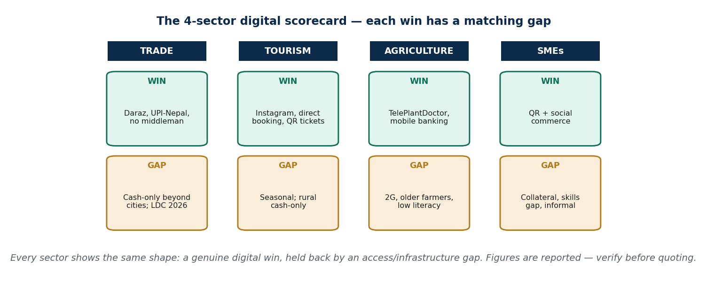

| Sector | Digital win | Digital gap |
|---|---|---|
| **Trade** | E-commerce boom, UPI payments, Daraz sellers reaching a national market | Still mostly cash-based; LDC graduation pressure in 2026 |
| **Tourism** | Global reach through Instagram, online bookings, QR ticketing at heritage sites | Rural tourist areas are cash-only; the off-season problem is unsolved |
| **Agriculture** | AI plant-disease app, mobile banking for farmers, digital weather forecasts | Poor connectivity, older farmers, very low digital literacy |
| **SMEs** | Facebook and Instagram selling, digital payments adopted, access to the national market | No collateral for loans, skills gap, no digital training |

**One line for each sector (the exam-ready version):**

- **Trade** — the Daraz seller is winning; the cash-only shopkeeper is being left behind.
- **Tourism** — social media sells Nepal better than any brochure ever did, but only Kathmandu
  tourists can pay digitally.
- **Agriculture** — great tools, wrong audience. Fix the access, not the app.
- **SMEs** — big opportunity, small support. Half the door is open.

### Key words from Unit 6

Digitalization in government · e-governance · transparency, efficiency, accountability, participation ·
G2C, G2B, G2G, G2E · input–process–output–feedback · digital service delivery · interoperability ·
citizen-centric design · data governance · ICT infrastructure · presentation / application / data /
infrastructure layer · process transformation model · two-factor authentication · OTP · socio-technical
transformation · Nagarik App · ConnectIPS · eSewa, Khalti, IME Pay · online passport system ·
government data centre · broadband expansion policy · blockchain land registry · national ID as
digital wallet · digital financial inclusion · QR payments · remittance · NRB · Nepal
Telecommunications Authority · phishing · OTP fraud · formal economy · e-procurement · IT Decade
2024–2034 · UN E-Government Index · Personal Data Protection Act (missing) · LDC graduation 2026 ·
UPI-Nepal · TelePlantDoctor · SMEs · collateral · digital skills gap.

### Summary — Unit 6

- **E-governance** is government using ICT to deliver services efficiently and transparently, aiming at
  transparency, efficiency, accountability and citizen participation, in four forms: **G2C, G2B, G2G,
  G2E**.
- Its process is **input → process → output → feedback**; its core elements are digital service
  delivery, interoperability, citizen-centric design, data governance and ICT infrastructure; its
  architecture has presentation, application, data and infrastructure layers.
- Nepal's main initiatives are the **Nagarik App**, **ConnectIPS**, the **wallet ecosystem** (eSewa,
  Khalti, IME Pay), the **online passport system**, the **government data centre**, and **broadband
  expansion**.
- **Digital financial inclusion** means affordable financial services for everyone through technology.
  It benefits individuals (time, safety, records), government (tax transparency, less cash corruption)
  and businesses (faster payment, wider reach) — and is regulated by **NRB** and the **Nepal
  Telecommunications Authority**.
- Public-sector **wins**: no queues, harder bribery, COVID-driven adoption, local governments online,
  the IT Decade 2024–2034, and the UN E-Gov rank rising from 132 to 125.
- Public-sector **challenges**: services that still need a physical visit (45 of 60 Nagarik services
  integrated), only ~41% rural reliable internet, no data sharing between departments, institutional
  resistance plus political instability (13+ PMs in 16 years), no Personal Data Protection Act, and
  exclusion (80% of users male, 60% under 30).
- Sector performance: **trade** gains a national market but faces LDC graduation in 2026; **tourism**
  gains global reach but stays cash-only outside the cities; **agriculture** has excellent tools that
  the actual farmers cannot access; **SMEs** (90% of businesses, 50%+ of jobs) adopt payments easily
  but lack collateral and digital skills.

<!-- question-bank:unit6:begin -->
## 6.T Test yourself — Unit 6

Work through the questions first and keep the answer key covered. Parts A and B have fixed answers, given at the end of this section; Parts C to E are the open questions that carry the most marks in an exam, so practise writing them out in full.

### Part A — Multiple choice

**A1.** E-governance is best defined as:

  *a)* government websites only  ·  *b)* using ICT to deliver & run public services  ·  *c)* buying office computers  ·  *d)* the internet

**A2.** A citizen filing VAT on the IRD portal is which type?

  *a)* G2C  ·  *b)* G2B  ·  *c)* G2G  ·  *d)* G2E

**A3.** The correct order of the e-governance process model is:

  *a)* output-input-process-feedback  ·  *b)* input-process-output-feedback  ·  *c)* process-input-feedback-output  ·  *d)* input-output-process-feedback

**A4.** Which architecture layer holds citizen, PAN and vehicle registries?

  *a)* presentation  ·  *b)* application  ·  *c)* data  ·  *d)* infrastructure

**A5.** The Digital Nepal Framework (2019) is best described as:

  *a)* a bank  ·  *b)* a wallet  ·  *c)* a roadmap of ~80 initiatives across 8 sectors  ·  *d)* a law banning cash

**A6.** Which is the 'base' sector every other sector depends on?

  *a)* Tourism  ·  *b)* Digital Foundation  ·  *c)* Energy  ·  *d)* Health

**A7.** Who is Nepal's regulator that licenses wallets and mandates NepalPay QR interoperability?

  *a)* NTA  ·  *b)* NRB (Nepal Rastra Bank)  ·  *c)* Daraz  ·  *d)* the ward office

**A8.** Digital financial inclusion is best measured by:

  *a)* how many own a phone  ·  *b)* how many have an account  ·  *c)* effective USE of affordable formal services  ·  *d)* number of banks

**A9.** Nepal's biggest legal gap for protecting citizens' digital data is:

  *a)* too many privacy laws  ·  *b)* no internet  ·  *c)* no dedicated Data Protection Act  ·  *d)* no computers

**A10.** Making a service 'digital-only' can widen the:

  *a)* budget  ·  *b)* digital divide (excludes rural/poor/old/etc.)  ·  *c)* internet speed  ·  *d)* tax base

**A11.** Nepal's reported LDC graduation around 2026 matters for digital trade because it:

  *a)* bans e-commerce  ·  *b)* removes some trade preferences, so efficient digital trade becomes urgent  ·  *c)* closes Daraz  ·  *d)* adds tariffs on wallets

**A12.** Digital tourism's core win for a small operator is:

  *a)* free hotels  ·  *b)* near-zero-cost global reach & direct booking  ·  *c)* no tourists  ·  *d)* government subsidy

**A13.** The single phrase that best captures Nepali digital agriculture is:

  *a)* no tools exist  ·  *b)* fully digital  ·  *c)* great tool, broken access  ·  *d)* illegal

**A14.** SMEs matter to Nepal's digital economy because they are reported to be:

  *a)* 5% of firms  ·  *b)* foreign-owned  ·  *c)* ~90% of businesses & 50%+ of jobs  ·  *d)* all in Kathmandu

### Part B — Unit review

The whole unit in one pass.

**B1.** E-governance means

  *a)* govt websites only  ·  *b)* using ICT to deliver/run public services  ·  *c)* buying computers  ·  *d)* the internet

**B2.** Filing VAT on the IRD portal is

  *a)* G2C  ·  *b)* G2B  ·  *c)* G2G  ·  *d)* G2E

**B3.** The process model order is

  *a)* output-input-process-feedback  ·  *b)* input-process-output-feedback  ·  *c)* process-input-output-feedback  ·  *d)* input-output-feedback-process

**B4.** Citizen/PAN/vehicle registries live in the

  *a)* presentation layer  ·  *b)* application layer  ·  *c)* data layer  ·  *d)* — none

**B5.** Nepal's e-gov maturity is reportedly around

  *a)* emerging  ·  *b)* enhanced  ·  *c)* transactional  ·  *d)* connected

**B6.** The Digital Nepal Framework (2019) is

  *a)* a bank  ·  *b)* a wallet  ·  *c)* a law  ·  *d)* a roadmap of ~80 initiatives / 8 sectors

**B7.** Nepal's payments regulator (licenses wallets, NepalPay QR) is

  *a)* NTA  ·  *b)* NRB  ·  *c)* Daraz  ·  *d)* the ward office

**B8.** Nepal's key data-protection gap is

  *a)* too many laws  ·  *b)* no dedicated Data Protection Act  ·  *c)* no internet  ·  *d)* no computers

**B9.** The digital divide is mainly about

  *a)* app colours  ·  *b)* who is left out (rural/poor/old/etc.)  ·  *c)* server brands  ·  *d)* tax rates

**B10.** Nepal's reported LDC graduation ~2026 implies

  *a)* e-commerce ban  ·  *b)* loss of some trade preferences  ·  *c)* closing Daraz  ·  *d)* wallet tariffs

**B11.** 'Great tool, broken access' best describes Nepali

  *a)* tourism  ·  *b)* agriculture  ·  *c)* banking apps  ·  *d)* e-procurement

**B12.** SMEs are reported to be roughly

  *a)* 5% of firms  ·  *b)* foreign-owned  ·  *c)* all in Kathmandu  ·  *d)* 90% of businesses / 50%+ of jobs

### Part C — Short answer

**C1.** Define e-governance + its 4 goals.

**C2.** Name the G2C/G2B/G2G/G2E types with a Nepal example each.

**C3.** Define digital financial inclusion + 2 benefits.

**C4.** State Nepal's data-protection gap.

**C5.** What is the Digital Nepal Framework's purpose (and its 8 sectors)?

### Part D — Applied case

**D1.** Sita in Humla / Kanchhi Maiya: identify the challenge she faces with a digital service and propose a concrete solution.

**D2.** Pick ONE sector (trade / tourism / agriculture / SMEs) and assess its digital win vs its gap using the scorecard.

### Part E — Discussion

**E1.** 'Can Nepal be a fully digital, cashless, e-governed society by 2035?' Argue using the scorecard, the data-protection gap, and the digital divide.

**E2.** Name a Nepali e-service and the goal (transparency/efficiency/accountability/participation) it serves.

**E3.** At which maturity stage is Nepal, and what would move it to 'connected'?

**E4.** Name one policy that is 'built' and one that is still 'written', and why.

**E5.** Name one rural inclusion barrier and its concrete solution.

**E6.** Pick a digital win and state its matching gap and one fix.

**E7.** Name one trade/tourism digital win and its matching gap beyond the cities.

**E8.** Using the 4-sector scorecard, can Nepal be cashless & e-governed by 2035? Defend a verdict.

### Answers — Unit 6

| # | Answer | Why |
|---|---|---|
| **A1** | **b)** using ICT to deliver & run public services | It is the digitalization of government service and interaction, not merely owning computers or a website. |
| **A2** | **b)** G2B | The state is serving a business (tax filing) — Government-to-Business. |
| **A3** | **b)** input-process-output-feedback | The citizen submits (input), the system processes, delivers the result (output), then feedback closes the loop. |
| **A4** | **c)** data | The data layer is the databases/registries; infrastructure is the servers/network beneath them. |
| **A5** | **c)** a roadmap of ~80 initiatives across 8 sectors | It is a national roadmap; the '8 sectors / ~80 initiatives' figures are reported — verify current status. |
| **A6** | **b)** Digital Foundation | Digital Foundation = connectivity, digital ID, payment rails, data centres — the base for the other seven. |
| **A7** | **b)** NRB (Nepal Rastra Bank) | NRB regulates payments/money (Payment & Settlement Act 2075); NTA regulates the telecom/internet it rides on. |
| **A8** | **c)** effective USE of affordable formal services | Inclusion is about access AND use/benefit — a dormant account is not inclusion. |
| **A9** | **c)** no dedicated Data Protection Act | Privacy Act 2075 & ETA 2063 exist but are thin/dated; there is no unified modern data-protection law. (Verify status.) |
| **A10** | **b)** digital divide (excludes rural/poor/old/etc.) | Without an assisted/offline path, digital-only excludes those on the wrong side of the divide. |
| **A11** | **b)** removes some trade preferences, so efficient digital trade becomes urgent | Losing preferences raises the pressure to compete on efficient, formal, digital trade. (Figure reported.) |
| **A12** | **b)** near-zero-cost global reach & direct booking | Promotion, direct booking and reviews let a tiny operator sell worldwide without an agent. |
| **A13** | **c)** great tool, broken access | The AI/mobile tools are excellent, but older, rural, 2G, low-literacy farmers can't reach them. |
| **A14** | **c)** ~90% of businesses & 50%+ of jobs | SMEs are the backbone, so their digital adoption largely IS the digital economy. (Figures reported.) |

| # | Answer |
|---|---|
| **B1** | **b)** using ICT to deliver/run public services |
| **B2** | **b)** G2B |
| **B3** | **b)** input-process-output-feedback |
| **B4** | **c)** data layer |
| **B5** | **c)** transactional |
| **B6** | **d)** a roadmap of ~80 initiatives / 8 sectors |
| **B7** | **b)** NRB |
| **B8** | **b)** no dedicated Data Protection Act |
| **B9** | **b)** who is left out (rural/poor/old/etc.) |
| **B10** | **b)** loss of some trade preferences |
| **B11** | **b)** agriculture |
| **B12** | **d)** 90% of businesses / 50%+ of jobs |

<!-- question-bank:unit6:end -->

---

# Course-Wide Quick Revision

Everything in the course, compressed. Use this in the last week: if you can explain every row below in
your own words, you know the course.

## R1. The comparisons you must be able to write

| # | Comparison | The one-line difference |
|---|---|---|
| 1 | **Digital economy vs knowledge economy** | Technology, data and platforms vs skills, expertise and innovation. Scale vs ideas. Transactions vs patents |
| 2 | **Digitization vs digitalization vs digital transformation** | Data becomes digital · process improves · the business itself changes |
| 3 | **Traditional vs information vs digital economy** | Technology absent · technology assists · technology *is* the activity |
| 4 | **Pipeline (digital) business vs platform business** | Makes and sells a product vs connects groups and lets them trade |
| 5 | **Direct vs indirect network effect** | More users of the *same* type (WhatsApp) vs more users of a *different* type (Daraz buyers and sellers) |
| 6 | **Network effect vs viral effect** | Gets more *useful* with more users vs merely *spreads* fast |
| 7 | **Network effect vs flywheel** | Natural characteristic vs engineered system designed to produce dominance |
| 8 | **Lock-in vs switching cost** | The platform's hold on you vs the price *you* pay to leave |
| 9 | **Walled garden vs multi-homing** | Closed ecosystem you stay inside vs using several competing platforms at once |
| 10 | **Economies of scale vs scope** | Cost per user falls as you grow vs one infrastructure serving many services |
| 11 | **Monopoly vs oligopoly vs monopolistic competition vs monopsony vs oligopsony** | One seller · a few sellers · many sellers with differentiated products · one buyer · a few buyers |
| 12 | **Traditional vs digital market** | Slow, local, costly to expand vs instant, global, cheap to scale — fragmented vs winner-takes-most |
| 13 | **Competition vs cooperation vs co-opetition** | Fighting for users · working together · cooperating upstream while competing downstream |
| 14 | **Infrastructure vs platform vs application layer** | Capability (networks, servers) · tools (OS, cloud, APIs) · experience (the app you open) |
| 15 | **Innovation vs invention** | Applying technology to create value vs creating the technology itself |
| 16 | **Business model vs market model** | Static: who pays for what · Dynamic: how users, prices and interactions behave over time |
| 17 | **Traditional vs digital globalization** | Goods, slow, costly, physical vs data and services, fast, cheap, virtual |
| 18 | **Digital money vs digital currency** | NPR in electronic form inside eSewa vs money that is digital by design (Bitcoin, CBDC) |
| 19 | **Cryptocurrency vs stablecoin vs CBDC** | Decentralised and volatile · pegged and semi-centralised · central-bank issued and legal tender |
| 20 | **Symmetric vs asymmetric information** | Both sides know the same vs one side knows more |
| 21 | **Adverse selection vs moral hazard** | **Before** the deal: bad options dominate · **After** the deal: carelessness because someone else bears the risk |
| 22 | **Perfect vs imperfect information** | Textbook assumption vs reality |
| 23 | **Signalling vs screening** | The **informed** side proves quality (warranty, degree) vs the **uninformed** side sets a test or menu so the truth reveals itself (test ride, deductible menu). Same goal, opposite actor |
| 24 | **Versioning vs price discrimination vs bundling** | One product in tiers · a different price per buyer · many items for one price — three ways to sell the same information repeatedly |
| 25 | **Explicit vs tacit knowledge** | Written down and transferable vs personal, experiential, hard to express |
| 26 | **G2C vs G2B vs G2G vs G2E** | Government to citizen · business · government · employee |
| 27 | **DAI vs DGI** | World Bank: how much digital is *adopted* (people, business, government) vs OECD: how *mature* digital government is (six dimensions) |

## R2. Every classification and list

| Topic | The list |
|---|---|
| **Characteristics of the digital economy** | Data-driven · automation · global connectivity · platform-based · scalability |
| **Digital economy ecosystem** | Consumers · businesses and platforms · government and regulators · technology providers |
| **Drivers of the digital economy** | Technological · economic · social · business |
| **Features of the K-economy** | Human capital · innovation and R&D · information flow · digital infrastructure · collaboration and networks |
| **Drivers of the K-economy** | Human capital development · technology and infrastructure · innovation and R&D · knowledge workers · knowledge companies · R&D and IP |
| **Four industrial revolutions** | Steam (1760s–1840s) · electricity and mass production (1870s–1914) · computers and automation (1960s–2000s) · AI, data and smart systems (2000s–) |
| **Drivers of 4IR** | AI · IoT · big data · automation and robotics · cloud computing |
| **Characteristics of 4IR** | Speed · scope · impact · integration |
| **Digital Nepal Framework sectors (8)** | Education · health · agriculture · finance · tourism · governance · commerce and industry · infrastructure and connectivity |
| **How platforms create value (5)** | Reduce transaction costs · efficient matching · build trust · provide tools and infrastructure · create network value |
| **Chicken-and-egg solutions** | Subsidise one side · build inventory manually · launch dense not wide · exclusive partnerships · freemium · incentives |
| **MSP revenue models** | Commission · advertising · subscription/freemium · data monetisation · seller services |
| **MSP risks** | Dependency · monopoly · data privacy · negative network effects · regulatory risk · disintermediation · platform envelopment |
| **Types of network effect** | Direct · indirect (cross-side) · data · technology/standard |
| **Platform growth stages** | Cold start → critical mass → growth acceleration → maturity |
| **Flywheel loops (4)** | Acquisition · activation · engagement · retention/reinforcement |
| **Types of switching cost (5)** | Financial · learning/effort · data/asset loss · network loss · psychological/habit |
| **Forces creating monopolies (6)** | Network effects · economies of scale · economies of scope · data advantage · zero marginal cost · entry barriers |
| **Government tools against big tech** | Data portability · interoperability · antitrust fines · bans · breaking up firms |
| **DAI pillars (3)** | People · business · government |
| **DGI dimensions (6)** | User-centricity · digital by design · data-driven public sector · proactiveness · government as a platform · open by default |
| **Types of digital market** | B2C · B2B · C2C · C2B · P2P/sharing |
| **Forms of cooperation** | Joint platforms · partnerships (co-branding, shared logistics, joint marketing) · service integration |
| **Types of digital innovation (6)** | Product · process · business model · service/customer experience · marketing · organizational |
| **Technologies driving innovation** | AI · IoT · cloud · big data · AR · VR |
| **Innovation process** | Ideation → prototype/MVP → scale |
| **Digital business models** | Platform · subscription · freemium · sharing · marketplace · advertising · e-commerce · ecosystem · usage-based · experience · hybrid/data |
| **Value creation models** | Platform/ecosystem · data-driven · data monetisation · advertising · multi-stakeholder · experience-based · value creation loop |
| **Value creation framework** | Inputs → process → outputs → impact |
| **Strategic control points** | Data ownership · algorithms · standards · user relationships |
| **Drivers of digital transformation** | Technological · economic · social · external shocks (COVID-19) |
| **SDGs in focus** | SDG 4 education · SDG 8 decent work and growth · SDG 9 innovation and infrastructure · SDG 16 governance |
| **How DT accelerates SDGs** | Speed · reach · efficiency · transparency · scalability |
| **Evolution of money** | Barter → coins → paper → bank money → digital currency |
| **Types of digital currency** | Cryptocurrency (payment and platform types) · stablecoin (fiat-backed, crypto-backed, algorithmic) · CBDC (retail and wholesale) |
| **Government approaches to crypto** | Complete ban · partial regulation · regulatory sandbox · develop a CBDC |
| **Determinants of asymmetric information (5)** | Cost of information · access · product complexity · technology · regulation |
| **Ways to reduce asymmetric information** | Transparency · reviews and ratings · certification · regulation · technology |
| **Types of intellectual property** | Copyright · patent · trademark |
| **Goals of e-governance (4)** | Transparency · efficiency · accountability · citizen participation |
| **E-governance process** | Input → process → output → feedback |
| **E-governance core elements (5)** | Digital service delivery · interoperability · citizen-centric design · data governance · ICT infrastructure |
| **E-governance architecture layers (4)** | Presentation · application · data · infrastructure |
| **Key sectors in Unit 6** | Trade · tourism · agriculture · SMEs |

## R3. Cause-and-effect chains worth memorising

| Chain |
|---|
| **Network effects:** more users → more value → more users → **winner-takes-most** |
| **Flywheel:** acquisition → activation → engagement → retention → back to acquisition |
| **Data loop:** more users → more data → better algorithm → better product → more users |
| **Adverse selection:** asymmetric information → buyer uncertainty → low price offered → good sellers leave → bad sellers dominate → **market failure** |
| **Cooperation:** high development cost → partnership → shared infrastructure → faster deployment |
| **Standardisation:** different systems → agree a standard → smooth user experience → wider adoption |
| **Layered model:** infrastructure (capability) → platform (tools) → application (experience) → user |
| **Innovation:** real problem → digital solution → user adoption → business growth |
| **Economic growth:** digital skills → digital jobs → income → higher GDP → economic growth |
| **Lock-in:** engagement → data → personalisation → stickiness → competitive moat |
| **E-governance:** digital workflow → audit trail → less discretion → reduced corruption |
| **Financial inclusion:** digital payment → recorded transaction → formal economy → better tax base and GDP measurement |

## R4. The Nepal fact file

| Fact | Detail |
|---|---|
| **Payment wallets** | eSewa (first and largest), Khalti (popular with youth), IME Pay (remittance-linked) |
| **QR network** | FonePay; interoperable QR mandated so one code works across wallets |
| **Interbank infrastructure** | NCHL (Nepal Clearing House); **ConnectIPS** as the national payment gateway |
| **Platforms** | Daraz, SastoDeal, HamroBazaar, NepBay, SmartDoko, BhatBhateniOnline (commerce) · Pathao, InDrive, Tootle (mobility) · Foodmandu (food) · Hamro Patro (utility) |
| **Knowledge companies** | Fusemachines, Leapfrog Technology, CloudFactory, Genese Cloud, Yarsa Games, Deerwalk |
| **Telecom / infrastructure** | NTC and Ncell (4G backbone) |
| **Regulators** | Nepal Rastra Bank (payments, PSP/PSO, KYC, transaction limits, National Payment System Strategy) · Nepal Telecommunications Authority (network quality, fair competition) |
| **Policies** | IT Policy 2072 · proposed Startup Act (5–7 year tax break, ~NPR 100M turnover limit) · Digital Nepal Framework (8 sectors) · Privacy Act 2075 · Electronic Transactions Act (cybercrime) · **no dedicated data protection law** |
| **Government platforms** | Nagarik App · ConnectIPS · online passport appointment system · IRIS tax portal · government data centre · broadband expansion policy |
| **Digital adoption status** | People moderate–high · business low–moderate · government early stage |
| **UN E-Government Index** | Rank **125 in 2022**, up from **132 in 2020** |
| **IT Decade** | **2024–2034**, with the goal of making Nepal an ICT hub |
| **Internet target** | **90% of households** with internet by 2029 (16th Plan) |
| **Nagarik App services** | ~**60 promised**, ~**45 actually integrated** |
| **Rural internet** | Only about **41%** of rural Nepal has reliable internet |
| **Service user profile** | ~**80% male**, ~**60% under 30** |
| **Political instability** | **13+ Prime Ministers in 16 years** → half-finished digital projects |
| **Trade** | **UPI-Nepal launched 2024**, 1 million+ transactions · **LDC graduation in 2026** removes trade preferences |
| **Tourism** | QR ticketing at Pashupatinath and Bhaktapur Durbar Square · Instagram and Booking.com direct bookings · season concentrated Oct–Nov and Mar–Apr |
| **Agriculture** | **TelePlantDoctor** (FAO + Nepal, 2024) AI plant-disease app · largest workforce, lowest digital literacy |
| **SMEs** | ~**90% of businesses**, **50%+ of employment** · blocked by collateral requirements and the skills gap |
| **Crypto** | **Banned in Nepal** — untraceable transactions, money-laundering risk, fraud potential, no consumer protection |
| **Regional comparisons** | India: UPI, Aadhaar, ONDC (digital public infrastructure) · Sri Lanka: PickMe beating Uber through local relevance |

## R5. Fifty-word glossary

**Adverse selection** — bad options dominate a market because buyers cannot tell quality before the
deal. **Algorithmic bias** — systematic unfairness in automated decisions. **Algorithmic management**
— platforms directing workers through AI, ratings and automatic task allocation. **API** — a bridge
that lets two applications talk to each other. **Asymmetric information** — one party knows more than
the other. **Blockchain** — a shared, tamper-resistant record of transactions. **Bounded rationality**
— settling for a "good enough" decision instead of analysing everything. **Bundling** — selling many
items together for one price, extracting more value than selling each alone. **CBDC** — digital money
issued by a central bank. **Chicken-and-egg problem** — neither side of a platform will join until the
other does. **Cold start** — the stage where a platform has too few users to be useful.
**Co-opetition** — cooperating and competing with the same firm at once. **Critical mass** — the point
where network effects start working. **Digital divide** — the gap between those with digital access
and skills and those without. **Digital twin** — a virtual copy of a real object or process.
**Digitization / digitalization / digital transformation** — data goes digital / processes improve /
the business changes. **Disintermediation** — users bypassing the platform that introduced them.
**Dynamic pricing** — prices that change automatically with demand and behaviour. **Economies of
scale** — cost per unit falls as volume rises. **Economies of scope** — one infrastructure supporting
many services. **E-WOM** — electronic word of mouth: online reviews, ratings and recommendations.
**Flywheel** — a deliberately designed loop that compounds growth. **Freemium** — free basic service,
paid premium features. **Gig economy** — short, task-based work arranged through platforms. **Human
capital** — the economic value of people's skills and knowledge. **ICT4D** — using ICT for social and
economic development. **Interoperability** — different systems working with each other. **KYC** — Know
Your Customer identity verification. **Liquidity** — how quickly supply meets demand on a platform.
**Lock-in** — users facing a high cost to leave. **Market failure** — a market that stops allocating
resources efficiently. **Market tipping** — the moment one platform becomes unbeatable. **Moral
hazard** — carelessness after a deal because someone else carries the risk. **Multi-homing** — using
several competing platforms at once. **Multi-sided platform** — a business connecting two or more
interdependent groups. **MVP** — the simplest version of a product that tests the idea. **Network
effect** — value rising as more people use something. **Orchestration** — the platform designing and
controlling how value is exchanged. **Platform envelopment** — a big platform absorbing a smaller
one's function. **Price discrimination** — charging different buyers different prices for the same
thing. **PSP / PSO** — payment service provider / operator, licensed by NRB. **Regulatory
sandbox** — a supervised space for testing new financial products. **Screening** — the uninformed side
designing a test or menu so the informed side reveals its type. **Search cost** — the time, effort
and money needed to find information. **Self-selection** — each type choosing the option that quietly
reveals what they are. **Signalling** — the informed side taking a costly, hard-to-fake action to prove
quality. **Stablecoin** — a digital currency pegged to a stable asset.
**Switching cost** — what a user gives up by moving to a competitor. **Tacit knowledge** — knowledge
that is experienced rather than written down. **Transaction cost** — the cost of making a deal happen
at all. **Value capture** — how a business converts value into revenue. **Value creation loop** —
usage producing data that improves the product that attracts more usage. **Versioning** — selling one
product in several tiers so buyers self-select by willingness to pay. **Walled garden** — a closed
ecosystem controlled by one company. **Winner-takes-most** — one platform taking the large majority of
a market. **Zero marginal cost** — serving one more customer costing almost nothing.

## R6. One sentence per unit

1. **Unit 1** — The digital economy is value created through technology; the knowledge economy is value
   created through people; the Fourth Industrial Revolution fuses both with the physical and biological
   world, and Nepal is entering all three at once with a young population but weak infrastructure.
2. **Unit 2** — Platforms connect groups rather than making products, grow through network effects and
   engineered flywheels, hold users through lock-in, and therefore tend to end in winner-takes-most
   markets that governments must then regulate.
3. **Unit 3** — Digital markets are fast, scalable and data-driven; firms compete *and* cooperate
   inside layered ecosystems; innovation means applying technology to real local problems; and strategy
   means controlling the data, the algorithm and the visibility.
4. **Unit 4** — Digital transformation changes the business itself rather than just its paperwork; it
   is driven by technology, economics, society and crisis; it accelerates the SDGs; and it is
   reshaping money itself through cryptocurrencies, stablecoins and central bank digital currencies.
5. **Unit 5** — Markets run on information; unequal information causes adverse selection, moral hazard
   and market failure; digitalization and AI shrink those gaps but create new ones in the form of
   algorithms, rankings and data power — and intellectual property decides whether creation still pays.
6. **Unit 6** — Nepal has built real digital public services and genuine financial inclusion, but
   fragmented departments, rural connectivity, political instability, missing data protection and an
   excluded majority of citizens mean the tools are ahead of the access.

## R7. A note on the source material

These notes are built from the complete IT 250 lecture set for all six units. Three points of honesty
about the sources:

- **Nepali statistics** (41% rural internet, the 60/45 Nagarik App services, 80% male users, UN E-Gov
  rank 132 → 125, the 2029 and 2026 targets) are reproduced as presented in the lectures. Where you
  cite them in an exam, attribute them to the lecture material rather than to a named report.
- **The syllabus topic "online search engines"** is covered inside the asymmetric-information and AI
  lectures rather than as a separate lecture; it is presented here in section 5.7.
- **"Strategy and the new economics of information"** likewise appears across the AI and digital-markets
  lectures; section 5.9 consolidates it into one place.

> **Final advice.** Most IT 250 questions are answered by naming a concept, defining it in one line,
> giving a Nepali example and then stating one consequence. The tables in R1 and R2 give you the
> concepts and the lists; the Nepal fact file in R4 gives you the examples. Practise the pairing.
