# IT 220 — Unit 6: Transaction Processing, Concurrency Control & Recovery Techniques (S37–S44)
### Full Lecturer-Ready + Student-Revision Material

**Program:** BIM, 4th Semester · **Credits:** 3 · **Unit weight:** 8 lecture hours
**Sessions:** S37–S44 (50 min each) · **Local context:** Nepal / South Asia
**Format:** Built to `COURSE_MATERIAL_STANDARD.md` (incl. §7A depth tables). Slides: `IT220_Unit6.pptx`
(from `build_unit6_pptx.py`); diagrams from `build_unit6_images.py` → `images/`.

> Same two-reader format as Units 1–5. This unit is partly procedural (schedules, precedence graphs,
> recovery walkthroughs), so the deck leans on **solved-problem walkthroughs** and comparison tables.
>
> **Running example (one transaction threaded through all eight sessions):**
> **"Rita sends Rs. 500 from her eSewa wallet to Hari."** This single transfer (debit Rita Rs. 500,
> credit Hari Rs. 500) motivates transactions (S37), ACID (S38), schedules/serializability (S39),
> locking (S40), timestamps (S41), and recovery (S42–S44).

---

## Unit 6 — Learning Outcomes
1. Define a transaction, trace its states, and explain the role of the system log.
2. State and apply the ACID properties to judge whether a transaction is correct.
3. Build and analyse schedules; test for conflict serializability using a precedence graph.
4. Apply Two-Phase Locking and Timestamp Ordering to control concurrency, and recognise deadlock vs starvation.
5. Distinguish deferred-update, immediate-update, and shadow-paging recovery, and design a backup strategy against catastrophic failure.

---
---

# S37 — Introduction to Transaction Processing & System Concepts
**Lecture hour 37 · 50 minutes**

### 🎯 OPENING — Hook `[~5 min]`
[SLIDE] *"Rita taps 'Send Rs. 500' on eSewa. The app debits her wallet, then the wifi dies before Hari is credited. Where did the Rs. 500 go?"* → a transaction must be all-or-nothing.

### 📚 CONTENT `[~35 min]`

#### Concept 1 — What Is a Transaction `[THEORY]` `[~7 min]`
**📖 In Depth.** A **transaction** is a *logical unit of work* — one or more database operations treated as a single, **indivisible** action that either completes entirely or has no effect at all. It begins with **BEGIN** and ends with **COMMIT** (make changes permanent) or **ABORT/ROLLBACK** (undo them). Its basic operations are `read_item(X)` and `write_item(X)`.

> **🌍 Real life.** eSewa transfer = read Rita's balance → debit 500 → credit Hari 500 → commit. If the phone dies after the debit, the whole unit rolls back so Rita's Rs. 500 returns.

> **🎯 Model exam answer.** *"Define a transaction."* A transaction is a logical unit of work comprising one or more DB operations (read/write) executed as a single indivisible action; it begins with BEGIN and ends with COMMIT (permanent) or ROLLBACK (undone). It must be all-or-nothing.

> **🧠 Hook:** "A transaction = one all-or-nothing unit of work, not one SQL line."

> **⚠️ Misconception.** *"A transaction = a single SQL statement."* No — it can group many statements (the debit and the credit are two statements in ONE transaction).

> **🔑 Key terms:** transaction · logical unit of work · BEGIN/COMMIT/ROLLBACK · read_item/write_item · all-or-nothing.

**📊 Depth table — Everyday actions that are really multi-step transactions**

| Action (Nepal / IT) | The steps inside the ONE transaction | What must happen if it fails halfway |
|---|---|---|
| eSewa: Rita sends Rs. 500 to Hari | read Rita → debit 500 → credit Hari → commit | roll back the debit — restore Rita's balance |
| ATM cash withdrawal | read balance → check → debit → dispense cash | if cash not dispensed, re-credit the account |
| IRCTC / bus ticket booking | reserve seat → charge card → issue ticket | if charge fails, release the held seat |
| NEA electricity bill payment | read due amount → debit wallet → mark bill paid | if 'mark paid' fails, refund the debit |
| Bank fund transfer (A→B) | debit A → credit B → log both | undo the debit if the credit never happens |
| Daraz checkout | reserve stock → charge → create order | release the stock if payment is declined |

*ℹ️ Each is ONE transaction made of several operations. 'All-or-nothing' is why none can leave you charged with nothing to show.*

---

#### Concept 2 — Single-User vs Multi-User & Why It Matters `[THEORY]` `[~6 min]`
**📖 In Depth.** A **single-user** system runs one transaction at a time; a **multi-user** system lets many transactions **interleave** and run concurrently. Concurrency — many transactions touching the same data at once — is the entire reason this unit exists. Interleaving is efficient but, if uncontrolled, can corrupt shared data, motivating **concurrency control** (S39–S41).

> **🌍 Real life.** During Dashain, thousands of Daraz shoppers check out in the same second; the DBMS interleaves their operations rather than forcing a queue.

> **🎯 Model exam answer.** *"Why do multi-user systems need concurrency control?"* Because they interleave the operations of concurrent transactions for efficiency, and some interleavings corrupt shared data (e.g. lost update); concurrency control allows the safe interleavings and blocks the unsafe ones.

> **🧠 Hook:** "One-at-a-time is easy; many-at-once is why concurrency control exists."

> **⚠️ Misconception.** *"Concurrency always corrupts data."* No — only SOME interleavings are unsafe; the DBMS's job is to permit the safe ones.

> **🔑 Key terms:** single-user · multi-user · concurrency · interleaving · concurrency control.

---

#### Concept 3 — Why Transactions Go Wrong (Types of Failure) `[THEORY]` `[~6 min]`
**📖 In Depth.** Transactions fail in several ways, and recovery (S42–S44) must handle each: **system crash** (memory/buffer lost), **transaction/system error**, **local logical error** (e.g. insufficient balance), **concurrency-enforcement abort** (DBMS breaks a deadlock or preserves serializability), **disk failure**, and **physical catastrophe** (fire, flood, earthquake).

> **🌍 Real life.** Load-shedding kills a bank server mid-batch (system crash); a Ntc data-center power trip; a fire destroys the disk array (catastrophe).

> **🎯 Model exam answer.** *"List the types of failure a DBMS must recover from."* System crash, transaction/system error, local logical error, concurrency-enforcement abort, disk/media failure, and physical catastrophe — the first four are non-catastrophic (disk intact), the last two catastrophic.

> **🧠 Hook:** "Failures range from a mid-txn crash to a whole data-center gone."

> **⚠️ Misconception.** *"A failure always means the hardware broke."* Many failures are logical (insufficient balance, a chosen deadlock victim) — the transaction aborts cleanly and data stays consistent.

> **🔑 Key terms:** system crash · transaction/local error · concurrency enforcement · disk failure · physical catastrophe.

**📊 Depth table — Each failure type → a Nepali example → how recovery responds**

| Failure type | Example (Nepal / IT) | How the system recovers |
|---|---|---|
| System crash (memory lost) | Load-shedding kills a bank server mid-batch | Reboot → scan log → REDO committed, UNDO the rest |
| Transaction / local error | Rita sends Rs. 500 with only Rs. 300 | Transaction aborts itself; no change made |
| System error | Division by zero in a report job | Abort the transaction; log the error |
| Concurrency enforcement | DBMS aborts one txn to break a deadlock | Abort victim, restart it later |
| Disk / media failure | A hard-disk array fails at a data-center | Restore from backup + archived log (S44) |
| Physical catastrophe | Earthquake / fire destroys the data-center | Off-site backup is the only recovery (S44) |

*ℹ️ The first four are non-catastrophic (disk intact → log-based recovery). The last two are catastrophic (disk gone → only a separate backup saves you).*

---

#### Concept 4 — Transaction States & the State Diagram `[THEORY]` `[~8 min]`
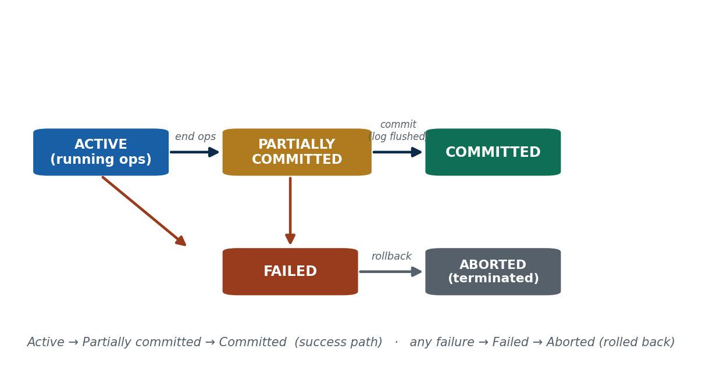

**📖 In Depth.** A transaction moves through defined states: **Active** (executing operations) → **Partially Committed** (last operation done, not yet made permanent) → **Committed** (changes durable). If anything goes wrong it enters **Failed** → **Aborted** (terminated, rolled back). The success path is Active → Partially Committed → Committed; any failure diverts to Failed → Aborted.

> **🌍 Real life.** Rita's transfer is Active while it reads and debits; Partially Committed the instant Hari's credit is computed but not flushed; Committed once eSewa shows "Transfer successful".

> **🎯 Model exam answer.** *"Name and describe the transaction states."* Active (executing read/write ops), Partially Committed (all ops done, changes not yet permanent), Committed (durably stored), Failed (an error occurred), Aborted (rolled back and terminated).

> **🧠 Hook:** "Active → Partially committed → Committed; any failure → Failed → Aborted."

> **⚠️ Misconception.** *"Partially committed means it's done and safe."* No — a partially committed transaction is NOT durable yet; a crash before the commit record is flushed can still lose it.

> **🔑 Key terms:** active · partially committed · committed · failed · aborted · rollback · commit point.

---

#### Concept 5 — The System Log (Journal) `[THEORY]` `[~7 min]`
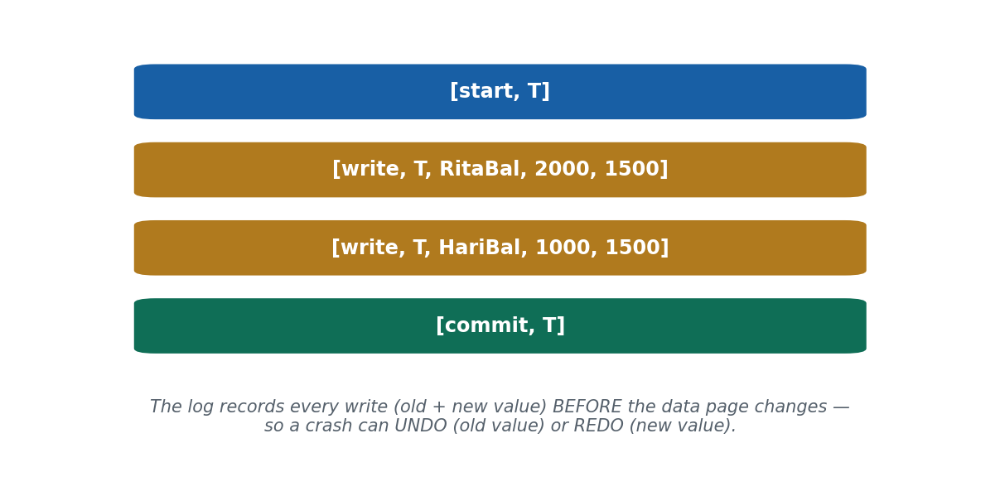

**📖 In Depth.** The **system log** is a sequential record, on **stable storage**, of every write a transaction makes — kept so the system can REDO or UNDO changes after a failure. Entry types: `[start,T]`, `[write,T,X,old,new]`, `[commit,T]`, `[abort,T]`, `[checkpoint]`. The **old value** enables **UNDO**; the **new value** enables **REDO**. Under **Write-Ahead Logging** (S42), the log record is written BEFORE the data page.

> **🌍 Real life.** Rita's transfer logs `[start,T]` → `[write,T,RitaBal,2000,1500]` → `[write,T,HariBal,1000,1500]` → `[commit,T]`.

> **🎯 Model exam answer.** *"What is the system log and why is it needed?"* A sequential record on stable storage of every write ([start],[write,X,old,new],[commit],[abort]); its old values enable UNDO and new values enable REDO after a failure. Recovery is impossible without it.

> **🧠 Analogy & hook.** The log is like a shopkeeper's *khata* (ledger) — every entry recorded before acting, so you can retrace steps. **Hook: "old value → UNDO; new value → REDO."**

> **🔑 Key terms:** system log/journal · [start]/[write]/[commit]/[abort] · old value = UNDO · new value = REDO · stable storage.

**📊 Depth table — Reading the log: each record type and its recovery job**

| Log record | What it stores | Its job in recovery |
|---|---|---|
| [start, T] | Transaction T has begun | Marks where T's work starts in the log |
| [write, T, X, old, new] | T changed item X from old → new | old value → UNDO;  new value → REDO |
| [read, T, X] | T read item X (some systems) | Not needed for undo/redo; used for analysis |
| [commit, T] | T committed successfully | Tells recovery to REDO T (it is durable) |
| [abort, T] | T was rolled back | Tells recovery to UNDO / ignore T |
| [checkpoint] | Buffers flushed at this point | Limits how far back recovery must scan (S42) |

*ℹ️ Recovery is disciplined log-reading: REDO transactions with both [start] and [commit]; UNDO those with [start] but no [commit].*

#### 🛠 ACTIVITY `[~5 min]`
In pairs: name one phone action that is really a multi-step transaction. List its steps and say what should happen if it fails halfway; mark the 'point of no return' (commit).

### 🧠 CHECK FOR UNDERSTANDING `[~5 min]`
- MCQ1: A transaction that executed all operations but is not yet permanent is in which state? → ✅ partially committed
- MCQ2: Which log record lets the system UNDO a change? → ✅ the old value in [write,T,X,old,new]
- Discussion: describe one phone action that is really a multi-step transaction, and what should happen if it fails halfway.

### 📝 SUMMARY `[~2 min]`
(1) A transaction is an all-or-nothing logical unit of work. (2) It moves through defined states; commit is the point of no return. (3) The log records every write so failures can be UNDONE or REDONE. **Next:** the four guarantees every good transaction must keep — ACID.

---
---

# S38 — Desirable Properties of Transactions (ACID)
**Lecture hour 38 · 50 minutes**

### 🎯 OPENING — Hook `[~5 min]`
[SLIDE] *"Rita's Rs. 500 was debited but never credited to Hari — and the bank says 'the system was busy'. Which promise was broken?"* → introduce ACID as four promises.

### 📚 CONTENT `[~35 min]`

#### Concept 1 — Atomicity `[THEORY]` `[~7 min]`
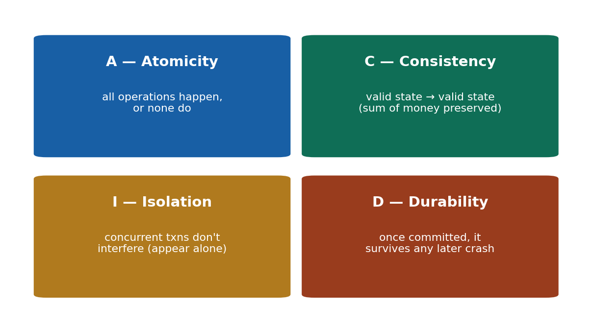

**📖 In Depth.** **Atomicity** guarantees that all operations of a transaction happen, or none do — no half-done transactions. On failure, the recovery manager uses the log's **old values** to UNDO partial changes. It is the direct enforcement of 'all-or-nothing' from S37.

> **🌍 Real life.** eSewa transfer — both the debit AND the credit, or roll back both. Never one without the other.

> **🎯 Model exam answer.** *"Define atomicity."* All of a transaction's operations execute completely or not at all; on failure every change is rolled back (via the log's old values). Both the debit and credit happen, or neither does.

> **🧠 Hook:** "Atomicity = all-or-nothing; a half-done transaction is undone."

> **⚠️ Misconception.** *"If the app crashes, it just leaves things as-is."* No — an incomplete transaction must be UNDONE, not frozen half-done.

> **🔑 Key terms:** atomicity · all-or-nothing · rollback · no partial transactions · recovery manager.

---

#### Concept 2 — Consistency `[THEORY]` `[~7 min]`
**📖 In Depth.** **Consistency** guarantees a transaction takes the database from one **valid state** to another, preserving all integrity constraints and **invariants** (e.g. total money in the system is unchanged by a transfer). The DBMS enforces declared constraints; the developer supplies correct logic. A bug that double-credits (creating money) breaks consistency even if atomicity held.

> **🌍 Real life.** Before: Rita 2000 + Hari 1000 = 3000; after: 1500 + 1500 = 3000. Sum preserved.

> **🎯 Model exam answer.** *"Define consistency."* A transaction moves the DB from one valid state to another, preserving all constraints/invariants (e.g. money conserved). A transaction that broke an invariant (double-credit) would violate consistency.

> **🧠 Hook:** "Consistency = valid state → valid state; the invariant is never broken."

> **⚠️ Misconception.** *"Consistency is the same as atomicity."* No — atomicity is about all-or-nothing execution; consistency is about not violating the rules. A fully-run transaction can still be inconsistent if its logic is wrong.

> **🔑 Key terms:** consistency · valid state → valid state · integrity constraints · invariant · conservation of money.

**📊 Depth table — Consistency: preserving the invariant (money is conserved)**

| Scenario | Before | After — correct | What a bug would do (violates consistency) |
|---|---|---|---|
| Rita → Hari Rs. 500 | Rita 2000, Hari 1000 (=3000) | Rita 1500, Hari 1500 (=3000) | credit Hari twice → 3500 (money created) |
| eSewa cashback Rs. 50 | Wallet 200 (+bank) | Wallet 250, promo-fund −50 | cashback with no matching debit → money created |
| Bank A → B Rs. 10,000 | A 50k, B 20k (=70k) | A 40k, B 30k (=70k) | debit A but skip credit B → 60k (money lost) |
| Ticket refund Rs. 800 | Seat sold, wallet 100 | Seat freed, wallet 900 | refund without freeing seat → seat double-sold |
| NEA bill Rs. 1200 | Wallet 2000, bill due | Wallet 800, bill paid | mark paid without debit → revenue lost |
| Daraz order Rs. 3000 | Stock 5, wallet 5000 | Stock 4, wallet 2000 | charge without reducing stock → oversell |

*ℹ️ Consistency = the invariant (money conserved, stock matched) holds before AND after. The last column is money/goods appearing or vanishing — exactly what consistency forbids.*

---

#### Concept 3 — Isolation `[THEORY]` `[~7 min]`
**📖 In Depth.** **Isolation** guarantees that concurrently executing transactions do not interfere — each behaves as if running alone, even though the DBMS interleaves them for efficiency. No transaction sees another's uncommitted changes. It is enforced by concurrency control (locking S40, timestamps S41); the equivalent serial order is the correctness standard (serializability, S39).

> **🌍 Real life.** Rita sends to Hari while Hari simultaneously pays a shop — neither sees the other's half-finished state.

> **🎯 Model exam answer.** *"Define isolation."* Concurrent transactions do not interfere; each behaves as though executed alone (no transaction sees another's uncommitted data), enforced by concurrency control so the result equals some serial order.

> **🧠 Analogy & hook.** Separate queues at separate bank counters — you don't grab cash from the next person's stack mid-count. **Hook: "interleave freely, but each appears to run alone."**

> **⚠️ Misconception.** *"Isolation means transactions run one-at-a-time."* No — they INTERLEAVE; isolation only requires the RESULT is as if they ran in some serial order.

> **🔑 Key terms:** isolation · no interference · interleave but appear alone · uncommitted data hidden · concurrency control.

---

#### Concept 4 — Durability `[THEORY]` `[~6 min]`
**📖 In Depth.** **Durability** guarantees that once a transaction has committed, its changes survive any subsequent failure. It is achieved by writing the transaction's log records to **stable storage** at commit, so even if the updated data pages are still in the buffer, recovery can REDO the committed changes. 'Committed' therefore means permanent.

> **🌍 Real life.** After eSewa shows "Transfer successful", a power cut one second later cannot erase it.

> **🎯 Model exam answer.** *"Define durability."* Once a transaction commits, its changes persist through any later failure, guaranteed by flushing its log records to stable storage at commit; recovery REDOes committed changes from the log even if data pages were only buffered.

> **🧠 Hook:** "Durability = once committed, it survives any later crash."

> **⚠️ Misconception.** *"Data is written to disk the instant you commit."* No — the data page may still be in the buffer; the LOG record on stable storage is what guarantees durability.

> **🔑 Key terms:** durability · committed = permanent · survives crashes · log on stable storage · REDO from log.

**📊 Depth table — ACID as a checklist: each letter, its job, and the eSewa failure it prevents**

| Property | One-word job | What it guarantees | eSewa failure it prevents |
|---|---|---|---|
| Atomicity | All-or-nothing | Every op happens or none do | Rita debited but Hari never credited |
| Consistency | Valid → valid | Invariants/constraints preserved | A double-credit creating money from nothing |
| Isolation | No interference | Concurrent txns appear to run alone | Two transfers reading each other's half state |
| Durability | Survives crashes | Committed changes are permanent | 'Transfer successful' erased by a power cut |
| (together) | Correctness | A trustworthy transaction | The reason NRB trusts digital wallets |
| (enforced by) | Log + CC | Log = A/C/D; concurrency control = I | — |

*ℹ️ ACID is the literal reason NRB trusts digital wallets, and 'explain ACID' is a near-certain fintech interview question.*

#### 🛠 SOLVED PROBLEM (deck) — Trace Rita → Hari Rs. 500 through Atomicity, Isolation, Durability + the log trace `[start][write][write][commit]`.

#### 🛠 ACTIVITY `[~5 min]`
For each mini-scenario, name the broken ACID property: (a) money debited never credited → Atomicity; (b) 'success' erased by a crash → Durability; (c) a double-credit created money → Consistency; (d) two transfers corrupted each other → Isolation.

### 🧠 CHECK FOR UNDERSTANDING `[~5 min]`
- MCQ1: "Once committed, it survives a crash" is which property? → ✅ durability
- MCQ2: Two transactions interleaving but not corrupting each other is ensured by → ✅ isolation
- Discussion: give a real Nepali payment scenario where breaking *consistency* would let money appear or vanish.

### 📝 SUMMARY `[~2 min]`
(1) Atomicity = all-or-nothing; Consistency = valid→valid. (2) Isolation = no interference; Durability = survives crashes. (3) A/C/D via the log; Isolation via concurrency control. **Next:** which interleavings are actually safe — schedules & serializability.

---
---

# S39 — Serializable Schedules
**Lecture hour 39 · 50 minutes**

### 🎯 OPENING — Hook `[~5 min]`
[SLIDE] *"Rita and Hari both top-up from the SAME shared family eSewa wallet at the exact same second. Whose top-up 'wins' — and is the final balance right?"* → schedules decide correctness.

### 📚 CONTENT `[~35 min]`

#### Concept 1 — Schedules (Histories) `[THEORY]` `[~7 min]`
**📖 In Depth.** A **schedule (history)** is an ordering of the operations of several transactions that preserves each transaction's internal order. A **serial** schedule runs one transaction fully before the next (always correct, but no concurrency); a **non-serial (concurrent)** schedule interleaves operations for speed but must be checked for correctness. The goal: the speed of a non-serial schedule with the correctness of a serial one.

> **🌍 Real life.** On the family wallet, T1 (Rita +500) and T2 (Hari +300) can run serially or interleaved.

> **🎯 Model exam answer.** *"Serial vs non-serial schedule?"* A serial schedule executes transactions one at a time (correct, no concurrency); a non-serial schedule interleaves their operations (efficient but must be verified serializable).

> **🧠 Hook:** "A schedule orders interleaved ops; serial = one-at-a-time, non-serial = interleaved."

> **⚠️ Misconception.** *"Any interleaving is as good as running them one at a time."* No — some interleavings corrupt data; only those equivalent to some serial order are safe.

> **🔑 Key terms:** schedule/history · serial vs non-serial · interleaving · preserves per-transaction order.

---

#### Concept 2 — The Lost-Update Problem `[THEORY]` `[EXAMPLE]` `[~8 min]`
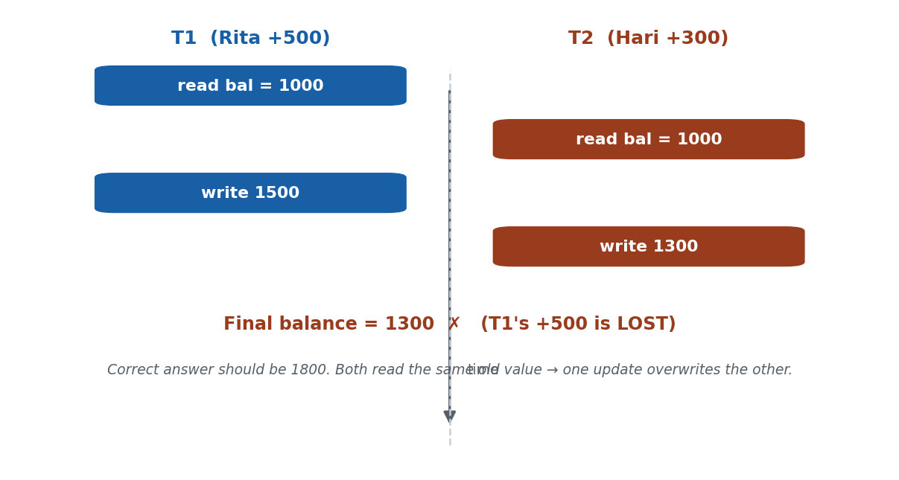

**📖 In Depth.** The **lost-update problem** is a concurrency anomaly where two transactions read the same value, then both write back based on it, so one update overwrites (loses) the other. Related anomalies: **dirty read** (reading uncommitted data) and **incorrect summary**. The fix is concurrency control (S40–S41).

> **🌍 Real life.** Family wallet at Rs. 1000. Rita (+500) and Hari (+300) both READ 1000; Rita writes 1500; Hari writes 1300 → final 1300, but it should be 1800. Rita's Rs. 500 is LOST.

> **🎯 Model exam answer.** *"Illustrate the lost-update problem."* Two transactions read the same data item and both write back a value based on what they read; the second write overwrites the first, so one update is lost (e.g. two top-ups both read Rs.1000, one vanishes).

> **🧠 Hook:** "Lost update: both read old value → one write overwrites the other."

> **⚠️ Misconception.** *"Concurrency always corrupts data."* No — only unsafe interleavings do; if one read after the other's write (a serializable order), the result is correct.

> **🔑 Key terms:** lost update · dirty read · incorrect summary · stale read · overwrite · concurrency anomaly.

**📊 Depth table — Concurrency anomalies: what goes wrong and the fix**

| Anomaly | What happens (Nepal / IT) | Result | Fix |
|---|---|---|---|
| Lost update | Two top-ups read Rs.1000, both write back | One top-up vanishes | lock/serialize the writes |
| Dirty read | T2 reads Rita's balance mid-transfer, T1 aborts | T2 used data that never existed | don't read uncommitted data |
| Incorrect summary | A report sums balances while transfers run | Total is off by an in-flight amount | isolate the reporting txn |
| Unrepeatable read | A balance re-read in one txn gives two values | Inconsistent decision | hold the read lock |
| Phantom | Count of 'today's txns' changes mid-report | New rows appear unexpectedly | range/predicate locking |
| Double booking | Two users book the last bus seat at once | Seat sold twice | serialize on the seat row |

*ℹ️ Every one of these is a specific bad interleaving. Concurrency control exists to allow the safe interleavings and block exactly these.*

---

#### Concept 3 — Serializable Schedules `[THEORY]` `[~7 min]`
**📖 In Depth.** A schedule is **serializable** if it is equivalent in effect to *some* serial execution of the same transactions — the final DB state matches running them one at a time in some order. Serializability is the correctness standard for concurrency: a serializable schedule cannot produce anomalies like lost updates. The practical, testable form is **conflict serializability**.

> **🌍 Real life.** The DBMS behind eSewa/Daraz checkout accepts a fast interleaving ONLY if it is serializable — why your balance isn't 'lost' at peak Dashain traffic.

> **🎯 Model exam answer.** *"Define a serializable schedule."* A concurrent schedule whose effect (final DB state) equals that of some serial execution of the same transactions; it is the gold standard of correctness, and its testable form is conflict serializability.

> **🧠 Analogy & hook.** Interleaved tasks that, when you squint, equal doing one full task then the next. **Hook: "serializable = interleaved, but equals SOME one-at-a-time order."**

> **⚠️ Misconception.** *"Serializable means the schedule IS serial."* No — a serializable schedule is usually non-serial (interleaved); it just has the same EFFECT as some serial order.

> **🔑 Key terms:** serializable schedule · equivalent to a serial order · correctness standard · conflict serializability.

---

#### Concept 4 — Conflicting Operations & Conflict Serializability `[THEORY]` `[~8 min]`
**📖 In Depth.** Two operations **conflict** if they belong to **different transactions**, act on the **same data item**, and **at least one is a WRITE** (types: write-write, read-write, write-read). A schedule is **conflict-serializable** if it can be turned into a serial schedule by swapping only non-conflicting adjacent operations. Read-read on the same item does NOT conflict; operations on different items never conflict.

> **🌍 Real life.** T1's write(wallet) and T2's read(wallet) conflict; two reads of the wallet do not.

> **🎯 Model exam answer.** *"When do two operations conflict?"* When they are from different transactions, on the same data item, with at least one write (W-W, R-W, W-R). A schedule is conflict-serializable if swapping only non-conflicting adjacent ops yields a serial schedule.

> **🧠 Hook:** "Conflict = same item, different txns, at least one write."

> **⚠️ Misconception.** *"Any two operations on the same item conflict."* No — two READS don't conflict; a conflict needs at least one WRITE.

> **🔑 Key terms:** conflict · same item + different txn + ≥1 write · W-W/R-W/W-R · read-read never conflicts · conflict-serializable.

**📊 Depth table — Do these two operations conflict? (same data item)**

| T_i operation | T_j operation | Conflict? | Why |
|---|---|---|---|
| read(X) | read(X) | No | neither changes X — order doesn't matter |
| read(X) | write(X) | Yes (R-W) | T_j changes what T_i reads |
| write(X) | read(X) | Yes (W-R) | T_j reads what T_i wrote |
| write(X) | write(X) | Yes (W-W) | final value depends on order |
| read/write(X) | read/write(Y) | No | different items — independent |
| two ops of the SAME txn | — | N/A | conflicts are only ACROSS transactions |

*ℹ️ A conflict needs different transactions + the same item + at least one write. Read-read and different-item pairs are always safe to reorder.*

---

#### Concept 5 — The Precedence (Serialization) Graph `[THEORY]` `[EXAMPLE]` `[~8 min]`
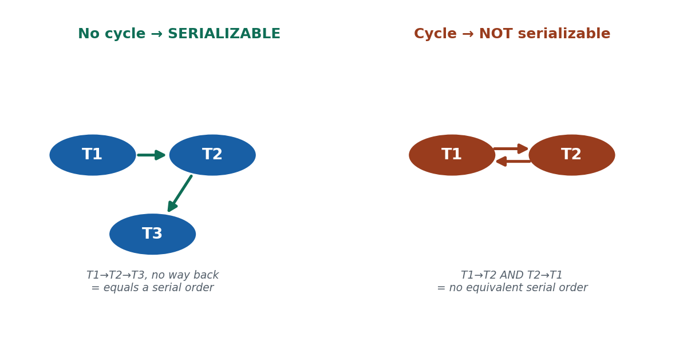

**📖 In Depth.** A **precedence (serialization) graph** has one node per transaction and a directed edge **Ti → Tj** whenever a conflicting operation of Ti precedes one of Tj on the same item. The rule: a schedule is **conflict-serializable if and only if the precedence graph is acyclic**; the topological order of an acyclic graph gives an equivalent serial schedule. A cycle here means 'not serializable' — **not** the same as a deadlock (that is a cycle in the *wait-for* graph, S40).

> **🌍 Real life.** If T1 writes the wallet before T2 reads it, draw T1 → T2; a straight chain (no cycle) is serializable, a cycle must be rejected/reordered.

> **🎯 Model exam answer.** *"State the precedence-graph rule for conflict serializability."* Build a node per transaction and an edge Ti→Tj for each conflicting pair in schedule order; the schedule is conflict-serializable iff the graph is acyclic (a cycle ⇒ not serializable).

> **🧠 Hook:** "Conflict-serializable ⟺ the precedence graph has NO cycle."

> **⚠️ Misconception.** *"A cycle in the precedence graph means deadlock."* No — here a cycle means the schedule is NOT serializable; deadlock is a cycle in the wait-for graph (S40).

> **🔑 Key terms:** precedence/serialization graph · node per txn · edge Ti→Tj on conflict · acyclic ⟺ serializable · cycle ≠ deadlock.

#### 🛠 SOLVED PROBLEM (deck) — Test schedule `T1:read(X); T2:read(X); T1:write(X); T2:write(X)`: edges T2→T1 and T1→T2 → a CYCLE → NOT conflict-serializable (the lost-update pattern).

#### 🛠 ACTIVITY `[~5 min]`
On a shared wallet at Rs. 1000, write two top-ups as an interleaving that causes a lost update, then reorder to fix it (→ Rs. 1800). Draw the precedence graph for each and note which has a cycle.

### 🧠 CHECK FOR UNDERSTANDING `[~5 min]`
- MCQ1: A schedule is conflict-serializable if its precedence graph → ✅ has no cycle
- MCQ2: Which pair conflicts? → ✅ write–write on the same item
- Discussion: sketch two top-ups on one shared wallet that cause a lost update, then reorder them to fix it.

### 📝 SUMMARY `[~2 min]`
(1) A schedule orders interleaved ops. (2) The safe ones are serializable. (3) Test conflict serializability via an acyclic precedence graph (cycle ≠ deadlock). **Next:** HOW the DBMS enforces serializable order — locking.

---
---

# S40 — Two-Phase Locking (2PL) Concurrency Control
**Lecture hour 40 · 50 minutes**

### 🎯 OPENING — Hook `[~5 min]`
[SLIDE] *"To stop two people grabbing the same wallet balance, the DBMS hands out 'keys' (locks). But what if Rita holds Hari's key and Hari holds Rita's?"* → locking and deadlock.

### 📚 CONTENT `[~35 min]`

#### Concept 1 — Locks: Shared and Exclusive `[THEORY]` `[~7 min]`
**📖 In Depth.** A **lock** reserves a data item for a transaction. A **shared (S)** lock is for reading and can be held by several transactions at once; an **exclusive (X)** lock is for writing and can be held by only one, with no other S or X lock allowed on the item. Compatibility: **S–S is allowed; any pairing involving X is not.**

> **🌍 Real life.** T1 takes an X-lock on the wallet row to debit it; T2 must wait. Two balance-checks can share an S-lock.

> **🎯 Model exam answer.** *"Shared vs exclusive lock?"* An S (shared/read) lock can be held by many transactions simultaneously; an X (exclusive/write) lock is held by exactly one, blocking all other access. Only S–S is compatible.

> **🧠 Hook:** "S-locks share among readers; an X-lock is exclusive to one writer."

> **⚠️ Misconception.** *"A shared lock blocks other readers."* No — MULTIPLE shared locks can coexist; only an exclusive (write) lock conflicts.

> **🔑 Key terms:** lock · shared (S, read) · exclusive (X, write) · compatibility matrix · S–S compatible, X conflicts.

**📊 Depth table — Lock compatibility matrix: can the requested lock be granted?**

| Item currently held as… | Request: Shared (S) | Request: Exclusive (X) |
|---|---|---|
| (no lock held) | ✅ granted | ✅ granted |
| Shared (S) by others | ✅ granted (readers share) | ✗ must wait (write needs exclusivity) |
| Exclusive (X) by another | ✗ must wait | ✗ must wait |
| Example: two balance checks | both get S → run together | — |
| Example: a debit (write) | — | one X only → others wait |
| Rule | only S–S is compatible | any X pairing conflicts |

*ℹ️ Read-read shares (S–S compatible); any write needs an exclusive X-lock, so it blocks and is blocked by everything else on that item.*

---

#### Concept 2 — The Two-Phase Locking Protocol `[THEORY]` `[~8 min]`
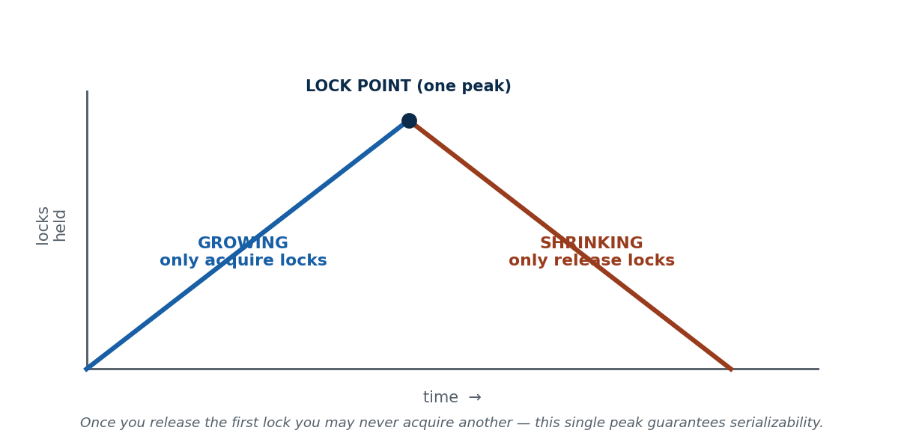

**📖 In Depth.** **Two-Phase Locking (2PL)** requires every transaction to acquire ALL its locks before releasing ANY. This splits its life into a **growing phase** (only acquire) and a **shrinking phase** (only release), separated by a single **lock point** (the peak). 2PL **guarantees conflict-serializability** and is the most common locking scheme in real DBMSs.

> **🌍 Real life.** A transfer acquires X-locks on both wallet rows (growing), performs the debit and credit, then releases (shrinking).

> **🎯 Model exam answer.** *"State the 2PL protocol and what it guarantees."* Every transaction acquires all its locks (growing phase) before releasing any (shrinking phase), with one lock point; this guarantees conflict-serializability.

> **🧠 Analogy & hook.** Collect all your shopping first (growing), then start returning items (shrinking) — never grab again after returning starts. **Hook: "grow then shrink; one peak."**

> **⚠️ Misconception.** *"2PL means locking in exactly two steps / two locks."* No — 'two-phase' refers to the growing then shrinking PHASES over the transaction's life, not a count of locks.

> **🔑 Key terms:** two-phase locking · growing phase · shrinking phase · lock point · guarantees serializability.

---

#### Concept 3 — Variants of 2PL `[THEORY]` `[~7 min]`
**📖 In Depth.** Variants trade concurrency for stronger guarantees: **basic** 2PL (grow then shrink; serializable but deadlock-prone), **conservative/static** 2PL (acquire all locks up front → deadlock-free, lower concurrency), **strict** 2PL (hold exclusive locks until commit/abort → prevents cascading rollback; the most common), and **rigorous** 2PL (hold all locks until commit).

> **🌍 Real life.** Strict 2PL on the eSewa wallet so a half-committed debit is never read by another transaction.

> **🎯 Model exam answer.** *"Name the 2PL variants and what each adds."* Basic (may deadlock, may cascade), conservative/static (deadlock-free, all locks up front), strict (X-locks held to commit → no cascading rollback), rigorous (all locks held to commit).

> **🧠 Hook:** "Variants differ in when locks are taken (conservative) or released (strict/rigorous)."

> **⚠️ Misconception.** *"All 2PL variants behave the same."* No — basic can deadlock and cascade; conservative avoids deadlock; strict/rigorous prevent cascading rollback.

> **🔑 Key terms:** basic 2PL · conservative (static) 2PL · strict 2PL · rigorous 2PL · cascading rollback · deadlock-free.

---

#### Concept 4 — Deadlock `[THEORY]` `[EXAMPLE]` `[~8 min]`
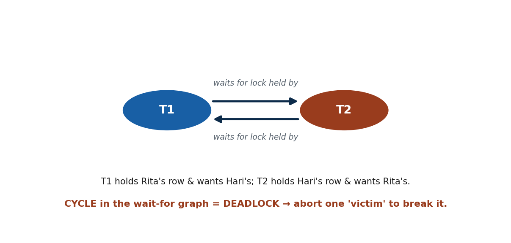

**📖 In Depth.** A **deadlock** occurs when two or more transactions each hold a lock the other needs and wait indefinitely — a **circular wait**. It is detected by finding a **cycle in the wait-for graph** (edge Ti→Tj when Ti waits for a lock Tj holds) and resolved by **aborting a victim** and restarting it. Prevention schemes **wait-die** and **wound-wait** use timestamps to avoid the circular wait.

> **🌍 Real life.** T1 (Rita→Hari) locks Rita's row and waits for Hari's; T2 (Hari→Rita) locks Hari's row and waits for Rita's — a circular wait.

> **🎯 Model exam answer.** *"Define deadlock and how it is detected and resolved."* A circular wait where each transaction holds a lock another needs; detected as a cycle in the wait-for graph; resolved by aborting and restarting a victim (or prevented with wait-die/wound-wait).

> **🧠 Hook:** "Deadlock = a cycle in the wait-for graph; abort a victim to break it."

> **⚠️ Misconception.** *"Deadlock means the server crashed."* No — it is a logical stalemate; the DBMS aborts and restarts a victim while the server keeps running.

> **🔑 Key terms:** deadlock · circular wait · wait-for graph · cycle = deadlock · victim abort · wait-die/wound-wait.

**📊 Depth table — Two cycles, two very different meanings**

| Graph | Node = | Edge means | A cycle means… | Belongs to |
|---|---|---|---|---|
| Precedence graph | a transaction | Ti's op conflicts before Tj's | schedule is NOT serializable | S39 (correctness) |
| Wait-for graph | a transaction | Ti waits for a lock Tj holds | DEADLOCK (frozen stalemate) | S40 (locking) |
| Fix for precedence cycle | — | — | reject / reorder the schedule | — |
| Fix for wait-for cycle | — | — | abort a victim, restart it | — |

*ℹ️ Do not confuse them: a cycle in the PRECEDENCE graph = not serializable (S39); a cycle in the WAIT-FOR graph = deadlock (S40).*

---

#### Concept 5 — Starvation `[THEORY]` `[~5 min]`
**📖 In Depth.** **Starvation** happens when a transaction is repeatedly delayed or repeatedly chosen as the deadlock victim, so it never acquires the resources it needs — even though the system as a whole makes progress. Unlike deadlock (a mutual freeze), starvation strands a single transaction, and it is fixed with fair scheduling, priorities, or **aging** (raising a waiting transaction's priority over time).

> **🌍 Real life.** A low-priority reporting job keeps being the victim during a Dashain rush; aging eventually lets it win.

> **🎯 Model exam answer.** *"Starvation vs deadlock?"* In deadlock nobody proceeds (mutual freeze); in starvation the system makes progress but one transaction never gets its turn. Aging fixes starvation.

> **🧠 Hook:** "Starvation = one txn never gets its turn; fix with priorities / aging."

> **⚠️ Misconception.** *"Starvation is the same as deadlock."* No — deadlock is a stalemate of several; starvation is unfairness to one.

> **🔑 Key terms:** starvation · repeated victim/delay · fairness · priorities · aging · distinct from deadlock.

#### 🛠 ACTIVITY `[~5 min]`
Write two eSewa transfers on rows A and B that deadlock; draw the wait-for graph, mark the cycle, and choose a victim to abort.

### 🧠 CHECK FOR UNDERSTANDING `[~5 min]`
- MCQ1: In 2PL, once a transaction releases its first lock it is in the → ✅ shrinking phase
- MCQ2: Deadlock is detected by a cycle in the → ✅ wait-for graph
- Discussion: describe a two-person eSewa scenario that deadlocks, and which transaction you'd abort to break it.

### 📝 SUMMARY `[~2 min]`
(1) S/X locks reserve items (only S–S compatible). (2) 2PL (grow then shrink) guarantees serializability; strict 2PL also stops cascading rollback. (3) Locking can deadlock (wait-for cycle → abort a victim) and starve (fix with aging). **Next:** a lock-free way to order transactions — timestamps.

---
---

# S41 — Timestamp Ordering Concurrency Control
**Lecture hour 41 · 50 minutes**

### 🎯 OPENING — Hook `[~5 min]`
[SLIDE] *"Instead of fighting over keys, what if every eSewa transaction got a numbered ticket — and the DBMS just enforced 'serve in ticket order'?"* → timestamp ordering, no locks.

### 📚 CONTENT `[~35 min]`

#### Concept 1 — Timestamps `[THEORY]` `[~7 min]`
**📖 In Depth.** A **timestamp TS(T)** is a unique, monotonically increasing identifier assigned to a transaction at its start (from the system clock or a logical counter). It defines a total order in which a **smaller timestamp means an older, higher-priority** transaction. Timestamp-ordering concurrency control enforces a schedule equivalent to executing transactions in timestamp order.

> **🌍 Real life.** Each eSewa transfer is stamped with its arrival order (like a bank counter token); Rita's TS=101 is 'senior' to Hari's TS=102.

> **🎯 Model exam answer.** *"What is a transaction timestamp?"* A unique, monotonically increasing ID assigned at start; a smaller TS = older = higher priority. It fixes the serial order the schedule is made equivalent to.

> **🧠 Hook:** "Timestamp = a ticket number at start; smaller TS = older = higher priority."

> **⚠️ Misconception.** *"Timestamps are just wall-clock time and can repeat."* No — they must be unique and strictly increasing; a logical counter is often used so two transactions never share one.

> **🔑 Key terms:** timestamp TS(T) · unique · monotonically increasing · older = higher priority · defines serial order.

---

#### Concept 2 — Read and Write Timestamps on Data Items `[THEORY]` `[~6 min]`
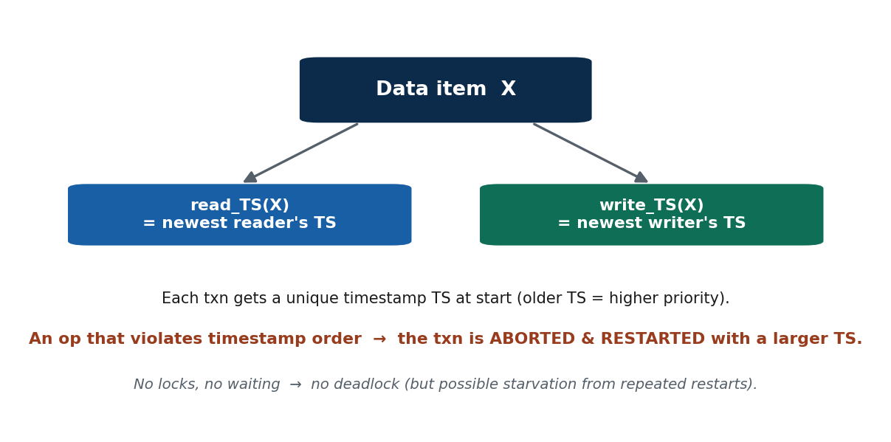

**📖 In Depth.** Each data item X stores **read_TS(X)** (the largest timestamp of any transaction that has read X) and **write_TS(X)** (the largest timestamp of any transaction that has written X). Every read/write request is validated against these two values to ensure operations occur in timestamp order; the stamps are updated when an operation is allowed.

> **🌍 Real life.** The family-wallet item remembers the newest reader and newest writer of the balance.

> **🎯 Model exam answer.** *"What two timestamps does each item keep, and why?"* read_TS(X) and write_TS(X) — the newest reader's and writer's timestamps — so the DBMS can detect an operation that arrives out of timestamp order.

> **🧠 Hook:** "Each item X carries read_TS(X) and write_TS(X) — the newest reader/writer."

> **⚠️ Misconception.** *"A data item only needs one timestamp."* No — reads and writes create different ordering conflicts, so two stamps are needed.

> **🔑 Key terms:** read_TS(X) · write_TS(X) · largest reader/writer timestamp · validate each op · updated on success.

---

#### Concept 3 — The Basic Timestamp-Ordering Protocol `[THEORY]` `[EXAMPLE]` `[~8 min]`
**📖 In Depth.** Under **basic timestamp ordering**, an operation is allowed only if it respects timestamp order: a **write** is rejected if a younger transaction has already read or written the item; a **read** is rejected if a younger transaction has already written it. A violating transaction is **aborted and restarted** with a new, larger timestamp. This yields a serializable schedule and is **deadlock-free** (nothing waits), though it can cause **starvation**.

> **🌍 Real life.** A 'late' transfer (TS=101) trying to write a wallet already written by a 'newer' one (write_TS=102) is aborted and restarted.

> **🎯 Model exam answer.** *"State the basic timestamp-ordering rule and its consequence."* Reject any operation that violates timestamp order (write if a younger txn read/wrote it; read if a younger txn wrote it); abort and restart the violator with a larger TS. It is serializable and deadlock-free but can starve.

> **🧠 Hook:** "Out-of-order op → abort & restart with a larger timestamp; never wait, never deadlock."

> **⚠️ Misconception.** *"Timestamp ordering can deadlock like 2PL."* No — it never waits; conflicts are resolved by abort/restart, so no circular wait, no deadlock (but starvation is possible).

> **🔑 Key terms:** basic TO protocol · read/write rules · reject out-of-order op · abort & restart · deadlock-free · starvation possible.

---

#### Concept 4 — Thomas's Write Rule `[THEORY]` `[~5 min]`
**📖 In Depth.** **Thomas's write rule** optimises timestamp ordering by **ignoring an obsolete write** — a write by a transaction older than the item's write_TS — rather than aborting the transaction, since a younger write has already superseded that value. It applies only to write-write cases and increases concurrency by rejecting fewer operations, while still producing a serializable schedule.

> **🌍 Real life.** TS=101's write is skipped because TS=105 already wrote that field — its value would be overwritten anyway.

> **🎯 Model exam answer.** *"What is Thomas's write rule?"* If a transaction's write is obsolete (a younger write already updated the item), the write is ignored instead of aborting the transaction, allowing more concurrency; it applies to write-write cases only.

> **🧠 Hook:** "Thomas's rule: ignore an obsolete write instead of aborting → more concurrency."

> **⚠️ Misconception.** *"Thomas's rule loses data by skipping a write."* No — it only skips a write a newer write has already superseded, so no committed data is lost.

> **🔑 Key terms:** Thomas's write rule · obsolete write · ignore instead of abort · write-write only · more concurrency.

**📊 Depth table — Two-Phase Locking vs Timestamp Ordering (the two concurrency-control families)**

| Dimension | Two-Phase Locking (2PL) | Timestamp Ordering (TO) |
|---|---|---|
| Mechanism | Locks (S/X); acquire then release | Timestamps; serve in TS order |
| Transactions that clash | WAIT for the lock to be freed | ABORT & restart with a larger TS |
| Guarantees | Conflict-serializability | Serializable in timestamp order |
| Failure mode | Deadlock (circular wait) possible | Starvation (repeated restarts) possible |
| Deadlock? | Yes — detect/prevent it | No — nothing ever waits |
| Best fit (Nepal / IT) | High-conflict eSewa peak (steadier) | Low-conflict reporting / distributed jobs |

*ℹ️ The core trade-off: 2PL makes clashing transactions WAIT (so it can deadlock); TO makes them RESTART (so it can starve but never deadlocks).*

#### 🛠 SOLVED PROBLEM (deck) — Item X (read_TS=0, write_TS=0); T2 write(X) allowed (write_TS→110); T1(TS=100) write(X) → younger T2 already wrote → basic rule ABORTS T1 (Thomas's rule would IGNORE the obsolete write).

#### 🛠 ACTIVITY `[~5 min]`
For a high-conflict eSewa peak vs a low-conflict nightly report job, decide whether 2PL or timestamp ordering fits, and name each one's failure mode (deadlock vs starvation/restarts).

### 🧠 CHECK FOR UNDERSTANDING `[~5 min]`
- MCQ1: In basic timestamp ordering, a transaction violating the timestamp order is → ✅ aborted and restarted
- MCQ2: Compared to 2PL, basic timestamp ordering → ✅ cannot deadlock
- Discussion: timestamp ordering never deadlocks but can starve — why is that trade-off sometimes acceptable for a wallet system?

### 📝 SUMMARY `[~2 min]`
(1) A timestamp gives each transaction a fixed order at start; items keep read_TS/write_TS. (2) Basic TO aborts and restarts out-of-order operations — it never waits. (3) No waiting → no deadlock, but possible starvation; Thomas's rule ignores obsolete writes for more concurrency. **Next:** what happens after a failure — recovery.

---
---

# S42 — Recovery Concepts · Deferred Update (NO-UNDO/REDO)
**Lecture hour 42 · 50 minutes**

### 🎯 OPENING — Hook `[~5 min]`
[SLIDE] *"The eSewa server crashes one second AFTER Rita's transfer commits — and mid-way through a second, uncommitted transfer. After reboot, which one must be redone and which thrown away?"* → recovery.

### 📚 CONTENT `[~35 min]`

#### Concept 1 — Recovery Concepts: UNDO and REDO `[THEORY]` `[~7 min]`
**📖 In Depth.** **Recovery** restores the database to its most recent consistent state after a failure, driven by the system log. Its two operations are **UNDO** (remove the effects of transactions that did not commit, using the log's old values) and **REDO** (reapply the effects of committed transactions, using the new values). Which operations are needed depends on the update technique.

> **🌍 Real life.** After reboot, the recovery manager scans the eSewa log to decide undo/redo per transaction.

> **🎯 Model exam answer.** *"What are UNDO and REDO?"* UNDO removes the effects of uncommitted transactions (old values); REDO reapplies committed transactions (new values). Recovery restores the last consistent state via the log.

> **🧠 Hook:** "Recovery = restore last consistent state; UNDO the uncommitted, REDO the committed."

> **⚠️ Misconception.** *"Recovery just reloads the last backup."* Not for a normal crash — the disk is intact, so recovery uses the LOG. Backups are for catastrophic media loss (S44).

> **🔑 Key terms:** recovery · last consistent state · UNDO (uncommitted, old values) · REDO (committed, new values) · log-driven.

**📊 Depth table — The recovery-action table: what to do with each transaction after a crash**

| Transaction (log evidence) | Status | Recovery action | Values used |
|---|---|---|---|
| [start,T] and [commit,T] present | Committed | REDO (make sure it's on disk) | new values |
| [start,T] but NO [commit,T] | Uncommitted | UNDO (immediate) / ignore (deferred) | old values |
| [start,T] then [abort,T] | Aborted | UNDO / already rolled back | old values |
| Committed before last [checkpoint] | Durable | Skip — already flushed | none |
| Rita's transfer: committed pre-crash | Committed | REDO the debit + credit | new balances |
| Hari's transfer: crashed mid-way | Uncommitted | UNDO the partial debit | old balance |

*ℹ️ Recovery is disciplined log-reading: REDO [start]+[commit]; UNDO (or ignore, under deferred update) [start]-but-no-[commit]. The checkpoint marks what is already safe on disk.*

---

#### Concept 2 — Caching, In-Place Update & Write-Ahead Logging `[THEORY]` `[~7 min]`
**📖 In Depth.** The DBMS caches data in a memory buffer and updates it there first (**in-place update** overwrites the item's disk copy when flushed). **Write-Ahead Logging (WAL)** requires a transaction's log record to reach stable storage *before* the corresponding data page, so every change can be undone (old value) or redone (new value) after a crash. WAL is the foundation of durability: **commit means 'safely logged', not 'already on the data disk'.**

> **🌍 Real life.** When eSewa commits Rita's transfer, the balance may still be in the buffer; the log records were flushed first (WAL).

> **🎯 Model exam answer.** *"State the Write-Ahead Logging rule and why it matters."* The log record for a change must be written to stable storage before the data page; this guarantees the undo/redo information is safe, so a crash can always be recovered.

> **🧠 Hook:** "WAL: write the log record to stable storage BEFORE the data page."

> **⚠️ Misconception.** *"Data is written to disk the instant you commit."* No — the data page may linger in the buffer; only the LOG record is guaranteed on stable storage at commit.

> **🔑 Key terms:** buffer/cache · in-place update · dirty page · Write-Ahead Logging (WAL) · log before data page · commit = logged.

---

#### Concept 3 — Checkpoints `[THEORY]` `[~7 min]`
**📖 In Depth.** A **checkpoint** is a periodic operation in which the DBMS flushes all buffered (dirty) pages to disk and records a `[checkpoint]` entry in the log. Because everything committed before the checkpoint is guaranteed on disk, recovery only needs to examine transactions active at or after the last checkpoint — bounding recovery time.

> **🌍 Real life.** Crash at 3:07 with the last checkpoint at 3:05 → recovery replays only from 3:05.

> **🎯 Model exam answer.** *"What is a checkpoint and why is it used?"* A point where buffers are flushed and a [checkpoint] mark logged; it limits how far back recovery must scan, since anything committed and flushed before it is already durable.

> **🧠 Analogy & hook.** A save point in a video game — you never replay the whole game, just from the last save. **Hook: "recovery starts from the last checkpoint, not the very start."**

> **⚠️ Misconception.** *"Recovery always replays the whole log from the beginning."* No — the last [checkpoint] bounds the work.

> **🔑 Key terms:** checkpoint · flush dirty pages · [checkpoint] log record · bounds recovery scan · save point analogy.

---

#### Concept 4 — Deferred Update (NO-UNDO/REDO) `[THEORY]` `[EXAMPLE]` `[~9 min]`
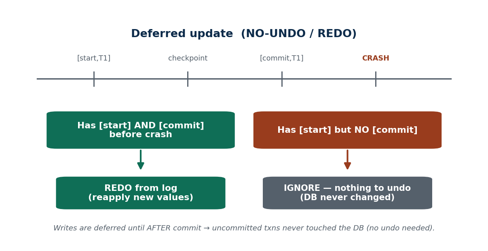

**📖 In Depth.** The **deferred-update (NO-UNDO/REDO)** technique postpones all database writes until *after* a transaction commits, keeping changes in the log/buffer until then. Consequently, uncommitted transactions never modify the database (**no UNDO** is ever needed), while committed transactions whose changes may still be buffered are reapplied (**REDO**). Recovery simply REDOes every transaction having both [start] and [commit] and ignores the rest.

> **🌍 Real life.** Rita's debit is written to the wallet table only AFTER [commit,T]; a crash before commit means the table was never changed → nothing to undo.

> **🎯 Model exam answer.** *"Why does deferred update need no UNDO?"* Because writes are deferred until after commit, an uncommitted transaction never changed the database; recovery only REDOes transactions with both [start] and [commit].

> **🧠 Hook:** "Deferred update: write only after commit → REDO only, never UNDO."

> **⚠️ Misconception.** *"Deferred update still needs to undo unfinished transactions."* No — uncommitted transactions made no disk changes, so there is nothing to undo.

> **🔑 Key terms:** deferred update · NO-UNDO/REDO · write after commit · nothing to undo · REDO committed · [start]+[commit] rule.

---

#### Concept 5 — Limitation of Deferred Update `[THEORY]` `[~5 min]`
**📖 In Depth.** Deferred update is simple and needs no UNDO, but it must hold ALL of a transaction's changes in the log/buffer until commit, straining memory and log space for long-running or large (batch) transactions and delaying when changes reach disk. This scalability cost motivates the **immediate-update** technique (S43).

> **🌍 Real life.** A bank's nightly interest batch updates millions of accounts in one transaction — a heavy buffer/log burden under pure deferred update.

> **🎯 Model exam answer.** *"State a limitation of deferred update."* It must buffer all of a transaction's changes until commit, which is costly for long/large transactions and delays durability — motivating immediate update.

> **🧠 Hook:** "Deferred update strains memory for long/large transactions → motivates immediate update."

> **⚠️ Misconception.** *"Deferred update is always best because it needs no undo."* No — its no-undo simplicity costs buffer/log space and delays durability for big transactions.

> **🔑 Key terms:** limitation of deferred update · buffer/log pressure · long/large transactions · delayed durability · motivates immediate update.

#### 🛠 SOLVED PROBLEM (deck) — Deferred-update log `[start,T1][write,T1,X,-,50][commit,T1][start,T2][write,T2,Y,-,80]` + CRASH: REDO T1 (committed) → X=50; ignore T2 (no commit) — no undo needed.

#### 🛠 ACTIVITY `[~5 min]`
Under deferred update, classify each transaction after a crash: T_a [start][write][commit] → REDO; T_b [start][write] → ignore (nothing written); T_c committed before the last checkpoint → skip.

### 🧠 CHECK FOR UNDERSTANDING `[~5 min]`
- MCQ1: In deferred update (NO-UNDO/REDO), uncommitted transactions need → ✅ no undo
- MCQ2: Writing the log record before the data page is the rule called → ✅ Write-Ahead Logging
- Discussion: after a crash you find [start,T] but no [commit,T] for Rita's transfer under deferred update — what do you do, and why is it safe?

### 📝 SUMMARY `[~2 min]`
(1) Recovery restores the last consistent state via the log (UNDO uncommitted, REDO committed). (2) WAL + checkpoints make recovery correct and fast. (3) Deferred update writes only after commit → NO-UNDO/REDO, but strains memory for long/large transactions. **Next:** write immediately and be ready to undo.

---
---

# S43 — Recovery Based on Immediate Update · Shadow Paging
**Lecture hour 43 · 50 minutes**

### 🎯 OPENING — Hook `[~5 min]`
[SLIDE] *"What if eSewa wrote each debit to disk INSTANTLY — faster, but now a crash can leave a half-done transfer on disk. How do we take it back?"* → immediate update needs UNDO.

### 📚 CONTENT `[~35 min]`

#### Concept 1 — Immediate Update `[THEORY]` `[~8 min]`
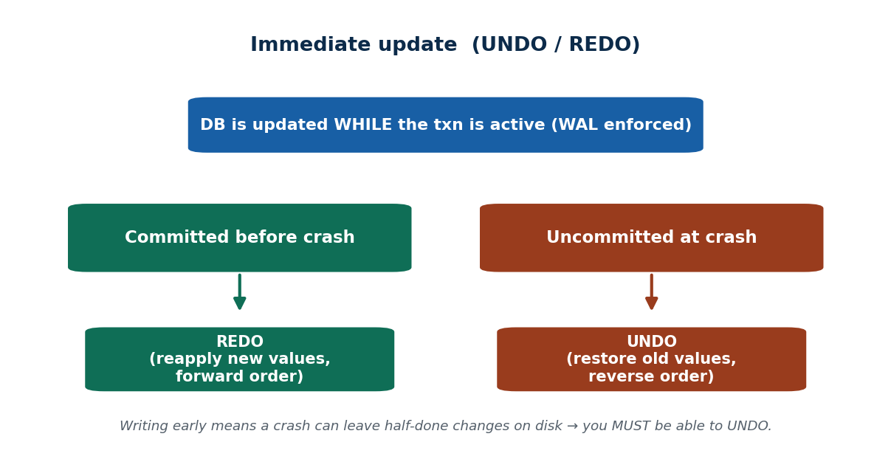

**📖 In Depth.** The **immediate-update** technique writes a transaction's changes to the database while it is still active (before commit), under **Write-Ahead Logging**. Because uncommitted changes may already be on disk, recovery requires **both UNDO** (rolling back uncommitted writes using logged old values) **and REDO** (reapplying committed writes still in the buffer). It is the UNDO/REDO model implemented by most production DBMSs.

> **🌍 Real life.** Rita's debit hits the wallet table immediately; if she aborts, UNDO restores the old balance from the log.

> **🎯 Model exam answer.** *"Why does immediate update need UNDO and REDO?"* Because changes are written before commit, a crash can leave uncommitted changes on disk (needing UNDO), while committed changes may still be buffered (needing REDO).

> **🧠 Hook:** "Immediate update writes early → recovery needs BOTH UNDO and REDO."

> **⚠️ Misconception.** *"Immediate update is just deferred update done faster."* No — it changes the recovery requirement: because uncommitted changes can reach disk, you now MUST be able to UNDO.

> **🔑 Key terms:** immediate update · write before commit · WAL enforced · UNDO/REDO · old value enables undo.

---

#### Concept 2 — UNDO/REDO vs UNDO-only Variants `[THEORY]` `[~7 min]`
**📖 In Depth.** Immediate-update variants differ by commit-time flushing: the general **UNDO/REDO** variant does not force all writes to disk at commit, so recovery may need REDO as well as UNDO; the **UNDO-only** variant forces all writes to disk at commit, making committed changes durable so **no REDO** is needed. Both contrast with deferred update's NO-UNDO/REDO; the choice trades commit-time I/O against recovery work.

> **🌍 Real life.** Force-flushing each committed transfer (UNDO-only) means no REDO but extra I/O at every commit.

> **🎯 Model exam answer.** *"Compare UNDO/REDO and UNDO-only immediate update."* UNDO/REDO does not force writes at commit (needs REDO); UNDO-only forces them at commit (no REDO, but extra commit-time I/O). Both need UNDO for uncommitted writes.

> **🧠 Hook:** "UNDO-only forces writes at commit (no redo); UNDO/REDO defers the flush (may redo)."

> **⚠️ Misconception.** *"All immediate-update recovery is the same."* No — forcing at commit removes REDO but adds I/O; not forcing is faster at commit but needs REDO.

> **🔑 Key terms:** UNDO/REDO · UNDO-only (force-at-commit) · no-redo when forced · commit-time I/O trade-off · vs NO-UNDO/REDO.

**📊 Depth table — The three recovery techniques: UNDO/REDO needs at a glance**

| Technique | When DB is written | UNDO needed? | REDO needed? | Trade-off |
|---|---|---|---|---|
| Deferred update | only AFTER commit | No (nothing written pre-commit) | Yes (committed, maybe buffered) | simple, but strains buffer for big txns |
| Immediate update (UNDO/REDO) | during the txn; no force at commit | Yes (uncommitted may be on disk) | Yes (committed, maybe buffered) | fast commit; most recovery work |
| Immediate update (UNDO-only) | during the txn; force at commit | Yes | No (forced to disk at commit) | no redo, but extra commit-time I/O |
| Shadow paging | new pages; pointer flip at commit | No (discard new pages) | No (pointer flip is atomic) | no undo log, but fragmentation & poor concurrency |

*ℹ️ Read the undo/redo columns as the exam answer: deferred = NO-UNDO/REDO; immediate = UNDO/REDO (or UNDO-only if force-flushed); shadow paging needs neither.*

---

#### Concept 3 — Recovery Procedure for Immediate Update `[THEORY]` `[~7 min]`
**📖 In Depth.** Recovery under immediate update scans the log and **REDOes all committed transactions** (forward, using logged new values) while **UNDOing all uncommitted transactions** (in **reverse** order, using logged old values). Redoing ensures committed changes are durable even if only buffered; undoing in reverse ensures overlapping uncommitted changes roll back to the last consistent state.

> **🌍 Real life.** After a crash: REDO the committed transfer; UNDO the half-done debit from its logged old value.

> **🎯 Model exam answer.** *"Describe immediate-update recovery."* Scan the log; REDO committed transactions forward from new values; UNDO uncommitted transactions in reverse from old values, restoring the last consistent state.

> **🧠 Hook:** "REDO committed (forward), UNDO uncommitted (reverse)."

> **⚠️ Misconception.** *"You can undo transactions in any order."* No — UNDO goes in REVERSE chronological order so overlapping writes end correctly.

> **🔑 Key terms:** immediate-update recovery · REDO committed forward · UNDO uncommitted reverse · old/new values · consistent state.

---

#### Concept 4 — Shadow Paging `[THEORY]` `[EXAMPLE]` `[~8 min]`
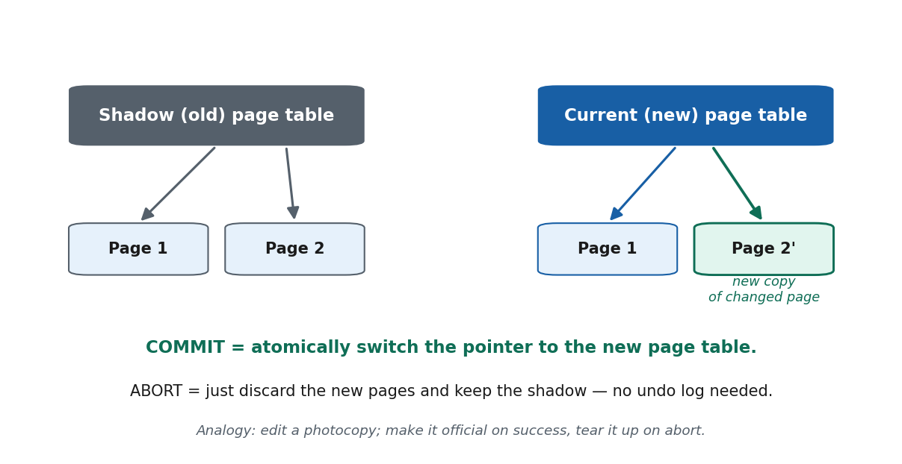

**📖 In Depth.** **Shadow paging** keeps an unchanged **shadow (old)** page table pointing to the original pages while updates are written to **new** page copies referenced by a **current** page table. **Committing** atomically switches the pointer to the current table; **aborting** discards the new pages and retains the shadow, so **no undo log** is required.

> **🌍 Real life.** A batch update to a customer table done on shadow pages; one atomic pointer flip makes all new pages live at once.

> **🎯 Model exam answer.** *"How does shadow paging commit and abort?"* Commit = atomically switch the page-table pointer from the shadow to the current (new) table; abort = discard the new pages and keep the shadow. No undo log is needed.

> **🧠 Analogy & hook.** Editing a photocopy — if happy, make the copy official (pointer flip); if not, tear it up and keep the original. **Hook: "flip the page-table pointer atomically to commit."**

> **⚠️ Misconception.** *"Shadow paging is always better because it needs no log."* No — it causes fragmentation, complicates concurrency, and needs garbage collection, so it scales poorly.

> **🔑 Key terms:** shadow paging · shadow vs current page table · new page copies · atomic pointer switch · no undo log · fragmentation.

---

#### Concept 5 — Pros and Cons of Shadow Paging `[THEORY]` `[~5 min]`
**📖 In Depth.** Shadow paging's **pros** are simplicity: atomic commit via a pointer switch and no undo log. Its **cons** are data fragmentation (updated pages scatter), poor support for high concurrency, and garbage-collection overhead for obsolete pages. These lead most DBMSs to use log-based recovery, though the copy-on-write idea persists in modern file systems and snapshots.

> **🌍 Real life.** Copy-on-write file systems and storage snapshots inherit the shadow-paging idea; busy wallets like eSewa still use log-based UNDO/REDO (MySQL/InnoDB, PostgreSQL).

> **🎯 Model exam answer.** *"State the pros and cons of shadow paging."* Pro: simple atomic commit, no undo log. Cons: fragmentation, poor concurrency support, garbage collection — so log-based recovery is preferred in production.

> **🧠 Hook:** "Simple atomic commit, but fragments data and scales poorly under concurrency."

> **⚠️ Misconception.** *"Shadow paging is obsolete and unused."* No — its copy-on-write, atomic-switch idea lives on in file systems and snapshot features.

> **🔑 Key terms:** pros: simple, atomic commit, no undo log · cons: fragmentation, poor concurrency, garbage collection · copy-on-write legacy.

#### 🛠 SOLVED PROBLEM (deck) — Immediate-update log `[start,T1][write,T1,X,10,50][commit,T1][start,T2][write,T2,Y,20,80]` + CRASH: REDO T1 (X→50) AND UNDO T2 (Y→20). Both operations — unlike deferred update.

#### 🛠 ACTIVITY `[~5 min]`
For a bank's nightly batch, compare immediate update ('edit the original') with shadow paging ('edit a photocopy, then flip the pointer'): what happens on a mid-batch crash, and what does recovery cost?

### 🧠 CHECK FOR UNDERSTANDING `[~5 min]`
- MCQ1: Immediate-update recovery requires → ✅ both UNDO and REDO
- MCQ2: In shadow paging, committing a transaction means → ✅ switching the current page-table pointer to the new page table
- Discussion: compare 'edit the original directly' (immediate update) vs 'edit a photocopy' (shadow paging) for a bank's nightly batch — which would you trust more and why?

### 📝 SUMMARY `[~2 min]`
(1) Immediate update writes during the transaction (WAL) → recovery needs BOTH UNDO and REDO. (2) REDO committed forward; UNDO uncommitted in reverse. (3) Shadow paging swaps page tables atomically (no undo log) but fragments data and scales poorly. **Next:** when the whole disk/data-center is gone — backup & catastrophic recovery.

---
---

# S44 — Database Backup & Recovery from Catastrophic Failures (closes Unit 6)
**Lecture hour 44 · 50 minutes**

### 🎯 OPENING — Hook `[~5 min]`
[SLIDE] *"An earthquake floods a Kathmandu data-center and the whole disk array is destroyed — the log is gone too. Now what saves your eSewa balance?"* → backups and off-site recovery.

### 📚 CONTENT `[~35 min]`

#### Concept 1 — Catastrophic vs Non-Catastrophic Failure `[THEORY]` `[~7 min]`
**📖 In Depth.** A **non-catastrophic** failure (power cut, software crash) leaves the disk and its log intact, so log-based UNDO/REDO recovery applies (S42–S43). A **catastrophic** failure destroys the storage media or the entire site (disk failure, fire, flood, earthquake, ransomware), taking the on-disk data and log with it; recovery then depends on a separate, ideally off-site, **backup**.

> **🌍 Real life.** Load-shedding is non-catastrophic (disk survives → log recovery); an earthquake/fire/ransomware that destroys the disk array is catastrophic.

> **🎯 Model exam answer.** *"Distinguish catastrophic and non-catastrophic failure."* Non-catastrophic = disk (and log) intact → log-based recovery. Catastrophic = media/site destroyed → only a separate off-site backup can recover the data.

> **🧠 Hook:** "Non-catastrophic → recover from the log; catastrophic → recover from a separate backup."

> **⚠️ Misconception.** *"The transaction log alone can recover anything."* No — if the disk holding the log is destroyed, there is no log to replay; a separate backup is required.

> **🔑 Key terms:** non-catastrophic (disk intact, log recovery) · catastrophic (media/site destroyed) · separate backup required.

---

#### Concept 2 — Database Backup `[THEORY]` `[~7 min]`
**📖 In Depth.** A **database backup** is a periodic copy of the database (and its log) stored on separate, stable media (tape, a separate disk, or cloud). A **full** backup copies the entire database; **incremental** and **differential** backups copy only what changed (since the last backup, or since the last full backup, respectively). Combined with an **archived log**, a backup lets you restore and then REDO forward to the point of failure.

> **🌍 Real life.** A Nepali bank takes a full backup at midnight and incrementals through the day, all off-site, plus archives the log.

> **🎯 Model exam answer.** *"Full vs incremental backup, and how you use them."* Full = complete copy; incremental = only changes since the last backup (smaller, faster, but needs the chain). Restore the full backup, apply incrementals, then REDO the archived log to the failure point.

> **🧠 Hook:** "Full = copy everything; incremental = only what changed since last backup."

> **⚠️ Misconception.** *"One backup is enough / backups can live on the same disk."* No — a backup on the same disk dies with it; backups must be on separate media and ideally off-site, plus the archived log to roll forward.

> **🔑 Key terms:** database backup · full vs incremental vs differential · separate/off-site media · archived log · roll forward.

---

#### Concept 3 — Backup Strategy & the 3-2-1 Rule `[THEORY]` `[~7 min]`
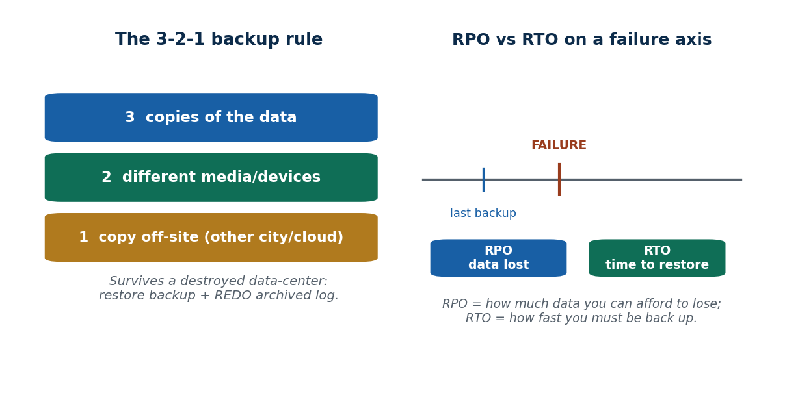

**📖 In Depth.** A robust strategy follows the **3-2-1 rule**: keep **3** copies of the data, on **2** different media types, with at least **1** copy off-site. This protects against corruption of any one copy, failure of any one media technology, and destruction of the primary site. Backups must be **tested** by trial restores — an unverified backup provides no real guarantee.

> **🌍 Real life.** A Nepali fintech: live DB (copy 1), local on-prem backup (copy 2, media A), encrypted cloud copy in another city (copy 3, media B, off-site) — aligning with NRB IT-guideline expectations.

> **🎯 Model exam answer.** *"State the 3-2-1 backup rule."* Keep 3 copies of the data, on 2 different media, with 1 copy off-site; test restores regularly. It survives loss of any single device or the whole primary site.

> **🧠 Analogy & hook.** Keep a copy of your important documents at a relative's house in another town in case yours burns down. **Hook: "3 copies, 2 media, 1 off-site."**

> **⚠️ Misconception.** *"Backups guarantee recovery on their own."* No — an untested backup can be corrupt; and a backup kept only on-site or on one medium can be lost in the same disaster.

> **🔑 Key terms:** 3-2-1 rule · 3 copies · 2 media · 1 off-site · test restores · regulatory expectation (NRB).

**📊 Depth table — A worked 3-2-1 plan for a Nepali fintech**

| Copy | Where it lives | Media | Purpose |
|---|---|---|---|
| Copy 1 (live) | Primary data-center, Kathmandu | Production disk/SSD | Serves live traffic |
| Copy 2 (backup) | Same site, separate server | Separate disk / NAS | Fast restore from local failure |
| Copy 3 (off-site) | Cloud region / second city | Cloud object storage | Survives a site-wide disaster |
| Archived log | Off-site with copy 3 | Cloud / tape | Roll forward to the failure point |
| Full backup | Nightly (e.g. midnight) | All media | Self-contained restore baseline |
| Incremental backup | Hourly through the day | All media | Small, fast, limits data loss (low RPO) |

*ℹ️ 3 copies (live + local + off-site), 2 media (disk + cloud/tape), 1 off-site — plus the archived log to roll forward. A fire at the primary site cannot destroy every copy.*

---

#### Concept 4 — Recovery from Catastrophic Failure `[THEORY]` `[EXAMPLE]` `[~7 min]`
**📖 In Depth.** Catastrophic recovery **restores the most recent full backup**, **applies incremental/differential backups** in order, then **REDOes committed transactions from the archived log** up to the point of failure, reconstructing the database on replacement hardware. The amount of data unavoidably lost is the interval not covered by the backups and archived log — the **recovery point objective (RPO)**.

> **🌍 Real life.** Data-center destroyed at 3 PM: restore the midnight full backup, apply the day's incrementals, REDO the archived log up to 3 PM.

> **🎯 Model exam answer.** *"Outline recovery from a catastrophic failure."* Restore the last full backup, apply incrementals in order, then REDO the archived log to the failure point on replacement hardware; the uncovered interval is the data lost.

> **🧠 Hook:** "Restore full backup → apply incrementals → REDO archived log to the failure point."

> **⚠️ Misconception.** *"After a catastrophe you just restore the backup and you're done."* No — the backup gets you to the last backup time; you must REDO the archived log to roll forward, or lose every transaction since.

> **🔑 Key terms:** catastrophic recovery · restore full backup · apply incrementals · REDO archived log · roll forward to failure.

---

#### Concept 5 — Disaster Recovery: RPO, RTO & High Availability `[THEORY]` `[~6 min]`
**📖 In Depth.** Disaster-recovery planning is quantified by the **recovery point objective (RPO)** — the maximum tolerable **data loss**, set by backup/log-archiving frequency — and the **recovery time objective (RTO)** — the maximum tolerable **downtime**, set by how fast you can restore and fail over. **High availability** (replication, standby servers) protects **uptime** and is distinct from backups, which protect **data**; a complete strategy needs both.

> **🌍 Real life.** A wallet might set RPO = 5 min (frequent log archiving) and RTO = 30 min (a standby replica to fail over to).

> **🎯 Model exam answer.** *"Define RPO and RTO, and how HA differs from backup."* RPO = maximum tolerable data loss (how far back the last usable copy is); RTO = maximum tolerable downtime. Backups protect data (recoverability); high availability/replication protects uptime — you need both.

> **🧠 Hook:** "RPO = data you can lose; RTO = time to be back; HA ≠ backup."

> **⚠️ Misconception.** *"Backups give you high availability."* No — backups protect DATA; HA (live replication, standby servers) protects UPTIME. Different goals, both needed.

> **🔑 Key terms:** RPO (data loss tolerated) · RTO (downtime tolerated) · replication/standby · high availability ≠ backup.

---

#### Concept 6 — Unit 6 Synthesis `[THEORY]` `[~ built into deck]`
**📖 In Depth.** The whole unit on one transfer: **transaction (S37) → ACID (S38) → serializable schedule (S39) → 2PL/timestamp concurrency (S40–S41) → log-based recovery (S42–S43) → backup against catastrophe (S44).** One transfer touches every idea in the unit.

> **🎯 Model exam answer.** *"Trace one eSewa transfer through Unit 6."* It is a logged transaction (S37) obeying ACID (S38), run in a serializable schedule (S39) enforced by locking or timestamps (S40–S41), made durable by log-based recovery (S42–S43), and protected by a 3-2-1 backup with RPO/RTO targets (S44).

> **🧠 Hook:** "One transfer, all of Unit 6."

> **🔑 Key terms:** transaction → ACID → serializability → concurrency control → recovery → backup.

#### 🛠 CAPSTONE (deck solved problem) — Trace 'Rita sends Rs. 500 to Hari' end-to-end through S37–S44, then outline a 3-2-1 backup + disaster-recovery plan for a Nepali fintech.

#### 🛠 ACTIVITY `[~5 min]`
Design a one-paragraph backup + disaster-recovery plan for a small Nepali fintech startup using the 3-2-1 rule: where each of the 3 copies lives, on which 2 media, which 1 is off-site, and target RPO/RTO.

### 🧠 CHECK FOR UNDERSTANDING `[~5 min]`
- MCQ1: Recovery from a physically destroyed disk relies primarily on → ✅ an off-site/separate backup (plus archived log)
- MCQ2: "How much data loss is acceptable" is measured by → ✅ RPO
- Discussion: design a one-paragraph backup plan for a small Nepali fintech startup using the 3-2-1 rule — where do the copies live?

### 📝 SUMMARY `[~2 min]`
(1) Catastrophic failure destroys the disk/log → only an off-site backup saves you. (2) Restore backup + REDO archived log to the failure point. (3) Plan with 3-2-1, RPO/RTO, and replication (HA ≠ backup). **End of Unit 6.** Next unit: Advanced Topics (tuning, security, distributed databases, warehousing, big data, NoSQL).

---
---

## END-OF-UNIT QUIZ — Unit 6 · answers ✅

### Part A — Multiple Choice
1. A logical unit of DB work that is all-or-nothing is a → ✅ transaction. 2. A transaction that finished all operations but is not yet permanent is → ✅ partially committed. 3. "Once committed, it survives a crash" is → ✅ durability. 4. Concurrent transactions not interfering is → ✅ isolation. 5. A concurrent schedule is conflict-serializable iff its precedence graph → ✅ has no cycle. 6. In Two-Phase Locking, releasing the first lock begins the → ✅ shrinking phase. 7. Deadlock is detected by a cycle in the → ✅ wait-for graph. 8. In basic timestamp ordering, an op violating timestamp order is → ✅ aborted and restarted. 9. Deferred-update (NO-UNDO/REDO) recovery requires → ✅ redo only. 10. Recovery from a physically destroyed disk depends primarily on → ✅ an off-site backup + archived log.

### Part B — Short Answer
11. List the four ACID properties and give the one-word job of each.
12. Draw the transaction state-transition diagram and label all states.
13. Given two transactions on one wallet, show one schedule that causes a lost update.
14. State the rule that makes a schedule conflict-serializable using a precedence graph.
15. Explain why immediate-update recovery needs UNDO but deferred-update does not.

### Part C — Long Answer / Applied
16. Using the eSewa "Rita sends Rs. 500 to Hari" transfer, trace it through atomicity, isolation, and durability, and describe what the log records at each step.
17. Compare Two-Phase Locking and Timestamp Ordering: mechanism, what each guarantees, and the failure mode each suffers (deadlock vs starvation). Give a scenario favouring each.
18. Compare deferred update, immediate update, and shadow paging for recovery (mechanism, undo/redo needs, pros/cons), then outline a 3-2-1 backup + disaster-recovery plan for a Nepali fintech facing catastrophic failure.
