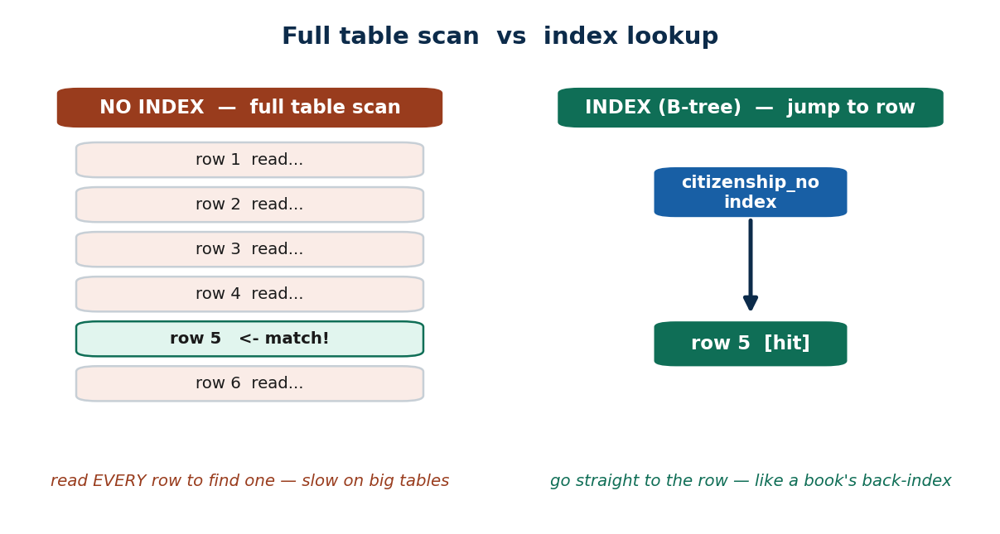
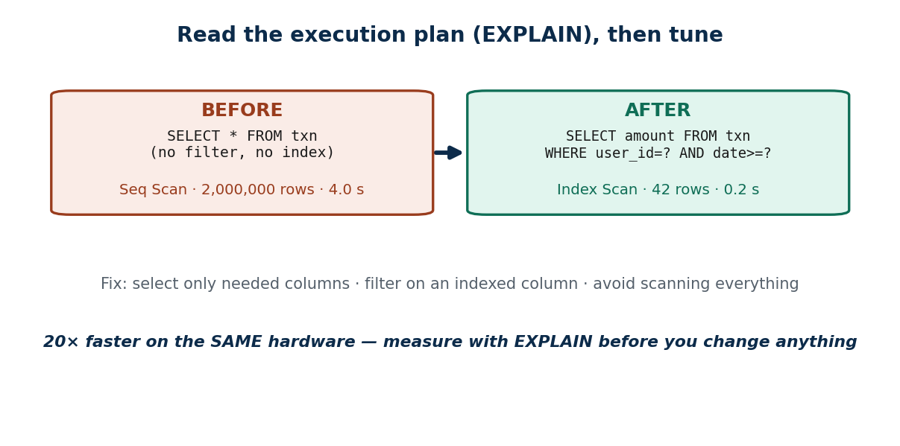
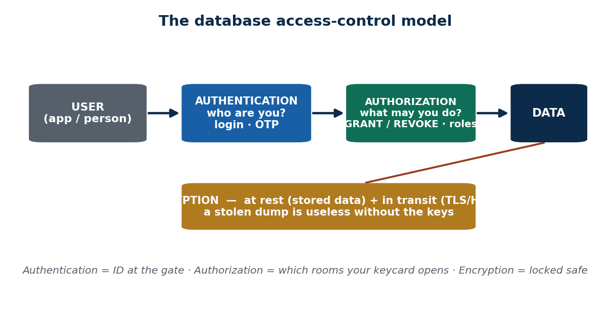
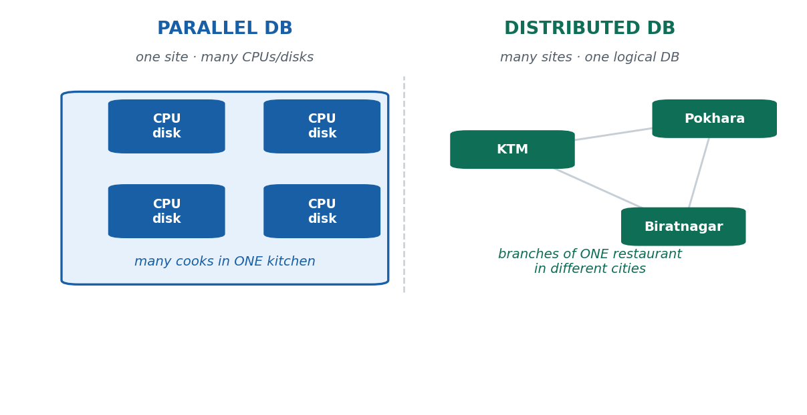
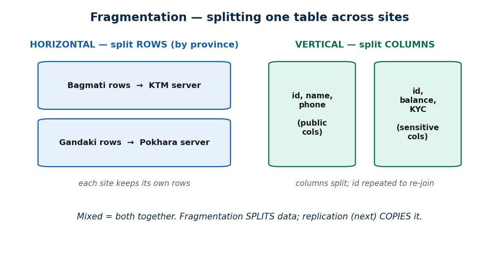
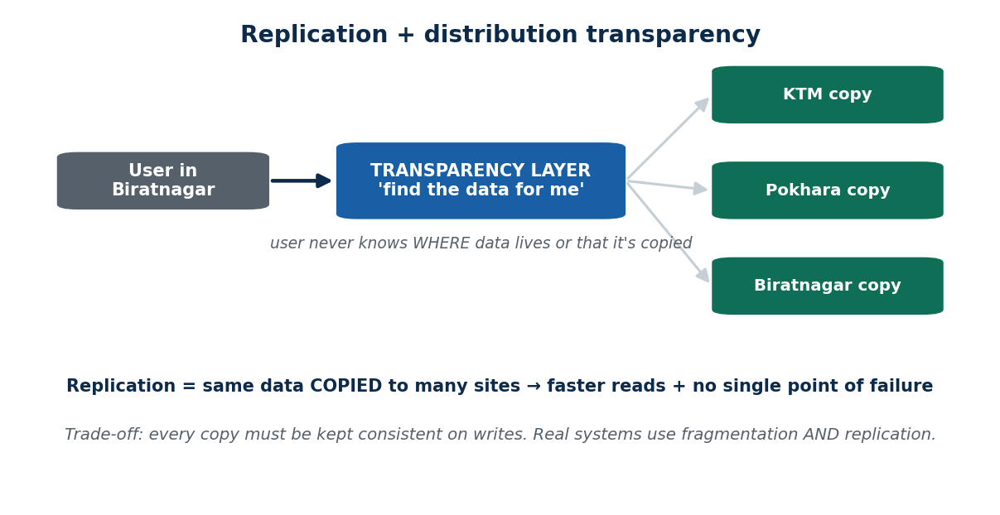
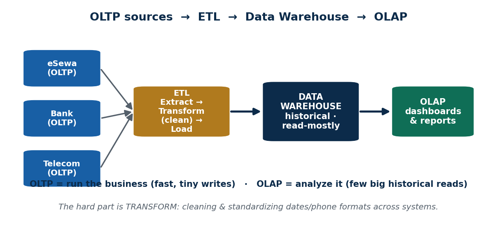
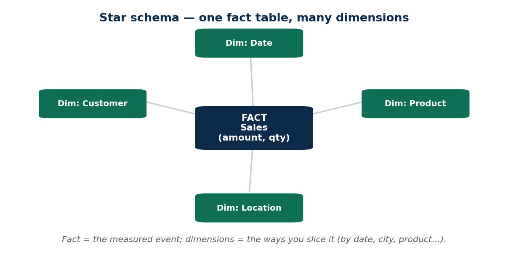
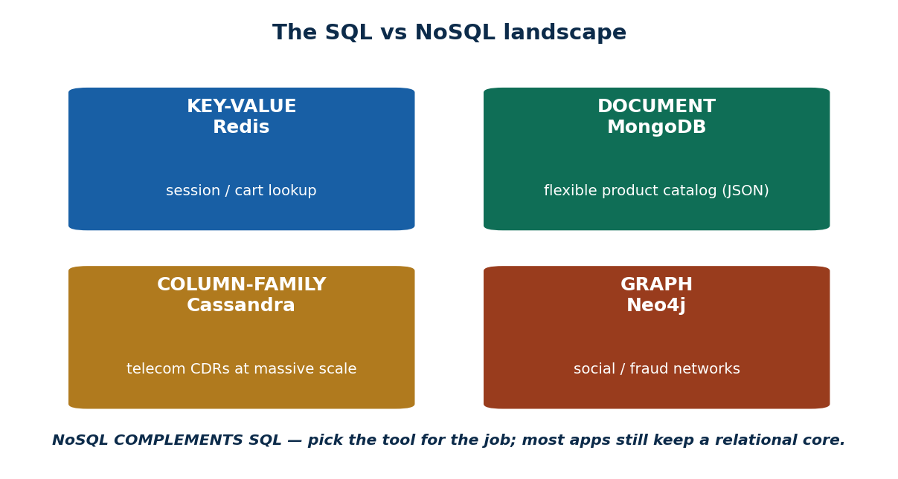
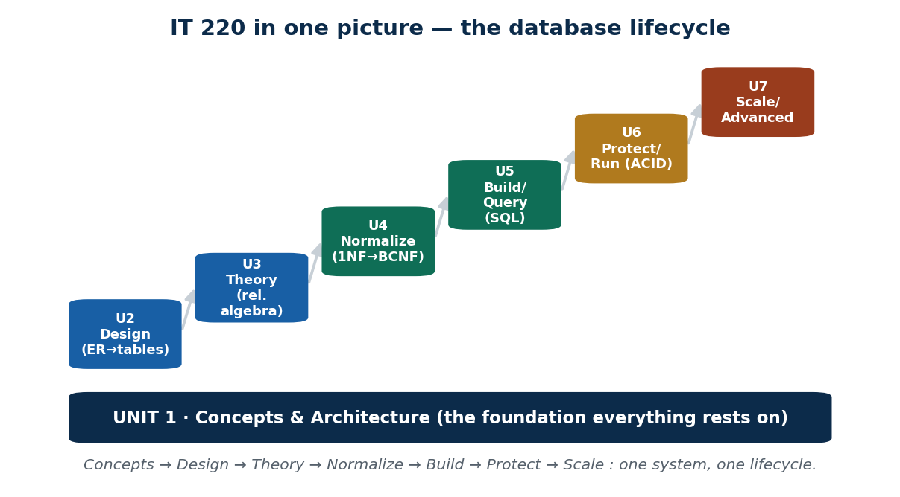

# IT 220 — Unit 7: Advanced Topics (S45–S48)
### Full Lecturer-Ready + Student-Revision Material

**Program:** BIM, 4th Semester · **Credits:** 3 · **Unit weight:** 4 lecture hours
**Sessions:** S45–S48 (50 min each) · **Local context:** Nepal / South Asia
**Format:** Built to `COURSE_MATERIAL_STANDARD.md` incl. the §7A depth rule. Slides: `IT220_Unit7.pptx`
(from `build_unit7_pptx.py`, importing `deckkit.py`); diagrams from `build_unit7_images.py` → `images/`.

> Same two-reader format as Units 1–6. This is the **final unit** of IT 220. S45–S47 add the
> advanced topics; **S48 is the final session of the course — a whole-course review + exam & project
> prep, NOT new theory.** Every concept carries a §7A depth table (comparison / concrete-example),
> localised to Nepal / IT, and everything load-bearing lives on the slide face (PDF-safe).

---

## Unit 7 — Learning Outcomes
1. Explain how indexing and query tuning improve database performance, and apply basic tuning reasoning.
2. Identify core database security threats and controls: authentication, authorization, SQL injection, encryption.
3. Describe parallel and distributed databases, including fragmentation, replication, and distribution transparency.
4. Distinguish OLTP from OLAP and explain data warehousing, ETL, and the goal of data mining.
5. Define BigData (the 3 Vs) and classify the main NoSQL database types and when to use them.
6. (S48) Synthesize all seven units into one coherent picture and prepare for the final exam + project demo.

---
---

# S45 — Database Performance Tuning · Database Security
**Lecture hour 45 · 50 minutes**

### 🎯 OPENING — Hook `[~5 min]`
[SLIDE] *"On exam-results day, lakhs of students hit the result portal in one hour — some pages load instantly, some time out. Two questions decide everything today: WHY is it slow, and WHO is allowed in?"* → performance + security.

### 📚 CONTENT `[~35 min]`

#### Concept 1 — Performance Tuning: Why It Matters `[THEORY]` `[~7 min]`
**📖 In Depth.** **Performance tuning = making the database return correct answers *faster* using the same hardware.** You tune at **three levels** — the **query** (rewrite the SQL), the **schema/index** (add the right index), and the **hardware/config** (last resort) — and you always **measure before you change** (profile with `EXPLAIN`). Tuning changes *speed only*; it must never change the answer.

> **🌍 Real life.** Daraz "search products" during the Dashain sale rush: the same catalogue that answered in 200 ms suddenly takes 4 s. The fix is rarely a bigger server — it's a better query plan and the right index, measured before and after.

> **🎯 Model exam answer.** *"What is performance tuning and at what levels is it done?"* Tuning makes the DB return correct answers faster on the same hardware at three levels — query, schema/index, hardware/config — always measuring first. A missing index or poor query usually dominates cost, so tuning query/index typically beats an expensive hardware upgrade.

> **🧠 Hook:** "Tune query → index → hardware — and measure first."

> **⚠️ Misconception.** *"It's slow — just buy a bigger server."* A missing index or bad query often costs 10×–100× more than hardware ever could; a bigger box only hides the problem.

> **🔑 Key terms:** performance tuning · query/index/hardware levels · measure first · `EXPLAIN` · index beats hardware.

**📊 Depth table — The three levels of tuning (and measure first)**

| Level | What you change | Example fix | Cost / when |
|---|---|---|---|
| Query | Rewrite the SQL itself | Add a WHERE filter; drop `SELECT *` | Cheapest — try first |
| Index / schema | Add or fix an index; adjust design | Index the `citizenship_no` column | Cheap — big wins |
| Config | DBMS memory / cache settings | Bigger buffer pool / cache | Medium — needs care |
| Hardware | More RAM / CPU / faster disk | Upgrade the server / add SSD | Expensive — last resort |
| Measure (always) | Nothing yet — you PROFILE | Run `EXPLAIN` on the slow query | Before every change |

*ℹ️ Work top-down: a query rewrite or a missing index usually beats a costly hardware upgrade. Measure before AND after — "guess and buy" is the expensive plan.*

---

#### Concept 2 — Indexing (recap from Unit 5) `[THEORY]` `[~7 min]`

**📖 In Depth.** An **index** is an auxiliary structure (usually a **B-tree**) that lets the DBMS **find rows without scanning the whole table**. Index the columns used in **WHERE, JOIN, and ORDER BY**. It speeds up reads/lookups but **slows down INSERT/UPDATE/DELETE** (the index must be maintained) and costs storage — so index *deliberately*. Without an index the DBMS does a **full table scan** (reads every row).

> **🌍 Real life.** A bank indexes `citizenship_no` on its customer table so a KYC lookup is instant instead of scanning millions of rows; eSewa indexes `user_id` on transactions so a user's history opens immediately.

> **🎯 Model exam answer.** *"What is an index and what is its trade-off?"* An index is an auxiliary (B-tree) structure that finds rows without a full table scan, speeding up reads on the indexed columns. The trade-off: it slows writes and uses storage, so index only the columns you filter, join, and sort on.

> **🧠 Analogy & hook.** A book's back-of-book index — without it you read every page. **Hook: "Reads faster, writes slower — index deliberately."**

> **⚠️ Misconception.** *"More indexes always = faster."* Every index must be updated on every write, so too many indexes slow writes and waste space.

> **🔑 Key terms:** index · B-tree · full table scan · WHERE/JOIN/ORDER BY · reads faster / writes slower.

**📊 Depth table — When an index HELPS, and when it HURTS**

| Situation | Index it? | Why |
|---|---|---|
| `WHERE citizenship_no = ?` (KYC lookup) | ✅ Yes | Turns a full scan into an instant jump |
| `JOIN customer ON account.cust_id` | ✅ Yes | Foreign-key joins get far faster |
| `ORDER BY txn_date` on a report | ✅ Yes | Avoids sorting the whole table |
| A tiny 50-row lookup table | ❌ No | A scan is already instant; index is overhead |
| A column that is written constantly | ⚠️ Careful | Every write must update the index too |
| Indexing every column "to be safe" | ❌ No | Slows all writes; wastes space; rarely used |

*ℹ️ Index the columns you FILTER, JOIN, and SORT on — not everything. Each extra index is a tax on every insert/update.*

---

#### Concept 3 — Query Tuning `[THEORY]` `[~8 min]`

**📖 In Depth.** **Query tuning** rewrites a query so the optimizer answers it with **less work — usually by reading fewer rows.** Read the **execution plan** (`EXPLAIN`) to see *why* it is slow, then fix the **query**, not the server: avoid `SELECT *`, **filter early on an indexed column** (e.g. `user_id` + a date range), avoid unnecessary **nested subqueries**, and prefer **joins the optimizer can drive with an index**. A `Seq Scan` on a huge table is the red flag.

> **🌍 Real life.** eSewa's transaction-history page is slow because it scans *all* transactions and then filters. Filter first on an indexed `user_id` + date range, select only needed columns, and paginate — the plan flips from a full Seq Scan (seconds) to an Index Scan (milliseconds).

> **🎯 Model exam answer.** *"How would you tune a slow query?"* Read the `EXPLAIN` plan to find the bottleneck (e.g. a full scan), then: avoid `SELECT *`, filter early on indexed columns, drop needless nested subqueries, prefer index-drivable joins, and paginate. Target the query — not the hardware — and verify with the plan before and after.

> **🧠 Hook:** "Read the plan, filter on an indexed column, stop scanning everything."

> **⚠️ Misconception.** *"More indexes / a bigger server fixes any slow query."* Often the query is the problem — `SELECT *` with no useful filter forces a full scan on any hardware.

> **🔑 Key terms:** query tuning · `EXPLAIN` / execution plan · avoid `SELECT *` · filter early · Seq Scan vs Index Scan · joins over subqueries.

**📊 Depth table (§7A) — Query-tuning techniques → when to use each**

| Technique | Problem it fixes | When to use | Nepal / IT example |
|---|---|---|---|
| Add / use an index | Full table scan on a filter | WHERE / JOIN on a big table | Index `user_id` on eSewa txns |
| Filter early (good WHERE) | Reading rows you'll discard | Query touches a huge table | `user_id` + date range on history |
| Select only needed columns | Hauling unused data | `SELECT *` on a wide table | Fetch `amount, date` — not `*` |
| Rewrite nested subquery as JOIN | Optimizer can't use an index | Correlated subquery is slow | Merchant report joins, not sub-selects |
| Read the EXPLAIN plan | You're guessing at the cause | Any slow query, before tuning | Spot a Seq Scan on 2M rows |
| Paginate / LIMIT results | Returning millions of rows | List/report screens | Show 20 transactions per page |
| Cache a hot result | Same heavy query repeated | Read-mostly, rarely changes | Cache the product catalogue |

*ℹ️ Match the technique to the symptom in the EXPLAIN plan. Almost every real win is "read fewer rows" — not a bigger machine.*

---

#### Concept 4 — Database Security: Authentication vs Authorization `[THEORY]` `[~7 min]`

**📖 In Depth.** Two different gates protect a database. **Authentication** answers *"WHO are you?"* (login, password, OTP, biometrics). **Authorization** answers *"WHAT are you allowed to do?"* (`GRANT`/`REVOKE`, roles, privileges). You **authenticate first, then authorize** — and apply **least privilege** (each user gets only the access their job needs).

> **🌍 Real life.** Khalti logs you in with an OTP (authentication). Once inside, a support agent can *view* a transaction but not issue a refund, while a manager can (authorization).

> **🎯 Model exam answer.** *"Differentiate authentication from authorization."* Authentication verifies who a user is (login/OTP); authorization decides what that authenticated user may do (GRANT/REVOKE, roles, least privilege). Authentication comes first; both are required — identity without privilege control, or vice-versa, leaves the DB exposed.

> **🧠 Analogy & hook.** Authentication = showing ID at the gate; authorization = which rooms your keycard opens. **Hook: "Who are you (auth) → what may you do (authz)."**

> **⚠️ Misconception.** *"Once you're logged in, you can do anything."* Logging in is only authentication; a separate authorization layer must still restrict each user.

> **🔑 Key terms:** authentication (who) · authorization (what) · GRANT / REVOKE · roles · least privilege.

**📊 Depth table (comparison) — Authentication vs Authorization**

| Dimension | Authentication | Authorization |
|---|---|---|
| Question it answers | Who are you? | What are you allowed to do? |
| Comes | First | After authentication |
| Mechanism | Login, password, OTP, biometrics | GRANT / REVOKE, roles, privileges |
| Nepal example | Khalti OTP login | Agent can view but not refund |
| If missing | Anyone can log in as anyone | A logged-in user can do anything |
| Analogy | Showing ID at the gate | Which rooms your keycard opens |

*ℹ️ Two SEPARATE gates, not synonyms. A system can authenticate you correctly and still wrongly authorize you to do things you shouldn't.*

---

#### Concept 5 — SQL Injection `[THEORY]` `[EXAMPLE]` `[~8 min]`
**📖 In Depth.** **SQL injection** is an attack where a user types malicious SQL into an input field and the app runs it as part of a real query — letting the attacker read, bypass, or alter the database. **Root cause:** building queries by **concatenating user input**. **Fix:** **parameterized queries / prepared statements** (input is *data*, never *code*), backed by input validation and least privilege.

**🧩 Worked example (Problem → steps → answer).**
- **Problem:** a login form pastes the typed username/password straight into the SQL. An attacker types `' OR '1'='1` as the password.
- **Step 1.** The app builds: `SELECT * FROM users WHERE user='admin' AND pass='' OR '1'='1'`.
- **Step 2.** Because `'1'='1'` is *always true*, the WHERE clause is true for every row — the check is bypassed.
- **Step 3.** The attacker is logged in (often as the admin) without knowing any password.
- **Step 4.** Root cause: user input was **concatenated** into the query, so it became executable code.
- **Step 5.** Fix — parameterized statement: `WHERE user=? AND pass=?` with values **bound separately**.
- **Answer.** Now `' OR '1'='1` is treated as a literal string, not SQL — the login simply fails.

> **🌍 Real life.** A Nepali web app's login form pastes the password into its SQL; `' OR '1'='1` logs the attacker in as admin. The same flaw lets attackers dump a KYC table through a carelessly built search box.

> **🎯 Model exam answer.** *"What is SQL injection and how is it prevented?"* An attack inserting malicious SQL via input (exploiting concatenated queries) to bypass logins or read/alter data. Prevent it with parameterized queries / prepared statements (input as data, not code), plus input validation and least privilege — not by hiding error messages.

> **🧠 Hook:** "If user input can become SQL code, you've built a door with no lock."

> **⚠️ Misconception.** *"Hiding the SQL and error messages makes it secure."* Obscurity is not a control — the only real fix is parameterized queries.

> **🔑 Key terms:** SQL injection · concatenation (the cause) · `' OR '1'='1` · parameterized / prepared statements · input validation.

**📊 Depth table — Vulnerable vs safe (the same query two ways)**

| Pattern | What the code does | Safe? | Why |
|---|---|---|---|
| String concatenation | `"...user='"+u+"'"` | ❌ No | User input becomes executable SQL |
| Parameterized query | `WHERE user=?` bind(u) | ✅ Yes | Input is treated as data, never code |
| Hiding error messages | Suppress DB errors only | ❌ No | Obscurity isn't a control; still injectable |
| Input validation | Reject odd characters | ⚠️ Helps | A useful extra layer, not a full fix alone |
| Least-privilege DB user | App can't DROP tables | ⚠️ Helps | Limits the blast radius if injected |
| Stored procedure (parametrized) | Call proc with bound args | ✅ Yes | Same principle — data kept out of code |

*ℹ️ The one real fix is keeping user input OUT of the SQL code. Validation and least privilege reduce risk but never replace it; hiding errors does nothing.*

---

#### Concept 6 — Encryption & the Security Threat Landscape `[THEORY]` `[~7 min]`
**📖 In Depth.** **Encryption** encodes data so only parties with the **key** can read it. Two flavours: **at rest** (stored data on disk/backups) and **in transit** (data moving over the network, via **TLS/HTTPS**). Even a stolen database dump is useless without the keys. Encryption is **one layer of defence-in-depth** — pair it with authentication, authorization/least privilege, and safe queries.

> **🌍 Real life.** A Nepali bank encrypts stored account data (at rest) and runs HTTPS on its mobile-banking app (in transit). A stolen laptop/backup is unreadable; sniffed public-Wi-Fi traffic is just ciphertext.

> **🎯 Model exam answer.** *"Explain encryption at rest vs in transit."* At rest protects stored data and backups; in transit (TLS/HTTPS) protects data moving over the network — both making a stolen dump or sniffed traffic useless without the keys. It is one layer alongside authentication, authorization, and parameterized queries.

> **🧠 Analogy & hook.** A locked safe — even if the thief takes the safe, they can't open it without the key. **Hook: "At rest + in transit; guard the keys."**

> **⚠️ Misconception.** *"Encryption alone makes the database secure."* It does nothing against SQL injection, weak passwords, or an over-privileged account — each threat needs its own control.

> **🔑 Key terms:** encryption · at rest vs in transit · TLS/HTTPS · keys · defence in depth.

**📊 Depth table (§7A) — Database security threats → the control that stops it**

| Threat | What the attacker does | Control that stops it | Nepal / IT example |
|---|---|---|---|
| Unknown user gets in | Logs in without valid identity | Authentication (password/OTP) | Khalti OTP at login |
| User does too much | Acts beyond their role | Authorization / least privilege | Agent can view, not refund |
| SQL injection | Injects SQL via an input box | Parameterized queries + validation | Fix the login form's query |
| Stolen database dump | Reads a copied data file | Encryption at rest | Bank encrypts stored accounts |
| Network eavesdropping | Sniffs data in transit | Encryption in transit (TLS/HTTPS) | HTTPS on mobile banking |
| Data loss / disaster | DB is destroyed or corrupted | Backups + recovery (Unit 6) | Nightly encrypted backups |
| Weak / shared passwords | Guesses or reuses credentials | Strong-password policy + MFA | OTP as a second factor |

*ℹ️ Security is layered — each threat has its own matching control. Encryption answers "stolen/sniffed data"; it does NOT stop SQL injection or over-broad privileges.*

### ✅ CHECK FOR UNDERSTANDING `[~5 min]`
- **MCQ1.** A query that filters by an indexed column avoids a… → **(a) full table scan ✅** (b) commit (c) deadlock (d) rollback.
- **MCQ2.** The best defence against SQL injection is… → **(c) parameterized / prepared statements ✅** (vs hiding errors, more indexes, a bigger server).
- **Discussion.** Pick a Nepali app you use — name one thing it should *authenticate* and one thing it should *authorize*.

### 🌍 REAL-LIFE APPLICATION `[~3 min]`
Tuning + security are the two most common DB/backend **job-interview** topics in Nepali fintech (eSewa, Khalti, IME Pay) and banking core systems.

### 📝 SUMMARY & TAKEAWAYS `[~2 min]`
1. Tune in order — query → index → hardware — and **measure first** (`EXPLAIN`); a missing index usually beats a bigger server.
2. **Authentication = WHO; authorization = WHAT** (least privilege) — two separate gates.
3. **SQL injection** is fixed with **parameterized queries**; **encryption** (at rest + in transit) protects data — layer the controls.

**Next:** what happens when one database is too big or too critical for a single machine — parallel & distributed databases.

---
---

# S46 — Parallel & Distributed Databases
**Lecture hour 46 · 50 minutes**

### 🎯 OPENING — Hook `[~5 min]`
[SLIDE] *"Ncell has subscribers in Mechi and in Mahakali. Should ALL their call records sit on one server in Kathmandu? What happens the day that one server burns down — or the whole country queries it at once?"* → distribute the data.

### 📚 CONTENT `[~35 min]`

#### Concept 1 — Parallel vs Distributed Databases `[THEORY]` `[~8 min]`

**📖 In Depth.** A **parallel database** uses many processors/disks in **ONE location** to speed up one system. A **distributed database** stores data across **MULTIPLE sites** that appear to the user as **one logical database**. Parallel is about *power in one place*; distributed is about *spreading across places* for locality and reliability. A system can be both.

> **🌍 Real life.** Ncell keeping all records on one KTM server is a single point of failure and slow for far users; a distributed design places records in regional data centres (many sites, one logical DB), with a parallel setup inside each site for local load.

> **🎯 Model exam answer.** *"Differentiate parallel and distributed databases."* Parallel uses many processors/disks at one site to speed up a single system; distributed stores data across multiple sites presented as one logical database, gaining locality, reliability, and scalability. Parallel scales power in one place; distribution spreads data across places — large systems often do both.

> **🧠 Analogy & hook.** Parallel = many cooks in one kitchen; distributed = branches of one restaurant in many cities. **Hook: "One place, more power vs many places, one logical DB."**

> **⚠️ Misconception.** *"Parallel and distributed are the same."* No — parallel = one place with more power; distributed = many places presented as one logical DB.

> **🔑 Key terms:** parallel (one site) · distributed (many sites, one logical DB) · locality · fault tolerance.

**📊 Depth table (§7A comparison) — Parallel vs Distributed databases**

| Dimension | Parallel database | Distributed database |
|---|---|---|
| Location | One site | Many sites / locations |
| Main goal | Speed — more processing power | Locality + reliability + scale |
| Data placement | Shared within one machine/cluster | Fragmented / replicated across sites |
| Failure of one node | Degrades the single system | Other sites keep serving |
| User's view | One system | One LOGICAL database (sites hidden) |
| Analogy | Many cooks, one kitchen | Branches of one restaurant, many cities |
| Nepal example | A powerful bank server cluster in KTM | Ncell records held in regional data centres |

*ℹ️ Parallel is POWER in one place; distributed is SPREADING across places for locality and no single point of failure. Real systems combine both.*

---

#### Concept 2 — Why Distribute? (Motivation) `[THEORY]` `[~5 min]`
**📖 In Depth.** Distribution earns its complexity for three payoffs: **locality** (data near users → faster), **reliability** (no single point of failure — other sites keep serving), and **scalability** (grow by adding sites, not replacing one giant server). The cost is **coordination complexity** — keeping distributed data consistent.

> **🌍 Real life.** A national telecom keeps regional records in regional data centres: eastern subscribers are served nearby (locality), one outage doesn't down the network (reliability), new regions are added as new sites (scalability).

> **🎯 Model exam answer.** *"Why distribute a database?"* For locality (faster/cheaper access near users), reliability (survive a site failure), and scalability (add sites as you grow); the trade-off is coordination complexity. This is why national-scale services run distributed rather than on one machine.

> **🧠 Hook:** "Distribute for locality, reliability, and scale — pay in complexity."

> **⚠️ Misconception.** *"Distribution is just for handling more data."* Locality and reliability matter just as much as volume.

> **🔑 Key terms:** locality · reliability · scalability · no single point of failure · complexity is the cost.

**📊 Depth table (payoff) — Why distribute: driver, payoff, and risk if you don't**

| Driver | What you gain | Nepal / IT example | If centralized instead |
|---|---|---|---|
| Locality | Data near users → faster | Regional telecom data centres | Far users see lag |
| Reliability | No single point of failure | Nagarik App backend across sites | One outage = whole country down |
| Scalability | Grow by adding sites | National e-commerce expanding | One server hits a hard ceiling |
| Load spreading | No single hotspot | Election/exam-result portals | One box melts under peak load |

*ℹ️ Every driver is "don't bet the whole country on one machine". The price is coordination complexity — managed by fragmentation, replication, and transparency.*

---

#### Concept 3 — Fragmentation `[THEORY]` `[~8 min]`

**📖 In Depth.** **Fragmentation** splits one logical table across sites. **Horizontal** splits **ROWS** (e.g. by province); **vertical** splits **COLUMNS** (repeat the key to re-join); **mixed** does both. Fragments reconstruct **losslessly** — **UNION** the horizontal fragments, **JOIN** the vertical ones — so the data stays queryable as one logical table.

> **🌍 Real life.** A bank stores each branch's accounts at that branch's site (horizontal fragmentation) for fast local access, yet head office runs a nationwide report by UNION-ing the fragments.

> **🎯 Model exam answer.** *"Define fragmentation and its types."* Fragmentation splits a logical table across sites: horizontal (rows, e.g. by province), vertical (columns, key repeated to re-join), and mixed. Fragments recombine losslessly (UNION for horizontal, JOIN for vertical), so data lives near its users yet remains one logical table.

> **🧠 Hook:** "Horizontal = split the ROWS; vertical = split the COLUMNS; mixed = both."

> **⚠️ Misconception.** *"Fragmenting chops up and loses the data."* No — fragments are a placement strategy; the full logical table is always reconstructable.

> **🔑 Key terms:** fragmentation · horizontal (rows) · vertical (columns) · mixed · reconstruct by UNION / JOIN.

**📊 Depth table (comparison) — Fragmentation types compared**

| Type | What it splits | Nepal example | Re-assemble by |
|---|---|---|---|
| Horizontal | Rows (a subset per site) | Bagmati rows → KTM; Gandaki → Pokhara | UNION the fragments |
| Vertical | Columns (a subset per site) | Public cols one site, KYC cols another | JOIN on the repeated key |
| Mixed / hybrid | Both rows and columns | Province split, then sensitive cols split | UNION then JOIN |
| (No fragmentation) | Nothing — one whole table | Everything on one KTM server | N/A — single copy |

*ℹ️ Splitting rows by province (horizontal) is the classic case — each region's data lives where its users are, yet a nationwide query still sees one logical table.*

---

#### Concept 4 — Replication `[THEORY]` `[~7 min]`

**📖 In Depth.** **Replication** keeps **COPIES** of the same data at multiple sites. It boosts **read speed** (read a nearby copy) and **availability** (a copy survives a site failure). The cost is **consistency**: a write must propagate to every copy, or copies drift. Fragmentation and replication are used **together** — fragment, then replicate the fragments.

> **🌍 Real life.** A national e-commerce site replicates its product catalogue to every region: everyone reads a nearby copy instantly, and if one data centre fails, others still serve it. The catalogue is read far more than written, so the consistency cost is worth it.

> **🎯 Model exam answer.** *"Define replication and its trade-off."* Replication keeps copies of the same data at multiple sites, improving read speed and availability; its cost is keeping copies consistent on writes. It complements fragmentation — systems fragment by locality and replicate read-mostly data for speed and resilience.

> **🧠 Analogy & hook.** Photocopying the same notice for every branch noticeboard. **Hook: "Copies = fast reads + availability, at a consistency cost."**

> **⚠️ Misconception.** *"Replication and fragmentation are opposites you must choose between."* They're complementary — real systems use both together.

> **🔑 Key terms:** replication · copies at many sites · faster reads + availability · consistency cost on writes.

**📊 Depth table (comparison) — Fragmentation vs Replication: split vs copy**

| Question | Fragmentation | Replication |
|---|---|---|
| Does what? | SPLITS data across sites | COPIES data to many sites |
| Each site holds | A different piece | The same data |
| Main benefit | Locality + spread the storage | Faster reads + availability |
| Main cost | Reassembly on cross-site queries | Keeping copies consistent on writes |
| Used together? | Yes — usually with replication | Yes — replicate the fragments |
| Analogy | Tear the notice into regional parts | Photocopy the whole notice per branch |

*ℹ️ NOT opposites. Systems fragment (place data near users) AND replicate (copy hot, read-mostly data) at the same time.*

---

#### Concept 5 — Distribution Transparency `[THEORY]` `[~5 min]`
**📖 In Depth.** **Distribution transparency** means the user/app does **not** need to know where data lives, or that it is fragmented or replicated. Three kinds: **location** (which site), **fragmentation** (that it's split), **replication** (that copies exist). The system hides all of it behind **one simple logical view** — this is **Unit 1's data independence** at the distribution level.

> **🌍 Real life.** A Daraz shopper in Biratnagar searches once and gets results — never knowing which data centre answered, whether the catalogue was fragmented by region, or that they read a replicated copy.

> **🎯 Model exam answer.** *"What is distribution transparency?"* It lets users query a distributed DB without knowing data location, fragmentation, or replication — the DBMS hides all of it behind one logical view. It is the distributed-level form of data independence: hide the internal structure, keep the external interface simple.

> **🧠 Analogy & hook.** "Hide the inside, keep the outside simple" — the Unit 1 idea, for distribution. **Hook: "The app sees one logical database."**

> **⚠️ Misconception.** *"The app must track which site holds each piece of data."* No — transparency means the DBMS hides location/fragmentation/replication.

> **🔑 Key terms:** distribution transparency · location · fragmentation · replication · one logical view · = data independence (Unit 1).

**📊 Depth table (scaffolding) — Three kinds of distribution transparency**

| Transparency | What it hides | What the user sees | Nepal example |
|---|---|---|---|
| Location | Which site stores the data | Just query — no site named | Daraz search "just works" |
| Fragmentation | That the table is split | One logical whole table | Nationwide report over provinces |
| Replication | That copies exist | One consistent value | Catalogue reads from any copy |

*ℹ️ All three add up to one promise: the user works with a single simple logical database and the DBMS quietly handles WHERE the data is, whether it's SPLIT, and whether it's COPIED.*

### ✅ CHECK FOR UNDERSTANDING `[~5 min]`
- **MCQ1.** Splitting a customer table so each province's rows live at that province's site is… → **(b) horizontal fragmentation ✅** (vs vertical, replication, indexing).
- **MCQ2.** A user querying a distributed DB without knowing data locations is enabled by… → **(a) distribution / location transparency ✅**.
- **Discussion.** For a national e-commerce site: fragment by province, replicate the catalogue, or both — and why?

### 🌍 REAL-LIFE APPLICATION `[~3 min]`
Every large Nepali/regional service — telecoms, the Nagarik App backend, big e-commerce — is distributed for reliability and locality; this is how systems stay up when one site fails.

### 📝 SUMMARY & TAKEAWAYS `[~2 min]`
1. **Parallel = one site, more power; distributed = many sites, one logical DB** (locality, reliability, scalability).
2. **Fragmentation SPLITS** data (horizontal = rows, vertical = columns); **replication COPIES** it — real systems use both.
3. **Distribution transparency** hides location, fragmentation, and replication — the app sees one logical database.

**Next:** turning operational data into *insight* — data warehousing, mining, BigData, and NoSQL.

---
---

# S47 — Data Warehousing & Mining · BigData · NoSQL
**Lecture hour 47 · 50 minutes**

### 🎯 OPENING — Hook `[~5 min]`
[SLIDE] *"eSewa runs your wallet RIGHT NOW — fast, tiny transactions. But how does eSewa figure out 'which districts spend most during Tihar'? Different job, different kind of database."* → OLTP vs OLAP and beyond.

### 📚 CONTENT `[~35 min]`

#### Concept 1 — OLTP vs OLAP `[THEORY]` `[~8 min]`

**📖 In Depth.** **OLTP** (Online Transaction Processing) handles **many small, fast** read/write transactions — the *running* of the business. **OLAP** (Online Analytical Processing) handles **few large, complex** read queries over history — the *analysis* of the business. Their workloads are **opposite**, so they run on **separate systems**: the operational database and a separate warehouse.

> **🌍 Real life.** A single Khalti payment being recorded is OLTP (tiny, instant, thousands/minute); "monthly spending trend by city" is OLAP (one big query over months, run by analysts) — kept on a separate warehouse so the wallet stays fast.

> **🎯 Model exam answer.** *"Differentiate OLTP and OLAP."* OLTP = many small fast read/write transactions on current data (running the business); OLAP = few large complex read queries over historical data (analysis). Opposite workloads → separate systems: the operational OLTP DB and an OLAP data warehouse.

> **🧠 Hook:** "OLTP runs the business (tiny writes); OLAP analyzes it (big historical reads)."

> **⚠️ Misconception.** *"One database should do both well."* Mixing heavy analytics on the live transaction DB slows down customers — separate them.

> **🔑 Key terms:** OLTP · OLAP · current vs historical · separate systems · don't mix workloads.

**📊 Depth table (§7A comparison) — OLTP vs OLAP**

| Dimension | OLTP (run the business) | OLAP (analyze the business) |
|---|---|---|
| Workload | Many small read/write txns | Few large, complex read queries |
| Data | Current, operational | Historical, aggregated |
| Optimized for | Fast writes & lookups | Complex reads & aggregation |
| Typical query | "Record this Khalti payment" | "Spend by district this Tihar" |
| Users | Customers, front-line apps | Analysts, management dashboards |
| Lives in | The operational database | A data warehouse |

*ℹ️ Opposite workloads → separate systems. Running OLAP reports on the live OLTP database slows down paying customers — the classic mistake.*

---

#### Concept 2 — Data Warehousing `[THEORY]` `[~7 min]`

**📖 In Depth.** A **data warehouse** is a **separate, subject-oriented, integrated store of HISTORICAL data built for analysis (OLAP)**. It is **read-mostly**, fed from many operational systems, and typically laid out as a **star schema** — a central **fact** table (measured events) surrounded by **dimension** tables (date, product, place).

> **🌍 Real life.** A bank pools data from branches, cards, and loans into one warehouse for management dashboards ("loans by district over five years"). The live branch DBs stay fast; the warehouse holds integrated history as a star schema.

> **🎯 Model exam answer.** *"What is a data warehouse?"* A separate, subject-oriented, integrated, historical, read-mostly store built for analysis (OLAP), fed from many operational systems and typically laid out as a star schema (fact + dimension tables). It lets decision-makers run large reports without slowing the live OLTP systems.

> **🧠 Analogy & hook.** Operational DBs = the daily-use cash drawer; warehouse = the audited archive room. **Hook: "Integrated historical store, shaped for reporting."**

> **⚠️ Misconception.** *"The warehouse is just a copy/backup of the operational DB."* It is a separate, integrated, historical store organized for analysis (star schema) — not a mirror.

> **🔑 Key terms:** data warehouse · subject-oriented · integrated · historical · read-mostly · star schema.

**📊 Depth table (comparison) — Operational database vs Data warehouse**

| Dimension | Operational DB (OLTP) | Data warehouse (OLAP) |
|---|---|---|
| Data age | Current | Historical (months/years) |
| Main operation | Read + write (transactions) | Read-mostly (analysis) |
| Organized for | Fast transactions | Fast reporting / aggregation |
| Sources | One running application | Many systems integrated |
| Schema style | Normalized tables | Star schema (fact + dimensions) |
| Nepal example | A branch's live accounts | Bank-wide dashboard warehouse |

*ℹ️ The warehouse is a purpose-built ANALYSIS store — it integrates many sources, keeps history, and is shaped (star schema) for slicing reports quickly.*

---

#### Concept 3 — ETL (Extract, Transform, Load) `[THEORY]` `[~7 min]`
**📖 In Depth.** **ETL** is the pipeline that moves data from operational systems **into** the warehouse. **Extract** pulls data from the sources; **Transform** cleans and standardizes it (**the hard part** — reconciling dates, formats, duplicates); **Load** writes it into the warehouse. It usually runs on a **schedule** (e.g. nightly).

> **🌍 Real life.** Combining eSewa + bank + telecom-recharge data where dates use different calendars/formats and phone numbers are written inconsistently: the Transform step reconciles them before Load, so a report can join spend across all three sources correctly.

> **🎯 Model exam answer.** *"What is ETL and which step is hardest?"* Extract pulls data from many sources, Transform cleans/standardizes/de-duplicates it (the hard part), and Load writes the integrated result into the warehouse. Without Transform the warehouse is full of mismatched dates and duplicate customers that break every report.

> **🧠 Analogy & hook.** ETL is the kitchen that turns messy raw ingredients (sources) into a clean dish (the warehouse). **Hook: "Transform is where the real work is."**

> **⚠️ Misconception.** *"ETL just copies the data over."* The Transform (cleaning/standardizing) step is the hard, essential part.

> **🔑 Key terms:** ETL · Extract → Transform → Load · Transform = clean & standardize · integrates many sources.

**📊 Depth table (scaffolding) — ETL: the three steps**

| Step | What it does | Example | Why it matters |
|---|---|---|---|
| Extract | Pull data from source systems | Read eSewa, bank, telecom feeds | Gets raw data out of silos |
| Transform | Clean & standardize formats | Unify dates (BS/AD), phone formats | The hard, essential step |
| Load | Write into the warehouse | Insert cleaned rows into the star schema | Makes data query-ready |

*ℹ️ Transform is where ~90% of the effort goes: source systems disagree on dates, phone formats, and codes. Skipping it gives a warehouse no report can trust.*

---

#### Concept 4 — Data Mining `[THEORY]` `[~7 min]`
**📖 In Depth.** **Data mining** discovers **previously UNKNOWN** patterns and relationships in large data sets. Main tasks: **classification** (predict a category), **clustering** (group similar items), **association rules** (things that occur together). Unlike a report/query — which answers a question you already framed — mining **surfaces the unknown pattern**.

> **🌍 Real life.** Daraz's "customers who bought X also bought Y" is association-rule mining; a telecom predicting which subscribers will churn is classification — both drive real actions (recommendations, retention offers).

> **🎯 Model exam answer.** *"What is data mining?"* Discovering previously unknown patterns in large data via classification, clustering, and association rules. Unlike a report/SQL query (which answers a pre-framed question), mining surfaces hidden patterns, enabling recommendations, churn prediction, and fraud detection.

> **🧠 Hook:** "A report answers a question you asked; mining finds an answer you didn't know to ask for."

> **⚠️ Misconception.** *"Data mining = just running queries/reports."* Mining finds *previously unknown* patterns, not pre-asked questions.

> **🔑 Key terms:** data mining · classification · clustering · association rules · finds UNKNOWN patterns.

**📊 Depth table (scaffolding) — Data-mining tasks: what each finds**

| Task | What it finds | Nepal / IT example |
|---|---|---|
| Classification | Predicts a category/label | Telecom predicts which customers will churn |
| Clustering | Groups similar records (no labels) | Segment Daraz shoppers by behaviour |
| Association rules | Items that occur together | "Bought X also bought Y" recommendations |
| Anomaly detection | Rare / suspicious cases | Flag a fraudulent eSewa transaction |
| Regression / forecasting | Predicts a number/trend | Forecast next month's recharge demand |

*ℹ️ All surface patterns you didn't explicitly ask for — the defining difference from a normal report or SQL query.*

---

#### Concept 5 — BigData & the 3 Vs `[THEORY]` `[~7 min]`
**📖 In Depth.** **BigData** is data too large, fast, or varied for a traditional DBMS to handle well. The **3 Vs**: **Volume** (huge size), **Velocity** (arriving fast/real-time), **Variety** (many formats — text, images, logs, GPS). Extended Vs add **Veracity** (trustworthiness) and **Value**. When data breaks all three, single-server relational techniques stop coping.

> **🌍 Real life.** A ride/delivery app (Pathao/inDrive) streams live GPS from thousands of riders (Velocity), across text, images, and logs (Variety), piling to enormous size (Volume) — BigData territory. A telecom's call-detail-record flood is the same.

> **🎯 Model exam answer.** *"Define BigData and its 3 Vs."* Data too large/fast/varied for a traditional DBMS: Volume (size), Velocity (real-time arrival), Variety (mixed formats); extended Vs are Veracity and Value. When all three hold, single-server relational techniques stop coping — motivating BigData platforms and NoSQL.

> **🧠 Analogy & hook.** A regular DB is a bucket; BigData is a monsoon river — you need different tools. **Hook: "Volume · Velocity · Variety."**

> **⚠️ Misconception.** *"BigData just means a lot of data (Volume only)."* Velocity and Variety matter just as much; often the combination breaks traditional tools.

> **🔑 Key terms:** BigData · Volume · Velocity · Variety · (+ Veracity, Value) · beyond a traditional DBMS.

**📊 Depth table (scaffolding) — The 3 Vs (+2) of BigData**

| V | What it means | Nepal / IT example |
|---|---|---|
| Volume | Huge size (TB → PB) | Years of telecom call-detail records |
| Velocity | Arrives fast / real-time | Pathao / inDrive live GPS streams |
| Variety | Many formats & types | Text, images, logs, GPS together |
| Veracity (bonus) | How trustworthy/accurate | Noisy sensor or crowd-sourced data |
| Value (bonus) | Is it worth analyzing? | Only mine what drives a decision |

*ℹ️ Memorise Volume, Velocity, Variety. When data breaks all three, single-server DBMS techniques stop coping — hence BigData tools and NoSQL.*

---

#### Concept 6 — NoSQL Databases & Their Types `[THEORY]` `[~8 min]`

**📖 In Depth.** **NoSQL** ("Not Only SQL") means **non-relational** stores built for scale, flexible schemas, and the 3 Vs. Four families: **Key-Value** (Redis — sessions/cart), **Document** (MongoDB — flexible catalogue), **Column-family** (Cassandra — CDRs at scale), **Graph** (Neo4j — connected data). Trade-off teaser: they gain flexibility/scale, often by relaxing strict **ACID** consistency. **NoSQL complements SQL** — pick the store by data shape.

> **🌍 Real life.** A flexible, ever-changing product catalogue fits a document store (MongoDB — each product a JSON document); eSewa's money ledger stays relational (SQL) for strict ACID consistency. Different jobs, different stores.

> **🎯 Model exam answer.** *"What is NoSQL and what are its types?"* Non-relational stores for scale, flexible schemas, and the 3 Vs, in four families — key-value (Redis), document (MongoDB), column-family (Cassandra), graph (Neo4j). They complement relational DBs, often trading strict ACID for flexibility/scale, so you pick the store by the data's shape.

> **🧠 Hook:** "NoSQL complements SQL — pick the tool for the job."

> **⚠️ Misconception.** *"NoSQL is replacing/killing SQL."* It complements relational DBs; most apps still need a relational core (especially for money).

> **🔑 Key terms:** NoSQL · key-value / document / column-family / graph · Redis/MongoDB/Cassandra/Neo4j · complements SQL · flexibility & scale vs strict ACID.

**📊 Depth table (§7A) — SQL & NoSQL families: datastore, shape & use-case**

| Family | Example datastore | Data shape | Best for | Nepal / IT example |
|---|---|---|---|---|
| Relational (SQL) | MySQL / PostgreSQL | Tables + relationships (ACID) | Structured data needing consistency | Bank accounts, eSewa ledger |
| Key-Value | Redis | key → value (a dictionary) | Fast lookups, caching | Login sessions, shopping cart |
| Document | MongoDB | JSON-like documents | Flexible, changing schema | Daraz product catalogue |
| Column-family | Cassandra | Wide rows, columns at scale | Massive write-heavy data | Telecom call-detail records |
| Graph | Neo4j | Nodes + relationships | Highly connected data | Social / fraud networks |
| Search | Elasticsearch | Inverted index of documents | Full-text search | Product / help-desk search |

*ℹ️ Pick the family by the data SHAPE and access pattern — not fashion. A relational core still anchors most systems (money, accounts); NoSQL complements it.*

### ✅ CHECK FOR UNDERSTANDING `[~5 min]`
- **MCQ1.** A single Khalti payment being recorded is an example of… → **(a) OLTP ✅** (vs OLAP, ETL, data mining).
- **MCQ2.** "Variety" in BigData's 3 Vs refers to… → **(c) many different data formats/types ✅** (vs speed, size, accuracy).
- **Discussion.** For a flexible, ever-changing product catalogue — relational or document NoSQL DB, and why?

### 🌍 REAL-LIFE APPLICATION `[~3 min]`
Analytics + BigData + NoSQL skills are the **fastest-growing data jobs** in Nepal/South Asia (fintech analytics, telecom churn, e-commerce recommendations) — this session points toward that career path.

### 📝 SUMMARY & TAKEAWAYS `[~2 min]`
1. **OLTP runs the business** (tiny fast transactions); **OLAP analyzes it** (big historical queries) — separate systems.
2. **Warehouses** store integrated historical data fed by **ETL** (Transform is the hard part); **data mining** finds hidden patterns.
3. **BigData = Volume/Velocity/Variety**; **NoSQL** (key-value/document/column/graph) **complements SQL** — pick the tool.

**Next:** the final session — we tie all 7 units together and prepare for the exam + project demo.

---
---

# S48 — Course Review · Project Presentations · Final Q&A (FINAL SESSION)
**Lecture hour 48 · 50 minutes**

> **No new theory.** This is a *synthesis + preparation* session: course-wide recap, exam guidance, and project-demo structure.

### 🎯 OPENING — Hook `[~5 min]`
[SLIDE] *"Eight semesters of life run on databases — and in 4 months you went from 'what is a database?' to designing, querying, securing, and scaling one. Today we connect every dot and get you exam- and demo-ready."*

### Part A — Course-wide recap: the whole course as one lifecycle `[~18 min]`

IT 220 is **one lifecycle** for building a real database system, all resting on the **Unit 1** concepts foundation:
**Concepts (U1) → Design (U2) → Theory (U3) → Normalize (U4) → Build/Query (U5) → Protect/Run (U6) → Scale/Advanced (U7).**

**📊 Depth table (recap) — The whole of IT 220 in one table**

| Unit | What it covered | Key skill you gained | Likely exam focus |
|---|---|---|---|
| U1 Concepts & Architecture | DB/DBMS, users/DBA, schemas, 3-schema, client/server | Talk about DB systems precisely | Definitions; 3-schema architecture |
| U2 ER & Relational Model | Entities, attributes, keys, relationships, ER→table | Design a schema from requirements | ER→table conversion |
| U3 Relational Algebra & Calculus | SELECT, PROJECT, JOIN — the formal basis of SQL | Reason about queries formally | Write/read algebra expressions |
| U4 Normalization | FDs, anomalies, 1NF→BCNF, 4NF | Remove redundancy & anomalies | Normalize to 3NF/BCNF (show work) |
| U5 SQL | DDL/DML, joins, subqueries, views, procedures, indexing | Build & query a real database | Write joins/subqueries/aggregates |
| U6 Transactions & Recovery | ACID, serializability, 2PL/timestamp, backup/recovery | Keep data correct under concurrency | ACID + 2PL; recovery |
| U7 Advanced Topics | Tuning, security, distributed DBs, warehousing/BigData/NoSQL | Make it fast, safe, and scalable | Definitions; tuning & security |

*ℹ️ One row per unit — the whole course at a glance. The arc: concepts → design → theory → refine → build → protect → scale. A fast revision map for the final exam.*

### Part B — How the units connect (mini synthesis) `[~7 min]`
**🧩 Worked thread — one system through all seven units (an eSewa-style wallet):**
- **U1** — decide it's a multi-user DBMS with a 3-schema design.
- **U2** — draw the ER diagram (User, Merchant, Transaction) and convert it to tables with keys.
- **U3/U4** — reason about the queries formally, then normalize to remove redundancy/anomalies.
- **U5** — build it in SQL: CREATE, INSERT, JOIN/aggregate queries + a view for statements.
- **U6** — a money transfer is a TRANSACTION: ACID + 2PL keep it correct under concurrency; backups enable recovery.
- **U7** — index and secure it (auth, authorization, encryption), then scale via distribution and analyze spend via a warehouse.

> **⚠️ Misconception to retire.** *"These units are separate topics."* They are **one lifecycle** of building a real system — design → normalize → SQL → transactions → protect/secure → scale/analyze. Any real Nepali fintech app is this exact journey.

### Part C — Exam preparation guidance `[~10 min]`
- **Likely high-weight areas:** ER→table conversion, normalization to 3NF/BCNF, SQL writing (joins/subqueries/aggregates), ACID + 2PL, definitions across Unit 1 & 7.
- **How to answer:** define → give an example → draw the diagram where asked; **show your working** in normalization/SQL (partial marks live in the steps).
- **Diagrams win marks:** ER, 3-schema, star schema, query plans — a clear labelled diagram often earns more, faster, than a paragraph.
- **Time management:** scan all questions first; bank definitions/MCQs quickly; reserve time for the long normalization/SQL working.
- **Self-test:** redo every unit's per-session MCQs and the end-of-unit quizzes (incl. Unit 7's below).
- **Go deeper:** Elmasri & Navathe; Silberschatz et al. — the standard database texts.

**📊 Depth table (exam prep) — High-weight topics → how to answer them**

| Topic | Why it's high-weight | How to answer well |
|---|---|---|
| ER → table conversion | Core design skill (U2) | Draw ER, then map entities/relationships to tables with keys |
| Normalization to 3NF/BCNF | Classic long question (U4) | State FDs; decompose step by step; justify each normal form |
| SQL writing | Practical core (U5) | Write correct joins/subqueries/aggregates; mind the GROUP BY |
| ACID + concurrency | Correctness under load (U6) | Define each ACID letter; show a 2PL/serializability example |
| Definitions (U1 & U7) | Quick, high-yield marks | One tight sentence + one example each; use the glossary |

*ℹ️ Spend revision time in proportion to weight: long design/normalization/SQL questions carry the most marks and reward shown working. Don't lose the fast MCQ/definition points.*

### Part D — Project demo structure `[~10 min]`
Recommended **8–10 minute** demo for groups (max 4, per syllabus):
1. **Problem & scope** — a real Nepali use-case (clinic, shop, campus system).
2. **ER diagram → schema** (show your design decisions).
3. **Normalization evidence** (which NF, and why).
4. **Live SQL:** create, insert, 3–4 meaningful SELECT/JOIN queries, one view.
5. **One "advanced" touch (Unit 7):** an index, a transaction, or a security note.
6. **Q&A readiness** — expect "why this key?", "is this normalized?", "what if two users update at once?".

> **Evaluation reminder.** Clarity of DESIGN reasoning > number of features. A clean, well-justified small system scores higher than a large messy one.

**📊 Depth table (demo prep) — Demo flow → what to show → the question to expect**

| Demo step | What to show | Question to be ready for |
|---|---|---|
| Problem & scope | A real Nepali use-case, clearly bounded | "Why a database for this?" |
| ER → schema | ER diagram and the tables + keys | "Why did you choose this key?" |
| Normalization | Which NF you reached, and why | "Is this fully normalized? Prove it." |
| Live SQL | Create/insert + 3–4 JOIN queries + a view | "Write a query that…" (be ready to type) |
| Advanced touch (U7) | An index, a transaction, or a security note | "What if two users update at once?" |
| Q&A readiness | Calm, design-first answers | "What would you improve with more time?" |

*ℹ️ Rehearse the live SQL — typing a query under questioning separates a strong demo from a shaky one. Lead every answer with DESIGN reasoning.*

### Part E — Final Q&A `[~5 min]`
Open floor; collect lingering doubts; point to the suggested readings (Elmasri/Navathe, Silberschatz) for depth.

### 📝 COURSE SUMMARY & TAKEAWAYS
1. The seven units are **one lifecycle**: concepts → design → theory → normalize → SQL → transactions/recovery → advanced/scale.
2. The exam favours **ER→table, normalization, SQL, ACID** — define, exemplify, diagram, and show your working.
3. A strong project demo shows **design reasoning**, not just a running app — clarity beats feature count.

**Course complete — you can now design, build, query, protect, and scale a real database.** The project demo is your rehearsal for a real technical interview in Nepal's IT sector.

---
---

# END-OF-UNIT 7 QUIZ (consolidated)

> Use after S47 (or as an S48 self-test). 10 MCQs + 4 short-answer + 2 scenario questions. ✅ marks the correct option.

## Section A — Multiple Choice (10)
1. Adding an index primarily speeds up… (a) inserts (b) **reads/lookups ✅** (c) backups (d) commits
2. The recommended fix for SQL injection is… (a) hide error messages (b) more indexes (c) **parameterized/prepared statements ✅** (d) a bigger server
3. "Who are you" is decided by… (a) authorization (b) **authentication ✅** (c) replication (d) encryption
4. Protecting a stored database dump from being read if stolen uses… (a) indexing (b) **encryption at rest ✅** (c) fragmentation (d) OLAP
5. Splitting table rows by province across sites is… (a) vertical fragmentation (b) **horizontal fragmentation ✅** (c) replication (d) normalization
6. Keeping copies of the same data at multiple sites is… (a) fragmentation (b) **replication ✅** (c) indexing (d) transparency
7. A single ATM withdrawal being recorded is… (a) OLAP (b) data mining (c) **OLTP ✅** (d) ETL
8. The "T" in ETL stands for… (a) Transfer (b) **Transform ✅** (c) Transaction (d) Truncate
9. "Velocity" in BigData's 3 Vs refers to… (a) data size (b) data variety (c) **speed of incoming data ✅** (d) data accuracy
10. MongoDB is an example of a ___ NoSQL database. (a) key-value (b) **document ✅** (c) graph (d) column-family

## Section B — Short Answer (4)
11. Differentiate authentication from authorization with one example each.
12. Define fragmentation and replication, and state why systems often use both.
13. Differentiate OLTP from OLAP in two points each.
14. List the 3 Vs of BigData and give a one-line example of each.

## Section C — Scenario (2)
15. eSewa's transaction-history page is slow. List three things you would check/do (think: query, index, OLTP-vs-OLAP separation) and justify each.
16. A national telecom wants regional data near regional users but no data loss if one data center fails. Explain how fragmentation, replication, and distribution transparency together solve this.

## Answer key (MCQ)
1-b, 2-c, 3-b, 4-b, 5-b, 6-b, 7-c, 8-b, 9-c, 10-b

---

## Unit 7 · Cheat Sheet (revise from this)
- **Tuning (S45):** query → index → hardware; MEASURE first (`EXPLAIN`). Index WHERE/JOIN/ORDER BY (reads faster, writes slower). Avoid `SELECT *`; filter early.
- **Security (S45):** authentication = WHO; authorization = WHAT (least privilege). SQL injection → parameterized queries. Encryption at rest + in transit (TLS).
- **Parallel vs distributed (S46):** parallel = one site, more power; distributed = many sites, one logical DB (locality, reliability, scale).
- **Fragmentation & replication (S46):** fragmentation SPLITS (horizontal=rows, vertical=columns); replication COPIES; transparency hides it all. Use both together.
- **Warehousing (S47):** OLTP runs, OLAP analyzes; warehouse = integrated historical store (star schema) fed by ETL (Transform = hard part); mining finds unknown patterns.
- **BigData & NoSQL (S47):** 3 Vs = Volume/Velocity/Variety. NoSQL: key-value (Redis) · document (MongoDB) · column (Cassandra) · graph (Neo4j) — complements SQL.
